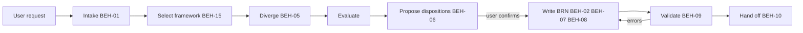

# SPEC-001 — Brainstorm skill (MVP)

## 1. Overview

The `brainstorm` skill ships in the `devforgeai` Claude Code plugin and is invoked as
`/devforgeai:brainstorm [topic]`, or automatically when a user asks to brainstorm. It runs a
conversational session: take in the topic, capture problems and ideas, evaluate them with a
selected framework, propose dispositions, **have the user confirm them**, then write a BRN
document from the brainstorm template, validate it and hand off.

Brainstorming frameworks are **reference files the skill selects from**. The MVP shipped the
extension point and one default framework; version 19 adds the catalog Bryan chose (PRD-001
version 16, §12). Adding a framework never changes `SKILL.md`.

This skill implements the spec and is recorded as `SKL-001` in its `provenance.yaml`.

**Version 11** (2026-10-03) has the skill keep its workflow checklist in Claude Code's task list when the session
has one, as the progress tracker's task-list convention asks (SPEC-012 §4), so that each answer is credited to
the step that asked for it (BEH-12).

**Version 12** (2026-10-03) runs the validator as a command of its own, so its exit status is the validator's: a
run joined to another command, such as `; echo "exit=$?"`, proves nothing, and the progress tracker rightly
credits none (BEH-09; SPEC-012 BEH-06).

**Version 13** (2026-10-03) tags each question with its step, as SPEC-012 version 9's convention asks: hidden in
AskUserQuestion's metadata, where the progress tracker checks it against the step marked in progress, and shown
in each question's header, where you see it (BEH-12).

**Version 14** (2026-10-04) asks the waiver (Bryan, 2026-10-04). When your request says to proceed without questions,
the skill first asks whether it should, in a question of its own with two fixed answers, "Proceed without questions"
and "Ask me as usual". Your answer is recorded, so the progress tracker sees the choice your request made (SPEC-012
version 11, SPEC-013 version 10). In a brainstorm it changes nothing the tracker checks: dispositions and convergence
still need your confirmation either way (BEH-06). Without the question tool, as in eval runs, nothing is asked and the
request is followed as before (BEH-13).

**Version 15** (2026-10-04) keeps two promises (Bryan, 2026-10-04). "Proceed without questions" said "I ask nothing
more", yet a missing topic and an existing BRN on the topic were still asked about; its description now names those
two, as architecture's already names its exceptions (BEH-13). And step 5's proposals were a table printed just before
the question, where the question dialog hid it; they now sit inside the question, in each option's preview (BEH-06).

**Version 16** (2026-10-06) saves the work as it goes (Bryan, 2026-10-06: "Work file, skill only"). The progress
tracker can offer to continue an unfinished run (SPEC-013 version 16), but its record keeps where the run stopped, not
what it had found: step 5's proposals lived only in the question's preview, so a continued run proposed different
ideas (SPEC-013 VER-49). The skill now keeps a work file outside `docs/specs/`, rewritten after steps 3 and 4 and
before step 5's question, and a continued run reads it and asks step 5 from the same proposals (BEH-14). The BRN is
still written only at step 6, so the tracker's write gate and the stop's draft question (ERR-02) are unchanged. Once
the BRN validates, the BRN is the record and the progress tracker deletes the work file (Bryan, 2026-10-06: "drafts
should be pruned eventually, since the brainstorm document will serve as the provenance root"); its folder is kept out
of git.

**Version 19** (2026-11-20) makes the brainstorm fit a new product and one that already exists (Bryan, 2026-11-18:
"the brainstorming skill is to handle both brownfield and greenfield projects"). It takes in the enhancement specs
Bryan approved on 2026-11-19, the documents in `docs/specs/brainstorming/` (pull request #172); §4 says how they
belong to this spec.

- **Five frameworks**, and six rules, taken in order, that select one. `SKILL.md` is reordered so that the task list
  comes first (BEH-15 to BEH-19, ERR-06).
- **Intake and evidence.** Step 1 decides the project kind, greenfield or brownfield, and the BRN records it. Each
  kind has its own question set, of at most four questions. The sources a brainstorm used are listed and cited where
  a fact is stated. Target users and Candidate success signals get fixed forms (BEH-20 to BEH-24, ERR-07).
- **Brownfield runs** read the project's earlier BRNs, PRDs, epics and architecture document. A suggestion that
  one of them already covers, or that an earlier BRN rejected, is listed and kept out of `ideas` unless the user
  says to add it. Parked ideas are offered once. Earlier assumptions can be updated, each on the user's
  confirmation (BEH-25 to BEH-29, ERR-08, ERR-09).
- **A path to a first release.** The open assumptions are ranked by risk, each with its cheapest test, and a first
  release cut is proposed, which only the user confirms (BEH-30 to BEH-33, ERR-10).
- **The report** names the project kind and the first-release ideas (BEH-34).

A BRN gains no field and no collection: the new information is written in fixed forms inside the existing sections
(§4), and a BRN written before this version stays valid. The workflow checklist's eight lines, and the `tasks:`
list that repeats them (version 18), don't change.

## 2. Constraints

- **NFR-001:** `SKILL.md` stays short. Framework detail, output rules and examples live in
  `references/`, which loads only on demand.
- **NFR-002:** the frontmatter follows the Agent Skills spec plus Claude Code fields only.
  Provenance lives in the sidecar, and `metadata` holds only the two quoted DevForgeAI keys.
- **NFR-003:** behavior is proven by the eval suite in §9, not by inspecting the instructions.
- **Version 19's rules** (`docs/specs/brainstorming/README.md` §3, R1 to R3). A BRN gains no collection and no
  field, and its frontmatter keys stay the same (R1). `SKILL.md`'s eight checklist lines and its `tasks:` list
  don't change, and `SKILL.md` stays at or under 400 lines (R2). Only the user's explicit answer writes a
  disposition, `status: converged`, an assumption's `state` other than `open`, a confirmed first release cut or a
  confirmed assumption update (R3).

## 3. Architecture and components

```
src/claude/DevForgeAI/                    # plugin source (ADR-001); deployed to .claude/skills/devforgeai/
├── .claude-plugin/plugin.json
├── skills/brainstorm/
│   ├── SKILL.md                          # workflow checklist, judgment rules, output contract
│   ├── provenance.yaml                   # SKL-001, implements SPEC-001
│   ├── assets/
│   │   └── brainstorm.md                 # THE brainstorm template (canonical; lives only here)
│   ├── scripts/
│   │   └── validate_brn.py               # standard-library validator for the output rules (BEH-09)
│   └── references/
│       ├── output-rules.md               # YAML item-block rules (quoting, IDs, one key per fence)
│       ├── work-file.md                  # the work file's shape (BEH-14)
│       ├── intake.md                     # version 19: the project kind, the question sets, sources, sections 3 and 8
│       ├── brownfield.md                 # version 19: what a brownfield run reads and records
│       ├── mvp-path.md                   # version 19: the assumption risk ranking and the first release cut
│       └── frameworks/
│           ├── INDEX.md                  # catalog: one row per framework; version 19: the selection rules
│           ├── diverge-converge.md       # MVP default framework
│           ├── shortlist-ranking.md      # version 19
│           ├── risk-first-mvp.md         # version 19
│           ├── improve-existing.md       # version 19
│           └── problem-reframing.md      # version 19
└── evals/brainstorm/                     # eval cases (§9)
```

The skill's unit tests are in `src/tests/brainstorm/`: `test_validate_brn.py`, and from version 19
`test_structure.py` (VER-18).



## 4. Data model

The skill has no database. It has two data contracts, and a work file:

**Output: the BRN document.** Written to `docs/specs/brainstorm/BRN-NNN.md` from the brainstorm
template. The file name is the ID only; the topic lives in the document's `title`. It must validate against `src/schemas/brainstorm.schema.json`. It uses only the
`problems`, `ideas` and `assumptions` collections and their defined fields. From version 19 a BRN the skill creates
is a *new-shape BRN*: it also holds the fixed shapes given below, as plain Markdown inside its existing sections.

**Work file: the run's draft (version 16).** Written to `devforgeai/drafts/brainstorm/<session ID>.md`, or, in a run
that continues an earlier one, to the draft the progress tracker's line names (BEH-14, version 17), in
a folder whose `.gitignore` holds `*`. Its shape: the brainstorm template, with the frontmatter `id` the template's
`BRN-000` for a new BRN or, when extending, the ID of the BRN being extended (which is what tells a continued run to
extend it); `title` the topic; `status: draft`; `generated_by.session` and the one Change Log row this session's; every
disposition `open`, a proposal never written as a disposition value; sections the run hasn't reached holding
`[NEEDS CLARIFICATION: not reached]`; step 5's proposals, once made, as a table of idea ID, title, proposed disposition
and reason in the convergence prose; no HTML comments. When extending, it starts from that BRN's content with its IDs
kept (BEH-11). BEH-08's rule that every placeholder is replaced doesn't hold for its `id`. It is the skill's own work
copy: nothing downstream reads it and the validator doesn't check it. The progress tracker, not the skill, deletes it:
a run's work files once its step 7 is done, and any work file older than the tracker's retention period, as old runs
are pruned (SPEC-012 version 15, SPEC-013 version 20). Where the tracker doesn't run, work files stay in the ignored
folder until the user removes them. From version 19 the work file also holds, from its first save, the
project-kind line, the frontmatter `sources`, section 3's table and the framework named in section 5 and, in a
brownfield run, the Existing product, Already covered and Previously decided shapes; from the step-5 save,
section 8's bullets, the assumption risk ranking, the first release cut in its proposed form and, in a
brownfield run, the Assumption updates table, every row proposed. A switch of framework made after step 3 is
completed is followed by one more save
(BEH-15, BEH-19, BEH-20, BEH-22 to BEH-25, BEH-28, BEH-33; `references/work-file.md` gives the shape in full).

**Extension point: a framework reference.** Each file in `references/frameworks/` has these sections,
in order:

| Section | Content |
|---|---|
| When to use / When not to use | Selection criteria that the index repeats in one line each |
| Steps | The facilitation sequence the skill follows |
| Questions to ask | Prompts to put to the user at each step |
| Mapping to the BRN | Which steps fill `problems`, `ideas` or `assumptions`, and how to fill `value`, `effort`, `risk` and `score` |
| Evaluation method text | The sentence written into the BRN's evaluation-method section |
| Example | One short worked input and output |

`INDEX.md` holds a table with columns *framework, file, use when, avoid when* and, from version 19, the
selection rules, the names a user may use, the six section headings every framework file has, what to say for a
name the index lacks, and how a switch is made (BEH-15, BEH-17, BEH-19, ERR-06). `SKILL.md` links to `INDEX.md`
and to the skill's other reference files, never to a framework file. Framework files are reached through the
index, which the skill reads first. That is one level of indirection, accepted so that adding a framework
touches only the index and the new file.

**The enhancement documents (version 19).** Version 19's requirements were written as six documents in
`docs/specs/brainstorming/`, which Bryan approved on 2026-11-19 ("I approve the enhancement specs in PR #172 at
7deb4d4, including both readings") and which were checked again on 2026-11-20 against the skill as version 18
left it. They are part of this spec:

| Document | Its items in this spec | What only the document holds |
|---|---|---|
| `README.md` | Rules R1 to R10 (its §3); the fixed shapes C-01 to C-11 and the gate (its §4, repeated below) | Where each staged file goes (its §7); the build's order (its §8) |
| `framework-catalog.md` | BEH-15 to BEH-19, ERR-06, VER-18 to VER-24 | The edits to `SKILL.md` and three reference files; `test_structure.py`; five eval cases; the staged index and framework files |
| `intake-and-evidence.md` | BEH-20 to BEH-24, ERR-07, VER-25 to VER-29 | The question sets and their tests; checks IV-01 to IV-07; three eval cases; the staged `intake.md` and template |
| `brownfield-iteration.md` | BEH-25 to BEH-29, ERR-08, ERR-09, VER-30 to VER-34 | The tests for "already covered" and "previously decided"; checks BV-01 to BV-05; three eval cases; the staged `brownfield.md` and example |
| `mvp-and-prototype-path.md` | BEH-30 to BEH-33, ERR-10, VER-35 to VER-38 | The ranking and cut rules worked through; checks MV-01 to MV-12; two eval cases; the staged `mvp-path.md` and example |
| `prd-handoff-contract.md` | BEH-34, VER-39 | Step 8's edits and one eval case. Its other items are proposals for SPEC-002 and are not part of this spec |

The documents and this spec are read together by these rules:

1. The text of each item BEH-15 to BEH-34, ERR-06 to ERR-10 and VER-18 to VER-39 in §6, §7 and §9 is its document's
   text, word for word, with a closing note that names the document and section it comes from. A rule the
   document gives as a list is joined into one string. An eval item's prompt, scaffold and graders stay in the
   document, and the item here names where.
2. In such an item a dotted number with no document named ("section 3.4", "§3.6") is a section of the
   document its closing note names; a whole number ("section 6") is that section of the BRN, the work file or
   the document the sentence is about. In BEH-20, "(section 3.2)" is intake-and-evidence.md's. "This
   document", and an edit or a test named by a short label ("edit A-T1", "T2"), are that document's, except
   T1 and T10 to T15 in VER-24, which are the runbook's tests. "Today" in BEH-34, and in the shapes below
   ("exactly as today", "today's"), means before version 19, as SKL-001 v12 stands; elsewhere it is the day of
   the run or the product as it now is. R1 to R10 and C-01 to C-11 are the README's. "SPEC-001 BEH-NN" is this
   spec's item.
3. The documents hold what the build copies or applies: the exact edits to the skill's files, the staged files,
   the validator's checks with their code and tests, each eval case, the worked examples, and the decisions with
   Bryan's words. The build follows them as written.
4. Where an item here and the same item in its document differ, this spec's text governs and the document is
   corrected to match; a change of an item's meaning needs a version of this spec. Where a sentence that
   version 19 added to an earlier item or section differs from the item it cites, the cited item governs.
5. An item is `active` here. The documents, written as proposals, say `proposed`, and give each item two more
   keys: `changes`, which the earlier items of §6 and §7 now carry, and `lands_in`, which is build detail.
   BEH-16's `changes` also names BEH-12: that concerns `SKILL.md`'s wording only, and BEH-12's rule is unchanged.

**Fixed shapes in a new-shape BRN (version 19).** What follows is the README's §4, in its words; "today's
`validate_brn.py`" there is the validator of SKL-001 v12.

Every shape is plain Markdown inside an existing section and valid for today's `validate_brn.py`.
`[NEEDS CLARIFICATION: <question>]` may stand for a cell or value that is unknown, with these exceptions, which
the owners' documents fix: no cell of C-05 holds one, no cell of C-07 other than `Cheapest test` does, and a C-11
`Evidence` cell never does. The document named with a shape owns its rules; this section fixes only the form.

**C-01. Project kind** (section 1; intake-and-evidence). The first line under `## 1. Context` is exactly one of:

```text
Project kind: greenfield
Project kind: brownfield
Project kind: [NEEDS CLARIFICATION: greenfield or brownfield]
```

followed by a blank line and the context prose. *Brownfield*: the product the topic is about exists (it is built
or in use). *Greenfield*: it does not. The user's words decide; what the project folder holds only suggests.

With the third line, and only then, section 7 holds exactly one bullet that says which kind the run worked as
(Bryan, 2026-11-19: "Record that the kind is still undecided."):
`- [NEEDS CLARIFICATION: greenfield or brownfield; this run worked as greenfield]`, or the same with
`worked as brownfield`. Check IV-07 requires it while the kind is undecided and rejects it once the kind line
says `greenfield` or `brownfield`. A BRN whose bullet says `worked as brownfield` holds the brownfield shapes.

**C-02. Existing product** (section 1, brownfield only, after the context prose; brownfield-iteration):

```markdown
### Existing product

| Document | Version | What it already covers |
|---|---|---|
| PRD-001 | 3 | Online booking for returning patients (FR-001 to FR-006) |
```

One row per document read; `Document` is a document ID. With no document read, the table is replaced by the line
`No document was found in the project.` After the table or that line, one line `Skipped: <path> (<reason>)` for
each document that could not be used.

**C-03. Target users** (section 3; intake-and-evidence). Exactly this table, one row per distinct `who` value of
the active problems, the persona cell equal to that value character for character, rows in the order the values
first appear:

```markdown
| Persona | Job to be done | Current workaround | Pain |
|---|---|---|---|
| Returning patient | Keep a check-up booked weeks ahead | A paper card on the fridge | Forgets, then pays a missed-visit fee |
```

**C-04. Convergence prose** (section 6; unchanged from SPEC-001). What was promoted, parked and rejected and why;
before confirmation, the paragraph starting `Proposed, awaiting confirmation:`.

**C-05. First release cut** (section 6, after C-04; mvp-and-prototype-path):

```markdown
### First release cut

First release cut: proposed, not confirmed

| Idea | In first release | Why |
|---|---|---|
| IDEA-01 | yes | Tests ASM-01, ranked 1. |
| IDEA-02 | no | Tests no assumption ranked 1 to 3. |
```

The status line is exactly `First release cut: proposed, not confirmed` or
`First release cut: confirmed by <owner> on YYYY-MM-DD`. One row per idea that is promoted or proposed for
promotion, in ID order; the second column is `yes` or `no`; the `Why` cell is one of the eight fixed sentences
mvp-and-prototype-path defines: five that the rule writes, `Included by the user.` and `Left out by the user.`,
which are written only on a row whose value the user stated, and the review flag
`Needs review: no rule supports this value.`, which stands with either value and only under the proposed status
line. With no such idea the table is replaced by the line `No idea is promoted or proposed for promotion.`

**C-06. Already covered and previously decided** (section 6, brownfield only, after C-05; brownfield-iteration):

```markdown
### Already covered

| Suggestion | Covered by |
|---|---|
| Text reminders before a visit | PRD-001#FR-003 |

### Previously decided

| Idea | Decision | Where |
|---|---|---|
| Charge a deposit at booking | rejected | BRN-001#IDEA-06 |
```

`Covered by` is `<document ID>#<item ID>`; `Decision` is `rejected` or `parked`; `Where` is `BRN-NNN#IDEA-NN`.
Each table is replaced by the line `None.` when it has no row. When the user says to add a candidate anyway, its
row is removed and section 6's prose says so: the tables list only what is still kept out.

**C-11. Assumption updates** (section 6, brownfield only, after C-06; brownfield-iteration). Section 6's order is
therefore C-04, C-05, C-06, C-11.

```markdown
### Assumption updates

| Earlier assumption | Change | Evidence | Status |
|---|---|---|---|
| BRN-001#ASM-01 | open to validated | 8 of 10 reminder texts were opened (data: reminder pilot export, October 2026) | proposed, not confirmed |
```

`Change` is `open to validated` or `open to invalidated`; `Status` is `proposed, not confirmed` or
`confirmed by <owner> on YYYY-MM-DD`. The table is replaced by the line `None.` when it has no row. In a run that
extends a brownfield BRN, the first cell may name that BRN's own assumption.

**C-07. Assumption risk ranking** (section 7, after the `assumptions` block and before the open-question bullets;
mvp-and-prototype-path):

```markdown
### Assumption risk ranking

| Rank | Assumption | If wrong | Confidence | Cheapest test |
|---|---|---|---|---|
| 1 | ASM-01 | Serious: stops IDEA-01 (1 of 2 in the cut table). | low | Interview: Ask ten patients whether they read texts from the clinic. |
```

One row per active assumption whose `state` is `open`, ranks 1 to n with no gap. `If wrong` starts with `Fatal`,
`Serious` or `Minor` and names the cut-table ideas the assumption stops; `Confidence` is `high`, `medium` or
`low`; `Cheapest test` starts with `Data`, `Prototype` or `Interview`, or is the marker
`[NEEDS CLARIFICATION: how to test ASM-NN]`. With no such assumption the table is replaced by the line `None.`
This ranking, and no other table, decides the first release cut.

**C-08. Candidate success signals** (section 8; intake-and-evidence). One bullet per first-release idea, in ID
order:

```markdown
- IDEA-01: fewer missed visits among patients who got a reminder; baseline [NEEDS CLARIFICATION: current no-show rate]
```

that is, `- <IDEA-NN>: <observable outcome>; baseline <value with its source, or a NEEDS CLARIFICATION marker>`.
With no first-release idea the section holds the line `- None.`

**C-09. Sources** (frontmatter `sources`; intake-and-evidence). One quoted string per input the brainstorm used,
`"<kind>: <reference>"`, `<kind>` one of `document`, `data`, `ticket`, `interview`, `url`, `note`. Example:
`"document: docs/specs/prd/PRD-001.md v3"`. A fact cited in a problem's `evidence` or a C-08 baseline is either
one NEEDS CLARIFICATION marker and nothing else, or text that ends with one `sources` entry, without its quotes,
in parentheses after a space. A C-11 `Evidence` cell always ends with such an entry and is never a marker: with
no fact there is no row (brownfield-iteration.md). In a BRN a brownfield run creates, the entries of the
documents it read stand first; a run that extends a BRN appends its new entries and never reorders the others.

**C-10. Step 5's form.** One AskUserQuestion form tagged step 5, its questions in this order, each with
`header: "Step 5"`; a question whose condition fails is left out:

1. "Confirm these dispositions?" (always; unchanged from SPEC-001 BEH-06).
2. "Has the brainstorm converged?" (always; unchanged).
3. "Confirm the first release cut?" (when C-05's table has a row), options `Accept as proposed` and
   `Leave it proposed`; changes come typed under Other.
4. "Confirm these assumption updates?" (when C-11's table has a row), options `Accept all as proposed` and
   `Leave them proposed`; changes come typed under Other.

**The gate.** A BRN is a *new-shape BRN* when a line after the frontmatter and outside every fenced block,
lowercased and with its runs of spaces collapsed, starts with `project kind:`. Every validator check these
documents add applies only to a new-shape BRN, and a new-shape BRN must hold every shape its kind requires
(C-01, C-03, C-05, C-07, C-08, C-09 always; C-02, C-06 and C-11 when the kind is brownfield). The test is loose
on purpose and C-01 is exact: a line that passes the test but is not one of C-01's three lines
(`project  kind: Brownfield`) makes the BRN new-shape, switches every check on, and is then rejected by IV-01,
which requires C-01's exact line, first under `## 1. Context` and followed by a blank line.

A BRN without the line is an earlier-shape BRN: it is checked exactly as today and stays valid. When it is
extended it keeps its earlier shape: no shape of this section is added to it, nothing of brownfield-iteration.md
or mvp-and-prototype-path.md applies to it, its run asks the greenfield question set (intake-and-evidence.md,
BEH-20), and step 8's report block is today's (prd-handoff-contract.md, BEH-34). Framework selection applies to
it as to any run, except rule 4, which needs a kind.

When a new-shape BRN is extended, its kind line changes only towards brownfield (the NEEDS CLARIFICATION line
may be decided; `greenfield` may become `brownfield`; `brownfield` stays) and nothing is removed from it except
the bullet of C-01 that says which kind an undecided run worked as. A run that turns the line to `brownfield`
adds C-02, C-06 and C-11 (intake-and-evidence.md, BEH-20; brownfield-iteration.md, BEH-29).

The validator's checks for these shapes are IV-01 to IV-07 (intake-and-evidence.md), BV-01 to BV-05
(brownfield-iteration.md) and MV-01 to MV-12 (mvp-and-prototype-path.md); each gives the same verdict with and
without PyYAML (BEH-09).

## 5. Interfaces and contracts

The skill's interface is its invocation, not an API.

```yaml
# Proposed SKILL.md frontmatter (validated by src/schemas/skill-frontmatter.schema.json)
name: brainstorm
description: Runs a structured brainstorming session and writes a DevForgeAI brainstorm (BRN) document with identified problems, ideas, assumptions and user-confirmed dispositions. Use whenever the user asks to brainstorm, explore ideas or options, come up with ways to solve a problem, or generate ideas for a product, feature or process, even when they don't mention a document, and to start the DevForgeAI planning chain before a PRD.
argument-hint: "[topic]"
metadata:
  devforgeai-id: "SKL-001"
  devforgeai-version: "6"
tasks:                            # version 18: the checklist's lines (BEH-12), in order
  - "Intake: topic, existing BRNs, clarifying questions"
  - Select a framework
  - "Diverge: problems, ideas, assumptions"
  - Evaluate with the framework
  - Propose dispositions and ask the user to confirm
  - Write the BRN
  - Validate the BRN
  - Report and hand off
```

- **Arguments:** `$ARGUMENTS` is the topic, and may be empty (BEH-01).
- **Triggers:** automatic invocation stays enabled. The description names the trigger phrases, and
  AC-05 plus its eval case guard against false triggers.
- **Downstream contract (consumed by the PRD workflow):** the BRN path pattern and `BRN-NNN` ID
  from BEH-02; stable item IDs (BEH-11); `disposition` and `reason` on every idea, with only
  user-confirmed values (BEH-06); `status: converged` only after the user confirms convergence. The
  PRD skill cites BRN items through `upstream` links such as `{id: BRN-001, item: IDEA-03, relation: derives}`,
  so the brainstorm skill must never change an item's meaning under an existing ID. From version 19 a new-shape
  BRN also carries §4's fixed shapes, which the PRD workflow reads from SPEC-002's next version on
  (prd-handoff-contract.md). `First release cut: confirmed by …` appears only after the user confirmed the cut,
  and `confirmed by …` in an Assumption updates row only after the user confirmed that row.
- **Tools:** Read, Glob, Write and Edit for files, and AskUserQuestion for confirmations; when the session has
  them, the task-list tools (TaskCreate and TaskUpdate, or TodoWrite) for the workflow checklist (BEH-12).
  No `allowed-tools` pre-approval in the MVP, so writes go through normal permission prompts. The skill never
  deletes a file: the progress tracker deletes its work files (version 16).
- **Task list for Taskmaster (version 18; Bryan, 2026-11-19):** `tasks:` names the run's steps for the
  Taskmaster mod, which seeds a skill's task list from that key and shows its progress in a pane. The titles are the
  workflow checklist's eight lines without their numbers, in order (Bryan: "Checklist lines"). With Taskmaster's
  "guide skill tasks" setting on (its default; Taskmaster 0.1.0, the installed copy, read 2026-11-19), Taskmaster appends a numbered list of these titles to the prompt and
  asks Claude to track exactly them with that wording; that list then equals BEH-12's subjects, `<N>. <title>`, so
  the two instructions name the same eight tasks. A `tasks:` title changes only with its checklist line. Claude Code
  ignores a frontmatter key it doesn't recognize, so without Taskmaster nothing changes; with it, the prompt gains
  Taskmaster's block (plugin 0.35.0, a minor version: Bryan, "0.35.0 (minor)").
  `src/schemas/skill-frontmatter.schema.json` accepts `tasks` (3 to 8 unique strings of 1 to 64 characters).
  From version 19, `src/tests/brainstorm/test_structure.py` checks that the list equals the checklist lines
  (BEH-16, VER-18).

## 6. Behavior

BEH-15 to BEH-34 are version 19's, taken from the enhancement documents (§4 says how to read them). Where one of
them replaces or extends an earlier item, the earlier item says so.

```yaml items
behaviors:
  - id: BEH-01
    status: active
    rule: "Take the topic from $ARGUMENTS or the conversation. If there is none, ask for it and write nothing until it is given. Decide the project kind (BEH-20). Ask at most four clarifying questions before diverging, in one form: the question set of the kind (BEH-21), skipping any question the request already answers. When the request says to proceed without questions, ask none, and never the kind question, once the waiver question (BEH-13) has been answered Proceed without questions or couldn't be asked, except the topic question when no topic is given (BEH-13, version 15). Record anything still unknown as [NEEDS CLARIFICATION] markers, not guesses."
  - id: BEH-02
    status: active
    rule: "Allocate the ID by scanning docs/specs/brainstorm/ for BRN-NNN.md files and using the highest number plus one (BRN-001 if none). Write the document to docs/specs/brainstorm/BRN-NNN.md. Never ask for or accept an output file name. Keep the descriptive topic in the title. Create the directory if it is missing."
  - id: BEH-03
    status: deprecated
    superseded_by: "BEH-15"
    rule: "Read references/frameworks/INDEX.md and choose the framework whose use-when criteria best fit the topic, or the one the user names. Use diverge-converge when nothing fits better. Tell the user which framework was chosen and why, and switch if they ask. Version 19: deprecated; BEH-15 replaces the selection, and BEH-19 the clause on switching."
  - id: BEH-04
    status: active
    rule: "Whatever the framework, write only into the problems, ideas and assumptions collections and their defined fields. Record framework-specific reasoning in the evaluation-method and convergence prose sections, never as new YAML keys."
  - id: BEH-05
    status: active
    rule: "During divergence, record the user's ideas in their own words alongside generated ones. In a brownfield run, a suggestion that a document read already covers, or that an earlier BRN rejected, is not added to ideas, the user's own included: it is listed in section 6 and the user is told, and it is added when the user then says to add it (BEH-26). Generate between 5 and 15 ideas unless the user asks otherwise or the framework's Steps set their own count (version 19: BEH-17, BEH-18). Every idea starts with disposition open."
  - id: BEH-06
    status: active
    rule: "At convergence, propose a disposition (promoted, parked or rejected) and a reason for each idea, then ask the user to confirm or change them. With AskUserQuestion, put the proposals inside the question form, never only in text before it, which the dialog hides (version 15; Bryan, 2026-10-04: 'Fold it in'): one question, 'Confirm these dispositions?', whose options are 'Accept all as proposed' (Recommended) and 'Leave them open', each option's preview holding the table of idea ID, title, proposed disposition and one-line reason, with the user's changes typed under Other; and in the same form a second question, 'Has the brainstorm converged?', with the options 'Converged' and 'Not yet'. Both questions are tagged step 5 (BEH-12). In a brownfield run whose Assumption updates table has a row, the same form ends with the question 'Confirm these assumption updates?', and only its answer confirms a row (BEH-28). When the First release cut table has a row, the same form asks, after the convergence question and before any question on assumption updates, 'Confirm the first release cut?', with the options 'Accept as proposed' and 'Leave it proposed' and changes typed under Other, and only its answer confirms the cut (BEH-32, version 19). Accept all writes every proposal; Leave them open writes none; typed changes write the dispositions the text states and leave the others open; converged is written only on Converged. When the table is too long for a preview, the preview lists every idea's ID and proposed disposition and the question text says the reasons are in the reply. Write only dispositions the user confirmed; leave the rest open. Set status to converged only when the user confirms convergence; otherwise leave it draft."
  - id: BEH-07
    status: active
    rule: "Fill the frontmatter: generated_by.tool claude-code, generated_by.model the current model ID, generated_by.session the session ID; authors the user and claude-code; reviewed_by empty; every hash null; created and updated today's date. Ask for owner only if it cannot be determined. Write the author of each Change Log row the skill adds as claude-code (session <session ID>): the ID names the conversation's transcript, so claude --resume <ID> can reopen the conversation behind that version while the transcript is retained (30 days by default)."
  - id: BEH-08
    status: active
    rule: "Build the document from ${CLAUDE_SKILL_DIR}/assets/brainstorm.md. Keep every section heading. Replace each placeholder or mark it [NEEDS CLARIFICATION]. Delete author comments. Version 19, for a new BRN and an extended new-shape BRN: section 1 opens with the project-kind line (BEH-20); section 3 is BEH-23's table and section 8 BEH-24's bullets; a BRN whose kind is brownfield, decided or worked with (BEH-20), holds the Existing product, Already covered, Previously decided and Assumption updates shapes (BEH-25, BEH-26, BEH-28); the assumption risk ranking and the first release cut are written at step 6 (BEH-33)."
  - id: BEH-09
    status: active
    rule: "Validate after writing. Run scripts/validate_brn.py on the file (standard library only; it applies references/output-rules.md mechanically: frontmatter keys, ID patterns, quoted free text, one top-level key per item block, no leftover placeholders) and fix what it reports. Run it as a command of its own, not joined to another with ;, a pipe or a background &, so its exit status is the validator's (&& and 2>&1 are fine): the progress tracker credits no run whose status another command hides (SPEC-012 BEH-06; version 12). Only without a shell or Python, check against references/output-rules.md by hand. Then read the file back and confirm that every disposition other than open, and status converged, was confirmed by the user, because the script cannot check this. Version 19: on a new-shape BRN the script also applies the checks IV-01 to IV-07, BV-01 to BV-05 and MV-01 to MV-12 (§4), and the read-back also covers the first release cut's status line (BEH-33), the status cells of the Assumption updates table (BEH-28) and every assumption state other than open (§2, R3). Never run a devforgeai command: the CLI doesn't exist and a program by that name on PATH can't be trusted (SPEC-004 §2). Repeat until clean, at most three attempts."
  - id: BEH-10
    status: active
    rule: "Hand off with counts of problems, ideas and assumptions, the ideas promoted, the open questions and the BRN file path. Then name the next workflow step: if ${CLAUDE_PLUGIN_ROOT}/skills/prd/SKILL.md exists, tell the user to run /devforgeai:prd with the BRN ID (for example /devforgeai:prd BRN-001; the prd skill takes an ID, never a path, per SPEC-002 §5) and give the BRN path as its input; otherwise say the PRD workflow (planned as /devforgeai:prd) is not built yet and that, once it is, /devforgeai:prd with this BRN's ID runs on it. The next step comes last in the final reply, as its own paragraph outside any code block, starting with the words Next step; nothing follows it. Never start writing a PRD. Version 19: for a new-shape BRN the report block also names the project kind and the first-release ideas with the cut's status (BEH-34)."
  - id: BEH-11
    status: active
    rule: "When extending an existing BRN, keep every existing item ID and its meaning. Give new items the next free number in their collection. Retire an item by setting status deprecated, never by deleting or renumbering it, because PRD requirements cite these IDs. Set generated_by.session to the extending session and add a Change Log row naming it; never edit earlier Change Log rows, which keep the sessions that wrote earlier versions. Version 19: a BRN without the project-kind line keeps its earlier shape when it is extended (BEH-20); a new-shape BRN's kind line changes only towards brownfield, and extending a brownfield BRN follows BEH-29."
  - id: BEH-12
    status: active
    rule: "When the session has task-list tools (TaskCreate and TaskUpdate, or TodoWrite; they may need loading through ToolSearch), keep the workflow checklist there, as SPEC-012 §4's task-list convention says. Before anything else, the question asking for a topic included, create one task per checklist step: its subject the step's checklist line without the box ('<N>. <title>'), its metadata devforgeai_step: N (with TodoWrite, the content '<N>. <title>'). Mark a step in_progress when its work starts. Before asking the user any question, mark the step the question belongs to in_progress: the topic, clarifying and extend-or-new questions belong to step 1, the confirmation of dispositions and convergence to step 5. Never put two steps' questions in one question form. Tag each question form with its step: the AskUserQuestion call's metadata source 'devforgeai_step:N', which the user doesn't see and the progress tracker checks against the step marked in progress, and each of its questions' header 'Step N', which the user sees (SPEC-012 §4, version 9). Mark each step completed as soon as it is done, one at a time, a step with nothing to do included. Without task-list tools, copy the checklist into the reply and tick items off as before. SKILL.md names the tag devforgeai_step, which tells the progress tracker that the skill follows the convention."
  - id: BEH-13
    status: active
    rule: "The waiver (version 14; Bryan, 2026-10-04). When the request says to proceed without questions (or not to ask, or to skip questions) and the session has AskUserQuestion, ask it once, at the start of step 1, before any other question, with step 1 marked in_progress (BEH-12): one question, alone in its form, the one question BEH-12's tag rule leaves out, with metadata source devforgeai_waiver (not devforgeai_step:1, so the progress tracker records it as the waiver and never as a step's answer), header 'Step 1', the question 'Your request says to proceed without questions. Should I?' and exactly two options, in this order: 'Proceed without questions' (description: 'I ask nothing more, except which topic and whether to extend an existing BRN, when open; decisions that need you stay open.') and 'Ask me as usual' (description: 'I ask about each decision as it comes up.'). On Proceed without questions, follow the request: ask no other question (BEH-01, BEH-06), except BEH-01's topic question when no topic is given and ERR-01's extend-or-new question when a BRN on the topic exists, which are still asked when open (version 15; Bryan, 2026-10-04: 'Align with architecture', as SPEC-003 BEH-18 keeps its gates). On Ask me as usual, on anything typed instead, or on a dismissal, ask as if the request hadn't said so. Ask it at most once in a run. Without AskUserQuestion, ask nothing, in plain text or otherwise, and follow the request as before; when the request doesn't say to proceed without questions, never ask it."
  - id: BEH-14
    status: active
    rule: "Save the work as it goes (version 16; Bryan, 2026-10-06: 'Work file, skill only', 'Delete at end + ignore', 'Tracker deletes + ages'), so a run the progress tracker continues later has the content, not only the position (SPEC-013 BEH-31). Keep a work file at the draft path the progress tracker's line on continuing names (below), else at devforgeai/drafts/brainstorm/<session ID>.md, the session ID being the one BEH-07 names, in the shape §4 gives, and write it in full with the Write tool three times: after marking step 3 completed and before marking step 4 in progress; after marking step 4 completed and before marking step 5 in progress; and with step 5 in progress, once its proposals are made and before its question is asked, or, when no question is asked (BEH-13, or no AskUserQuestion), once the proposals are made. Before the first write, create devforgeai/drafts/.gitignore holding the single line * when it is missing, so no work file reaches git. Never write a work file under docs/specs/: the progress tracker then counts none of these writes as the BRN's write gate and never refuses them (SPEC-012 BEH-06). Never run the validator on it. Step 6 writes the BRN as before. Never delete a work file: the progress tracker deletes a run's work files once its step 7 is done, and work files older than its retention period (SPEC-012 version 15, SPEC-013 version 20); when validation still fails (ERR-05), they stay. Continuing (version 17; Bryan, 2026-10-06: 'deterministic in Claude mod is best approach as Claude ignores ceremonial verbiage'): when the progress tracker's line that continues an earlier brainstorm run names a draft (SPEC-013 BEH-39), that path is this run's work file: load it, save to it from then on at the same points (the saves before step 4 and step 5 are made only when the run reaches those points), and keep its problems, ideas, assumptions, scores and IDs; when its id is a BRN's ID, extend that BRN at step 6 (ERR-01's extend, BEH-11) without asking ERR-01's question again, otherwise allocate the ID at step 6 (BEH-02). Every other sentence of the line is followed as written: the tracker, not the skill, decides which step is asked and with which proposals, and names no draft once the BRN is written. A named draft that can't be read counts as none. When ERR-02 writes a draft BRN, write the work file again with its id that BRN's ID, so a continued run reads the work file and step 6 extends that BRN instead of allocating another (Bryan, 2026-10-06: 'Finish into BRN-003'). A fresh run reads none, and never reads another session's work file. ERR-02's question on a stop stays: the work file is not the draft BRN it offers. Version 19: the work file names the framework in section 5 from its first save, and a continued run keeps that framework (BEH-15); a switch of framework made after step 3 is completed is followed by one more save, a fourth write in such a run (BEH-19); from the step-5 save on the work file holds the assumption risk ranking and the first release cut, the cut always in its proposed form, and a continued run keeps them (BEH-33)."
  - id: BEH-15
    status: active
    rule: "At step 2 the skill reads references/frameworks/INDEX.md and takes the first of its six selection rules whose test holds, in the order 1 to 6, asking no question to decide: 1, the user names a listed framework; 2, shortlist-ranking; 3, risk-first-mvp; 4, improve-existing; 5, problem-reframing; 6, diverge-converge. The request is the arguments plus everything the user wrote in the run before step 2 ends, intake answers included. A phrase matches when the request holds it as whole words, ignoring case, a hyphen and a space counting as the same; a phrase ending in * matches any word that starts with it. Rule 1 matches when the request holds a framework's name from the index's Frameworks table or one of its other names in the index's list (a name listed with capital letters matches only with those capitals). With two frameworks named, the one named first in the request is taken. A name the request says not to use does not count, and a later rule that would select that framework is skipped; when rule 6 is the one skipped, problem-reframing is taken with the sentence \"Framework: `problem-reframing`, because you asked not to use `diverge-converge`.\". Ordinary wording is not a name: \"How might we cut no-shows?\" names no framework. Rule 2 matches when both hold: (a) the request lists three or more candidate ideas (items of a bulleted or numbered list, or of a run separated by commas, semicolons, \"and\" or \"or\"), or it names a backlog, shortlist or list to use with a file path in the project whose file, read at step 2, gives two or more candidates (its top-level list items; with none, its table's body rows; with neither, its non-empty lines that are not headings); whether a listed item is a candidate idea is a judgment (R9): it is something to build, change or do (\"dark mode, CSV export, SSO\" are candidates; \"nurses, porters, cleaners\" are not); (b) the request holds one of: rank*, priorit*, choose, choosing, pick, picking, select, selecting, cut, trim, narrow, shortlist, compare, which of, which one, which should, in what order, in which order. Rule 3 matches when the request holds one of: mvp, minimum viable, prototype*, proof of concept, first release, first version, version one, v1, build first, ship first, do first, where to start, what to start with, smallest thing, riskiest, biggest risk*, could fail, might fail, would fail, make it fail, make this fail, could go wrong, might go wrong, pre-mortem, premortem. Rule 4 matches when both hold: (a) the project kind is brownfield: the kind step 1 decided (README C-01), or, when it is undecided, the kind step 1 works with (intake-and-evidence.md, BEH-20); a run has one kind, the same for selection as everywhere else; with no kind decided or worked with, (a) does not hold (an earlier-shape BRN being extended has none); (b) the request holds one of: improv*, enhanc*, extend*, fix*, upgrad*, rework*, redesign*, refin*, optimi*, revamp*, moderni*, next version, next release, version 2, v2, add to, new feature*. Rule 5 is a judgment (R9): the skill tries to fill both blanks of \"who struggles with what\" with words from the request, rephrased if needed but never invented, and the rule matches when either blank stays empty. \"Sign-ups have been flat for six months\" matches; \"Patients forget appointments booked weeks ahead\" does not. The skill then tells the user which framework and why with the matching rule's sentence from the index, word for word, as a line of its own: \"Framework: `<name>`, because you named it.\" (1); \"Framework: `shortlist-ranking`, because you gave a list of candidates and asked to rank or cut it.\" (2); \"Framework: `risk-first-mvp`, because you asked what to build first or what could make this fail.\" (3); \"Framework: `improve-existing`, because the product exists and you asked to improve, extend or fix it.\" (4); \"Framework: `problem-reframing`, because the request doesn't yet say who is affected and what hurts them.\" (5); \"Framework: `diverge-converge`, because no other rule in the index matched.\" (6). When rule 2 (b) holds and the request names a backlog that can't be read as (a) requires (no path, a path that doesn't exist, fewer than two candidates), rule 2 does not match; the skill says \"I can't read `<what the request named>` as a list of candidates. Paste the list, or give a file path, and ask me to switch to `shortlist-ranking`.\" and goes on to rule 3. The work file's section 5 holds the chosen framework's method text from its first save on. A run that continues an earlier one (BEH-14) does not select again when its work file's section 5 opens with a framework's method text: that framework is in use. (From docs/specs/brainstorming/framework-catalog.md §3.)"
  - id: BEH-16
    status: active
    rule: "SKILL.md's ## headings are exactly, in this order: Workflow; Decisions that belong to the user; Inputs; Working through the steps; Output contract; Examples; References. The Workflow section holds only the sentence \"Work through this checklist:\" and the fenced checklist of the eight unchanged lines; the fence opens at most 17 lines after the frontmatter's closing line. The frontmatter's tasks: list (SPEC-001 version 18) holds the eight checklist lines without their boxes and numbers, in order; a title changes only with its checklist line. Working through the steps holds the task-list rules, the saving rule, the continuing rule and the sections ### 1. Intake to ### 8. Report and hand off, in that order. SKILL.md has at most 400 lines. Every .md file in references/ and references/frameworks/ has, within its first 15 lines, a line that is exactly \"## Contents\" or a line that starts with \"## When to use\". (From docs/specs/brainstorming/framework-catalog.md §3.)"
  - id: BEH-17
    status: active
    rule: "Every framework file has exactly these ## headings, with this text, in this order: When to use / When not to use; Steps; Questions to ask; Mapping to the BRN; Evaluation method text; Example. Mapping to the BRN states the rating method exactly; Steps say how dispositions are proposed, as proposals only (R3); Evaluation method text is a quoted paragraph whose opening words, up to its first colon, no other framework's text starts with; Example holds item blocks that pass validate_brn.py. The opening words are: \"Diverge-converge:\", \"Shortlist ranking (RICE):\", \"Problem reframing:\", \"Improve existing (SCAMPER):\" and \"Risk-first MVP:\". The skill writes the framework's method text as the first paragraph of the BRN's section 5. problem-reframing, improve-existing and risk-first-mvp rate value, effort and risk as the quoted strings \"high\", \"medium\" or \"low\" and compute score = 2 × value − effort − risk with high = 3, medium = 2 and low = 1, written unquoted; an idea that can't be rated has all four null. Each file defines the three ratings in its own terms (its Mapping to the BRN, Ratings). Those three frameworks propose: promoted for the ideas with a score of 2 or more, at most three, taken by highest score, then lower effort, then lower ID; rejected for every idea with a score of −1 or less; parked for every other idea and for an unrated one; each proposed reason is one sentence starting \"Score N: \". problem-reframing: each start point (a symptom, goal or solution the request states) gets one why chain of at most five answers; an answer the skill supplies itself is recorded as an assumption and marked \"(assumed: ASM-NN)\"; a chain stops at five answers, at the user's \"don't know\", or after two of the skill's own answers in a row; the last answer is the root cause. Each chain gives one problem (statement: who, what hurts, \"because\" and the root cause; evidence: the last answer that is not the skill's own, with its source, else \"[NEEDS CLARIFICATION: is it true that <the first assumed answer>?]\"). Section 5 holds, per problem in ID order, the lines \"- Why chain for PRB-NN: <start point> → because <answer> …\", \"- Job for PRB-NN: When <situation>, <who> wants to <motivation>, so that <outcome>.\" and, for each of its one to three questions, \"- HMW-NN (PRB-NN): How might we <question>? Ideas: IDEA-NN, IDEA-NN.\". Every HMW has at least one idea and the ideas number 5 to 15. improve-existing: the skill lists up to seven things the product does today, each from a source (the project's documents, the user's description, data, tickets), and writes nothing about the product that no source says. It then asks the seven SCAMPER prompts in order (Substitute, Combine, Adapt, Modify, Put to another use, Eliminate, Reverse), at most two ideas each. A prompt yields nothing when no answer both changes something in the baseline and addresses a framed problem: no idea is written for it. Section 5 holds exactly seven lines in that order, \"- <Prompt>: IDEA-NN, IDEA-NN\" or \"- <Prompt>: no idea (<reason>)\", and an eighth, \"- The user's own: IDEA-NN\", when the user gave ideas. The 5-to-15 rule does not apply. With no idea at all, the skill says \"Framework: `diverge-converge`, because SCAMPER produced no idea for this product.\" and continues with diverge-converge from its step 2. risk-first-mvp: the skill states the bet, records the user's reasons the idea could fail and adds its own until there are at least three, stopping at seven; each reason becomes one problem when it is true today for a person whether or not anything is built, otherwise one assumption. For each assumption in ID order it writes one idea, the smallest thing that would show whether the assumption holds (of the candidates, the one that gives a result soonest), then second tests in the same order until there are five ideas, at most 15. Section 5 holds \"- Bet: …\", \"- Reason N: <reason> (ASM-NN)\" or \"(PRB-NN)\" for each reason, and \"- IDEA-NN tests ASM-NN, ASM-NN\" or \"- IDEA-NN tests no assumption\" for each idea. value is high for two or more assumptions tested, medium for one, low for none. The framework ranks no assumption and chooses no first release: README C-07 and C-05 do. (From docs/specs/brainstorming/framework-catalog.md §3.)"
  - id: BEH-18
    status: active
    rule: "With shortlist-ranking, each candidate of the user's list becomes one idea, in list order and in the user's words; the skill generates no idea of its own, whatever the count; at most 99 are taken. Each idea has four inputs. Reach: a whole number per period, from the user's figure for that idea, else from a figure in one of the BRN's sources, never the skill's estimate; if reach is unknown for any rated idea, reach counts as 1 for every idea. Impact: 3, 2, 1, 0.5 or 0.25, the user's value else the skill's estimate. Confidence: 100 when both grounds hold, 80 when one does, 50 when neither (ground 1: reach is known; ground 2: the idea addresses a problem whose evidence is not a NEEDS CLARIFICATION marker). Effort: person-weeks, the user's figure rounded up to the next 0.5 (a person-day is 0.2, a person-month is 4), else the skill's estimate from 0.5, 1, 2, 4, 8, 16, 32. The fields: value = reach × impact; effort = the person-weeks; risk = 100 − confidence; each a number in double quotes with no thousands separator and no trailing zeros. score = value × (100 − risk) ÷ 100 ÷ effort, computed from the written values, rounded to one decimal with a 5 rounding up, written unquoted with one decimal. An idea too vague to rate has all four null. Rank: highest score first; on a tie the smaller effort, then the lower ID; an unrated idea has no rank. Cut: with capacity C in person-weeks (the user's figure, else half of the rated ideas' summed effort, labelled as an assumption in the capacity line), an idea whose running total of effort down the ranking is at most 0.6 × C is a must, at most 0.8 × C a should, at most C a could, beyond that a won't. Proposals: promoted for every must and should; parked for every could, won't and unrated idea; never rejected. The proposed reason is \"<Cut word> in the proposed cut: rank R of N, score S.\" or \"Not rated: <what is missing>.\". The cut word is not a requirement priority and the cut is not the first release cut (C-05). Section 5 holds the method text, the line \"Reach unit: <unit> per <period>.\" (or \"Reach unit: not known for every candidate, so reach is counted as 1 for all.\") and the table | Idea | Reach | Impact | Confidence | Effort |. Section 6 holds, before any ### heading: the proposal paragraph (\"Proposed, awaiting confirmation: promote <IDs in rank order>; park <IDs in rank order, unrated last>.\", three or more IDs joined by commas with \"and\" before the last, \"none\" for an empty list); the line \"Capacity: <C> person-weeks (given by the user).\" or, when the user gave none, \"Capacity: <C> person-weeks (assumed: half of the candidates' summed effort).\"; the table | Rank | Idea | Score | Effort | Cumulative effort | Cut |; and the sentence \"The cut proposes dispositions only: it is not the first release cut, and it sets no requirement priority.\" (From docs/specs/brainstorming/framework-catalog.md §3.)"
  - id: BEH-19
    status: active
    rule: "The user asks to switch when, after the step-2 sentence, they name another listed framework to use. The skill says \"Framework: `<new>`, because you asked to switch from `<old>`.\" Before step 3 is completed, the new framework's Steps start from its first step and every problem, idea and assumption already captured is kept with its ID. After step 3 is completed and before step 5's form is answered (a switch typed as that form's answer counts as before, and no disposition or convergence is written from that answer): every problem, idea and assumption is kept with its ID and text; step 3 is not redone and no idea is generated; the task list is left as it is (the step in progress stays in progress); none of the new framework's questions is asked: what the user has said, the figures given with the request to switch included, and the framework's fallbacks are used; every idea's value, effort, risk and score is set to null and filled again by the new framework's mapping; the old proposals are dropped; the work file is saved once more, with the new proposals, before step 5's form is asked with them. After such a switch, section 5 holds in this order: the new framework's method text; the line \"Switched from `<old>` after step 3: the problems, ideas and assumptions were kept and only the evaluation was redone.\"; the lines the new framework writes while evaluating; the old framework's section-5 lines that say where the items came from, unchanged. Lines the new framework would have written during step 3 are left out. Switching to shortlist-ranking, every idea already captured is a candidate. After step 5's form is answered, or once the BRN is written, the skill does not switch in that run: it says \"The brainstorm is already written as BRN-NNN. To evaluate it with `<new>`, run `/devforgeai:brainstorm` again and choose to extend BRN-NNN.\" and changes nothing. A switch to a name the index lacks is handled by ERR-06 and the current framework stays. (From docs/specs/brainstorming/framework-catalog.md §3.)"
  - id: BEH-20
    status: active
    rule: "After the topic and extend-or-new, decide the project kind by the first rule that matches: (1) the BRN being extended, or the work file of a continued run, has the line 'Project kind: greenfield' or 'Project kind: brownfield': that kind, and nothing is asked, with the one exception of the next item; (2) the user's words say the product exists: brownfield; (3) the user's words say it does not exist: greenfield; (4) the skill can ask and the run is not a continued one: the kind question, whose answer decides; (5) otherwise the kind is not decided. When rules 2 and 3 both match, neither does. When a new-shape BRN is extended, its kind line changes only in these ways. A 'greenfield' line becomes 'brownfield' when the user's words in this run say the product exists (rule 2); otherwise it stays, and nothing is asked. The NEEDS CLARIFICATION line is decided again by rules 2 to 5 and becomes 'greenfield' or 'brownfield' when one of them decides; when that BRN already holds the four brownfield headings it can become only 'brownfield'. A 'brownfield' line never changes. When the user's words say the product does not exist and the line can't follow them (a 'brownfield' line, or the NEEDS CLARIFICATION line with the four headings), the skill says 'BRN-NNN records this product as brownfield. To brainstorm it as a new product, create a new BRN.', keeps the line, and goes on with the extension unless the user asks for a new BRN. When the line becomes 'brownfield', brownfield-iteration.md BEH-29 adds the brownfield parts; nothing is ever removed from the BRN. The one thing taken out is section 7's bullet that says which kind an undecided run worked as: it goes when the kind line is decided (IV-07). The user's words are the arguments, the user's messages in the conversation and the answer to the topic question. Only an explicit statement about the product counts, by the test and the seven examples of references/intake.md (section 3.2). A file in the project never decides the kind. The kind question is asked alone in its own AskUserQuestion form tagged devforgeai_step:1 with header 'Step 1': 'Does the product this brainstorm is about already exist?', options 'It exists' and 'It doesn't exist yet', in this order, with the descriptions of section 3.3. When docs/specs/prd/PRD-*.md matches at least one file, the first label is 'It exists (Recommended)' and its description ends with ' This project has a PRD.' Typed text is judged by rules 2 and 3; a dismissal, or text matching neither or both, leaves the kind not decided. Without AskUserQuestion the question is asked in plain text, alone, and the turn ends. The skill can ask unless the request says to proceed without questions and the waiver (BEH-13) was answered Proceed without questions or couldn't be asked. After Proceed without questions the kind question is never asked. When the kind is not decided, write the line 'Project kind: [NEEDS CLARIFICATION: greenfield or brownfield]' and work with brownfield when docs/specs/prd/PRD-*.md matches at least one file, else with greenfield. The kind worked with chooses the question set (BEH-21), the framework rule that reads the kind (README section 5, rule 4), the template's brownfield-only parts and whether brownfield-iteration.md applies. It is never written as the project kind. A BRN whose kind is not decided records it in three places (Bryan, 2026-11-19: 'Record that the kind is still undecided.'): the NEEDS CLARIFICATION kind line; one bullet among section 7's open questions, written before the others, exactly '- [NEEDS CLARIFICATION: greenfield or brownfield; this run worked as greenfield]' or the same with 'worked as brownfield'; and one sentence in the final reply's discussion, 'The project kind is not decided: I worked as <greenfield or brownfield> because this project has <a PRD or no PRD>. Tell me whether the product exists and I will update BRN-NNN.' The report block names the kind as 'not settled' (prd-handoff-contract.md, BEH-34). The bullet is written only while the kind line is the NEEDS CLARIFICATION line: when the kind is decided later, in this run or an extension, the bullet is removed in the same edit. Write the kind line as the first line under '## 1. Context', followed by a blank line and the context prose (C-01). An explicit statement the user makes later, before the BRN is written, replaces the kind; a change to brownfield runs the brownfield reading before the next step's work. A BRN without the project-kind line that is being extended gets no kind: no line and no shape of this document is added to it, and the greenfield question set is asked. (From docs/specs/brainstorming/intake-and-evidence.md §3.1.)"
  - id: BEH-21
    status: active
    rule: "Ask at most four clarifying questions in step 1, in one AskUserQuestion form tagged devforgeai_step:1, each question with header 'Step 1' and multiSelect true: the greenfield set or the brownfield set of section 3.4, chosen by the kind decided or worked with, in the set's order, with its exact wording and options. Skip a question the user's words already answer, by the test of section 3.4 for that question. When all four are skipped, show no form. Ask no follow-up question in step 1. An option picked with nothing typed is recorded in the option's words and its missing detail as a NEEDS CLARIFICATION marker. Ask none of them when the request says to proceed without questions and the waiver was answered Proceed without questions or couldn't be asked. Without AskUserQuestion, and with no such request, ask the same questions as a numbered plain-text list without the options, in one message, and end the turn. Each answer fills what section 3.4's table names; what stays unknown is written as the marker that table gives. (From docs/specs/brainstorming/intake-and-evidence.md §3.1.)"
  - id: BEH-22
    status: active
    rule: "A source is an input the brainstorm used: something the user gave or named, the user's own statement in the conversation, or a project document the skill read in this run. Write one frontmatter sources entry per source, as the quoted string '<kind>: <reference>', with the kind and the reference form of section 3.5's table, taking the first kind that fits. Never write an entry for anything else: what the skill knows by itself is not a source. Never fetch a source: no URL is opened and no web search is made. A project file the user names as a source is read (Bryan, 2026-11-19: 'You may read a project file I name as a source.'). A project file is a path in the user's words that, taken from the project root when relative, resolves to a regular file inside the project folder and outside its .git folder; a path that leaves the folder, a folder, and a pattern with a wildcard are not. The skill reads it whole with the Read tool, once, and nothing else because of it: it never edits, moves, deletes or runs it, and never reads a file the user did not name (the brownfield reading of brownfield-iteration.md apart). Its entry is 'document: <path from the project root>', then ' v<version>' when its frontmatter has an integer version. Facts taken from it are stated in its terms and cited with that entry. When it can't be read (it does not exist, it is not text, or the Read tool fails or is refused), ERR-07 applies. Write one note entry per run for the user's own statements. Clean each reference as section 3.5 says. Entries stand in the order the sources were first given or read, each once; when extending, existing entries are kept as they are and new ones appended. A fact written into an active problem's evidence or a section 8 baseline is either one NEEDS CLARIFICATION marker and nothing else, or a statement that ends with one sources entry, without its quotes, in parentheses after one space. When two sources state the fact, cite the one that stands first in sources. A fact from the skill's own knowledge is never written as evidence: the value is a marker naming the missing fact. (From docs/specs/brainstorming/intake-and-evidence.md §3.1.)"
  - id: BEH-23
    status: active
    rule: "Section 3 holds exactly the table '| Persona | Job to be done | Current workaround | Pain |' and nothing else: one row per distinct who value of the active problems, in the order the values first appear, the Persona cell equal to the who value character for character (C-03). Step 1's question 2 and step 3's framing gather the cells; step 6 writes the table, and the work file holds it from its first save. Each of the three other cells holds what the user's words or a source say about that persona, in at most 15 words, with no vertical bar and no citation. A cell nobody stated holds '[NEEDS CLARIFICATION: job to be done of <persona>]', '[NEEDS CLARIFICATION: current workaround of <persona>]' or '[NEEDS CLARIFICATION: pain of <persona>]'. It is never filled from a problem's statement or from general knowledge. A who value has no vertical bar, and one persona has one spelling in every problem. (From docs/specs/brainstorming/intake-and-evidence.md §3.1.)"
  - id: BEH-24
    status: active
    rule: "Section 8 holds one bullet per first-release idea, in ID order: '- IDEA-NN: <observable outcome>; baseline <value>' (C-08). The first-release ideas are the active ideas whose row in section 6's First release cut table says yes; with no such table or no such row, section 8 holds the single line '- None.' Step 5 gathers the bullets, once the first release cut is proposed; step 6 writes them, and the work file holds them at its step-5 save. The outcome is one clause naming what would be seen to change, for the persona of a problem the idea addresses, if the idea works. It states a direction and never a target number, and never contains '; baseline '. The baseline is today's value of that outcome as a cited fact (BEH-22), or the marker '[NEEDS CLARIFICATION: current <what is measured>]'. (From docs/specs/brainstorming/intake-and-evidence.md §3.1.)"
  - id: BEH-25
    status: active
    rule: "When the kind is brownfield, decided or worked with (BEH-20), read the project's documents right after the kind is known and before the clarifying questions. Select files by name with Glob, then read each selected file whole with the Read tool, in this order and with these caps: (1) docs/specs/brainstorm/BRN-*.md, the three highest numbers, highest first, never the BRN being extended; (2) docs/specs/prd/PRD-*.md, the two highest numbers, highest first; (3) docs/specs/epic/EPIC-*.md, the four highest numbers, highest first; (4) docs/specs/arch/ARCH-*.md, the highest number. Only a file named <PREFIX>-NNN.md is selected. Nothing else is read for this purpose: no story, no spec, no ADR and no source code is read automatically (Bryan, 2026-11-19: 'Skip automatic story and spec reads.'); a file the user names as a source is read under BEH-22 and is never an Existing product row. At most ten documents. Every document read is read-only: the skill never edits, repairs, moves or deletes it. Take from a BRN its title, version, and each active idea's id, idea, disposition and reason and each active assumption's id, statement, validation and state; from a PRD its title, version, section 1 and each active functional and non-functional requirement's id, statement and priority; from an EPIC its title, version and each active done_when item's id and criterion; from an ARCH its title, version and each active component's id, name and responsibility. Copy no disposition, priority or decision into this BRN's items. For each document read, in the order read, write one frontmatter upstream record with no item, '{id: <ID>, relation: informed_by, version: <its version>, hash: null}', and one sources entry 'document: docs/specs/<folder>/<ID>.md v<its version>', these entries standing before every other sources entry in a BRN this run creates; a run that extends a BRN appends them instead (BEH-29). Write '### Existing product' in section 1 after the context prose (C-02): one row per document read, in the order read, with its ID, its version and the third cell of section 3.3; with no document read, the line 'No document was found in the project.' in place of the table. The context prose says what the product does today only from a PRD's section 1 or the user's words; otherwise it holds '[NEEDS CLARIFICATION: what the product does today]'. (From docs/specs/brainstorming/brownfield-iteration.md §3.1.)"
  - id: BEH-26
    status: active
    rule: "At step 3, test every candidate idea before it gets an ID: each suggestion of the user's and each idea the skill generates. A candidate is already covered when one item taken from a PRD, EPIC or ARCH read, as it is written, already gives the same people the same result. The items that count are active functional and non-functional requirements whose priority is not wont, active done_when items and active components. PRD items are checked first, then EPIC, then ARCH, each in ID order, and the first that covers the candidate is cited. A candidate covered only in part is not covered. Section 3.4 gives the test's examples. A candidate is previously decided when it proposes the same action for the same people as an active idea of a BRN read whose disposition is rejected. Section 3.5 gives the test's examples. A covered or previously decided candidate is not added to ideas, the user's own suggestion included. A covered one is a row of '### Already covered' (its wording, and '<document ID>#<item ID>'), in the order the candidates came up. A previously decided one is a row of '### Previously decided' (the earlier idea's text, 'rejected', 'BRN-NNN#IDEA-NN'). Each table is replaced by the line 'None.' when it has no row (C-06). The skill reports every candidate kept out with the exact ID, and never asks about it (Bryan, 2026-11-19: 'Report covered suggestions with the exact requirement ID and let me say \"add it anyway\" without prompting.'). When step 3's work is done, the reply holds one line per candidate kept out, in the order they came up: for a covered one, 'Not added, already covered by <document ID>#<item ID>: \"<the suggestion>\"'; for a previously decided one, 'Not added, rejected in BRN-NNN#IDEA-NN: \"<the suggestion>\"'. After the lines comes, once, the sentence 'Say \"add it anyway\" to add one.' The final reply's discussion repeats the lines and the sentence for every candidate still kept out. No question, in a form or in text, is ever asked about a kept-out candidate, and the run does not wait for an answer. The user overrides by saying so, at any time after a report: a message that tells the skill to add a kept-out candidate ('add it anyway', 'add them anyway', 'add both', 'include the text reminders anyway', 'keep my deposit idea'). Which candidate: the one the message names, by its words or by the ID in its report line; 'it' when exactly one candidate is kept out; 'them', 'both' or 'all' for every candidate kept out. 'It' with several kept out and none named adds nothing: the reply says 'Several suggestions were kept out. Name the one to add, for example \"add the text reminders anyway\".' A message that asks why, or only acknowledges, adds nothing. Section 3.5 gives examples. An override writes this: the candidate becomes an idea in the user's words (the skill's wording for a candidate of its own) with the next free ID and disposition open, rated at step 4 like any other; its row is removed from its table, which becomes 'None.' when that was the last row; a previously decided idea gets the item-level link of BEH-27; and section 6's prose gains one sentence, 'IDEA-NN was added at <owner>'s request although <document ID>#<item ID> covers it.' or 'IDEA-NN was added at <owner>'s request although BRN-NNN#IDEA-NN rejected it.' Before the BRN is written this goes into the work as it stands. After the BRN is written, in the same session, the skill edits the BRN in place as SKILL.md's 'Decisions that belong to the user' describes for a later confirmation (mark step 6, edit, step 7 validate, step 8 report), without asking step 5's form again: the new idea is open. In a later session it is an extension of that BRN (BEH-11). The framework's idea count (5 to 15, unless its Steps set their own: framework-catalog.md, BEH-17 and BEH-18) is counted among the ideas added; candidates kept out don't count. A framework that generates no idea of its own (shortlist-ranking) generates none in place of a candidate kept out: a candidate of the user's list that is covered or previously decided is kept out and listed like any other. (From docs/specs/brainstorming/brownfield-iteration.md §3.1.)"
  - id: BEH-27
    status: active
    rule: "A parked idea of an earlier BRN is never added to ideas by the skill alone. When the BRNs read hold at least one active idea whose disposition is parked and the skill can ask, it offers them once, at step 3, after the problems are framed and before it generates ideas: one AskUserQuestion form tagged devforgeai_step:3, one question with header 'Step 3', 'Take up parked ideas from earlier brainstorms?', options 'Take up none' and 'Take up all' in this order, each option's preview listing every parked idea as 'BRN-NNN#IDEA-NN: <idea text>', one per line. Names typed under Other take up those ideas only: a name is a qualified 'BRN-NNN#IDEA-NN', or a bare 'IDEA-NN' that matches exactly one parked idea listed. A bare ID that matches parked ideas of more than one BRN read is asked about once more, in a form tagged devforgeai_step:3 with header 'Step 3': 'Which IDEA-NN do you mean?' (with the ID), one option per matching idea labelled with its qualified form, multiSelect true. When that question can't be asked, is dismissed or is not answered, that idea is not taken up and stays a 'parked' row of Previously decided. A dismissal takes up none. Without AskUserQuestion the list and the question are plain text and the turn ends. Each idea taken up becomes a new idea of this BRN: the next free ID, its idea text copied word for word, addresses naming the problems of this BRN it bears on, value, effort, risk and score rated afresh at step 4, disposition open, and an item-level upstream record '{id: BRN-NNN, item: IDEA-NN, relation: informed_by, version: <that BRN's version>, hash: null}'. An idea taken up that bears on no problem of this BRN is not added: it stays previously decided and the reply says so. Ideas taken up don't count toward the framework's idea count. Every parked idea not taken up is a row of '### Previously decided' with the decision 'parked'. The rows of that table are ordered by Where. An idea that carries the item-level link is never also a row. When the skill can't ask (BEH-20's meaning), no parked idea is taken up. (From docs/specs/brainstorming/brownfield-iteration.md §3.1.)"
  - id: BEH-28
    status: active
    rule: "At step 3, after the problems, the reply shows each active assumption of the BRNs read whose state is open, as 'BRN-NNN#ASM-NN: <statement> (to validate: <validation>)'. Nothing is asked about them. At step 5, before the form, the skill proposes a change of state only from a stated fact with a source: for each assumption shown, a fact in this run's sources that reports the result the assumption's validation asks for gives 'open to validated' when it agrees with the statement and 'open to invalidated' when it contradicts it. No such fact, a fact about something else, or an opinion gives no row. Section 3.7 gives the test's examples. Each proposal is a row of '### Assumption updates', the last subsection of section 6 (C-11): 'BRN-NNN#ASM-NN', the change, the fact ending with one sources entry in parentheses, and the status 'proposed, not confirmed'. Rows are ordered by their first cell. With no row the line 'None.' replaces the table. An Evidence cell is never a marker. When the table has a row, step 5's form ends with C-10's question 4, header 'Step 5': 'Confirm these assumption updates?', options 'Accept all as proposed' and 'Leave them proposed', each option's preview holding the table with each assumption's statement; changes come typed under Other. Accept all as proposed writes 'confirmed by <owner> on <today>' in every row. Leave them proposed, a dismissal, or no question asked leaves every row 'proposed, not confirmed'. Typed text confirms the rows it confirms, removes a row it rejects, and leaves the rest proposed. <owner> is the frontmatter owner without its quotes; when it is a NEEDS CLARIFICATION marker the skill asks for the owner's name first, and without it every row stays proposed. A confirmed change lives in this BRN's row and nowhere else: a new BRN never edits an earlier BRN. Step 7's read-back resets to 'proposed, not confirmed' any status cell the user did not confirm in step 5 of this run, unless the BRN being extended already held that row as confirmed. (From docs/specs/brainstorming/brownfield-iteration.md §3.1.)"
  - id: BEH-29
    status: active
    rule: "When the user's words say the product exists (BEH-20's rule 2), a BRN is on the same topic for ERR-01 only when its title covers the same or a closely similar topic and its status is draft. A converged or archived BRN is not asked about: it is read as an earlier BRN (BEH-25) and the run writes a new BRN. When the user asks in words to extend a BRN by its ID, it is extended, whatever its status. When the user's words don't say the product exists, ERR-01's test is unchanged: any BRN on the same or a closely similar topic is asked about. A run that extends a BRN whose kind line says brownfield reads the documents again (BEH-25) and rebuilds Existing product from this reading; updates each upstream record's version; appends this run's new sources entries (a document read for the first time, or read at a new version) after the existing entries, in BEH-25's order among themselves, and never reorders or removes an existing entry; keeps the rows of Already covered, Previously decided and Assumption updates and adds new rows by BEH-26 to BEH-28. In such a run the BRN's own active assumptions whose state is open are candidates for an update too (BEH-28). Their row's first cell names this BRN. On confirmation the assumption's state is set to validated or invalidated in the same edit, under BEH-11's rules for extending, and the assumption risk ranking and the first release cut are then made again without it (mvp-and-prototype-path.md, BEH-32 item 3); while the row is 'proposed, not confirmed' the state stays open. When a run that extends a new-shape BRN turns its kind line to brownfield (intake-and-evidence.md, BEH-20: from 'greenfield', or from the NEEDS CLARIFICATION line of a BRN without the four headings), it reads the documents (BEH-25), adds '### Existing product' in section 1 after the context prose and '### Already covered', '### Previously decided' and '### Assumption updates' in section 6 after the first release cut, each filled by this run (BEH-25 to BEH-28) or holding its replacement line, adds the upstream records, and appends the sources entries. Nothing already in the BRN is removed, except section 7's bullet that says which kind an undecided run worked as (intake-and-evidence.md, IV-07). The result passes BV-01. Nothing of BEH-25 to BEH-29 applies to a BRN without the project-kind line, also when it is extended. (From docs/specs/brainstorming/brownfield-iteration.md §3.1.)"
  - id: BEH-30
    status: active
    rule: "1. At step 5, after a disposition is proposed for each idea and before the work file is saved, rank every active assumption whose state is open, as §3.1 to §3.4 define. 2. The cut rows are the active ideas whose disposition is promoted, or is open with a step-5 proposal of promoted, in ID order; M is their number. 3. For each ranked assumption, decide for each cut row whether the idea depends on it (§3.1's test), and write the If wrong cell from the rows that do: Fatal when all M rows depend and M is at least 1, Serious when at least one and fewer than M depend, Minor when none does, in §3.2's three fixed forms. 4. Write Confidence as high, medium or low from the kinds of the sources entries that support the assumption (§3.3). 5. Write Cheapest test as the kind that §3.4's decision list gives, a colon, a space and the first sentence of the assumption's validation; or the marker [NEEDS CLARIFICATION: how to test ASM-NN] when the validation is empty or itself a marker. 6. Order the rows by risk points (impact times doubt), then impact, then doubt, then the number of rows stopped, then assumption ID, and number them from 1 (§3.5). 7. With no active assumption whose state is open, write the line None. in place of the table. (From docs/specs/brainstorming/mvp-and-prototype-path.md §3.)"
  - id: BEH-31
    status: active
    rule: "1. After the ranking and before the work file is saved, propose yes or no for every cut row from the ranking alone, by §3.6's four steps: one idea picked for each assumption ranked 1 to 3 that stops a row and has no yes row yet (highest score, a null score lowest, lowest ID on a tie); the highest-scoring row when nothing was picked; every cut row that a yes idea needs, repeated until nothing is added; no for every other row. 2. Write each row's Why cell as one of the five fixed sentences of §3.7 that the step producing the row names. 3. With at least one cut row, the proposal holds at least one yes. With none, write the line No idea is promoted or proposed for promotion. in place of the table. 4. When a yes idea needs an active idea that is not a cut row, change nothing in the cut and add §3.6's NEEDS CLARIFICATION bullet to section 7. 5. A proposal's status line is exactly First release cut: proposed, not confirmed. (From docs/specs/brainstorming/mvp-and-prototype-path.md §3.)"
  - id: BEH-32
    status: active
    rule: "1. When the cut table has a row, step 5's form (C-10) holds a third question after the convergence question: 'Confirm the first release cut?', header 'Step 5', the options 'Accept as proposed' (description 'The ideas marked yes are the first release.') and 'Leave it proposed' (description 'The table stays a proposal; you can confirm it later.'), in that order, none marked recommended, each option's preview holding the status line, an empty line and the cut table; when the table is too long for a preview, the preview lists each row's idea ID with yes or no and the question says the reasons are in the reply. When the table has no row, the question is left out. 2. Without AskUserQuestion and with a user to ask, the status line and the table are shown in plain text with the dispositions and the same question is asked. When no question is asked (the waiver's Proceed without questions, or nobody to ask), the cut stays proposed. 3. The answers are applied in this order: the dispositions the first question confirmed are written, and in a brownfield run the assumption updates the fourth question confirmed (brownfield-iteration.md, BEH-28 and BEH-29); the cut rows and the ranked assumptions (the active ones whose state is open) are listed again; when either list differs from the one the form showed (an idea entered or left the cut rows, or a confirmed update closed one of this BRN's own assumptions), the ranking and the cut are made again from the new lists, the status line stays proposed whatever the third answer was, and the reply names the ideas that entered or left the table and the assumptions that left the ranking. 4. Otherwise: 'Accept as proposed', or typed text that accepts the table, keeps the rows; typed changes set each named row to the stated value and its Why cell to 'Included by the user.' (yes) or 'Left out by the user.' (no); every other row keeps its value and has its Why cell derived again by §3.10's refresh, which gives it a rule sentence that holds or, when no rule supports its value, the flag 'Needs review: no rule supports this value.'; 'Leave it proposed', a dismissal, no answer, or typed text that states neither an acceptance nor a change keeps the rows and the proposed status line. 5. After an acceptance or typed changes, the status line becomes First release cut: confirmed by <owner> on <today> (the frontmatter owner without its quotes; today as YYYY-MM-DD) only when every row's idea then has disposition promoted, no row is flagged and the owner is not a NEEDS CLARIFICATION marker; otherwise it stays proposed with the rows as item 4 left them, and the reply names the ideas that are not promoted and the rows that are flagged. When the owner is a NEEDS CLARIFICATION marker the skill asks for the owner's name first, and without it the cut stays proposed. 6. A cut is never written as confirmed in any other way: not from a recommended option, not by the skill's own choice, not in the work file. 7. A confirmation that arrives after the BRN is written follows SKILL.md's 'Decisions that belong to the user': step 5 is marked again and its form asked, the third question showing the table as the BRN holds it; when that table holds a flagged row, the question's text names each flagged row with its value as item 10 gives it and its answer is read as item 10 says, which is the one asking of that run, a row still flagged afterwards being reported as item 10 says; only then is the BRN edited in place, validated again and reported. 8. When a new-shape BRN is extended, the ranking is made again from the BRN as it then stands and the cut rows are listed. When their idea IDs are the same set as the rows of the BRN's cut table, each row whose Why cell is 'Included by the user.' or 'Left out by the user.' keeps its value and its sentence, and every other row is worked out again from the current ranking and scores by §3.11's rule (§3.6 with the user's rows kept), its value included when the rule now gives the other answer. When the IDs differ, every row is proposed again by §3.6 and none is kept, and the user's previous choices (each row the BRN held with a user sentence, as idea ID and value, in ID order) are shown in the reply as 'Earlier choices, not carried over: IDEA-04 (yes), IDEA-02 (no). Tell me which still stand.' and in the Change Log row as 'First release cut proposed again: the eligible ideas changed. Earlier choices by the user: IDEA-04 (yes), IDEA-02 (no).' (with no such row, the Change Log sentence ends after 'changed.' and the reply has none). In both cases the status line is kept only when the new table equals the BRN's in every cell; when any cell changed, the new table is written as proposed and the third question asks about it; with the same IDs the reply and the Change Log row then hold 'First release cut returned to proposed: IDEA-02 changed.', naming in ID order each row with a changed cell. 9. 'Included by the user.' and 'Left out by the user.' are written only on a row whose value the user stated: a row a typed change names, or a flagged row the user accepted when the third question was asked again (item 10). No other event writes them. 10. When the refresh flags a row, the status line is the proposed one whatever the answer was. When a question can be asked, the third question is asked once more, and only once in a run, alone in a form tagged step 5, its text showing each flagged row as its idea ID and its current value ('Confirm the first release cut? Needs review: IDEA-04 (no), IDEA-06 (yes).'), with the same options and the refreshed table in each preview. Only an explicit acceptance of those displayed values ('Accept as proposed', or typed text that accepts them) records them as the user's choices: each flagged row's Why cell becomes 'Included by the user.' (yes) or 'Left out by the user.' (no). Typed changes are applied as item 4 says, a flagged row the text does not name staying as the refresh leaves it. Either is followed by one more refresh and by item 5. 'Leave it proposed', a dismissal or no answer keeps every flag. Whenever a row is still flagged at the end of the run (the answer left it, the last refresh flagged one, or no question could be asked: the waiver's Proceed without questions, or no AskUserQuestion and nobody to ask), every flag is kept, the status line stays proposed, and the final reply's discussion reports the flagged rows with the sentence 'Needs review: IDEA-04 (no), IDEA-06 (yes). No rule supports these values, so the first release cut stays proposed.', each row as its idea ID and value, in ID order. (From docs/specs/brainstorming/mvp-and-prototype-path.md §3.)"
  - id: BEH-33
    status: active
    rule: "1. Step 6 writes '### Assumption risk ranking' into section 7, after the assumptions item block and before the bullets, and '### First release cut' into section 6, after the convergence prose, each exactly as step 5 left it, in a new BRN and in an extended new-shape BRN; an extended earlier-shape BRN gets neither. 2. The work file holds both from the step-5 save on, the cut's status line always the proposed one; a continued run that finds them in its work file keeps them and asks step 5 from them. 3. A draft BRN saved before step 5's proposals exist (SPEC-001 ERR-02) holds the cut's line for no row and a ranking made with M = 0. 4. Step 7's validator applies MV-01 to MV-12 (§5.2) to a new-shape BRN and none of them to an earlier-shape BRN, with the same verdict with and without PyYAML. 5. Step 7's read-back checks that the cut's status line says confirmed only when the user confirmed the cut at step 5 of this run, or the BRN being extended said so and the table is unchanged; anything else is reset to First release cut: proposed, not confirmed. (From docs/specs/brainstorming/mvp-and-prototype-path.md §3.)"
  - id: BEH-34
    status: active
    rule: "1. For a new-shape BRN, step 8's block names the project kind on its first line, after the framework: greenfield, brownfield, or 'not settled' when C-01 is the NEEDS CLARIFICATION form. 2. The block gains a line after 'Promoted:': 'First release:' followed by the IDs of the ideas whose row in C-05's table says yes, in ID order, and the cut's status in brackets, '(confirmed)' or '(proposed, not confirmed)'; or 'First release: none' when no row says yes. 3. For an earlier-shape BRN the block is as SPEC-001 BEH-10 gives it today. 4. Nothing else of the hand-off changes: the next step is still /devforgeai:prd with the BRN's ID. (From docs/specs/brainstorming/prd-handoff-contract.md §3.)"
```

## 7. Errors and edge cases

```yaml items
errors:
  - id: ERR-01
    status: active
    condition: "A BRN on the same or a closely similar topic already exists; when the user's words say the product exists, only one whose status is draft counts (BEH-29)"
    handling: "Show it and ask whether to extend it (version plus one, with a change-log entry) or create a new BRN"
    user_result: "A choice between update and new; nothing is overwritten silently"
  - id: ERR-02
    status: active
    condition: "The user stops mid-session"
    handling: "Ask whether to save what has been captured as a draft BRN; if yes, write it with every disposition open"
    user_result: "Either a draft file or no file, as the user chose"
  - id: ERR-03
    status: active
    condition: "The project has no docs/specs/ directory"
    handling: "Create docs/specs/brainstorm/ and state that this was done"
    user_result: "The file path, and a note that the directory was created"
  - id: ERR-04
    status: active
    condition: "The frameworks index is missing, or the chosen framework file is missing or malformed"
    handling: "Fall back to diverge-converge and tell the user which file was the problem"
    user_result: "The session continues with the default framework"
  - id: ERR-05
    status: active
    condition: "Validation still fails after three fix attempts"
    handling: "Stop, leave status draft, and list the remaining errors"
    user_result: "The file path and the unresolved errors"
  - id: ERR-06
    status: active
    condition: "The request, or a later request to switch, asks for a framework by a name that matches no name in the index. Whether the named thing is a framework is a judgment (R9): it must be a way of working through ideas (a framework, method, technique, canvas or analysis), not a tool, a data source or a document. \"Use SWOT\" asks for one; \"use our CRM data\" does not."
    handling: "Say, word for word, \"`<the name as the user wrote it>` is not a framework in this skill's index, which lists `shortlist-ranking`, `risk-first-mvp`, `improve-existing`, `problem-reframing` and `diverge-converge`.\" (the table's frameworks, in its order). Ask nothing. At step 2, go on from rule 2 and give the matching rule's sentence next. On a request to switch, keep the current framework. (From docs/specs/brainstorming/framework-catalog.md §4.)"
    user_result: "The sentence naming what the index lists, then the framework selected by rules 2 to 6; the session continues"
  - id: ERR-07
    status: active
    condition: "The user names a source the skill can't open: a URL, a document outside the project folder, or a project file (BEH-22) that does not exist, is not text, or that the Read tool fails or is refused to read"
    handling: "Write its sources entry by BEH-22 (a project file that can't be read: 'document: <its path from the project root>' with no version). Fetch nothing, and try no other file or tool in its place. For a project file, say in the reply 'I could not read <path>, so I used only what you said about it.' Use only what the user said the source shows, cited with that entry; a fact nobody stated is a NEEDS CLARIFICATION marker (From docs/specs/brainstorming/intake-and-evidence.md §4.)"
    user_result: "The source is listed in sources; the facts cited from it are the user's own words about it; nothing was fetched or invented"
  - id: ERR-08
    status: active
    condition: "A document selected for reading (BEH-25) can't be used: the Read tool returns no content; or it does not start with a '---' line or has no closing '---' line; or its frontmatter id differs from the file name without .md; or its frontmatter version is not a positive integer. The tests run in this order and stop at the first that fails"
    handling: "Skip the document: no Existing product row, no upstream record, no sources entry, nothing taken from it, and no other file read in its place. Never repair or edit it. Write the line 'Skipped: <path from the project root> (<reason>)' after the Existing product table and one blank line, the reason being 'could not be read', 'no frontmatter', 'id does not match the file name' or 'no version' by the test that failed (From docs/specs/brainstorming/brownfield-iteration.md §4.)"
    user_result: "The BRN and the final reply name each skipped document with its reason; the document is unchanged"
  - id: ERR-09
    status: active
    condition: "The kind is brownfield, decided or worked with, and no document was read: the four globs match nothing, or every selected document was skipped"
    handling: "Write 'No document was found in the project.' in place of the Existing product table (then any Skipped lines), 'None.' under Already covered and Previously decided, and under Assumption updates 'None.' unless the run extends a BRN with rows of its own. Tell the user once: 'I found no DevForgeAI document in this project, so I work from what you tell me about the product.' Ask nothing more than the brownfield question set (From docs/specs/brainstorming/brownfield-iteration.md §4.)"
    user_result: "A valid brownfield BRN built from the user's words; the reply says no document was found"
  - id: ERR-10
    status: active
    condition: "The typed answer to 'Confirm the first release cut?' can't be applied in full: it names an idea that has no row in the cut table, or it states neither an acceptance nor a change"
    handling: "Write only the changes that name a row. When nothing readable names a row, change no row and keep 'First release cut: proposed, not confirmed'. Never show the options again for the same question. Say in the reply which part was not applied, and that only a promoted idea, or one proposed for promotion, can be in the first release (From docs/specs/brainstorming/mvp-and-prototype-path.md §4.)"
    user_result: "The cut with the readable changes applied, or still proposed; the part of the answer that was not applied, named"
```

## 8. Non-functional design

```yaml items
quality_responses:
  - id: QR-01
    status: active
    response: "SKILL.md holds only the workflow checklist, judgment rules, output contract and links; frameworks and output rules live in references/. From version 19 the workflow checklist stands first and the layout is BEH-16's"
    measured_by: "devforgeai check line and character limits on SKILL.md; from version 19, src/tests/brainstorm/test_structure.py (VER-18)"
    upstream:
      - {id: PRD-001, item: NFR-001, relation: satisfies, version: 16, hash: null}
  - id: QR-02
    status: active
    response: "Frontmatter limited to the fields in §5; provenance kept in provenance.yaml; metadata values quoted"
    measured_by: "skill-frontmatter.schema.json and skill.schema.json validation"
    upstream:
      - {id: PRD-001, item: NFR-002, relation: satisfies, version: 16, hash: null}
  - id: QR-03
    status: active
    response: "One eval case per VER item, tagged brainstorm and ver-NN, run against the no-plugin baseline. From version 19 a unit item has a test file instead (VER-18, VER-28, VER-33, VER-37)"
    measured_by: "claude plugin eval --threshold 0.8 over 3 runs"
    upstream:
      - {id: PRD-001, item: NFR-003, relation: satisfies, version: 16, hash: null}
```

## 9. Verification

| Kind | Status |
| --- | --- |
| Version 19 (SKL-001 v13) | Drafted 2026-11-20 on the model Fable 5.2, awaiting Bryan's approval; not built. The enhancement documents' exact edits were checked that day against `main` at `ff78d44` (SKL-001 v12) in scratch copies, by a script that applies every edit in the build's order: all 100 apply. After the four commits `SKILL.md` has 331, 348, 368 and 386 lines, its eight checklist lines unchanged and their hash equal to the manifest's. `test_structure.py` (17 tests) and `test_validate_brn.py` (96, 183, 279 and 354 tests) pass at each of the four states, with and without site-packages; the staged example BRNs and this project's BRN-001 print `OK`. No eval was run, no `llm` grader was exercised, and the manual items VER-24, VER-29, VER-34 and VER-38 are not run. A new SKL-001 version ends the three-run waivers of SKL-001 v11 and v12 (rows below): the qualification at 0.8 per case over 3 runs is due for every brainstorm case, old and new, including `saves-work-as-it-goes`, which scored 0.78 on SKL-001 v10. |
| Version 18 (SKL-001 v12) | Merged in PR #173 (`8769dd8`, 2026-11-20) as plugin 0.35.0; not deployed yet: the user-scope marketplace install runs here and changes only when Bryan updates it. Built on branch `feat/brainstorm-taskmaster-tasks` (draft PR #173), 2026-11-19, through `/plugin-dev:create-plugin`: `SKILL.md`'s frontmatter gains §5's `tasks:`, the frontmatter schema accepts the key, and plugin 0.35.0 ships it. No other skill text changed. plugin-validator passed; skill-reviewer found that the first titles (Taskmaster's suggested wording) differed from BEH-12's subjects in 7 of 8 steps, which Taskmaster's "with this wording" instruction would turn into two lists or uncredited steps, so the titles became the checklist lines (Bryan, 2026-11-19). Evals: the smoke row below. |
| Smoke (SKL-001 v12), 2026-11-19 | Bryan's command, `--tag brainstorm --case keeps-task-list --runs 1 --ablation none`, with `--allow-tools Write Edit Bash --scaffold --judge-model sonnet --threshold 0.8 --no-publish --keep-temp`. Run from a herdr pane the session drove (a plain terminal), bound by `record_revision.sh` to `d6aa99e` (plugin digest `9fee2a9538a21384`, plugin 0.35.0). Results: `tmp/eval-results/tm-smoke-20261119T215351Z/` in the PR's worktree (local). The runner selected exactly one case, `keeps-task-list` ("1 case(s)"). Score 1.00, 6 of 6 graders: `brn-exists`; `skill-fired`; `step-5-task`; `steps-completed` (TaskUpdate 8 times); `tasks-before-write` (TaskCreate at call 7, before the first Write at call 23); `tasks-tagged` (TaskCreate 8 times). No error, no missing tool grant; $1.19, 233 s. Taskmaster didn't load in the eval's sandbox (the kept trace has no `<taskmaster>` block), so the smoke shows the skill unchanged without Taskmaster; the live check above covers it with Taskmaster. Bryan waived the three-run qualification for this Taskmaster change "until the next brainstorm skill version or 2026-12-31, whichever comes first", on the condition, met, that the smoke reached 0.8. |
| Live (version 18, Taskmaster) | Run 2026-11-19 from a herdr pane the session drove (Bryan: "Drive it in a herdr pane"). Setup: Claude Code 2.1.328, Opus 5.5, Taskmaster 0.1.0 (the installed copy, its defaults: frontmatter tasks, guide skill tasks and strict order on), in a scratch folder. The branch's plugin (source unchanged since `f614cbf`) was loaded with `--plugin-dir`; the debug log reads `Plugin "devforgeai" from --plugin-dir overrides installed version`, and the skill's Base directory is the worktree's. (1) Enforcement off: one task list. Eight TaskCreates titled `<N>. <checklist line>`, each with its `devforgeai_step`, both from Taskmaster's guide block and from BEH-12. The tracker reached all 8 steps with no flags and deleted the work file; Taskmaster showed 8 of 8; the BRN validated. (2) Enforcement on, in a freshly started session (Bryan switched it on): the same, Taskmaster "8 of 8 · 100% · enforced"; the guide block carried Taskmaster's enforcement rule; there were no refusals and no "Do not end your turn" reminders. (3) Enforcement on, fresh session: the user typed "Stop here" at the first question. Claude stopped with step 1 in progress and 7 pending, marked nothing completed, and got no reminder: Taskmaster's Stop gate checks the request the stop message opens, which has no tasks. An earlier attempt after `/clear` ran without enforcement (Taskmaster reads its settings only when a session starts) and isn't counted. Found: Taskmaster's block is appended after the `ARGUMENTS:` line (character 19,082 against 19,012, in a 19,589-character skill text); the topic was read correctly in every run. Not run: a continued run (where the tracker's continuing line lands), TodoWrite, step 7's stop after three failed validations, and a run started while Taskmaster's list holds an earlier run's tasks (§13). |
| Text fix, SKL-001 v11, 2026-11-04 (#135) | The skill says "the arguments" instead of a live `$ARGUMENTS`, which Claude Code replaced with the user's input (Bryan, 2026-11-04: "the arguments" (Recommended)). No requirement changed; `$ARGUMENTS` in this spec names the input. Smoke on `ad298e1`, one run, no baseline, sonnet (`tmp/eval-results/135-smoke-20261104T215940Z/`, local): `hands-off-to-prd` 1.00 ($0.45), plain words. Typed with an argument, `claude -p`, sonnet, on 2.1.318: `/devforgeai:brainstorm zebra feeding schedules. Proceed without questions.` ($0.62) wrote a BRN on that topic, and the session shows the `ARGUMENTS:` line, the new wording from the branch, and no `$ARGUMENTS`. It stays in-review. Bryan waived the 3-run qualification for this fix until this skill's next version or 2026-12-31, whichever comes first ("Smoke plus dated waiver (Recommended)"). Merged in PR #150 (`f390c33`) on 2026-11-06 and deployed by Bryan in plugin 0.32.0 the same day. |
| Merged (v16, 17) | Versions 16 and 17 (SKL-001 v9, then v10, in review). Merged with PR #95's build in PR #99 (`51571ce`, 2026-10-06) and deployed as plugin 0.27.0 the same day; the deployed copy matches the source (`diff -rq` exit 0). |
| Live (VER-17, version 17) | (a) passed, with SPEC-013's VER-62 (see its §9 row): a run stopped at step 5 and continued showed the same proposals, kept the draft's IDs, saved to the carried draft, and the tracker deleted it once step 7 was done, with no permission prompt. Not run: (b) a second continuation (covered by VER-61's kit test only), (c) extend, (d) a run continued after validation, (e) ERR-02's draft BRN. |
| Version 17 (SKL-001 v10) | Built on branch `docs/save-the-work-state-v22` (draft PR #99, `c3a4f7e`), 2026-10-06, with SPEC-012 version 16 and SPEC-013 version 22: the continuation is one rule, use the draft the tracker's line names. Evals bound to `3f5ee87` (Claude Code 2.1.291, worker1): the brainstorm suite with --runs 1 and the baseline (`tmp/eval-results/save-work-pr3-20261006T151117`, $8.28, 464 s): 9 of 10 cases at 1.00, mean Δ +0.64; saves-work-as-it-goes 0.75 (baseline 0.25). Rerun of that case, 3 runs, no baseline, temp kept (`save-work-pr3-sw3-20261006T152018`, $2.49): 0.78 on each run, failing work-file-shape and work-file-written (VER-16's 'Writes of one file', three saves with the Write tool). Each trace (run 1's kept as trace-run1.jsonl) shows the draft written once with Write, later saves by a Bash python edit, and the BRN made with `cp <draft> docs/specs/brainstorm/BRN-001.md`, then validated: the route the live VER-53 run took. SKL-001 v10 changed no save instruction (its diff touches only the continuation), so version 16's single-run 1.00 was likely chance. Evals run headless, without the progress tracker that now refuses that cp in enforce mode and records a Bash-saved draft (SPEC-013 BEH-38). Bryan, 2026-10-06: 'Live check decides (Recommended)': VER-16's treatment is decided after VER-62 and VER-17 run live, in the end-of-workflow summary. |
| Version 16 (SKL-001 v9) | Built on branch `docs/save-the-work` (PR #95), 2026-10-06, through `/plugin-dev:skill-development`: the eval case `saves-work-as-it-goes` (VER-16; graders checked offline with node) and the skill (`b660ca4`), the skill-reviewer's fixes (`fa3f54b`), the build review's (`d7d8e9d`, `abc4f01`); plugin-validator: no critical finding. **Evals**, in Bryan's worker1 tab on his word, bound to `0d79b2d` (digest `71736bc303823ca4`), Claude Code 2.1.291: the case alone, 1 run, `tmp/eval-results/save-work-20261006T065126-quick/` ($1.14); the suite with `--runs 1` and the baseline, `tmp/eval-results/save-work-20261006T065126/`: 10 of 10 at 1.00, mean Δ +0.65, saves-work-as-it-goes 1.00 against 0.25, $9.49, 514 s. **Bryan waived the 3-run qualification on 2026-10-06** ("Waive 3-run"). VER-17 waits for the state-file change (SPEC-012 v16, SPEC-013 v22, SPEC-001 v17): a run continued at step 5 isn't told to ask with the saved proposals (tmp/plans/save-work/review-build.md S2). Plugin 0.27.0 |
| Version 15 (SKL-001 v8) | Merged in PR #83 (`ab8301c`, 2026-10-04) and deployed as plugin 0.21.0 on 2026-10-04 (the deployed copy matches the source; `diff -rq` exit 0). Built on branch `docs/waiver-follow-ups` (draft PR #83) through `/plugin-dev:create-plugin` and `/plugin-dev:skill-development` (`fd6a528`, reviewer fixes `8fe705f`); skill-reviewer and plugin-validator, no critical finding; `evaluate.py check` matched. VER-13: single-arm evals bound to `ef0c104` (`--runs 1 --ablation none`, judge sonnet, threshold 0.8; `tmp/eval-results/followups-suite1-20261004T220926-{brainstorm,architecture}`): brainstorm 9 of 9 and architecture 24 of 24, every case 1.00 ($18.02 for architecture). The two folders' plugin digests differ only by Claude Code's generated type files (`.claude-plugin/types/`, `tsconfig.json`, gitignored and not deployed), rewritten when the plugin loaded. VER-15 Live in Bryan's worker1 tab on 2026-10-04, Claude Code 2.1.289, enforce mode, `claude --plugin-dir` on a deploy-style copy of the build plus a probe mod that logged each turn.complete's reason: (a) 'Don't ask me any questions' with no topic: the waiver showed Proceed's new description word for word; after Proceed the skill asked only 'What topic should we brainstorm?', in text, and wrote nothing; (b) the dental no-shows request with BRN-001 present: after Proceed it asked only extend or new; (c) a run with the user answering: step 5 asked 'Confirm these dispositions?' and 'Has the brainstorm converged?' in one form, both headed 'Step 5', the table of all five ideas (ID, idea, score, proposed disposition, reason) in the preview; Accept all and Converged wrote 2 promoted and 3 parked and `status: converged`; all 8 steps reached, no flag. Pass |
| Version 14 (SKL-001 v7) | Merged in PR #77 (`8eb431a`, 2026-10-04 18:15 UTC) and deployed as plugin 0.20.0 on 2026-10-04 (the deployed copy matches the source; `diff -rq` exit 0). Built on branch `docs/waiver-menu-specs` (PR #77, `9366f46`, review fixes `505a4ba`); checklist unchanged, manifest matched. VER-13: `tmp/eval-results/waiver-suite1-20261004T120554-{brainstorm,architecture}` in the worktree, bound to `505a4ba`, 1 run, `--ablation none`: brainstorm 9 of 9 and architecture 24 of 24 at 0.8 or above ($4.65 and $17.74). VER-14 live, in Bryan's worker1 tab on 2026-10-04, enforce mode, `claude --plugin-dir` on a copy of `505a4ba`: the waiver menu alone in step 1, Proceed, no other question, 12 ideas open, status draft, state waiver proceed, no flags. Pass. The 3-run qualification was waived by Bryan on 2026-10-04, who approved SKL-001 v7 the same day |
| Versions 11 to 13 (SKL-001 v6) | Built on branch `feat/skl-001-v6-skl-003-v7` (worktree, draft PR #73) through `/plugin-dev:create-plugin`, 2026-10-03: the eval cases first `1fe55f6` (`keeps-task-list`, hand-written, and `writes-valid-brn`'s grader `ran-validator-alone`), the skill `1d93c29`, the review fixes `aba1b04` and `7e6168d`, and Bryan's review decisions `edee883` (a confirmation typed after a run that asked nothing asks the step-5 question again and edits the BRN in place). **Evals**, in Bryan's cmux tab on his word: a pilot bound to `7e6168d`, `tmp/eval-results/pilot-brainstorm-20261003T185015/` (keeps-task-list, writes-valid-brn, asks-for-topic: 3 of 3 at 1.00); one single-arm run of the suite bound to `f1654d8`, `tmp/eval-results/suite1single-brainstorm-20261003T201734/`: 9 of 9 at 1.00, $4.57, 13 to 36 turns of 60. **Bryan waived the 3-run qualification with the baseline on 2026-10-04**, so these single-arm results are the record. Every eval run offered TaskCreate, TaskUpdate and ToolSearch and no AskUserQuestion, so the fallback without task tools isn't exercised; `max_turns` went to 60, and asks-for-topic's to 20. **VER-12: pass**, live in enforce mode on 2026-10-03, Claude Code 2.1.288 (session `f363357c`, run `20261004T004218Z-brainstorm-1d2db9f3`): 16 step events, every step started and done in order; the intake questions tagged step 1, the framework's own questions tagged step 3 (the step whose work asks them), and the disposition and convergence question asked alone under step 5, each with the header 'Step N'; the validator run on its own, passing at once; no flag, counts.unmarkedQuestions 0. A refusal check in the same tab (run `20261004T010506Z-brainstorm-024312d2`): a tagged question asked before step 1 was marked was refused with SPEC-013 BEH-21's text, and went through once the step was marked. Reading: twice a step was started before the previous step's done event (two TaskUpdates in one batch); the steps still finished in order. SKL-001 v6 was approved by Bryan on 2026-10-04; merged in PR #73 (`2f99a01`, 2026-10-04) and deployed as plugin 0.18.0 the same day in Bryan's cmux tab, where the deployed copy matched the source (`diff -rq` printed nothing) |

Each automated VER item has exactly one eval case under `evals/brainstorm/`, tagged `brainstorm`
and `ver-NN`. Eval runs are non-interactive, so no user is there to confirm. That is why
VER-02 can check that nothing gets promoted.

From version 19 a `unit` item names its test file under `src/tests/brainstorm/` instead of an eval case. The
enhancement documents write the level of an item that has an eval case as `eval`; here it is `e2e`. STORY-001 is
not in this repository, so each of VER-18 to VER-39 names the acceptance criterion that the earlier item nearest
to it names (§13).

```yaml items
verifications:
  - id: VER-01
    status: active
    obligation: "Asked to brainstorm a named topic in an empty workspace, the skill fires, creates docs/specs/brainstorm/BRN-001.md containing problems and ideas item blocks, and hands off. Eval case writes-valid-brn: tool_used Skill, file_exists, regex on the file, regex on the trace for validate_brn.py, a tool_used grader that a Bash command runs validate_brn.py with no ; or | in it (version 12), llm rubric."
    level: e2e
    covers:
      - BEH-01
      - BEH-02
      - BEH-05
      - BEH-08
      - BEH-09
      - ERR-03
    upstream:
      - {id: STORY-001, item: AC-01, relation: verifies, version: 4, hash: null}
  - id: VER-02
    status: active
    obligation: "With no user present to confirm, no idea in the written file has disposition promoted, parked or rejected, and status is not converged. Eval case no-unconfirmed-dispositions: regex not_contains on the file."
    level: e2e
    covers:
      - BEH-06
    upstream:
      - {id: STORY-001, item: AC-02, relation: verifies, version: 4, hash: null}
  - id: VER-03
    status: active
    obligation: "The written file's generated_by has non-empty tool, model and session, reviewed_by is empty, every hash is null, and the Change Log row reads claude-code (session <the same session>). Eval case records-provenance: regex on the file."
    level: e2e
    covers:
      - BEH-07
    upstream:
      - {id: STORY-001, item: AC-03, relation: verifies, version: 4, hash: null}
  - id: VER-04
    status: active
    obligation: "Asked to brainstorm with the diverge-converge framework, the skill names the framework in its reply, and the written file uses only the brainstorm schema's collections and fields and explains the selected method in section 5. Eval case uses-named-framework: an llm grader on the reply; on the file, regex graders and an llm grader. The regex graders are partial structural checks (allowed collection keys, one key per item block, field names from the combined brainstorm field list, framework named in section 5), not schema validation. The file llm grader receives the complete document and each collection's allowed fields separately, checks collection-specific fields and whether section 5 explains the selected method, and must cite the offending passage or field and the violated requirement when it fails. Interim until devforgeai check exists: CLI validation is recorded as NOT_RUN; the CLI will provide deterministic validation and the llm will continue to assess meaning and method quality."
    level: e2e
    covers:
      - BEH-03
      - BEH-15
      - BEH-04
    upstream:
      - {id: STORY-001, item: AC-04, relation: verifies, version: 4, hash: null}
  - id: VER-05
    status: active
    obligation: "Adding a test framework file and index row, with SKILL.md unchanged, lets the skill select it; removing the file makes the skill fall back to the default and say so."
    level: manual
    covers:
      - BEH-03
      - BEH-15
      - ERR-04
    upstream:
      - {id: STORY-001, item: AC-04, relation: verifies, version: 4, hash: null}
  - id: VER-06
    status: active
    obligation: "An unrelated request that mentions ideas (for example: review the ideas in this pull request description) does not invoke the skill. Eval case ignores-unrelated-request: tool_used Skill min 0 max 0 arm both."
    level: e2e
    covers:
      - QR-02
      - QR-03
    upstream:
      - {id: STORY-001, item: AC-05, relation: verifies, version: 4, hash: null}
  - id: VER-07
    status: active
    obligation: "Invoked with no topic, the skill asks for one and creates no file. Eval case asks-for-topic: file_exists exists false, llm rubric."
    level: e2e
    covers:
      - BEH-01
    upstream:
      - {id: STORY-001, item: AC-06, relation: verifies, version: 4, hash: null}
  - id: VER-08
    status: active
    obligation: "With docs/specs/brainstorm/BRN-001.md on the same topic seeded by scaffold, the skill asks whether to extend it or create a new one, and does not overwrite it. Eval case existing-brn: scaffold, llm rubric, regex that BRN-001 is unchanged."
    level: e2e
    covers:
      - ERR-01
      - BEH-02
      - BEH-11
    upstream:
      - {id: STORY-001, item: AC-01, relation: verifies, version: 4, hash: null}
  - id: VER-09
    status: active
    obligation: "Stopping mid-session offers a draft save; a document that cannot be fixed within three attempts is left as draft with the errors listed. SKILL.md is within the NFR-001 limits and its frontmatter validates."
    level: manual
    covers:
      - ERR-02
      - ERR-05
      - QR-01
    upstream:
      - {id: STORY-001, item: AC-01, relation: verifies, version: 4, hash: null}
  - id: VER-10
    status: active
    obligation: "After writing the BRN, the final reply names the PRD workflow as the next step with the BRN path. The plugin ships the prd skill, so the reply tells the user to run /devforgeai:prd with the BRN ID and never passes a file path to it. Eval case hands-off-to-prd: regex on last_message for the BRN path, for '/devforgeai:prd BRN-001', and for the absence of a path argument; llm rubric. The not-yet-built branch of BEH-10 can no longer be exercised in this plugin and is not covered by an eval."
    level: e2e
    covers:
      - BEH-10
    upstream:
      - {id: STORY-001, item: AC-07, relation: verifies, version: 4, hash: null}
  - id: VER-11
    status: active
    obligation: "With the task-list tools allowed, VER-01's prompt in an empty workspace gives a task list kept by the convention: at least 8 TaskCreate calls whose input carries devforgeai_step, one of them with the subject '5. Propose dispositions and ask the user to confirm'; the first TaskCreate before the first Write; at least 8 TaskUpdate calls to completed; and the BRN still written. Eval case keeps-task-list: allowed_tools adds TaskCreate, TaskUpdate, TaskList and TaskGet; tool_used graders with input_match, tool_order, file_exists. A TaskUpdate's input names only a task ID and a status, so which task is which step, and the marking before a question, are checked live by VER-12."
    level: e2e
    covers:
      - BEH-12
    upstream:
      - {id: STORY-001, item: AC-01, relation: verifies, version: 4, hash: null}
  - id: VER-12
    status: active
    obligation: "Live, in a session with the task tools, with SPEC-013's VER-22: a brainstorm run in which the user answers keeps its list, with step 1 in progress for the intake questions, step 5 in progress for the disposition question asked alone, every question form tagged devforgeai_step:N for its step with each question's header 'Step N' (version 13), and each step completed in order; the tracker records step events for all 8 steps and flags no question gate (counts.unmarkedQuestions 0). Recorded in §9."
    level: manual
    covers:
      - BEH-12
    upstream:
      - {id: STORY-001, item: AC-02, relation: verifies, version: 4, hash: null}
  - id: VER-13
    status: active
    obligation: "Without AskUserQuestion, no waiver question stops a run: the eval cases whose prompts say not to ask (writes-valid-brn, keeps-task-list, no-unconfirmed-dispositions, records-provenance, hands-off-to-prd, uses-named-framework and, from version 19, uses-shortlist-ranking, uses-problem-reframing, uses-improve-existing, uses-risk-first-mvp, selects-shortlist-ranking, records-project-kind, kind-not-decided, cites-sources, brownfield-reads-documents, brownfield-keeps-out-covered, brownfield-nothing-to-read, proposes-first-release-cut, ranks-assumptions-by-risk and reports-kind-and-first-release) still pass at 0.8 or above, each writing its BRN with no question asked; asks-for-topic, existing-brn and ignores-unrelated-request, whose prompts don't waive, are unchanged."
    level: e2e
    covers:
      - BEH-13
      - BEH-01
    upstream:
      - {id: STORY-001, item: AC-02, relation: verifies, version: 4, hash: null}
  - id: VER-14
    status: active
    obligation: "Live, in a session with the task tools, with SPEC-013's VER-36: a brainstorm whose request says to proceed without questions first marks step 1 and asks the waiver alone, tagged devforgeai_waiver with header 'Step 1' and the two labels; 'Proceed without questions' gives no other question and a BRN with every disposition open and status draft, and the tracker's state shows waiver proceed and no question gate; in a second run 'Ask me as usual' gives the topic or clarifying questions and step 5's question, as with a request that didn't waive. A request that doesn't waive shows no waiver question. Recorded in §9."
    level: manual
    covers:
      - BEH-13
    upstream:
      - {id: STORY-001, item: AC-02, relation: verifies, version: 4, hash: null}
  - id: VER-15
    status: active
    obligation: "Live, in a session with the task tools (version 15): (a) a brainstorm whose request names no topic and says to proceed without questions asks the waiver, whose 'Proceed without questions' description reads 'I ask nothing more, except which topic and whether to extend an existing BRN, when open; decisions that need you stay open.'; after Proceed it asks for the topic; (b) with a BRN on the topic already present and the same request, after Proceed it asks extend or new; (c) a brainstorm with a user answering reaches step 5 and asks 'Confirm these dispositions?' and 'Has the brainstorm converged?' in one form, each with the header 'Step 5', with the options in BEH-06's order, and each disposition option's preview shows the table of every idea with its proposed disposition and reason; accepting writes those dispositions. Recorded in §9."
    level: manual
    covers:
      - BEH-06
      - BEH-13
      - ERR-01
    upstream:
      - {id: STORY-001, item: AC-02, relation: verifies, version: 4, hash: null}
  - id: VER-16
    status: active
    obligation: "With the Write tool (version 16), VER-01's prompt in an empty workspace: Writes of one file under devforgeai/drafts/brainstorm/ come after the task list is created and before the Write of docs/specs/brainstorm/BRN-001.md, the last of them holding status draft, id BRN-000, no disposition other than open and a table of proposed dispositions in its convergence prose; devforgeai/drafts/.gitignore holds *; no rm or other delete of it by the skill (eval runs have no progress tracker, so the work file is still there at the end); no file under docs/specs/ other than BRN-001.md is written; the BRN still validates. Eval case saves-work-as-it-goes (hand-written, like the other brainstorm cases); its graders are fixed at the build."
    level: e2e
    covers:
      - BEH-14
    upstream:
      - {id: STORY-001, item: AC-01, relation: verifies, version: 4, hash: null}
  - id: VER-17
    status: active
    obligation: "Live, in enforce mode, with SPEC-013's VER-49 and VER-62 (versions 16 and 17): (a) a brainstorm stopped at step 5 after its question showed the proposals, then typed again and continued: the line names the work file as the draft and asks step 5 with its last form inlined (SPEC-013 BEH-39, version 17); the continued run saves to that path, its step-5 question shows the same ideas and proposed dispositions as before the stop, the BRN written at step 6 keeps the work file's item IDs, and once step 7 is done the tracker has deleted both work files, with no permission prompt; (b) the same, stopped again at step 5 before the question and continued a second time: the third run still shows the same proposals; (c) a run that chose to extend BRN-001, stopped at step 5 and continued: no extend-or-new question, and step 6 extends BRN-001; (d) a run stopped after its BRN validated and continued: no step-5 question; (e) a run keeping its task list, stopped at step 4, whose user saved ERR-02's draft BRN-NNN, then continued: the work file (id BRN-NNN) is read, step 5 is asked from it, and step 6 extends BRN-NNN to version 2, with no new BRN. No flag and no refusal. Recorded in §9."
    level: manual
    covers:
      - BEH-14
    upstream:
      - {id: STORY-001, item: AC-02, relation: verifies, version: 4, hash: null}
  - id: VER-18
    status: active
    obligation: "src/tests/brainstorm/test_structure.py, whose whole text is in §5.1, passes: the checklist's eight lines equal the pinned list and their hash equals the progress manifest's; the Workflow section holds only its sentence and the fence, which opens at most 17 lines after the frontmatter and before Decisions; the frontmatter's tasks: list equals the eight lines without their boxes and numbers; the ## headings and the ### step headings are the pinned lists; SKILL.md has no \"(Workflow\" and at most 400 lines; every reference file shows its guide within 15 lines; the index's table and the files in frameworks/ name the same frameworks; the selection rules are numbered 1 to n, name listed frameworks, end with diverge-converge and follow the table's order; each framework file has the six headings in order; the method texts' opening words are distinct and none starts another; each file's Example passes validate_brn.py with and without site-packages. (From docs/specs/brainstorming/framework-catalog.md §5.)"
    level: unit
    covers:
      - BEH-15
      - BEH-16
      - BEH-17
    upstream:
      - {id: STORY-001, item: AC-04, relation: verifies, version: 4, hash: null}
  - id: VER-19
    status: active
    obligation: "Named, shortlist-ranking is used on the four given candidates: no idea is added, the given reach and effort are used, the ratings are quoted numbers, the cut table and the capacity line are in section 6, and no disposition is written. Eval case uses-shortlist-ranking: its prompt, scaffold and graders are in docs/specs/brainstorming/framework-catalog.md §5, item VER-19."
    level: e2e
    covers:
      - BEH-15
      - BEH-18
      - BEH-04
    upstream:
      - {id: STORY-001, item: AC-04, relation: verifies, version: 4, hash: null}
  - id: VER-20
    status: active
    obligation: "Named, problem-reframing is used on a symptom: section 5 holds the why chain, the job and the How-Might-We line for PRB-01 in their fixed shapes, a why the skill supplied is an assumption, and no disposition is written. Eval case uses-problem-reframing: its prompt, scaffold and graders are in docs/specs/brainstorming/framework-catalog.md §5, item VER-20."
    level: e2e
    covers:
      - BEH-15
      - BEH-17
      - BEH-04
    upstream:
      - {id: STORY-001, item: AC-04, relation: verifies, version: 4, hash: null}
  - id: VER-21
    status: active
    obligation: "Named, improve-existing is used on a described product: section 5 holds the seven SCAMPER lines in order, each with idea IDs or \"no idea (reason)\", the ideas change what the product does today, and no disposition is written. Eval case uses-improve-existing: its prompt, scaffold and graders are in docs/specs/brainstorming/framework-catalog.md §5, item VER-21."
    level: e2e
    covers:
      - BEH-15
      - BEH-17
      - BEH-04
    upstream:
      - {id: STORY-001, item: AC-04, relation: verifies, version: 4, hash: null}
  - id: VER-22
    status: active
    obligation: "Named, risk-first-mvp is used: section 5 holds the bet, at least three reasons each tied to one assumption or problem, and a tests line for each idea; there are assumptions and at least five ideas, and no disposition is written. Eval case uses-risk-first-mvp: its prompt, scaffold and graders are in docs/specs/brainstorming/framework-catalog.md §5, item VER-22."
    level: e2e
    covers:
      - BEH-15
      - BEH-17
      - BEH-04
    upstream:
      - {id: STORY-001, item: AC-04, relation: verifies, version: 4, hash: null}
  - id: VER-23
    status: active
    obligation: "With no framework named, a request that gives four candidates with reach and effort and asks to rank them selects shortlist-ranking by rule 2: section 5 opens with its method text and no other framework's, no idea is added, the cut table is in section 6, and the reply names the framework. Eval case selects-shortlist-ranking: its prompt, scaffold and graders are in docs/specs/brainstorming/framework-catalog.md §5, item VER-23."
    level: e2e
    covers:
      - BEH-15
      - BEH-18
    upstream:
      - {id: STORY-001, item: AC-04, relation: verifies, version: 4, hash: null}
  - id: VER-24
    status: active
    obligation: "Live, by docs/runbooks/brainstorm-manual-test.md T10 to T15 (§5.3): (a) a request for an MVP selects risk-first-mvp with rule 3's sentence word for word; (b) a request to improve a product the user says is live selects improve-existing with rule 4's sentence; (c) a topic that is a symptom, with the clarifying questions answered \"I don't know\", selects problem-reframing with rule 5's sentence; (d) a request naming SWOT gets ERR-06's sentence word for word, then rule 6's sentence, and the session continues with diverge-converge; (e) in that run, \"switch to RICE\" typed under Other in step 5's form writes no disposition, gives the switch sentence, keeps every idea ID and text, replaces the ratings with quoted numbers, asks step 5 again with the cut's proposals, and the BRN's section 5 opens with the shortlist method text followed by the \"Switched from\" line; (f) a request to rank a backlog that is named but not given gets rule 2's \"I can't read\" sentence and another framework. Rule 6 is covered by T1. (From docs/specs/brainstorming/framework-catalog.md §5.)"
    level: manual
    covers:
      - BEH-15
      - BEH-19
      - ERR-06
    upstream:
      - {id: STORY-001, item: AC-04, relation: verifies, version: 4, hash: null}
  - id: VER-25
    status: active
    obligation: "A request that says the product does not exist yet gives a BRN whose first line under section 1 is 'Project kind: greenfield', with no brownfield subsection, section 3 as the Target users table and section 8 as success-signal bullets or '- None.' Eval case records-project-kind: its prompt, scaffold and graders are in docs/specs/brainstorming/intake-and-evidence.md §5, item VER-25."
    level: e2e
    covers:
      - BEH-20
      - BEH-23
      - BEH-24
    upstream:
      - {id: STORY-001, item: AC-06, relation: verifies, version: 4, hash: null}
  - id: VER-26
    status: active
    obligation: "A request that does not say whether the product exists, with nobody to ask and a PRD in the project, gives the NEEDS CLARIFICATION kind line, never 'brownfield'; section 7 holds the bullet that says the run worked as brownfield; the run works as brownfield (the Existing product table lists the PRD); the reply says the kind is not decided; and the PRD is unchanged. Eval case kind-not-decided: its prompt, scaffold and graders are in docs/specs/brainstorming/intake-and-evidence.md §5, item VER-26."
    level: e2e
    covers:
      - BEH-20
    upstream:
      - {id: STORY-001, item: AC-06, relation: verifies, version: 4, hash: null}
  - id: VER-27
    status: active
    obligation: "A request that names a project file and a URL as sources: the file is read and left unchanged, sources holds a document entry for it and a url or ticket entry for the address, the fact that only the file states is in evidence and cites the file, no evidence value is neither a marker nor cited, and nothing is fetched. Eval case cites-sources: its prompt, scaffold and graders are in docs/specs/brainstorming/intake-and-evidence.md §5, item VER-27."
    level: e2e
    covers:
      - BEH-22
      - ERR-07
    upstream:
      - {id: STORY-001, item: AC-06, relation: verifies, version: 4, hash: null}
  - id: VER-28
    status: active
    obligation: "src/tests/brainstorm/test_validate_brn.py, run as 'python3 -B src/tests/brainstorm/test_validate_brn.py': the 29 tests of edit A-T3 pass in each of its three classes (with PyYAML, without the user site, with python3 -S). They show that a new-shape BRN passes; that each of IV-01 to IV-07 reports its message on its line; that an undecided kind passes only with its one section 7 bullet; that a deprecated problem, a kind line inside a fenced block and an earlier-shape BRN are not held to the checks; and that the unfilled template is rejected without a traceback. The file's other tests pass unchanged except the template's pinned line (edit A-T1). (From docs/specs/brainstorming/intake-and-evidence.md §5.)"
    level: unit
    covers:
      - BEH-20
      - BEH-22
      - BEH-23
      - BEH-24
    upstream:
      - {id: STORY-001, item: AC-01, relation: verifies, version: 4, hash: null}
  - id: VER-29
    status: active
    obligation: "Live, with AskUserQuestion, following docs/runbooks/brainstorm-manual-test.md with a copy of the plugin: (a) 'Brainstorm ways to cut no-shows at our dental clinic' in an empty project: the kind question comes alone, headed 'Step 1', with the labels 'It exists' and 'It doesn't exist yet' and neither recommended; (b) the same request in a project holding docs/specs/prd/PRD-001.md: the first label is 'It exists (Recommended)' and its description ends with 'This project has a PRD.'; (c) after 'It doesn't exist yet': one form with the greenfield set's questions that the request does not answer, in the set's order, wording and options, at most four, and the BRN's kind line says greenfield; (d) after 'It exists': the brownfield set; (e) a request that states the trigger, the people, a limit and a named report: no clarifying form is shown; (f) a request that says to proceed without questions, answered 'Proceed without questions': no kind question and no clarifying question, the kind line is the NEEDS CLARIFICATION one, section 7's first bullet is '- [NEEDS CLARIFICATION: greenfield or brownfield; this run worked as greenfield]' (as brownfield in the project of (b)), the report block says 'project kind: not settled' and the reply holds the sentence 'The project kind is not decided: I worked as greenfield because this project has no PRD. Tell me whether the product exists and I will update BRN-NNN.'; then the user writes 'it has been live since March': the BRN is edited in place, its kind line says brownfield, the bullet is gone and the validator prints OK; (g) the user answers question 4 with a URL: the BRN lists it as a url or ticket entry, and the session shows no fetch of it; (h) extending a BRN that has no project-kind line: the extended file has no such line and its section 3 keeps its shape; (i) extending a greenfield new-shape BRN with 'the site went live last month': the kind line becomes brownfield, the four brownfield headings are added and the validator prints OK; extending a brownfield BRN with 'nothing is built yet': the line stays brownfield and the reply says, word for word, 'BRN-NNN records this product as brownfield. To brainstorm it as a new product, create a new BRN.' (j) the user answers question 4 with 'the numbers are in docs/contributor-survey.md', a file of the project: the session shows one Read of it and no write to it, and the BRN lists 'document: docs/contributor-survey.md' and cites it; with a path that does not exist the reply says 'I could not read <path>, so I used only what you said about it.'; with '../other/notes.md' the session shows no Read of it. Recorded in SPEC-001 §9. (From docs/specs/brainstorming/intake-and-evidence.md §5.)"
    level: manual
    covers:
      - BEH-20
      - BEH-21
      - BEH-22
      - ERR-07
    upstream:
      - {id: STORY-001, item: AC-06, relation: verifies, version: 4, hash: null}
  - id: VER-30
    status: active
    obligation: "With a converged BRN-001, PRD-001 version 3 and a PRD-002 without frontmatter seeded, a request that says the site is live writes BRN-002 with 'Project kind: brownfield', an Existing product table listing BRN-001 and PRD-001 in that order, a Skipped line for PRD-002, an informed_by record and a document sources entry for each document read, both parked ideas of BRN-001 under Previously decided, and leaves the three seeded files unchanged. Eval case brownfield-reads-documents: its prompt, scaffold and graders are in docs/specs/brainstorming/brownfield-iteration.md §5, item VER-30."
    level: e2e
    covers:
      - BEH-25
      - BEH-27
      - BEH-29
      - ERR-08
    upstream:
      - {id: STORY-001, item: AC-06, relation: verifies, version: 4, hash: null}
  - id: VER-31
    status: active
    obligation: "With BRN-001 and PRD-001 seeded, a request that suggests text reminders (covered by PRD-001#FR-003) and a deposit at booking (rejected as BRN-001#IDEA-06), and gives the reminder pilot's result, writes BRN-002 with the reminders under Already covered, the deposit under Previously decided, neither among the ideas, and an Assumption updates row for BRN-001#ASM-01 that is proposed and not confirmed; the reply names each kept-out suggestion with its exact ID and asks nothing; BRN-001 is unchanged. Eval case brownfield-keeps-out-covered: its prompt, scaffold and graders are in docs/specs/brainstorming/brownfield-iteration.md §5, item VER-31."
    level: e2e
    covers:
      - BEH-26
      - BEH-28
    upstream:
      - {id: STORY-001, item: AC-02, relation: verifies, version: 4, hash: null}
  - id: VER-32
    status: active
    obligation: "A request that says the product is in use, in a project with no document, writes a brownfield BRN-001 whose Existing product holds 'No document was found in the project.', with 'None.' under the three section 6 headings and an empty upstream, and the reply says no document was found. Eval case brownfield-nothing-to-read: its prompt, scaffold and graders are in docs/specs/brainstorming/brownfield-iteration.md §5, item VER-32."
    level: e2e
    covers:
      - BEH-20
      - ERR-09
    upstream:
      - {id: STORY-001, item: AC-06, relation: verifies, version: 4, hash: null}
  - id: VER-33
    status: active
    obligation: "src/tests/brainstorm/test_validate_brn.py, run as 'python3 -B src/tests/brainstorm/test_validate_brn.py': the 32 tests of edit B-T2 pass in each of its three classes. They show that the staged example BRN-002 passes, as does the same BRN with no document read; that each of BV-01 to BV-05 reports its message on its line; that a Skipped line, a proposed update, an undecided kind that worked as brownfield with all four headings and document sources entries that follow other entries pass; and that a row about this BRN's own assumption must agree with its state. (From docs/specs/brainstorming/brownfield-iteration.md §5.)"
    level: unit
    covers:
      - BEH-25
      - BEH-26
      - BEH-27
      - BEH-28
      - BEH-29
      - ERR-08
      - ERR-09
    upstream:
      - {id: STORY-001, item: AC-01, relation: verifies, version: 4, hash: null}
  - id: VER-34
    status: active
    obligation: "Live, with AskUserQuestion, following docs/runbooks/brainstorm-manual-test.md with a copy of the plugin, in a project seeded with the example's BRN-001 and PRD-001: (a) 'Our booking site is live. Brainstorm what to improve next.': no extend-or-new question although BRN-001 exists; at step 3 one form headed 'Step 3' asks 'Take up parked ideas from earlier brainstorms?' with 'Take up none' and 'Take up all', both previews listing BRN-001#IDEA-04 and BRN-001#IDEA-05; typing 'IDEA-04' gives a new idea with that text and an item-level upstream record, and Previously decided lists only IDEA-05 as parked; (b) in the same run the reply shows BRN-001#ASM-01 and ASM-02 with their validations; (c) the user suggests text reminders: the reply holds the line 'Not added, already covered by PRD-001#FR-003: \"<the user's words>\"' and the sentence 'Say \"add it anyway\" to add one.', and no question about it is asked, in a form or in text; the user says 'add it anyway': it becomes an idea in the user's words, the row is gone and section 6 holds the sentence 'IDEA-NN was added at Dana's request although PRD-001#FR-003 covers it.'; (d) the user gives the pilot result with its source: step 5's form ends with 'Confirm these assumption updates?', its previews showing the row; 'Accept all as proposed' writes 'confirmed by Dana on <today>' and BRN-001 is byte for byte unchanged; in a second run 'Leave them proposed' writes 'proposed, not confirmed'; (e) with BRN-001's status changed by hand to draft and the same request: extend-or-new is asked; (f) a run that extends the BRN-002 written in (d), with a fact for BRN-002's own ASM-01: on acceptance the row says confirmed and ASM-01's state is validated; on 'Leave them proposed' the state stays open; (g) with PRD-001's frontmatter removed by hand: the BRN names it in a Skipped line with 'no frontmatter' and PRD-001 is unchanged; (h) with a second earlier BRN that also holds a parked IDEA-04, typing 'IDEA-04' gets one more question, 'Which IDEA-04 do you mean?', with the two qualified forms as options, and dismissing it takes up neither, both staying parked rows; (i) extending a greenfield new-shape BRN after saying the product is live: the kind line becomes brownfield, the four headings are added and filled, nothing else is removed and the validator prints OK; (k) with the reminders and a deposit both kept out, 'add it anyway' adds neither and the reply says to name one, and 'add both' adds both, the deposit's idea carrying the item-level link to BRN-001#IDEA-06 and section 6 the sentence '... although BRN-001#IDEA-06 rejected it.'; (l) 'add it anyway' said after the BRN was written, in the same session: the BRN is edited in place and validated again, and step 5's form is not shown again; (m) the project holds docs/specs/story/STORY-001.md and docs/specs/spec/SPEC-001.md: the session shows no Read of either and Existing product lists neither; (j) extending the BRN-002 of (d) after PRD-001's version was raised by hand: the existing sources entries keep their order and the new document entry is the last. Recorded in SPEC-001 §9. (From docs/specs/brainstorming/brownfield-iteration.md §5.)"
    level: manual
    covers:
      - BEH-26
      - BEH-27
      - BEH-28
      - BEH-29
    upstream:
      - {id: STORY-001, item: AC-02, relation: verifies, version: 4, hash: null}
  - id: VER-35
    status: active
    obligation: "With nobody to confirm, the BRN holds '### First release cut' with the status line 'First release cut: proposed, not confirmed', never a confirmed one; every row's Why cell is one of the five proposal sentences; at least one row says yes; no disposition is decided; section 8 lists exactly the yes rows; and each yes row's reason is true of the ranking. Eval case proposes-first-release-cut: its prompt, scaffold and graders are in docs/specs/brainstorming/mvp-and-prototype-path.md §5.1, item VER-35."
    level: e2e
    covers:
      - BEH-31
      - BEH-32
      - BEH-33
    upstream:
      - {id: STORY-001, item: AC-02, relation: verifies, version: 4, hash: null}
  - id: VER-36
    status: active
    obligation: "The BRN holds '### Assumption risk ranking' in section 7, directly after the assumptions item block, with the fixed header row and a first row ranked 1; every row has the fixed If wrong, Confidence and Cheapest test forms; no Minor row stands above a row that stops an idea; and the ideas each row lists, and its confidence, are sound. Eval case ranks-assumptions-by-risk: its prompt, scaffold and graders are in docs/specs/brainstorming/mvp-and-prototype-path.md §5.1, item VER-36."
    level: e2e
    covers:
      - BEH-30
    upstream:
      - {id: STORY-001, item: AC-01, relation: verifies, version: 4, hash: null}
  - id: VER-37
    status: active
    obligation: "src/tests/brainstorm/test_validate_brn.py (T2): the staged example passes; its unconfirmed form passes; rows set by the user pass; after a typed change that leaves an idea out, a flagged row passes under the proposed status line, the stale rule sentence in its place is rejected (MV-10), and a confirmed cut that holds a flagged row is rejected (MV-12); the fallback and the no-row forms pass; an earlier-shape BRN with a broken cut table passes (the gate); and one wrong sample for each of MV-01 to MV-12 is rejected with a line ending in that check's number, each with PyYAML, with the system's packages only and with python3 -S. (From docs/specs/brainstorming/mvp-and-prototype-path.md §5.1.)"
    level: unit
    covers:
      - BEH-33
    upstream:
      - {id: STORY-001, item: AC-01, relation: verifies, version: 4, hash: null}
  - id: VER-38
    status: active
    obligation: "Live, with a user answering, on a copy of the plugin loaded with claude --plugin-dir (docs/runbooks/brainstorm-manual-test.md), each run's BRN printing OK under the validator: (a) step 5's form shows 'Confirm the first release cut?' third, header 'Step 5', the options 'Accept as proposed' and 'Leave it proposed' with BEH-32's descriptions, neither marked recommended, each preview showing the status line and the cut table; Accept all as proposed, Converged and Accept as proposed give 'First release cut: confirmed by <the owner> on <today>' and section 8 lists the yes ideas; (b) Leave them open with Accept as proposed gives the proposed status line and a reply naming the ideas that are not promoted; (c) a typed disposition change that parks a row's idea, with Accept as proposed, gives a table made again without that idea, the proposed status line, and a reply saying the idea left the table; (d) Accept all as proposed with the typed cut answer 'add IDEA-NN' (a no row) gives that row yes with 'Included by the user.', no other user sentence anywhere, and a confirmed status line; the typed answer 'IDEA-NN in' for an idea with no row changes nothing, shows no second menu, and the reply says why (ERR-10); (e) a run whose request says to proceed without questions (Proceed chosen) writes the cut proposed; the message 'I confirm the first release cut' then gets step 5's form again, and only after Accept as proposed is the BRN edited in place, validated and reported; (f) extending (d)'s BRN with one more idea proposed for promotion (different eligible ideas) gives a table proposed again in every row, the proposed status line, the third question, the reply sentence 'Earlier choices, not carried over: IDEA-NN (yes). Tell me which still stand.' and the Change Log sentence 'First release cut proposed again: the eligible ideas changed. Earlier choices by the user: IDEA-NN (yes).'; extending (d)'s BRN after one assumption's state was changed, with the same eligible ideas, keeps the 'Included by the user.' row, works the others out again, values included, and returns the table to proposed only when a cell changed, the reply and the Change Log row then holding 'First release cut returned to proposed: IDEA-NN changed.'; (g) in (a)'s BRN, a reader checks three ranking rows against §3.1 and §3.3 (the listed ideas depend on the assumption; the confidence has its source) and the cut against §3.6 by hand; (h) in a run that extends a brownfield new-shape BRN, Accept as proposed for the cut together with Accept all as proposed for an update of that BRN's own assumption gives a ranking without that assumption, a cut made again, the proposed status line, and a reply saying the assumption left the ranking; (i) with a cut in which one yes idea is 'Needed by' another, the typed cut answer that leaves the other out gives the needed row a rule sentence that holds, or 'Needs review: no rule supports this value.' with the proposed status line and the third question asked once more, and only once, its text showing the flagged row's idea ID and current value; Accept as proposed then gives that row the user sentence for that value and a confirmed cut; Leave it proposed, and in a second run a dismissal, each keep the flag and the proposed status line and give a reply holding 'Needs review: IDEA-NN (no). No rule supports these values, so the first release cut stays proposed.'; the same request with 'proceed without questions' asks nothing, keeps the flag and reports it the same way; no row other than the one named and the one accepted holds a user sentence. Recorded in SPEC-001 §9. (From docs/specs/brainstorming/mvp-and-prototype-path.md §5.1.)"
    level: manual
    covers:
      - BEH-30
      - BEH-31
      - BEH-32
      - ERR-10
    upstream:
      - {id: STORY-001, item: AC-02, relation: verifies, version: 4, hash: null}
  - id: VER-39
    status: active
    obligation: "With nobody to confirm, the final reply's block names the project kind after the framework and holds a 'First release:' line that lists idea IDs as '(proposed, not confirmed)' or says 'none', never '(confirmed)'; the next step is still /devforgeai:prd BRN-001. Eval case reports-kind-and-first-release: its prompt, scaffold and graders are in docs/specs/brainstorming/prd-handoff-contract.md §5.1, item VER-39."
    level: e2e
    covers:
      - BEH-34
    upstream:
      - {id: STORY-001, item: AC-07, relation: verifies, version: 4, hash: null}
```

## 10. Rollout, migration and rollback

The skill is new, so there is nothing to migrate. Removing the plugin, or the skill directory within
it, rolls it back. BRN documents it wrote stay valid because they depend only on the template and schema.

Versions 11 to 13 (SKL-001 v6) ship in a plugin version no earlier than the one that builds SPEC-012 version 9 and
SPEC-013 version 8, so a session without the task tools is never held to a task list, and the tags it writes are
recorded and checked. The checklist's lines
don't change, so the tracker's brainstorm manifest stays matched. Rolling back is returning to SKL-001 v5; the
tracker then places the run's answers by its windows again (SPEC-012 BEH-09).

Version 14 (SKL-001 v7) ships in the plugin version that builds SPEC-012 version 11 and SPEC-013 version 10 (0.20.0),
so the waiver's answer is recorded and never refused. The checklist's lines don't change, so the brainstorm manifest
stays matched; no brainstorm step is waivable (SPEC-012 BEH-19), so a waiver changes nothing the tracker checks here.
This spec's SPEC-012 link moves to version 11 when that is approved.

Version 15 (SKL-001 v8) ships with SPEC-003 version 10 and SPEC-013 version 11, in one plugin version. The checklist's
lines don't change, so the brainstorm manifest stays matched; the questions keep their step tags (step 1, step 5).

Version 16 (SKL-001 v9) changes neither the write gate nor the question windows: the work file is outside the write gate's pattern
(`docs/specs/brainstorm/BRN-*.md`), and the resume line already names every file a run's Write and Edit calls wrote
(SPEC-013 BEH-31, version 16). The checklist's lines don't change, so the brainstorm manifest stays matched. Work files already written stay in
the user's project; rolling back to SKL-001 v8 stops writing and reading them. Deleting them is the tracker's
(SPEC-012 version 15, SPEC-013 version 20), shipped in the same plugin version; with an older tracker they stay, ignored
by git.

Version 19 (SKL-001 v13) is built as four commits of one skill version, in the order
`docs/specs/brainstorming/README.md` §8 gives: the framework catalog; intake and evidence; brownfield iteration; the
first-release path, which also carries BEH-34's report block. The checklist's lines and the `tasks:` list don't
change, so the brainstorm manifest stays matched and Taskmaster seeds the same eight titles.
`src/schemas/brainstorm.schema.json` doesn't change: the new shapes are prose, which the validator of SKL-001 v12
already accepts. A BRN written before this version has no project-kind line, is checked as before and keeps its
shape when it is extended (BEH-20). The template is replaced whole, in `assets/` and in its copy
`src/templates/brainstorm.md`. ADR-003 version 3 makes the clarifying-question limit four (BEH-21). What the PRD
skill does with the new shapes is specified apart, for SPEC-002's next version (prd-handoff-contract.md), and is
not part of this version. Until that version is built, the PRD skill as it stands (SKL-002 v6) reads a new-shape
BRN by its own rules: it takes requirements only from ideas whose `disposition` is `promoted` and leaves every
`priority` and `release` null until the user decides (its `references/brn-mapping.md`), so no rule of it turns a
first release cut, proposed or confirmed, into scope. That is read from its text on 2026-11-20 and not run: no
PRD eval case uses a new-shape BRN, and §11 gives the live check. Rolling back is returning to SKL-001 v12; the
BRNs written meanwhile stay valid under its validator. The plugin version of the build is Bryan's to choose
(§13).

## 11. Implementation plan

1. Create a worktree for STORY-001 and the plugin skeleton `src/claude/DevForgeAI/.claude-plugin/plugin.json` (with `author`), following ADR-001.
2. Copy the skill template to `skills/brainstorm/`, fill `SKILL.md` from §5–§7 and `provenance.yaml` as SKL-001 (implements SPEC-001).
3. Move `src/templates/brainstorm.md` into `assets/` with `git mv`; the skill is its only home (implements BEH-08). The canonical schemas are in `src/schemas/` (ADR-001). The skill ships no schema: nothing in it executes one, and BEH-09 checks against `references/output-rules.md`.
4. Write `references/output-rules.md` from `src/templates/README.md` §1.1–§1.2 and `src/schemas/brainstorm.schema.json` (implements BEH-09).
5. Write `references/frameworks/INDEX.md` and `diverge-converge.md` in the §4 shape (implements BEH-03, BEH-04).
6. Write the eval cases for VER-01 to VER-04, VER-06 to VER-08 and VER-10 from the skill template's `evals/` (implements QR-03).
7. Deploy and validate per ADR-001 steps 2–5, iterating until each eval case scores at least 0.8. Perform VER-05 and VER-09 by hand.

**Version 11** (after approval), through `/plugin-dev:create-plugin` and Anthropic's two skill guides:
1. Write the eval case `keeps-task-list` (hand-written, like the other brainstorm cases) and run it on SKL-001 v5
   with `--runs 1 --ablation none`; it fails, since v5's text names no `devforgeai_step`.
2. Build SKL-001 v6, which implements versions 11 to 13: the Workflow section takes BEH-12's wording and step 7
   BEH-09's (the validator as a command of its own), writes-valid-brn gains VER-01's new grader, `provenance.yaml` and
   `metadata.devforgeai-version` go to 6, skill-reviewer reviews it, and `evaluate.py check` (SPEC-012 IF-02)
   reports the brainstorm manifest matched.
3. Evaluate cheapest first: `keeps-task-list` with `--runs 1 --ablation none`, then the suite with `--runs 1`,
   then 3 runs with the baseline. A trace with no TaskCreate call means the case's `allowed_tools` didn't give
   the eval's model the task tools: record it in §9 and bring it to the owner before the full suite.
4. Once the plugin version that builds SPEC-012 version 9 and SPEC-013 version 8 is deployed, run VER-12 live.

**Version 14** (after approval), through `/plugin-dev:create-plugin` and `/plugin-dev:skill-development`:
1. Build SKL-001 v7: the waiver in step 1 (BEH-13) and BEH-01's clause; `provenance.yaml` and
   `metadata.devforgeai-version` go to 7; skill-reviewer reviews it; `evaluate.py check` reports the manifest matched.
2. Evaluate cheapest first: the six waiving cases with `--runs 1`, then the suite with `--runs 1` (VER-13).
3. Once the plugin version that builds SPEC-012 version 11 and SPEC-013 version 10 is deployed, run VER-14 live.

**Version 15** (after approval), through `/plugin-dev:create-plugin` and `/plugin-dev:skill-development`:
1. Build SKL-001 v8: Proceed's description and the topic and extend-or-new exception (BEH-13), step 5's question form
   (BEH-06); `provenance.yaml` and `metadata.devforgeai-version` go to 8; skill-reviewer reviews it; `evaluate.py
   check` reports the manifest matched.
2. Evaluate the suite with `--runs 1` (eval runs have no question tool, so no case changes; every case must still
   pass).
3. Run VER-15 live in worker1, on Bryan's word.

**Version 16** (after approval), through `/plugin-dev:create-plugin` and `/plugin-dev:skill-development`:
1. Write the eval case `saves-work-as-it-goes` (VER-16) and run it on SKL-001 v8 with `--runs 1 --ablation none`; it
   fails, since v8 writes no work file.
2. Build SKL-001 v9: BEH-14 in steps 3, 4, 5 and 7 and a continuing paragraph, with the work file's shape (§4) in
   `references/` so SKILL.md stays short (NFR-001), no delete by the skill, and the checklist's lines unchanged;
   `provenance.yaml` and `metadata.devforgeai-version` go to 9; skill-reviewer reviews it; `evaluate.py check` reports
   the manifest matched. Check in the first eval run that the second and third Writes of the work file succeed without
   a Read between them.
3. Evaluate the new case, then the suite with `--runs 1` (every case must still pass).
4. Run VER-17 live in worker1, on Bryan's word.

**Version 19** (after approval), through `/plugin-dev:create-plugin` and `/plugin-dev:skill-development`, on Opus 5.5
at xhigh effort (Bryan, 2026-11-18: "skill-build is to be using opus 5.5 xhigh"), in a fresh worktree:
1. Make one commit for each enhancement document, in the order `docs/specs/brainstorming/README.md` §8 gives, its
   tests first: copy the document's staged files to the destinations README §7 names, apply its exact edits in its
   order, add its eval cases. After each commit every test under `src/tests` passes, `test_structure.py` and
   `test_validate_brn.py` both with and without site-packages.
2. This version and ADR-003 version 3 already hold the five edits the documents give for those two files (A-P1,
   A-D1, B-P1, B-P2, B-P3): no commit repeats them.
3. With the fourth commit: BEH-34's edits and VER-39's case; `provenance.yaml` and `metadata.devforgeai-version` go
   to 13, and `provenance.yaml`'s link to this spec to version 19; the plugin version changes in `plugin.json`,
   `.claude-plugin/marketplace.json` and the pin in `src/tests/progress/test_adapter_structure.py`; `evaluate.py
   check` reports the manifest matched; plugin-validator and skill-reviewer review the final commit.
4. Evaluate cheapest first, in worker1: the new cases with `--runs 1 --ablation none`, then the suite with
   `--runs 1`, then 3 runs with the baseline, since the waivers end with this version (§9).
5. Run the manual items VER-24, VER-29, VER-34 and VER-38 live, on Bryan's word. With them, before the build
   merges and on his word too, run the PRD skill as it stands (SKL-002 v6) on the staged example
   `brainstorm-greenfield-mvp`, twice: on its BRN as staged, whose cut is confirmed, and on a copy whose status
   line reads `First release cut: proposed, not confirmed`. Each run passes when no requirement comes from an
   idea that is not promoted, every `release` and `priority` stays null until the user decides, and the cut is
   nowhere written as decided scope. Record the result in §9.
6. Update the records the build makes false, as documents only: PRD-001's next version drops the non-goal on
   building the catalog's frameworks and the words "not built" in FR-002's note; `docs/backlog.md` closes
   DEF-007 to DEF-010 and the report-block half of DEF-011; §9 here and CLAUDE.md record the build.

## 12. Alternatives considered

| Option | Why not chosen |
|---|---|
| Plain project skill in `.claude/skills/brainstorm/` (no plugin manifest) | `claude plugin eval` targets plugins only, and the bare name `/brainstorm` collides with other installed brainstorming skills |
| Plugin installed from a marketplace at project scope | Chosen instead: a skills-directory plugin deployed from src (ADR-001). A project-scope install would also load in every worktree |
| Name `devforgeai-brainstorm` or the gerund `brainstorming` | The plugin namespace already supplies `devforgeai:`. A short verb keeps later skills consistent (`prd`, `epic`, `story`, `spec`) |
| A shared templates folder (such as `src/templates/`) at runtime | That path doesn't exist in other projects or in eval workspaces, and a second copy would drift. Each template lives only in the skill that produces its document |
| Frameworks listed in SKILL.md | Every addition would change SKILL.md and grow it; the index keeps SKILL.md fixed (FR-002) |
| Ticking the checklist in the reply only | The tracker can't tell which step a question belongs to when Claude asks before it ticks (SPEC-012 §13); ticks stay the fallback without a task list |
| Printing a step marker before each question | Claude's narration before a question was in thinking blocks, which no hook records (SPEC-012 §12) |
| Asking the waiver on every run, or in plain text without the question tool | Every run would open with a question, and eval runs, which have no question tool, would stop at it. Bryan chose to ask only when the request waives (2026-10-04) |
| The draft written to the BRN's own path, `docs/specs/brainstorm/BRN-NNN.md`, with the tracker taught that a draft isn't the write gate (SPEC-012, SPEC-013 versions) | The tracker counts any write to that path as step 6's, content unread: in a run without a task list it closes step 5's answer window (3 flags, refused in enforce mode, tested on synthetic logs), and a continued run would skip step 5. Bryan chose the work file, which needs no tracker change (2026-10-06) |
| The draft at the BRN's path only in runs that keep the task list | Runs without a task list would lose the feature |
| Logging each question's text and option previews in the run record | It reverses SPEC-012 DM-02, which logs only that a question was answered; Bryan declined it on 2026-10-05 ("Snapshot answers in record") |
| Letting the skill set dispositions itself | Idea selection is a user decision (FR-003); unconfirmed AI dispositions would pass structural checks while being unjustified |
| New BRN fields or collections for the project kind, the first release cut or the risk ranking (version 19) | A field would change the brainstorm schema, the validator, the output rules, the template, the PRD skill's mapping, the ui skill's check, the Codex port and four skills' eval fixtures; fixed prose shapes change none of them, and BRNs already written stay valid (`docs/specs/brainstorming/README.md`, R1) |
| A priority on each idea (version 19) | Priority is the PRD's: ADR-003 makes a BRN's `disposition` and a PRD's MoSCoW `priority` part of the document contract. The first release cut is a proposal the user confirms, never a field |

## 13. Open questions

- Open (version 19), Bryan's to decide:
  - The plugin version of the build. Version 18's was his choice ("0.35.0 (minor)"); this version adds behaviour,
    so 0.36.0 is the value expected. This spec sets none.
  - brownfield-iteration.md's sentence for a covered suggestion the user adds anyway, "IDEA-NN was added at
    <owner>'s request although …", has no rule for a BRN whose `owner` is a NEEDS CLARIFICATION marker (BEH-28
    has one for its own status cells: it asks for the owner's name first). Options: write the sentence with the
    marker in it, which is what the staged wording does when followed literally; or write "at the user's
    request" in that case. Until he decides, the build follows the staged wording.
  - mvp-and-prototype-path.md's reading of BEH-32: a change typed in answer to the cut question, when it is asked
    once more for flagged rows, makes only the rows it names the user's. Told to Bryan on 2026-11-19; he neither
    confirmed it nor objected. The spec's text stands as written until he does.
- Open (version 19): two changes made on 2026-11-20 to text Bryan approved on 2026-11-19, both caused by version
  18's `tasks:` list, for him to confirm with this version.
  - BEH-16 said the checklist's fence opens "within the file's first 25 lines". The `tasks:` list moved it from
    line 21 to line 30. The bound is now "at most 17 lines after the frontmatter's closing line" (13 in fact, as
    before), so a later frontmatter key doesn't move it. The other option is a plain "first 34 lines".
  - `test_structure.py` has one more test, the seventeenth: the `tasks:` list equals the checklist lines without
    their boxes and numbers (§5; BEH-16, VER-18). Version 18 gave the rule and no test.
- Open (version 19): a third change to the approved text, from the review of this version, for Bryan to confirm.
  BEH-32's item 5 gained the sentence "When the owner is a NEEDS CLARIFICATION marker the skill asks for the
  owner's name first, and without it the cut stays proposed." mvp-and-prototype-path.md's §4, citing item 5,
  and the staged `mvp-path.md` already said so; the item's text said only that the cut stays proposed. BEH-28 says
  the same for its status cells. Neither item gives that ask a form of its own: BEH-12's rule holds for it, a
  question of step 5, tagged so.
- Open (version 19), with Taskmaster. By their text the new items add questions and no stop that ends a turn
  without one: the kind question (BEH-20); step 3's question on parked ideas and its follow-up on an ID that
  matches two BRNs (BEH-27); the questions a framework's own steps ask; step 5's third and fourth questions
  (BEH-32, BEH-28), the cut question asked once more (BEH-32) and the ask for the owner's name (BEH-28, BEH-32).
  ERR-06 to ERR-10 each continue the run. One case to watch: without AskUserQuestion the kind question is asked
  in plain text, alone, and the turn ends (BEH-20); whether Taskmaster's Stop gate takes that reply as ending in
  a question is not known. NOT_RUN live, with Taskmaster's enforcement and strict order: step 5's form with all
  four questions; the cut question asked once more; the kind question in plain text; and work done after the BRN
  is written, when step 5 is marked again for a confirmation that arrives late (BEH-32 item 7) or the BRN is
  edited in place for a covered suggestion the user adds late (BEH-26).
- Open (version 19): the PRD skill as it stands on a new-shape BRN. Between this build and SPEC-002's next
  version, `/devforgeai:prd` (SKL-002 v6) reads BRNs that hold a first release cut it knows nothing of. By its
  text it can't take the cut as scope (§10). NOT_RUN: the two live runs of §11 step 5. If a run shows the cut
  written as decided scope, the PRD side (prd-handoff-contract.md) is built before the brainstorm build merges,
  or with it; that order is Bryan's to decide.
- Noted (version 19): STORY-001, which this spec specifies, is not in this repository, so the acceptance criterion
  each of VER-18 to VER-39 names is the one the earlier item nearest to it names: AC-04 for the framework items
  (as VER-04 and VER-05), AC-06 for intake and for what a brownfield run reads (as VER-07), AC-01 for the
  validator's unit tests and the ranking (as VER-01), AC-02 where the user's confirmation is what is checked (as
  VER-02), AC-07 for the report (as VER-10). Bryan can correct any of them when the story is restored.

- Open (version 18): with Taskmaster on, a run gets two instructions for its task list. Taskmaster's (its "guide
  skill tasks" setting, on by default) lists the `tasks:` titles, numbered, and asks Claude to track exactly them with
  that wording; BEH-12 asks for one task per checklist step, titled `<N>. <title>` and tagged `devforgeai_step`, which
  the progress tracker needs to credit a step. Since the titles are the checklist lines, both name the same tasks, and
  Taskmaster matches a created task to its seeded row by title. Still to check live (§9): that Claude keeps the
  `devforgeai_step` tags while following Taskmaster's wording; that Taskmaster's enforcement with strict order doesn't
  hold a step back; and that Taskmaster's block, appended to the prompt at `skill.prompt`, doesn't land after the
  `ARGUMENTS:` line or the tracker's continuing line, which the skill finds at the end of its text. From the second
  skill-reviewer pass: (a) with Taskmaster's enforcement on, its Stop gate lets a turn end with tasks open only on a
  reply ending in a question, so the skill's stops with no question (ERR-02's "write nothing more", step 7's stop
  after three failed attempts) are sent back, and Claude may carry on past them; (b) with TodoWrite, which has no
  metadata, the tracker finds a step only from the `N.` prefix, so a task written without its number is uncredited;
  (c) when Taskmaster's list already holds an earlier run's tasks, a new run's tasks attach to those rows by title
  (BEH-12 says an earlier run's tasks don't count); Taskmaster's guide then uses its second wording, "add these
  tasks to it with this wording". Taskmaster's behaviour here is as read in its installed copy, 0.1.0, on 2026-11-19.
  Live check of 2026-11-19 (§9): one list of tagged tasks and every step credited, with enforcement off and on;
  strict order held no step back; a stop the user types holds under enforcement, with no reminder. Taskmaster's
  block does land after the `ARGUMENTS:` line, and the topic was still read. Still open, each NOT_RUN live:
  - NOT_RUN: a continued run, which shows where the tracker's continuing line lands relative to Taskmaster's block.
  - NOT_RUN: (b), a run whose task list is kept with TodoWrite.
  - NOT_RUN: (c), a run started while Taskmaster's list holds an earlier run's tasks.
  - NOT_RUN: step 7's stop after three failed validation attempts, under Taskmaster's enforcement.
- Decided (Bryan, 2026-11-19, at approval): PRD-001 NFR-002 says each skill "conforms to the Agent Skills
  specification and validates against" the frontmatter schema, which QR-02 satisfies. `tasks` is neither an Agent
  Skills field nor a Claude Code field (nor is `argument-hint` an Agent Skills field; Claude Code accepts it). No
  placement avoids that: Taskmaster reads top-level keys only (`tasks`, `steps`, `taskmaster`), and the schema
  allows only string values under `metadata`. Bryan: "For PRD-001 NFR-002, I authorize the brainstorm skill's
  top-level tasks: list as a Taskmaster-specific extension." The exception is narrow: it covers this one key, in this
  skill, for Taskmaster. Any other non-standard frontmatter key, or `tasks:` in another skill, needs its own decision.

- Decided (Bryan, 2026-10-06, end-of-workflow summary of PR 3): VER-16 ("Graders on outcome (Recommended)"): saves-work-as-it-goes fails only its tool clause
  (three saves with the Write tool) in headless evals, where Claude saves with Bash and copies the draft into the BRN;
  with the progress tracker present (SPEC-013 VER-62, live) those writes are recorded, refused or flagged. Waived for
  the merge of PR #95 and PR #99; open for a later version: the case's graders check the files (the draft holds the
  proposals before the BRN exists; the BRN validates), whatever tool wrote them.
- Decided (Bryan, 2026-10-06, end-of-workflow summary of PR 3): VER-17 (b) to (e), not run live, are waived ("Waive, kit-covered (Recommended)"): SPEC-013 VER-61's
  kit tests cover the line for (b), (d) and (e), and (c)'s skill text is unchanged.

- Decided by Bryan on 2026-10-06, for version 17 (SPEC-012 version 16, SPEC-013 version 22): the progress tracker
  states a continued run's state, its draft, the step to ask and that step's last form, as facts in its line (SPEC-013
  BEH-39), and the skill keeps one rule: use the draft the line names. Version 16's case analysis (copy the work file
  first, read it only at step 6 or earlier, ask step 5 only when the line says to confirm it) is removed: three
  reviews and a live check showed such prose misread or ignored ("Claude ignores ceremonial verbiage and I've noticed
  if a skill contains too much pseudo code logic, it will ignore also"). The build (SKL-001 v10) carries this into
  SKILL.md and references/work-file.md (its "Continuing a run" steps) and checks the saves-work-as-it-goes graders.

- Resolved (Bryan, 2026-10-06, version 16, from the second drafts review): a run stopped at step 4 whose user saved
  ERR-02's draft BRN, then continued, finishes into that BRN ("Finish into BRN-003 (Recommended)"): ERR-02's write
  sets the work file's id to the BRN's ID, the continued run reads the work file, and step 6 extends the BRN (BEH-11).
  The work file's clock for the tracker's age pass is its run's, not the file's (SPEC-013 version 20); a work file the
  line names that can't be read counts as none.

- Resolved (Bryan, 2026-10-06, version 16): "Save the work too" covers brainstorm now and architecture in a later
  cycle ("Brainstorm now"); the draft is a work file outside `docs/specs/`, with no change to the tracker's write gate ("Work
  file, skill only"); ERR-02's draft question on a stop stays ("Keep it"). Then, on a side note that drafts add prompts and leftover
  files, Bryan: "drafts should be pruned eventually, since the brainstorm document will serve as the provenance root";
  he chose "Delete at end + ignore" (the work files deleted once the BRN validates, and the folder gets a .gitignore)
  and "Pre-approve rm only". Claude Code's skills documentation then showed that allowed-tools pre-approval lasts only
  for the turn that loads the skill, so step 7's rm would still prompt; Bryan asked "could the claude mod we developed
  have this integrated after validation to run a deletion script?" and chose "Tracker deletes + ages (Recommended)":
  the progress tracker deletes a run's work files once its validation step is done, and work files older than its
  retention period, through progress/prune.py (SPEC-012 version 15, SPEC-013 version 20); the skill never deletes.
  Drafter's
  choices, for Bryan's accept or challenge (with the drafts review's, tmp/plans/save-work/review-drafts.md): the path
  `devforgeai/drafts/brainstorm/<session ID>.md`, outside `docs/specs/`; three full writes, at the step boundaries
  BEH-14 names, so a stop mid-step loses that step's work since its last write, and the step-5 write made also when no
  question is asked; the work file's shape (§4): id `BRN-000`, or the extended BRN's ID, which carries the extend-or-new
  answer to a continued run, sections not reached marked; the work file never validated; a continued run reads the
  last work file its resume line names, copies it to its own path first (a Write Claude retypes, so a copy could come out shortened; no
  cp, which would prompt), and asks step 5 again only when the line asks
  to confirm step 5 (version 17 replaces this: nothing is copied, the run saves to the draft the line names, and the
  tracker's line says which step to ask); a fresh run ("Start fresh" included) reads none and leaves the earlier one in place; work files of
  runs never continued are deleted by age with the runs, ignored by git meanwhile; the first write prompts for
  permission at step 3, earlier than the BRN's at step 6.

- Resolved (Bryan, 2026-10-04, with SPEC-012 version 11 and SPEC-013 version 10): a request that says to proceed
  without questions is confirmed by the waiver question, asked once at the start, only then; the tracker records
  its answer. A dismissal or a typed answer means "Ask me as usual" (Resolved, Bryan, 2026-10-04, version 15: "Keep as
  is"; it keeps every decision asked).
- Resolved (Bryan, 2026-10-04, version 15: "Align with architecture"): after *Proceed without questions*, the skill
  still asks for a missing topic (BEH-01) and extend-or-new (ERR-01) when open, and the option's description now
  says so (BEH-13), as architecture's BEH-18 keeps its gates.
- Resolved (Bryan, 2026-10-04, version 15: "Fold it in"): step 5's table was text printed before the question, which
  the dialog hid; the proposals now go in the options' previews (BEH-06).
- Approved (Bryan, 2026-10-04): SKL-001 v8, its 3-run qualification waived; he accepted the end-of-workflow notes.
  Open, for later (from them): when step 5's table is too long for a preview, the question says the reasons are in
  the reply, which the dialog hides.

- Resolved (Bryan, 2026-10-03, with SPEC-012 version 9): each question names its step, in AskUserQuestion's
  metadata, which the tracker checks against the step marked in progress when the question is asked, and in each
  question's header, which the user sees; an answer counts for a step only when the two agree.
- Resolved (Bryan, 2026-10-03, with SPEC-012 version 5): tracked skills keep their checklist in the task list,
  and a question asked with no step in progress is refused in enforce mode; a skill whose runs don't keep the
  list is fixed through its spec (SPEC-012 §4).
- Resolved: the eval pass threshold is 0.8, a DevForgeAI framework requirement (PRD-001#NFR-003; ADR-003 A2, accepted by Bryan 2026-09-23).

## Change Log

| Version | Date | Author | Change | Items affected |
|---|---|---|---|---|
| 1 | 2026-09-22 | claude-code | Initial draft | all |
| 2 | 2026-09-22 | claude-code | Decision: templates live only in their skill's assets/; removed the sync question | §3, §11, §12, §13 |
| 3 | 2026-09-22 | claude-code | Layout and build steps follow ADR-001; plugin location resolved | frontmatter, §3, §11, §12, §13 |
| 4 | 2026-09-22 | claude-code | Handoff to the PRD workflow (BEH-10, VER-10), stable IDs (BEH-11), downstream contract, BEH-01 skips answered questions, schema not shipped in assets, framework source moved to src/staging/templates and src/schemas; links re-reviewed at PRD v2, STORY v2 | §5, §6, §9, §11 |
| 5 | 2026-09-22 | claude-code | BRN path is ID-only: docs/specs/brainstorm/BRN-NNN.md, never a user-supplied name, topic kept in title (agreed with Bryan); VER-04 documents interim regex plus llm file grading, CLI NOT_RUN; links re-reviewed at STORY v3 | §4, BEH-02, ERR-03, VER-01, VER-04, VER-08 |
| 6 | 2026-09-23 | claude-code | Handoff command takes the BRN ID, not the path, matching SPEC-002 §5; VER-10 updated now that the prd skill ships (found in the STORY-002 full-plugin eval, agreed with Bryan) | §5, BEH-10, VER-10 |
| 6 | 2026-09-23 | Bryan | Approved; §13 eval-threshold question resolved by ADR-003 A2 | status, §13 |
| 7 | 2026-09-26 | claude-code | BEH-09: validate with the skill's scripts/validate_brn.py (added in SKL-001 v3), then check user-confirmed dispositions and convergence by reading the file back; never call a devforgeai command (SPEC-004 §2). §3 lists the script, §5 shows SKL-001 v3, VER-01 names the validator grader | BEH-09, VER-01, §3, §5 |
| 7 | 2026-09-26 | Bryan | Approved (option A: no devforgeai call; adopt the validator script; read-back check of confirmed dispositions) | status |
| 8 | 2026-09-27 | claude-code (session 86470fb4-119e-49d1-8adc-0f575bcc5b9a) | BEH-07: each Change Log row the skill adds names its session, claude-code (session <ID>), so claude --resume can reopen it. BEH-11: extending sets generated_by.session to the extending session and never edits earlier rows (found in the manual run: v2 overwrote v1's session). VER-03 checks the row. §5 shows SKL-001 v4, and its description now matches the shipped SKILL.md (widened on 2026-09-26 after the skill failed to trigger on plain "brainstorm X" requests in the eval pilot) | BEH-07, BEH-11, VER-03, §5 |
| 8 | 2026-09-27 | Bryan | Approved: keep every session ID in the Change Log, not as a list in generated_by; transcript retention stays at 30 days; sync §5's description to the shipped one | status |
| 9 | 2026-09-27 | claude-code (session a2b1015f-3340-4c70-80ed-b674d486fadd) | BEH-10: the next step comes last in the final reply, as its own paragraph outside any code block, starting with Next step, and nothing follows it. When the prd skill is absent, it names /devforgeai:prd with the BRN ID as the command to run once that skill is built. Found in the 2026-09-27 run: the handoff was the last line of the report block at the top, and four paragraphs of discussion followed it. Decided by Bryan; awaiting his approval | BEH-10, status |
| 9 | 2026-09-27 | Bryan | Approved | status |
| 10 | 2026-09-27 | claude-code (session 86470fb4-119e-49d1-8adc-0f575bcc5b9a) | Housekeeping after the 2026-09-27 reorganisation, no behaviour change: templates are in src/templates/ (was src/staging/templates/) and schemas are cited as src/schemas/ | §4, §5, §11, §12 |
| 10 | 2026-09-27 | Bryan | Approved | status |
| 11 | 2026-10-03 | claude-code (session a4f2ade8-0127-4b96-bc22-b3498b2ab3a9) | With SPEC-012 version 5's task-list convention (Bryan, 2026-10-03): BEH-12 keeps the workflow checklist in the session's task list, when it has one, with each question asked under its step; new VER-11 (eval case keeps-task-list) and VER-12 (live); §5 lists the task tools and shows SKL-001 v6; SPEC-012 link | frontmatter, §1, §5, BEH-12, VER-11, VER-12, §10, §11, §12, §13 |
| 11 | 2026-10-03 | Bryan | Approved | status |
| 12 | 2026-10-03 | claude-code (session a4f2ade8-0127-4b96-bc22-b3498b2ab3a9) | Bryan's decision of 2026-10-03 on the validator run joined with '; echo': BEH-09 runs the validator as a command of its own, so its exit status is the validator's and the progress tracker can credit it (SPEC-012 version 7, BEH-06); VER-01 gains a grader for it; SPEC-012 link moved to version 7 | frontmatter, §1, BEH-09, VER-01, §10, §11 |
| 12 | 2026-10-03 | Bryan | Approved | status |
| 13 | 2026-10-03 | claude-code (session a4f2ade8-0127-4b96-bc22-b3498b2ab3a9) | With SPEC-012 version 9 (Bryan, 2026-10-03): BEH-12 tags each question form with its step, AskUserQuestion's metadata source devforgeai_step:N, which the tracker checks against the step marked in progress, and each question's header 'Step N', which the user sees; VER-12 checks both live; SKL-001 v6 implements versions 11 to 13 and ships with SPEC-012 version 9 and SPEC-013 version 8; SPEC-012 link moved to version 9 | frontmatter, §1, BEH-12, VER-12, §10, §11, §13 |
| 13 | 2026-10-03 | Bryan | Approved, with the step shown in each question's header | status |
| 13 | 2026-10-04 | claude-code (session a4f2ade8-0127-4b96-bc22-b3498b2ab3a9) | Record-only update, with no version bump: §9 gains a status table and records SKL-001 v6's build, its single-arm evaluation, Bryan's waiver of the 3-run qualification, and the live VER-12 | §9 |
| 13 | 2026-10-04 | claude-code (session a4f2ade8-0127-4b96-bc22-b3498b2ab3a9) | Record-only update, with no version bump: §9 records Bryan's approval of SKL-001 v6 | §9 |
| 13 | 2026-10-04 | claude-code (session a4f2ade8-0127-4b96-bc22-b3498b2ab3a9) | Record-only update, with no version bump: §9 records plugin 0.18.0, set for the merge on Bryan's word | §9 |
| 13 | 2026-10-04 | claude-code (session a4f2ade8-0127-4b96-bc22-b3498b2ab3a9) | Record-only update, with no version bump: §9 records PR #73's merge and the deploy of plugin 0.18.0 | §9 |
| 14 | 2026-10-04 | claude-code (session a4f2ade8-0127-4b96-bc22-b3498b2ab3a9) | Bryan's decisions of 2026-10-04: when the request says to proceed without questions, the skill asks the waiver once at the start, with its own tag and two fixed labels, only with AskUserQuestion (new BEH-13; BEH-01, VER-13, VER-14); status in-review | frontmatter, §1, BEH-01, BEH-13, VER-13, VER-14, §10, §11, §12, §13 |
| 14 | 2026-10-04 | claude-code (session a4f2ade8-0127-4b96-bc22-b3498b2ab3a9) | Before approval, the drafts review's fixes: the waiver is named as the one question the tag rule leaves out | BEH-13 |
| 14 | 2026-10-04 | Bryan | Approved, with the waiver asked only when the request waives | status |
| 14 | 2026-10-04 | claude-code (session a4f2ade8-0127-4b96-bc22-b3498b2ab3a9) | Record-only update, with no version bump: §9 records the build, the tests, the evals and the live checks of version 14 | §9 |
| 14 | 2026-10-04 | claude-code (session a4f2ade8-0127-4b96-bc22-b3498b2ab3a9) | Record-only update, with no version bump: Bryan approved SKL-001 v7 and waived its 3-run qualification; §13 records an open item from the build's review | §9, §13 |
| 14 | 2026-10-04 | claude-code (session a4f2ade8-0127-4b96-bc22-b3498b2ab3a9) | Record-only update, with no version bump: §9 records PR #77's merge (`8eb431a`) and the deploy of plugin 0.20.0 | §9 |
| 15 | 2026-10-04 | claude-code (session a4f2ade8-0127-4b96-bc22-b3498b2ab3a9) | Bryan's decisions of 2026-10-04 (the waiver follow-ups): Proceed's description names the topic and extend-or-new questions still asked when open (BEH-13); step 5's proposals inside the question form, in each option's preview, with a convergence question in the same form (BEH-06); a dismissed or typed waiver answer stays Ask me as usual; new VER-15 (live); status in-review | frontmatter, §1, BEH-06, BEH-13, VER-15, §10, §11, §13 |
| 15 | 2026-10-04 | claude-code (session a4f2ade8-0127-4b96-bc22-b3498b2ab3a9) | Before approval, the drafts review's fixes: BEH-01's 'ask none' names the topic exception; BEH-06 says what each answer writes and how a long table is shown; VER-15 checks extend-or-new and the Step 5 header | BEH-01, BEH-06, VER-15 |
| 15 | 2026-10-04 | Bryan | Approved | status |
| 15 | 2026-10-04 | claude-code (session a4f2ade8-0127-4b96-bc22-b3498b2ab3a9) | Record-only update, with no version bump: §9 records SKL-001 v8's build, evals and VER-15 | §9 |
| 15 | 2026-10-04 | claude-code (session a4f2ade8-0127-4b96-bc22-b3498b2ab3a9) | Record-only update, with no version bump: Bryan approved SKL-001 v8 and waived its 3-run qualification; §13 records one item from the end-of-workflow notes | §13 |
| 15 | 2026-10-04 | claude-code (session a4f2ade8-0127-4b96-bc22-b3498b2ab3a9) | Record-only update, with no version bump: §9 records PR #83's merge (`ab8301c`) and the deploy of plugin 0.21.0 | §9 |
| 16 | 2026-10-06 | claude-code (session 932ae51e-b469-4be2-ad5f-a2d7be0c1663) | Bryan's decisions of 2026-10-06 ("Save the work too": brainstorm now, a work file with no tracker change, ERR-02 kept): the skill keeps a work file at devforgeai/drafts/brainstorm/<session ID>.md, written after steps 3 and 4 and before step 5's question, which a run the tracker continues reads (new BEH-14, VER-16, VER-17); SPEC-013 link; status in-review | frontmatter, §1, §4, BEH-14, VER-16, VER-17, §10, §11, §12, §13 |
| 16 | 2026-10-06 | claude-code (session 932ae51e-b469-4be2-ad5f-a2d7be0c1663) | Before approval, the drafts review's fixes and Bryan's pruning decisions ('Delete at end + ignore', 'Pre-approve rm only'): the work file's shape in §4, its id carrying the extend-or-new answer; the writes' timing, also when no question is asked; the work file's folder kept out of git; the work files deleted once the BRN validates, with the rm pre-approved in allowed-tools (§5); a continued run copies the work file to its own path and asks step 5 again only when the resume line asks; VER-16 and VER-17 extended | §1, §4, §5, BEH-14, VER-16, VER-17, §10, §11, §13 |
| 16 | 2026-10-06 | claude-code (session 932ae51e-b469-4be2-ad5f-a2d7be0c1663) | Before approval, Bryan's 'Tracker deletes + ages' (allowed-tools pre-approval lasts one turn, so step 7's rm would still prompt): the progress tracker deletes a run's work files once its step 7 is done, and work files past its retention period (SPEC-012 version 15, SPEC-013 version 20); the skill deletes nothing and gets no allowed-tools; a continued run's precedence clause (past step 6 reads no work file); VER-16 and VER-17 follow | §1, §4, §5, BEH-14, VER-16, VER-17, §10, §11, §13 |
| 16 | 2026-10-06 | claude-code (session 932ae51e-b469-4be2-ad5f-a2d7be0c1663) | Before approval, the second drafts review's fixes and Bryan's 'Finish into BRN-003': ERR-02's draft BRN sets the work file's id, so a continued run extends it; an unreadable named work file counts as none; VER-17 (e) follows; §10 and §13 say the write gate is unchanged rather than the tracker; the copy's drafter's choice | BEH-14, VER-17, §10, §13 |
| 16 | 2026-10-06 | Bryan | Approved ('Approve all three'), with the drafter's choices in §13 | status |
| 16 | 2026-10-06 | claude-code (session 932ae51e-b469-4be2-ad5f-a2d7be0c1663) | Record-only update, with no version bump: §9 records SKL-001 v9's build, its single-arm evaluation and Bryan's waiver of the 3-run qualification | §9 |
| 17 | 2026-10-06 | claude-code (session 932ae51e-b469-4be2-ad5f-a2d7be0c1663) | Bryan's decisions of 2026-10-06 (§13): BEH-14's continuation is one rule, use the draft the progress tracker's line names (SPEC-013 BEH-39), and the tracker decides the step to ask and its proposals; VER-17 follows. Links: SPEC-012 v16, SPEC-013 v22 | BEH-14, VER-17, §13 |
| 17 | 2026-10-06 | Bryan | Approved ('Approve all three (option 1)'), with the drafter's choices and the reviews' fixes in §13 | status |
| 17 | 2026-10-06 | claude-code (session 932ae51e-b469-4be2-ad5f-a2d7be0c1663) | Record-only update, with no version bump: §9 records the merge in PR #99 (`51571ce`) and the deploy as plugin 0.27.0 | §9 |
| 17 | 2026-11-04 | claude-code (session ff2b61f5-d9cf-4808-aa2e-6c0ebf931d91) | Record-only update, with no version bump: §9 records SKL-001 v11, #135's text fix, and Bryan's waiver | §9 |
| 18 | 2026-11-19 | claude-code (session 97c37b01-dc3d-4018-b282-da453ac780fb) | Bryan's request of 2026-11-19 (the Taskmaster mod's prompt to add a `tasks:` list to the skill's frontmatter; "Source, via plugin-dev", a worktree from main and a PR; "Name Taskmaster"): §5's frontmatter gains `tasks:`, eight titles, one per checklist step, so QR-02's limit to §5's fields admits it, and the frontmatter schema accepts the key. Workflow, checklist and BEH-12 unchanged. §9 records the build; §13 opens the two-lists question. Awaiting Bryan's approval | §5, §9, §13 |
| 18 | 2026-11-19 | claude-code (session 97c37b01-dc3d-4018-b282-da453ac780fb) | After skill-reviewer's finding (Taskmaster's "with this wording" against BEH-12's subjects), Bryan's decisions of 2026-11-19: the titles are the checklist lines ("Checklist lines (Recommended)"), so the schema's cap is 64 characters; plugin 0.35.0 ("0.35.0 (minor)"). §13 narrowed to what the live check must show. Awaiting Bryan's approval | §5, §9, §13 |
| 18 | 2026-11-19 | claude-code (session 97c37b01-dc3d-4018-b282-da453ac780fb) | The second skill-reviewer pass (titles match all eight seeded rows) adds three items to §13's live check: stops with no question under Taskmaster's enforcement, TodoWrite's `N.` prefix, and an earlier run's tasks in Taskmaster's list. Awaiting Bryan's approval | §13 |
| 18 | 2026-11-19 | claude-code (session 97c37b01-dc3d-4018-b282-da453ac780fb) | §5 and §13 date the Taskmaster facts (0.1.0, read 2026-11-19); §13 adds PRD-001 NFR-002's question for Bryan (`tasks` is not an Agent Skills field). Awaiting Bryan's approval | §5, §13 |
| 18 | 2026-11-19 | claude-code (session 97c37b01-dc3d-4018-b282-da453ac780fb) | Record-only update: §9 records the live check with Taskmaster (enforcement off and on, and a typed stop under enforcement); §13 says which of its items the check settled. Awaiting Bryan's approval | §9, §13 |
| 18 | 2026-11-19 | claude-code (session 97c37b01-dc3d-4018-b282-da453ac780fb) | §13 records Bryan's narrow exception to PRD-001 NFR-002 (the brainstorm skill's top-level `tasks:` list, as a Taskmaster-specific extension) and marks the live check's four untested scenarios NOT_RUN. Links moved to version 18: SPEC-002, SPEC-005, SPEC-012 | §13 |
| 18 | 2026-11-19 | Bryan | Approved ("I approve SPEC-001 v18 as scoped to Taskmaster in PR #173"), with the NFR-002 exception: "For PRD-001 NFR-002, I authorize the brainstorm skill's top-level tasks: list as a Taskmaster-specific extension." | status |
| 18 | 2026-11-19 | claude-code (session 97c37b01-dc3d-4018-b282-da453ac780fb) | Record-only update, with no version bump: §9 records SKL-001 v12's one-case smoke (keeps-task-list 1.00 at `d6aa99e`) and Bryan's dated waiver of the three-run qualification | §9 |
| 19 | 2026-11-20 | claude-code (session fa59a935-ed2e-4502-b6c4-93bb6d847546) | Bryan's request of 2026-11-18 ("the brainstorming skill is to handle both brownfield and greenfield projects") and his approval of the enhancement specs on 2026-11-19 ("I approve the enhancement specs in PR #172 at 7deb4d4, including both readings"; "draft the enhancement spec on Fable 5.2 against updated main, preserving Taskmaster's eight checklist titles"): this version takes in `docs/specs/brainstorming/`. New: BEH-15 to BEH-34, ERR-06 to ERR-10 and VER-18 to VER-39, word for word from the documents; §4's rules for reading the documents with this spec, and the fixed shapes of a new-shape BRN. Changed: BEH-01 (the project kind; four questions), BEH-05, BEH-06, BEH-08 to BEH-11, BEH-14, ERR-01, QR-01 and VER-13; BEH-03 deprecated for BEH-15; VER-04 and VER-05 also cover BEH-15; §1 to §5 and §9 to §13. Two changes to the approved text, for the `tasks:` list of version 18 (§13): BEH-16's bound and a test. The links to PRD-001 moved to version 16 (NFR-001 to NFR-003 read the same as in version 11); ADR-003 version 3 linked. Written on the model Fable 5.2. Awaiting Bryan's approval | §1 to §13 |
| 19 | 2026-11-20 | claude-code (session fa59a935-ed2e-4502-b6c4-93bb6d847546) | After an independent review on the model Fable 5.2: §4's reading rules 2, 4 and 5 (a dotted section number is the document's, a whole number the BRN's; where a version-19 sentence differs from the item it cites, the item governs); BEH-03 names BEH-19 too; BEH-06 keeps edit B-P3's text whole; BEH-08's shapes hold for a kind decided or worked with; BEH-14 and §4 limit the extra save to a switch made after step 3 and say what else the work file holds; QR-03 allows for unit items; §11 step 6, the records the build makes false; §13's Taskmaster entry lists every new question and what is not run live. A third change to the approved text (§13): BEH-32's item 5 gains the ask for the owner's name, here and in mvp-and-prototype-path.md. Awaiting Bryan's approval | §3, §4, §6, §8, §11, §13 |
| 19 | 2026-11-20 | claude-code (session fa59a935-ed2e-4502-b6c4-93bb6d847546) | After the review's confirm pass: §4's rule 2 says what "today" means in each place, whose section BEH-20's "(section 3.2)" is and whose tests VER-24 names; §4's sentence on the work file gives the Assumption updates table to a brownfield run only; §13's entry on BEH-32's item 5 says which text cited the item. Awaiting Bryan's approval | §4, §13 |
| 19 | 2026-11-20 | claude-code (session fa59a935-ed2e-4502-b6c4-93bb6d847546) | The time between this build and the PRD skill's (SPEC-002's next version): §10 says what the PRD skill as it stands does with a new-shape BRN, read from its text and not run; §11 step 5 adds two live runs of it before the build merges, on Bryan's word; §13 records them as NOT_RUN. Awaiting Bryan's approval | §10, §11, §13 |
