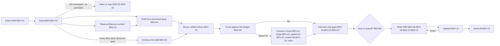

# SPEC-002 — PRD skill (MVP)

## 1. Overview

The `prd` skill ships in the `devforgeai` plugin and is invoked as `/devforgeai:prd [BRN-NNN]`, or
automatically when a user asks to write a PRD from a brainstorm. It:
1. selects a brainstorm document (BRN);
2. drafts requirements from the BRN's **promoted** ideas;
3. interviews the user **only for what the BRN and the request leave open**, and sizes that interview
   to what is unresolved before the first question (version 6);
4. writes a new PRD, extends an existing one, or continues a draft whose decisions are still open;
5. validates it;
6. hands off to the architecture step (ADR-002).

Two rules shape everything else:
- **The PRD records decisions; the AI doesn't make them.** Stage, operating context, priority and
  release are written only when the user supplied or confirmed them. Otherwise they're `null`, which means
  "not decided yet", just as `disposition: open` does in a BRN.
- **The PRD states *what* and *why*; architecture is interviewed, not designed.** The skill reads
  existing architecture decisions and classifies what it learns (BEH-16). Existing commitments and hard
  constraints are recorded and cited. Open design decisions are flagged with a marker that blocks the
  affected epics, and are decided in ADRs, not in the PRD.

**Version 6** (issue #142) makes the interview adapt to the number of unresolved decisions and to the user's
effort, without moving a decision to the AI (Bryan, 2026-11-02: "an interview that adapts to unresolved
decisions and user effort while preserving decision ownership—not merely fitting more selections into each
call"). A project testing DevForgeAI had a brainstorm of about 35 promoted ideas; one priority question per
requirement (BEH-05) inside the default budget of 8 calls (`interview.max_calls`, ADR-003 A3) reaches about
8 of them, and the interview asked for a stage the brainstorm had already named. Version 6 reuses settled
values with their source (BEH-19), counts the whole interview against the budget and says so before the
first call (BEH-20), lets the user choose how to settle priorities when the count doesn't fit (BEH-21 to
BEH-24), continues a draft whose decisions are still open (BEH-25), and says what an answer that decides
nothing writes: nothing (BEH-26, issue #143). Priority questions count against the budget (Bryan,
2026-11-02: "inside the budget. Priority questions must count; treating them as gates would undermine the
cap"). The architecture and context interviews share the budget mechanism; their adoption is a §13 question
in SPEC-003 and SPEC-011 (Bryan, 2026-11-02: "PRD now, with specific §13 questions for architecture and
context").

This skill implements the spec and is recorded as `SKL-002` in its `provenance.yaml`. SKL-002 v5 implements
version 5; version 6 is built only after the dev-guard of ADR-008 passes its own checks (Bryan, 2026-11-02:
"spec now, build under the guard, after the guard passes its own required checks").

## 2. Constraints

- **NFR-001 / NFR-002 / NFR-003**, as for SPEC-001: a short `SKILL.md` with detail in `references/`,
  spec-only frontmatter with provenance in the sidecar, and behavior proven by the eval suite in §9.
- **ADR-001 v4:** built in a worktree from `src/`, deployed with rsync, and evaluated from a plain terminal.
- **ADR-008 (accepted 2026-10-31):** a change to the skill under `src/claude/DevForgeAI/` is made inside a
  `/plugin-dev:create-plugin` iteration that the dev-guard records. The version 6 build waits for the guard.
- **SPEC-001 §5 (downstream contract):**
  - BRNs are at `docs/specs/brainstorm/BRN-NNN.md` with stable item IDs.
  - Only `promoted` ideas are user-approved.
  - `status: converged` means the user confirmed convergence.

## 3. Architecture and components

```
src/claude/DevForgeAI/
├── skills/prd/
│   ├── SKILL.md                          # workflow checklist, decision rules, output contract
│   ├── provenance.yaml                   # SKL-002, implements SPEC-002
│   ├── assets/
│   │   └── prd.md                        # THE PRD template (moved from src/templates/)
│   └── references/
│       ├── output-rules.md               # item-block rules for PRD documents (fallback validation)
│       ├── brn-mapping.md                # how each BRN section maps into the PRD
│       ├── defaults.md                   # framework-default layer for the v1 settings (ADR-003 A2, A3)
│       ├── policy.md                     # policy resolution, precedence and failure rules (ADR-003 A3–A5)
│       └── interview.md                  # question bank per round and stage, batching rules; from version 6
│                                         # also the reuse line, the count line, the modes and the review file
└── evals/prd/<case>/                     # one case per automated VER item (§9), fixtures per case
```

The review file (BEH-24) is a work file outside the documents, `devforgeai/drafts/prd/PRD-NNN-review.md`,
in the gitignored folder the brainstorm skill's work file uses (SPEC-001 version 16; SPEC-012 version 15,
`workFiles`).



## 4. Data model

**Input: a BRN** at `docs/specs/brainstorm/BRN-NNN.md`, read-only (BEH-14). **Also read:** approved
policy documents in `docs/specs/policy/` (BEH-17), and accepted ADRs (BEH-16).

**Output: a PRD** at `docs/specs/prd/PRD-NNN.md` from `assets/prd.md`, valid against
`prd.schema.json`. This spec adds four fields to the PRD schema and template:

| Field | Where | Values | Meaning |
|---|---|---|---|
| `stage` | frontmatter | `prototype`, `mvp`, `evolution`, `null` | **Scope maturity.** prototype: exploratory, may be discarded. mvp: the smallest scope that delivers value to real users and is built upon. evolution: changes an established product (new capability, maintenance, migration or refactoring). Controls interview **depth** (BEH-03) |
| `operating_context` | frontmatter | `local`, `internal`, `pilot`, `production`, `null` | **Who uses it, with what data.** local: developers only, synthetic data. internal: own organization, may touch real internal data. pilot: limited real external users or real customer data. production: generally available to real users with real data. Controls which quality categories **must** be asked (BEH-03) |
| `priority` | each FR and NFR | `must`, `should`, `could`, `wont`, `null` | MoSCoW importance **within its release**. Now nullable |
| `release` | each FR and NFR | `current`, `later`, `null` | **Which release**: `current` = the PRD's `target_release` (e.g. "MVP"), `later` = backlog |

The two frontmatter fields are independent: "an MVP serving real users" is `stage: mvp` with
`operating_context: production`. The NFR `category` list gains `constraint`. A PRD can't move to
`approved` while `stage`, `operating_context` or any `release` is `null`, or while any
`release: current` item has a `null` `priority`, the same rule as for `[NEEDS CLARIFICATION]`
markers. A `release: later` item's `priority` may stay `null` until a release takes the item in.
`[NEEDS ADR]` markers don't block approval (templates README §2.7).

**Mapping from BRN to PRD** (the detail goes in `references/brn-mapping.md`):

| BRN | PRD | Link |
|---|---|---|
| `problems` (PRB) | §2 problem prose | frontmatter `upstream`: `{id: BRN-NNN, item: PRB-NN, relation: derives}` |
| promoted `ideas` (IDEA) | one or more `functional_requirements` | item `upstream`: `{id: BRN-NNN, item: IDEA-NN, relation: derives}` |
| `assumptions` (ASM) | `assumptions` | item `upstream`: `derives` the BRN ASM |
| candidate success signals (prose) | `success_metrics` | `derives` the promoted IDEA it measures; otherwise none. Its baseline, target and measured_by come from the BRN's evidence or the user, otherwise `[NEEDS CLARIFICATION]` |
| open, parked, rejected ideas | nothing | never cited |

**"Unprocessed" BRN** (used by BEH-01): a BRN with at least one promoted idea that no item in any
`docs/specs/prd/PRD-*.md` cites through an `upstream` link. This is derived from links alone.
**Nothing is written into the BRN to mark it processed**, because downstream documents never edit upstream ones.

**"Open decisions"** (version 6; used by BEH-13, BEH-20 and BEH-25): a PRD's `null` `stage`, `null`
`operating_context`, `null` `release` on any FR or NFR, and `null` `priority` on a `release: current` FR or
NFR, the four kinds BEH-13 counts. A `release: later` item's `null` priority is not an open decision (§4
above), and a `[NEEDS CLARIFICATION]` marker is an open question, not an open decision. A **continuable
PRD** is a `draft` or `in-review` PRD with at least one open decision.

**Three write kinds** (version 6). A **new PRD** (BEH-08). An **extension** (BEH-09), which adds items for
new promoted ideas and leaves every existing item unchanged. A **continue** (BEH-25), which settles a
continuable PRD's open decisions: it changes only `null` fields of the four kinds, adds no item, asks no
quality category, touches no marker but the context rewrite BEH-25 names, and never touches an approved
PRD. The three are told apart in the reply and in the Change Log row.

**The reuse line and the count line** (version 6) are written in the reply before the first call, in the
text of the first question of the first call (AskUserQuestion shows nothing written before it, so in a live
session the question is where the user sees them), and in the write's Change Log row, in these forms. Each
entry's source is the request, `BRN-NNN vN` with the section or item it was read from, `PRD-NNN vN` when
extending or continuing, or `answer` for a value settled earlier in the run; the version read is part of
the source, so a later run can tell a stale source:

```
Reused: stage=mvp (BRN-001 v2 §6); operating_context=internal (request); target_release="MVP" (BRN-001 v2 §1)
Interview budget: interview.max_calls=8 (default); open: 35 requirements (35 FR, 0 NFR), 2 framing, 3 architecture, 3 quality, 2 metrics, up to 2 NFR priorities; estimate: about 12 calls, 8 available
```

`Reused: none` when nothing was reused. "Up to N NFR priorities" is the bound BEH-20 counts for the NFRs the
quality round may add. The estimate above is 47 questions in 12 calls; the mode question BEH-21 then asks
joins the count it restates (BEH-20). The
budget's source takes ADR-003 A5's forms: `(default)`, `(POL-NNN#SET-NN)` or `(local)`. The Change Log row's
text ends with the policy resolution line, as before; the two lines above come before it, and so does
`Interview budget raised in the session to N calls` when BEH-20's raise applied, `Not must now: <IDs>` for
each triage group answered 'None of these' (BEH-22), and `Continued: <ID>=<priority>/<release>; …` after a
continue.

**The review file** (version 6, BEH-24) at `devforgeai/drafts/prd/PRD-NNN-review.md`, written only after
the draft PRD it reviews exists, so its rows carry the PRD's own IDs:

```markdown
# Review of PRD-001 (version 1): fill a cell to decide it; leave it blank to decide later
# priority: must | should | could | wont      release: current | later
# stage: prototype | mvp | evolution           operating_context: local | internal | pilot | production

| Field | Value |
|---|---|
| stage | |
| operating_context | |

| ID | Statement | priority | release |
|---|---|---|---|
| FR-001 | The system shall … | | |
```

A row exists for each open decision; markers aren't rows. A filled cell is the user's decision; a blank cell
is none. The file never holds a suggestion. Cells are read trimmed and case-insensitively; a `|` inside a
statement is written `\|`; a row whose ID the PRD doesn't hold is ERR-09.

## 5. Interfaces and contracts

```yaml
# Proposed SKILL.md frontmatter (validated by src/schemas/skill-frontmatter.schema.json)
name: prd
description: Turns a DevForgeAI brainstorm (BRN) document into a product requirements document (PRD), interviewing only for what the brainstorm leaves open, such as delivery stage, priorities, current-release versus later scope, quality requirements and constraints. Use when the user wants to write a PRD, define requirements or scope from a brainstorm, or continue the DevForgeAI planning chain after brainstorming.
argument-hint: "[BRN-NNN]"
metadata:
  devforgeai-id: "SKL-002"
  devforgeai-version: "<SKL-002's provenance.yaml version, quoted>"
```

- **The name must be exactly `prd`.** The brainstorm skill's handoff looks for `${CLAUDE_PLUGIN_ROOT}/skills/prd/SKILL.md`.
- **The version isn't fixed here.** `metadata.devforgeai-version` must equal `provenance.yaml`'s `version`,
  so a skill fix bumps the skill, not this spec.
- **Arguments:** `$ARGUMENTS` is a BRN ID (`BRN-NNN`) or empty (BEH-01). File paths aren't accepted.
- **Tools:** Read, plus Glob and Grep when available, otherwise `ls` on the named folder, to read BRNs and PRDs; Write and Edit for the PRD, and (version 6) for the review file and the `devforgeai/drafts/.gitignore` that BEH-24 writes when missing; the host's question tool for the interview (below); Bash only to run the skill's policy validation script with `python3`.
- **Policy validation (D-09):** the skill ships `scripts/validate_policy.py` and unchanged copies of
  `src/schemas/policy.schema.json` and `common.schema.json` in `references/schemas/`. The script validates
  each approved policy document in full against those schemas (field types, date patterns, authors and
  link records) with the `jsonschema` library, then against SV-01 to SV-06 and SV-08 (ADR-005 D3), and prints every error with
  its file, field and rule. It is the one maintained validation path. The architecture skill ships
  byte-identical copies of the script and schemas, since SPEC-003 BEH-03 resolves policy exactly as this
  skill does. When `devforgeai check` ships (PRD-001 FR-018), both skills switch to it and drop the copies.
- **Provider adaptations.** These are host-specific; every rule in §6 and §7 applies to every provider.

  | | Claude Code | Codex |
  |---|---|---|
  | Invocation | `/devforgeai:prd [BRN-NNN]` | `$devforgeai:prd BRN-NNN`, skill selection or a natural request |
  | Questions | AskUserQuestion: at most 4 questions per call, 2–4 options each; a triage question (BEH-22) is a multiSelect question, and the table question shows its table in an option's preview | The host's question tool when it can show every choice (at most 3 per batch); otherwise numbered plain text, then wait. A triage question is a numbered list whose answer names the numbers ticked. The same `interview.max_calls` budget |
  | Local preferences (BEH-18) | `.claude/devforgeai.local.md` | `.codex/devforgeai.local.md` |
  | Provenance (BEH-10) | `tool: claude-code`; the current model ID; `${CLAUDE_SESSION_ID}` | `tool: codex`; model and session only from a supported host interface; otherwise `unavailable`, disclosed |
  | Resources | `${CLAUDE_SKILL_DIR}` | The loaded skill directory |

  Each provider's qualification records which adaptations its runs exercised. A provider that can't
  supply exact identity keeps BEH-10's obligation open in its qualification, rather than filling it.
  AskUserQuestion takes at most 4 questions per call, with 2–4 options each. The interview budget in BEH-05 is sized to that.
- **Downstream contract (consumed by the architecture step, then the epic workflow, per ADR-002):**
  - PRD path `docs/specs/prd/PRD-NNN.md`, and stable FR, NFR and SM IDs (BEH-09 extends without renumbering).
  - `release: current` with priority `must`, `should` or `could` marks what the current release delivers.
    `priority: wont` with `release: current` marks an explicit exclusion from this release ("won't have this
    time"): the epic workflow never builds a `wont` item. `null` values are open decisions that neither the
    architecture step nor the epic skill may treat as decided.
  - The PRD's `upstream` links show which policy settings informed it, with their versions (BEH-17).
  - `status` stays `draft` until the user approves it. An approved PRD is a scope baseline; widening it goes through an extension that returns it to `in-review` (BEH-09).
  - Epics cite PRD items with `refines` links such as `{id: PRD-001, item: FR-004, relation: refines}`.
  - A `[NEEDS ADR: <decision>; affects FR-…]` marker in §12 means no epic may be written for the named
    requirements until the architecture step resolves that exact decision: a DEC asking it, resolved by an
    accepted, non-superseded ADR or by an approved, active mandated-platform setting that answers that
    question and passes the applicable checks (SPEC-003 §4, BEH-07). A policy setting answering a different
    question, or the resolution of another question, doesn't clear the marker.

## 6. Behavior

```yaml items
behaviors:
  - id: BEH-01
    status: active
    rule: "Select the input. If $ARGUMENTS is a BRN ID, read docs/specs/brainstorm/<ID>.md. If it is empty, list the unprocessed BRNs (§4) with their titles and the number of uncited promoted ideas, and (version 6) after them each continuable PRD (§4) with its title and the number of its open decisions, then ask which one to use: a BRN starts a new PRD or an extension, a PRD a continue (BEH-25). Never guess the BRN, and never take a file path."
  - id: BEH-02
    status: active
    rule: "Read the BRN's frontmatter status, problems, ideas, assumptions and candidate success signals. Use only ideas with disposition promoted. Never cite an open, parked or rejected idea anywhere in the PRD."
  - id: BEH-03
    status: active
    rule: "Choose quality questions by operating context and interview depth by stage. Operating context decides which NFR categories must be asked: local, only constraint; internal, constraint, security and privacy; pilot, those plus reliability, observability and compliance; production, all of those plus performance and accessibility. Stage decides depth: prototype needs requirements only at capability level and a minimal rollout; mvp confirms each current-release requirement; evolution also asks about effects on existing behaviour and systems. These sets are the framework floor. Approved policy may add categories through quality.required_categories when its applies_when matches (BEH-17), but can never remove floor categories. Always offer one open question for any other quality need. When operating context is unknown, ask it in the first round; if it can't be asked, use the production set for deciding which gaps to mark, and leave it null. Record each required category the user did not answer as [NEEDS CLARIFICATION: <category> requirements for <context>] in open questions, never as a placeholder requirement. Keep four kinds of answer apart. An explicit none (the user confirms the category needs nothing) is recorded in section 7's prose as the user's answer, and no NFR is written. No target yet keeps the requirement or metric, with its target marked [NEEDS CLARIFICATION: target for <item>]. A partial answer becomes the NFRs it states, and the rest of the category stays marked. No answer is marked as above. None of these answers waives applicable policy: a category that approved policy requires, or a mandated platform, still applies, and an explicit none for it is recorded together with a [NEEDS CLARIFICATION] marker naming the policy setting."
  - id: BEH-04
    status: active
    rule: "Draft before asking. Map the BRN into a PRD draft following references/brn-mapping.md: problems into section 2 with frontmatter derives links; each promoted idea that no PRD cites yet (§4) into one or more functional requirements that start 'The system shall', each with an upstream derives link to its idea, so every FR derives from a promoted idea; assumptions carried over with derives links; success signals into metrics. NFRs cite their actual source: a BRN item only when one states the requirement; otherwise the policy setting, ADR or PRD it comes from, or no link when the user stated it. Never add a brainstorm link to a requirement the user stated or policy added. Leave out a promoted idea that an item of any PRD already cites, and name it in the reply with the item that cites it."
  - id: BEH-05
    status: active
    rule: "Interview only for gaps, in batched rounds using references/interview.md: framing (stage, operating context, target_release name, primary users, non-goals), architecture context (BEH-16), requirements, quality and constraints (BEH-03), and success metrics (baseline and target). Each requirement gets one question that shows its drafted statement and offers must now, should now, later, or won't: must now and should now write that priority with release current; later writes release later and leaves priority null; won't writes priority wont with release current (an explicit exclusion from this release; a requirement that should never be built is edited or dropped instead). The user can edit the statement or answer 'decide later', which leaves priority and release null. One question per requirement is the requirements round's form whenever BEH-20's estimate fits the budget; when it doesn't, the user chooses a form (BEH-21), and triage by group (BEH-22) replaces it for the requirements the user settles that way. Ask at most the host's per-call question limit (§5: four in Claude Code) and at most interview.max_calls calls (framework default 8, resolved by BEH-17), raised only as BEH-20 allows (version 6: a request for more no longer exceeds a budget that policy locks). Record anything left over when the budget runs out as [NEEDS CLARIFICATION], and a requirement whose priority or release is still open stays null. Skip any question the BRN, the request, an earlier answer or the PRD being extended or continued already answers (BEH-19). When the request says to proceed without questions, ask none. A question with more choices than the host's per-call option limit allows (§5: four in Claude Code) is split into several questions. Gate questions (which BRN, an unconverged BRN, new versus extend, continue a draft) count toward interview.max_calls, but a gate is asked even when the budget is spent, because nothing is written without its answer. Every other kind of call counts too (Bryan, 2026-11-02: 'Priority questions must count; treating them as gates would undermine the cap'): mode selection (BEH-21), each triage group, the table and each correction round (BEH-22), framing, architecture, quality, metrics, and a question asked again (ERR-10)."
  - id: BEH-06
    status: active
    rule: "Write stage, operating context, priority and release only when the user supplied or confirmed them. Otherwise write null. Questions may suggest a value, but a suggestion is never written unconfirmed. Mark any other unanswered gap [NEEDS CLARIFICATION]. Write a new PRD with status draft. Extending a draft or in-review PRD keeps its status; extending an approved PRD follows BEH-09. A failed validation (ERR-06) never restores approved. Never set approved."
  - id: BEH-07
    status: active
    rule: "Record fixed external conditions (mandated platforms, required integrations, data residency, existing systems, regulatory mandates) as NFR items with category constraint, stated as the condition and not as a design, with where it applies (the whole product, a named capability or an environment). When the user offers a design preference (for example an architecture style or a framework), ask whether it is a hard constraint. If it is, record it as a constraint. If not, list it under open questions as a design decision for a future ADR, and never as a requirement."
  - id: BEH-08
    status: active
    rule: "For a new PRD, allocate the ID by scanning docs/specs/prd/ for PRD-NNN.md files and using the highest number plus one (PRD-001 if none). Write to docs/specs/prd/PRD-NNN.md, creating the directory if it is missing. Never ask for or accept a file name. Put the product or release name in the title."
  - id: BEH-09
    status: active
    rule: "Decide new versus extend on scope, ownership and lifecycle, never on product identity or the number of existing PRDs. Read each existing PRD's title, goals, non-goals, owner, status and target_release. Recommend extending one only when the BRN's promoted ideas belong to that PRD's existing initiative and scope, share its owner, and fit its release lifecycle. Recommend a new PRD when they form a distinct initiative, have a different owner or approval path, or follow a different schedule, even within the same product. State the reasons and let the user decide. A new-versus-extend choice the user already stated explicitly, in the request or in reply to an earlier question, answers this gate: don't ask it again, and name where the answer came from. 'Proceed without questions' is not a choice. Ask when it is ambiguous; a single existing PRD is not evidence that it is the right destination. To extend: raise the version by one, update the date, give new items the next free number in each collection, leave every existing item unchanged, add a Change Log entry and add the new BRN links. If the PRD was approved, set status to in-review and clear approved_by and approved_on, so the scope change is reviewed explicitly. Then tell the user that epics citing this PRD are now suspect links to re-review. A superseded or deprecated PRD is never extended; recommend a new PRD instead."
  - id: BEH-15
    status: active
    rule: "Don't copy a constraint or cross-cutting NFR that another PRD already defines. Cite it from its authoritative source with a frontmatter upstream link {id: PRD-NNN, item: NFR-NNN, relation: constrains}, and say in the PRD what it applies to. When the user states a new constraint, record where it applies in the statement: the whole product, a named capability, or an environment."
  - id: BEH-16
    status: active
    rule: "Read architecture context from two sources only: ADRs in docs/specs/adr/ and documents that the BRN or the request names. Never crawl the codebase. Propose which accepted ADRs apply to this product and let the user confirm; with no user present, use only ADRs the request names. Ignore superseded ADRs. Classify what is learned: an existing commitment (an accepted ADR) becomes a frontmatter upstream link {id: ADR-NNN, relation: constrains}; a hard constraint becomes an NFR with category constraint; a preference becomes an open question; an unresolved decision (including a proposed ADR) becomes [NEEDS ADR: <decision>; affects FR-NNN, ...] in open questions, naming the requirements whose epics it blocks. Each applicable architecture.mandated_platforms setting (BEH-17) becomes a constraint NFR whose own item upstream cites its setting with {id: POL-NNN, item: SET-NN, relation: constrains, version: <policy version>, hash: null}; the link is not repeated in frontmatter. Ask about architecture context in the interview, but never decide a design question in the PRD."
  - id: BEH-17
    status: active
    rule: "Resolve policy with the ADR-003 A4 sequence, following references/policy.md. R1: read docs/specs/policy/POL-*.md, validate approved documents in full against policy.schema.json and common.schema.json and then SV-01 to SV-06 and SV-08, with the skill's validation script (§5), and skip and report draft or in-review ones. When the script can't run, stop (ERR-08) rather than skip validation. R2: resolve the unconditional settings (interview.max_calls, architecture.mandated_platforms) across framework defaults (references/defaults.md), organization, project and local preference (BEH-18), honouring overridable_by. R3: establish the operating context from the request, the BRN or the first framing question. R4: apply each active quality.required_categories setting whose applies_when includes that context, additively to the BEH-03 floor; if the context is still unknown, evaluate as production and say so. R5: record each applied policy setting as an upstream link with the policy version, in exactly one place: a mandated platform's constrains link on the item upstream of the constraint NFR it produced (BEH-16), and every setting that governs how the document is produced (interview.max_calls, quality.required_categories) as a frontmatter informed_by link. Then write the ADR-003 A5 resolution line into the Change Log entry, including defaults, local values, settings that didn't apply, the fail-safe context and ignored documents."
  - id: BEH-18
    status: active
    rule: "Read local preferences from .claude/devforgeai.local.md if it exists: YAML frontmatter with devforgeai_local: 1 and interaction-default keys only (v1: interview.max_calls). Use an entry only if the effective setting's overridable_by includes local. Ignore and report any other entry (unknown key, organizational-policy key, bad type or range, not allowed). A local file never stops the skill. Record used values as '<key>=<value> (local)' in the resolution line, never as a link."
  - id: BEH-10
    status: active
    rule: "Fill the frontmatter provenance with the actual authoring tool, model and session, as the host provides them (§5, Provider adaptations). Never guess, copy or fabricate them. When the host can't provide one, write unavailable and disclose it in this write's Change Log row and in the handoff. A new PRD: authors the user and the tool; reviewed_by empty; created and updated today's date. An extension: keep the existing authors (adding the tool if it is missing), reviewed_by and every Change Log row; update today's date; and say in this write's Change Log row and in the handoff that the new revision hasn't been reviewed. Every hash null."
  - id: BEH-11
    status: active
    rule: "Build the document from ${CLAUDE_SKILL_DIR}/assets/prd.md. Keep every section heading, including the GENERATED epic map. Replace each placeholder or mark it [NEEDS CLARIFICATION]. Delete author comments."
  - id: BEH-12
    status: active
    rule: "Validate after writing against the self-check list in references/output-rules.md, reading the file back. Run one initial check, then at most three repair-and-readback cycles, so at most four checks. A repair changes the file to address a reported error; when an error can't be repaired (for example an external limitation), stop early and report it instead of repeating an unchanged check. Record each check and repair in the reply. Never run a devforgeai command: the CLI doesn't exist and a program by that name on PATH can't be trusted (SPEC-004 §2). A link this write adds cites the cited document's current version; an existing link to an older version is a suspect link (templates README §2.6), named in the reply and never an error."
  - id: BEH-13
    status: active
    rule: "Hand off with counts of requirements, constraints and metrics, the number of open decisions (a null stage, operating context or release, or a null priority on a release current item), the open questions, the PRD path, the write kind (new, extended or continued), the calls used against the budget, and the mode chosen when one was (version 6). List every [NEEDS ADR] marker and say that epics for the requirements it names must wait until the architecture step resolves that exact decision, by an accepted ADR or an approved mandated platform answering it. Then name the next step, which is the architecture step (ADR-002): tell the user to run /devforgeai:architecture with the PRD ID. When this run wrote a review file (BEH-24), the next step is instead to fill devforgeai/drafts/prd/PRD-NNN-review.md and run /devforgeai:prd with the BRN ID to continue the PRD (BEH-25); the architecture hand-off follows the continue. A draft saved under ERR-07 hands off as any other write, and the reply says it can be continued. The next step comes last in the final reply, as its own paragraph outside any code block, starting with the words Next step; nothing follows it. Never start architecture work or write an epic."
  - id: BEH-14
    status: active
    rule: "Never modify a BRN document."
  - id: BEH-19
    status: active
    rule: "Reuse before asking (version 6; issue #142, direction 1). After drafting, settle each framing value (stage, operating context, target_release, primary users, non-goals), each requirement's priority and release, each required quality category and each metric's baseline and target from what already states it, reading every source: the request, the PRD being extended or continued (BEH-09, BEH-25: its frontmatter values and, for an extension, its existing items, which are never asked again), the BRN (its frontmatter, context, target users, convergence prose and candidate success signals), and an earlier answer in this run. Record each value's source, with the version read (§4). A value counts as stated only by the test the skill's decision rules already give: a statement that clearly maps to one value ('this is our MVP' is stage mvp; 'real patients book through it from day one' is operating_context production), and for priority and release only a statement about importance or release. Stage and operating context stay independent (§4): a release called an MVP settles stage and nothing else. A value is reused when every source that states it agrees. An answer given in this run supersedes the other sources, since it is the user's latest word; among the request, the PRD and the BRN, no source outranks another. Ask only for a value that is missing, ambiguous (it has two readings), stale (its source is a BRN or PRD version older than the one read now) or conflicting (two sources disagree), and say which in the question, naming the sources and their values for a conflict. Write the reuse line (§4) in the reply before the first call, with or without an interview, in the text of the first question of the first call, and in the write's Change Log row; a value whose source is an earlier answer appears in the Change Log row only. A reused value is written as the user's own (BEH-06); the reuse line, in the first question, is where the user sees and corrects it before anything else is asked."
  - id: BEH-20
    status: active
    rule: "Count the whole interview before the first call (version 6; issue #142, direction 2; Bryan, 2026-11-02: 'inside the budget'). After drafting and reuse, count the questions still needed, by kind: each open gate; each framing value not reused; the architecture questions of interview.md round 2 (the accepted ADRs in groups of the host's option limit, each stated design preference, external conditions, open architecture questions); one per drafted FR and NFR whose priority or release is open, in the one-question form; one per required quality category the draft doesn't cover plus the open question, and one priority question per required category the draft doesn't cover as the bound for the NFRs round 4 adds; one per drafted metric whose baseline or target is open. In a continue (BEH-25), only the open decisions are counted. When the operating context is unknown, count the production set (BEH-03's fail-safe). The estimate in calls is the question count divided by the host's per-call limit, rounded up. The calls available are interview.max_calls less the calls already made, gates included. When the estimate exceeds the calls available, BEH-21's mode question is asked, and the estimate restated with it counts that question too and replaces the requirements round's questions with the chosen mode's cost (BEH-21). Write the count line (§4) in the reply before the first call, with or without an interview, and in the text of the first question of the first call: the resolved interview.max_calls with its ADR-003 A5 source form, the open requirements as a number with FRs and NFRs apart, the other open counts by kind, the NFR-priority bound as 'up to N NFR priorities', the estimate and the calls available. Restate it, as text in the next question's text and in the reply, before the requirements round when the estimate changed (the context became known, or a mode was chosen). Count the actual calls as they are made, and give the number used in the reply after the write (BEH-13). A raise: the user may ask for a larger budget, in the mode question (BEH-21) or in words, and it applies only when the effective interview.max_calls setting's overridable_by includes local (a request made in the session is read as the local layer, ADR-003 A3: the framework default allows it, an organization or project setting may not) and the value asked for is at most 20 (ADR-003 A3's range); otherwise ERR-11. A raise changes neither the resolution line (which keeps the resolved value and its source, never a '(local)' entry for the raise) nor the links; the Change Log row records it as §4 says. When the budget is locked (overridable_by excludes local), say so with the setting's ID and offer no raise; the mode question names what stays null under each mode. When the open gates alone need the whole budget, say so: after the gates the run proceeds as if the request said to proceed without questions, every other decision stays null, and the reply says the PRD can be continued (BEH-25) with a pasted list in the request (BEH-23), which costs no call."
  - id: BEH-21
    status: active
    rule: "The modes (version 6; issue #142, direction 3). A mode settles the requirements round's questions, each open requirement's priority and release (and, in a continue, the four kinds of open decision); the framing, architecture, quality and metrics rounds run as before, before the write, whatever the mode. When BEH-20's estimate exceeds the calls available, the first question of the first call asks how to settle the open requirements, and its text carries the reuse line and the count line. Its options, in this order, each with one line on its cost in calls and what stays null under it: triage by group (BEH-22; cost: one call per twelve open requirements, rounded up, plus one table call, plus the other rounds' calls); a review file (BEH-24; cost: the other rounds' calls only, then the draft is written and the user continues later); a pasted list (BEH-23; the list typed as this question's answer, which costs no further call); raise the budget to N, N being the estimate plus one, at most 20 (when that exceeds 20: 'to 20, leaving about M requirements open'), offered only when BEH-20 allows a raise. A mode whose cost exceeds the calls available is still offered, with the number of requirements that would stay null. No option is marked recommended, none is pre-selected, and the user may type another instruction. The mode question counts against the budget. Under 'proceed without questions' no mode question is asked: the open requirements stay null and the count line says so. The mode chosen is named in the reply and in the Change Log row. The user may change mode in a typed answer; that is an answer, not a call of its own."
  - id: BEH-22
    status: active
    rule: "Triage by group, then the table (version 6; issue #142, direction 4; after get-shit-done's multi-select per category and agent-os's numbered-list confirmation). The triage pass: a multiSelect question per group of at most three open requirements in ID order (FRs, then NFRs), asking which of them are must now; each option's label is the requirement's ID and its description the statement, shortened where needed without changing its meaning; one more option, 'None of these'; four such questions per call, so twelve requirements a call. A ticked requirement gets priority must and release current. An unticked requirement stays null: it is not later, not won't, and not decided. 'None of these' alone means none of the group is must now: the group stays null, and the answer is recorded as the user's in the reply and the Change Log row ('Not must now: FR-004 to FR-006', §4), which tells it apart from a group that got no answer. An answer with no tick at all decides nothing (BEH-26) and is not asked again. 'None of these' with a ticked requirement is a contradiction (ERR-10). Requirements the quality round adds later join the next group, or get the one-question form, as the budget allows. The table pass: after the last group, one single-select question whose table lists every requirement still open with its ID, its statement, and a suggested release later with priority null, each row marked '(suggested)': the one rule is that a requirement nobody ticked is proposed for later, never for a priority. The table is shown in the preview of the first option, and in the question's text when the host shows no preview. The options: 'Accept every row as listed', which writes each row's values; 'Decide none now', which writes nothing for them; and typed text, read as a pasted list (BEH-23) that changes the rows it names. After typed text the revised table is shown as plain text, as a new question whose answer is typed ('accept', or more changes), never as another options menu (BEH-26); each such round counts. The reply after a bulk acceptance names each ID with its statement, priority and release as written, so the acceptance is on the record as the user's. could now, should now, won't and decide later stay available through the typed list. Nothing is written until the user's tick, acceptance or typed value sets it (BEH-06). Twelve a call is Claude Code's figure; a host with a smaller batch (§5, Codex) fills its own."
  - id: BEH-23
    status: active
    rule: "A pasted list (version 6; issue #142, direction 3; interview.md's skip rule made explicit). A list in the request, in a typed answer or in the table's typed text, each entry naming a requirement by its FR or NFR ID, or by the promoted idea it derives from (IDEA-NN, which then applies to every FR drafted from that idea), followed by one of must now, should now, could now, later, won't or decide later, settles those values as the user's: no question is asked for them, and each applied entry is named in the reply. One entry 'the rest: <value>' applies that value to every requirement the list doesn't name; 'the rest: decide later' leaves them null. When an IDEA-NN entry and an FR entry cover the same requirement, the FR entry applies, as the more specific statement. An entry naming nothing drafted, or a value outside that list, is ERR-09. A requirement the list doesn't name stays null unless 'the rest' names a value. A list in the request costs no call."
  - id: BEH-24
    status: active
    rule: "A review file (version 6; issue #142, direction 3; after OpenSpec's review of a draft and get-shit-done's answer file). When the user chooses the review file as the mode, asks to answer at their own pace, or takes it with ERR-07's draft save: the review file replaces the requirements round only, so the framing, architecture, quality and metrics rounds run first as the budget allows; then write the PRD as a draft with every undecided field null, validated and reported as any write (BEH-06, BEH-12); then write devforgeai/drafts/prd/PRD-NNN-review.md in §4's shape, one row per open decision, after writing devforgeai/drafts/.gitignore with the single line * when it is missing (the brainstorm work file's rule, SPEC-001 version 16); then hand off as BEH-13 says for a pending review file. Reading it, on a continue (BEH-25): a filled cell applies only to a field that is null in the PRD; a cell that would change a non-null value is reported and not applied, and asked as a correction when a user is present; a value outside the header's lists is ERR-09; a blank cell stays null. The file is left in place after reading, and the reply names the rows applied, so reading it again changes nothing. A new PRD or an extension never reads a review file. The user may instead edit the draft PRD's null fields by hand: a continue reads the PRD as it is."
  - id: BEH-25
    status: active
    rule: "Continue a draft (version 6; issue #142, direction 5, 'a resume asks only what's still unresolved'; the third write kind, §4). When the request names a PRD to continue, or $ARGUMENTS names a BRN whose promoted ideas are all cited by continuable PRDs (§4) and the request asks neither for a new PRD nor for an extension, ask as a gate whether to continue (options: continue PRD-NNN, one option per continuable PRD that cites the BRN; write nothing), skipped when the request already names the PRD, as BEH-09's stated choice is; a PRD picked from BEH-01's listing answers the gate too. A continue reads the PRD and its review file when one exists (BEH-24), lists the open decisions (§4: the four kinds; markers are not asked), writes the reuse line with the PRD's non-null values as reused from PRD-NNN vN (never asked again, BEH-26) and the count line (BEH-20), and interviews only for the open decisions, the modes included (BEH-21). It asks no quality category and adds no NFR: a category still marked after the first run is answered by hand or in a later extension. The write: raise the version by one, update the date, set each answered null field to its value, keep every item block byte-identical apart from those fields (no new item, no renumbering, no change to a non-null value), keep the status (draft or in-review), keep the frontmatter as an extension does (BEH-10: authors with the tool added if missing, reviewed_by and every Change Log row kept, and the row says the revision hasn't been reviewed), add no link (policy is resolved as in any run, BEH-17 R1 to R4; its resolution line goes in the Change Log row, and an existing policy link at an older version is a suspect link named in the reply, BEH-12), and add a Change Log row that names each value set (§4's Continued form) and ends with the resolution line. When a continue sets operating_context, each '[NEEDS CLARIFICATION: <category> requirements for production]' marker written under the unknown-context fail-safe is rewritten with the new context, or removed when neither the new context's floor nor applied policy requires its category; the Change Log row names each; no other marker changes. An approved PRD is never continued: an open decision in it, if any, is a scope change the owner makes through an extension (BEH-09) or by hand. With no answer for anything (no user, or every question unanswered), nothing is written and the PRD is unchanged. BEH-01's listing names each continuable PRD after the unprocessed BRNs."
  - id: BEH-26
    status: active
    rule: "Answers that decide nothing (version 6; issue #143, Bryan, 2026-11-02: 'Distinguish an unanswered/dismissed prompt from an explicit none', 'Preserve previously confirmed values, and never interpret preselected defaults as submitted answers', 'Require behavior tests, not only wording changes'; worded to match the rule the other interviewing skills adopt under #143). An unanswered, dismissed, empty or unreadable answer decides nothing: the value stays what it was, null or the value confirmed earlier, the question is not treated as answered, and it is not asked again in the run (the user can continue later, BEH-25). An explicit none is a decision, recorded as the user's answer (BEH-03's explicit none; 'None of these' in BEH-22, recorded as 'Not must now'). A recommended, suggested or preselected option is never a submitted answer: only the user's selection or typed text counts (BEH-06). A value confirmed earlier, in this run or in the PRD being extended or continued, is never cleared or overwritten by a later unanswered question, and a continue changes no non-null value (BEH-25). A free-text answer ends the menu for that question: the skill acts on the text, or asks in plain text, and never shows another options menu for the same question (BEH-22's revised table after typed changes is plain text; ERR-10's repeat is a selection asked again after a contradiction, not a menu after text)."
```

## 7. Errors and edge cases

```yaml items
errors:
  - id: ERR-01
    status: active
    condition: "The BRN ID given does not exist"
    handling: "Say so, list the BRN IDs that do exist, and write nothing"
    user_result: "The list of available BRNs"
  - id: ERR-02
    status: active
    condition: "The selected BRN's status is not converged"
    handling: "Warn that some ideas may not be decided, and continue only after the user confirms. If there is no confirmation, as in a non-interactive run, write nothing"
    user_result: "A warning and a question; no file unless confirmed"
  - id: ERR-03
    status: active
    condition: "The selected BRN has no promoted idea"
    handling: "Stop, write nothing, and point the user back to the brainstorm workflow to converge"
    user_result: "An explanation and the next step (/devforgeai:brainstorm)"
  - id: ERR-04
    status: active
    condition: "No BRN can be processed: no argument was given and no unprocessed BRN exists and no continuable PRD exists (BEH-25), or the BRN named has promoted ideas and a PRD already cites every one, and that PRD is not continuable or the request asks for a new PRD or an extension (version 6)"
    handling: "Say why, and write nothing. With no BRN at all, say that no brainstorm exists yet and point to /devforgeai:brainstorm. List each BRN that has no promoted idea, with its status, and point to /devforgeai:brainstorm to converge it. Say that every promoted idea of each remaining BRN is already cited by a PRD, naming the PRDs that cite them, and, when a citing PRD is continuable, that it can be continued (BEH-25)"
    user_result: "Why no BRN can be processed, and the next step"
  - id: ERR-05
    status: active
    condition: "The BRN's item blocks can't be read (malformed YAML or missing collections)"
    handling: "Report which block failed and stop. Never repair the BRN"
    user_result: "The error and the BRN path"
  - id: ERR-06
    status: active
    condition: "Validation still fails after the initial check and three repair cycles, or an error can't be repaired"
    handling: "Stop. A new PRD stays draft. An extension keeps the status BEH-06 and BEH-09 gave it: a draft or in-review PRD keeps its status, and an approved PRD whose content changed stays in-review with approved_by and approved_on cleared. Never set approved. List the checks, the repairs and the unresolved errors, and don't present the PRD as ready for the architecture step"
    user_result: "The file path, the checks and repairs made, and the unresolved errors"
  - id: ERR-07
    status: active
    condition: "The user stops mid-interview"
    handling: "Ask whether to save a draft PRD, with or without a review file (BEH-24) for its open decisions. If yes, write it with every undecided field null, then validate it (BEH-12) and report it (BEH-13) as any other write, saying that it can be continued (BEH-25); with the review file, hand off as BEH-13 says for a pending one"
    user_result: "Either a draft file or no file, as the user chose"
  - id: ERR-08
    status: active
    condition: "An approved policy document fails the schema, or breaks SV-01 (duplicate setting ID), SV-02 (two approved documents in one scope), SV-03 (interview.max_calls set twice), SV-04 (a project setting overrides a mandated platform that doesn't allow it) or SV-08 (a testing.* key set twice), or any lower layer overrides a setting whose overridable_by doesn't include that layer (ADR-003 A4), for example a project policy setting interview.max_calls when the organization setting allows only local; or the validation script can't run while approved policy exists"
    handling: "Stop before writing anything. Name the policy file, the setting and the rule broken (schema or SV-NN). Never guess or fall back silently"
    user_result: "The policy error to fix; no PRD file"
  - id: ERR-09
    status: active
    condition: "A pasted list or review file entry can't be read (version 6): it names no drafted requirement or promoted idea, gives a value outside BEH-23's list or the review file's header, or (review file) would change a non-null value"
    handling: "Report the entry as written and set nothing for it; apply every readable entry. With a user present and a call available, ask the entry as a correction question, which counts against the budget; with the budget spent, it stays as reported"
    user_result: "The unreadable entries named; the readable ones applied"
  - id: ERR-10
    status: active
    condition: "A triage answer ticks 'None of these' together with a requirement (BEH-22)"
    handling: "No decision for that group. Ask the group's question again once, in the next call, which counts, when a call is available; with the budget spent, or when the answer is contradictory again, the group stays null and the reply names it"
    user_result: "The group asked again, or left undecided and named"
  - id: ERR-11
    status: active
    condition: "The user asks for a larger budget that the effective interview.max_calls setting doesn't allow (its overridable_by excludes local) or that is above 20 (version 6)"
    handling: "Refuse, naming the setting (POL-NNN#SET-NN and its overridable_by, or ADR-003's range), keep the resolved budget, and offer the modes (BEH-21), each with what stays null under it. The refusal is text, not a call, unless it is asked as a question"
    user_result: "Why the budget can't be raised, and the modes with what stays null under each"
```

## 8. Non-functional design

```yaml items
quality_responses:
  - id: QR-01
    status: active
    response: "SKILL.md holds only the workflow checklist, decision rules, output contract and links. The BRN mapping, the question bank and the output rules live in references/."
    measured_by: "SKILL.md line count and description length"
    upstream:
      - {id: PRD-001, item: NFR-001, relation: satisfies, version: 14, hash: null}
  - id: QR-02
    status: active
    response: "Frontmatter limited to the fields in §5; provenance kept in provenance.yaml; metadata values quoted, with devforgeai-version equal to the provenance version"
    measured_by: "Reading against skill-frontmatter.schema.json and skill.schema.json, and comparing the two version values"
    upstream:
      - {id: PRD-001, item: NFR-002, relation: satisfies, version: 14, hash: null}
  - id: QR-03
    status: active
    response: "One eval case per automated VER item, tagged prd and ver-NN, run against the no-plugin baseline"
    measured_by: "claude plugin eval --threshold 0.8 over 3 runs"
    upstream:
      - {id: PRD-001, item: NFR-003, relation: satisfies, version: 14, hash: null}
```

## 9. Verification

**Verification status.**

| Kind | Status |
|---|---|
| Version 6 | **Specified, not built.** Drafted on 2026-11-02 for issue #142 (the PRD interview at scale) and #143's prd part, from the plan Bryan approved on 2026-11-02 (`tmp/plans/2026-11-02-interview-at-scale-and-improve.md`, local; its W1 sections are named in the Change Log row). SKL-002 v5 implements version 5 and its `provenance.yaml` keeps `implements SPEC-002 version 5` until SKL-002 v6 is built under `/plugin-dev:create-plugin` and the dev-guard (ADR-008), after the guard passes its own checks (EVAL.md A and B). New: BEH-19 to BEH-26, ERR-09 to ERR-11, VER-39 to VER-45 and VER-49 (eval cases, written first with `src/tests/prd/make_evals.py` and run once on SKL-002 v5, where they should fail) and VER-46 to VER-48 (manual, `docs/runbooks/prd-v6-interview-checks.md`). Changed: BEH-01, BEH-05, BEH-13, ERR-04, ERR-07, §1, §3, §4, §5 (Tools and Questions rows only; the description is unchanged, so SKL-002 v5's frontmatter still matches). Reviewed before approval by an independent drafts review (`docs/process/plugin-workflow/reviews/20261102T1713Z-drafts-review-2babfc3.md`), whose findings the second Change Log row answers. Structural: this version validates against `spec.schema.json` and every item is covered (`src/tests/prd/test_structure.py`, SPEC_STATE pinned to version 6). Behavioural: NOT_RUN until the build. Codex: not ported (ADR-005); the two prd skills drift until it is |
| Version 5 | Claude: SKL-002 v5 implements it. It was requalified on 2026-10-02: 35 of 35 cases at ≥ 0.8 over 3 runs, 34 at 1.00 (row SKL-002 v5). VER-37 (case `needs-adr-handoff`, 3 graders) and VER-38 (case `unlinked-signal-keeps-target`, 4 graders) are new; both failed on SKL-002 v4 below the 0.8 bar (the red run in row SKL-002 v5). Codex: not ported. The changed items are §4's success-signal row, §5's `[NEEDS ADR]` contract and BEH-13 |
| SKL-002 v5 | Built on 2026-10-01 and 2026-10-02 in Claude Code session 96018bc1-5ee7-423f-93a4-da37a8b6c392 through `/plugin-dev:create-plugin`, after an advisor check of the plan against this version and Anthropic's two skill guides: `599d347`, then `ddc1753` with the skill-reviewer's polish; plugin-validator found no critical issue. `main` was merged in at `a79ad0d` (`f81e869`), and the plugin set to 0.11.0 (`932f89e`, Bryan's choice). **Red run** on SKL-002 v4, run by Bryan, bound to `1d64ad3` (digest `bd2fe55d…`), once per case without the baseline (`tmp/eval-results/prd-v5-red-20261001T222354-*`): `needs-adr-handoff` scored 0.67, $0.62, and the judge failed 3 of 3 on "Epics for FR-001 and FR-002 must wait until an accepted ADR resolves it"; `unlinked-signal-keeps-target` scored 0.25, $0.57, because v4 named the metric "Average score in the quarterly volunteer survey" and the graders' anchor looked for "satisfaction". The anchor now accepts satisfaction or survey (`a4a0ec4`). Re-graded offline, v4's PRD scores 0.75: the baseline 3.4 and the survey were kept, the target 4.0 was replaced by `[NEEDS CLARIFICATION]` (issue #39 reproduced), and there is no upstream link. **Pass A** on SKL-002 v5, bound to `932f89e` (digest `e1f16d70…`; `tmp/eval-results/prd-v5-a-20261001T223854-*`): `unlinked-signal-keeps-target` 1.00, $0.55; `needs-adr-handoff` 0.67, $0.64, because the reply said epics "can't start until the architecture step settles this, through an accepted ADR", dropping the mandated platform when the resolution line read `architecture.mandated_platforms=none (default)`. Step 10 then gave the marker and its sentence as a template to copy, and says to name both ways even with no policy (`444a38c`; create-plugin re-invoked for this iteration, plugin-validator and skill-reviewer re-run: `5142ae0`, `fc2c02e`). SKILL.md is 430 lines. Structural at `fc2c02e`: passes (`test_structure.py` 3, `test_shared_files.py` 5, `test_validate_policy.py` 116, `check_graders.py` 103 of 103; no regeneration drift). Every later run is bound to `fc2c02e` (plugin 0.11.0, digest `598d8598…`), Claude Code 2.1.287, judge model sonnet: `needs-adr-handoff`, 3 runs without the baseline, 1.00 in each, $1.85 (`tmp/eval-results/prd-v5-a2-20261002T083218/`; the reply copies the marker and the sentence, in a code block); pass B, the whole prd tag once without the baseline, 35 of 35 at 1.00, $16.70 (`tmp/eval-results/prd-v5-b-20261002T091007/`). **Requalification (pass C)**, run by Bryan on 2026-10-02: the whole prd tag, 35 cases, 3 runs against the no-plugin baseline, concurrency 4, 3,253 s (`tmp/eval-results/prd-v5-c-20261002T092916/`). **All 35 cases met the 0.8 bar:** 34 at 1.00 in every plugin run, and `retired-setting-ignored` (VER-22) at 0.89. Its run 3 named the deprecated setting in section 7's prose ("the policy setting that mandated Keystone SSO … is deprecated and takes no part"), with no NFR and no link, so VER-22's obligation holds; the grader's whole-file "Keystone" pattern is stricter than the obligation (a follow-up). Mean Δ +0.57; $79.03. The result folders are in the worktree's `tmp/eval-results/` (local, untracked). **SKL-002 v5 approved by Bryan on 2026-10-02** |
| SKL-002 v4 | Built on 2026-10-01 in Claude Code session 8619f756-390e-4265-a95c-03fa25310d46 through `/plugin-dev:create-plugin`, after an advisor check of the plan against this version and Anthropic's two skill guides: `c8f04df`, then `77b7b5d` with the plugin-validator's and skill-reviewer's findings. Structural: passes (`test_structure.py` 3, `test_shared_files.py` 5, `test_validate_policy.py` 116, `check_graders.py` 83 of 83; no regeneration drift); SKILL.md is 420 lines. Behavioural, run by Bryan on 2026-10-01 from the worktree, once per case without the baseline, bound to `51ae072` (plugin 0.9.0, digest `603628f1…`): pass A, the four new cases, 4 of 4 at 1.00, $1.35 (`tmp/eval-results/prd-v4-a-20261001T135909-no-brainstorm-yet/` and the three folders after it); pass B, the whole prd tag, 32 of 33 at 1.00, $15.41 (`tmp/eval-results/prd-v4-b-20261001T141649/`). `warns-unconverged` (VER-04) scored 0.50: the reply warned and asked, but called the draft BRN "finished in practice" instead of warning that ideas may not be decided, so ERR-02's wording was sharpened in `87ad053`. `main` (SKL-004 v2) was then merged in, and SPEC-004 relinked to this version. A preflight run of `warns-unconverged` on `6bc8860` scored 1.00 ($0.28). Requalification (pass C), run by Bryan on 2026-10-01, bound to `6bc8860` (plugin 0.9.0, digest `486d1914…`): the whole prd tag, 33 cases, 3 runs against the baseline, judge model sonnet. Bryan's session limit stopped the first invocation after 14 complete cases (`tmp/eval-results/prd-v4-c-20261001T143501/`); `tmp/prd-v4-requal.sh` reran the other 19 one case at a time, each in its own folder bound to the same commit (`tmp/eval-results/prd-v4-c2-*`). **All 33 cases met the 0.8 bar:** 32 at 1.00 in every plugin run, and `none-does-not-waive-policy` (VER-25) at 0.83, where 2 of 3 plugin runs failed `compliance-none-recorded`. The kept traces show both runs recorded the user's none in section 7 ("Compliance: the user confirmed that no regulation applies.") in words the grader's pattern doesn't list: a grader limit, not a skill failure. Mean Δ +0.53; $75.35 including the interrupted run. The Sonnet subset (VER-01, VER-07, VER-13, VER-27, VER-33 and VER-34, once each) is not run yet. After the requalification, the shared "none" pattern of VER-24's and VER-25's graders was widened to accept "no regulation applies" (`0a8b442`, Bryan's choice); the skill didn't change. **SKL-002 v4 approved by Bryan on 2026-10-01** |
| Version 4 | Behavioural: the two new cases ran once each on SKL-002 v3 on 2026-10-01, without the baseline, run by Bryan from the `docs/spec-002-v4` worktree and bound to `a6c1cc4` with `record_revision.sh` (folders `tmp/eval-results/prd-v4-red-20261001T123717-no-brainstorm-yet/` and `tmp/eval-results/prd-v4-red-20261001T123740-revisited-brainstorm-extends/`, local, untracked). `no-brainstorm-yet` (VER-33) scored 1.00, $0.21: the judge passed 3 of 3, and the reply said that no brainstorm exists and pointed to `/devforgeai:brainstorm`. `revisited-brainstorm-extends` (VER-34) scored 0.78 (7 of 9), $0.61: every file grader passed, and `names-left-out-ideas` and `reports-suspect-links` failed, both obligations that version 4 adds. So the defects that issues #36 and #38 and issue #40's #4 describe, found by reading, did not appear in these runs. A second round on SKL-002 v3, bound to `ff3e8b7` (folders `tmp/eval-results/prd-v4-red-20261001T131938-no-unprocessed-brn/`, `…T132003-all-ideas-cited-stops/` and `…T132114-revisited-brainstorm-extends/`): `no-unprocessed-brn` (VER-35) scored 1.00, $0.22; `all-ideas-cited-stops` (VER-36) scored 0.50, $0.61, because v3 wrote PRD-002 and said "PRD-002 repeats" PRD-001 (issue #38's defect); `revisited-brainstorm-extends` (VER-34) scored 0.57 (4 of 7), $0.67, because v3 reported the seven links to BRN-001 version 1 as errors, moved the two frontmatter links to version 2, and stopped under ERR-06 with five errors in existing items it couldn't change (issue #40's self-check 9), though the first run had passed validation. So issue #38 and issue #40's #4 reproduced; issue #36 did not, in VER-33 or VER-35. Before that second round, Bryan had those two regex graders replaced by llm graders, which keep the reply as evidence: one per duty, `reply-names-left-out-ideas` and `reply-reports-suspect-links`, so that a reply that misses both still fails (5 of 7). The same change counts any third citation of IDEA-01 or IDEA-03, at any version, and checks every existing item with one end-anchored grader, after the plugin-validator and skill-reviewer found false passes. Structural: passes, checked with `src/tests/prd/test_structure.py` on 2026-10-01 (validates against `spec.schema.json`; every BEH, ERR and QR item is covered by a VER item). Changed, on Bryan's decisions of 2026-10-01 on the SKL-002 v3 review (issues #36, #37 and #38), with the spec parts of issue #40: ERR-04 says why no BRN can be processed; BEH-04 drafts only promoted ideas that no PRD cites; §4 and BEH-13 let a `release: later` item's priority stay null; BEH-12 treats an existing older-version link as a suspect link, not an error; ERR-07 validates and reports a saved draft; Appendix A asks the NFRs' priorities; BEH-05 splits questions over the option limit and asks gates past the budget, and BEH-09 never extends a superseded or deprecated PRD (issue #40, Bryan's decision of 2026-10-01); BEH-13 and VER-07 keep only the shipped architecture-skill branch. VER-33 to VER-36 are new; VER-35 and VER-36 test ERR-04's cases that VER-33 can't separate from v3. The rows below record versions 1 to 3 |
| Version 3 | Claude: SKL-002 v3 (the shared-schema change, PR #25) was requalified on its 12 policy eval cases on 2026-09-30, 12 of 12 at 1.00 (row (f)). Every change from v2 is in policy validation and its reference text, so its other 17 cases last ran on v2 (row (e)); the manual VER-11, VER-12 and VER-23 were not rerun. Codex: ported in PR #26, with its own native evaluation (`src/codex/devforgeai/shared-schema-update-evidence/20260930/REPORT.md`). Changed: §5, BEH-17 R1 and ERR-08 name SV-08 |
| Version 2 | Claude: SKL-002 v2's automated VER items ran on 2026-09-29, 29 of 29 at 1.00 (row (e)); the manual VER-11, VER-12 and VER-23 are not run. Codex: not run. The changed items were BEH-03 to BEH-06, BEH-09, BEH-10, BEH-12, BEH-17, ERR-06, ERR-08 and VER-09 to VER-11, with VER-24 to VER-32 new. Rows (a) to (d) record version 1's evidence |
| Structural: this spec against `spec.schema.json` | Passes (checked 2026-09-29) |
| Structural: SKL-002's frontmatter, provenance and links | Pass for SKL-002 v3 at `a19949b` (2026-09-30), the head of PR #25, with the same checks; `test_validate_policy.py` ran 112 tests under both jsonschema versions, and 116 at `4c01126`, after PR #27. Pass for SKL-002 v2 at `7e87cf4` (2026-09-29): `src/tests/prd/test_structure.py` checks the frontmatter and provenance against their schemas, the metadata version against provenance, SKILL.md's length (420 lines) and its links. `test_validate_policy.py` (84 tests, under jsonschema 4.26 and 4.10) and `test_shared_files.py` (byte-identity with the architecture skill and `src/schemas/`) pass |
| Behavioural (a): automated VER items, original run | `tmp/eval-results/prd-full-1/` (local, untracked). Started 2026-09-27 22:54 EDT (02:54 UTC on 09-28); Claude Code 2.1.283; 20 cases; 3 runs per arm against the no-plugin baseline; threshold 0.8; judge model sonnet; $41.51; 1,652 s; root `src/claude/DevForgeAI`. **All 20 case scores met the 0.8 threshold.** Eighteen scored 1.00 with the plugin. Two had failing graders, kept as recorded: `writes-prd-from-brn` scored 0.833 in each run, with the llm grader `requirements-match-answers` failing all three runs (VER-01). `architecture-context` averaged 0.952 (1.00, 1.00, 0.857), with the llm grader `marker-names-booking-frs` failing in run 3 (VER-14) |
| Behavioural (b): reruns with changed graders | Fresh executions, not regrades of saved replies. They don't replace the original results in (a). `tmp/eval-results/prd-full-1-regrade-writes-prd-from-brn/` (2026-09-27 23:25 EDT, 3 runs per arm, $2.51): `requirements-match-answers` (llm) removed; six regex graders added (`framing-from-answers`, `frs-start-with-shall`, `idea-01-frs-must-current`, `idea-03-frs-should-current`, `no-other-idea-01-decision`, `no-other-idea-03-decision`); 1.00 in each run. `tmp/eval-results/prd-full-1-regrade-architecture-context/` (23:27 EDT, 3 runs per arm, $2.69): `marker-names-booking-frs` (llm) replaced by `marker-names-booking-fr` (regex); 1.00 in each run |
| Behavioural (c): case changed since, not rerun | `hands-off-to-architecture` (VER-07): its prompt and `handoff-quality` grader changed in commit `acce5a2` (2026-09-28), when the architecture skill shipped. The runs above tested the earlier branch (no architecture skill); the current case hasn't run |
| Behavioural (d): manual VER items (VER-11, VER-12, VER-23) | Version 1: NOT_RUN. Version 2, 2026-09-29 (Claude Code 2.1.285, a copy of the plugin at `7e87cf4` loaded with `--plugin-dir`, driven through the owner's cmux tab by session fdbef416-eebb-4053-95ce-624a311d72d5): **VER-11: pass on every clause but one, run in session `4665c43e-7434-4854-94aa-781003f2d88c`.** The food bank BRN names the users, and the request stated the stage and operating context. No question repeated them. It used 5 calls of at most 4 questions (budget 8); the quality questions were the internal floor (constraint, security, privacy) plus one "anything else"; the partial privacy answer became NFR-002, with `[NEEDS CLARIFICATION: privacy requirements for internal]` for retention; the constraint "none" and SM-01's "no target yet" were recorded as answers. Stopping mid-interview (ERR-07) was not run. **VER-23: only its ERR-08 "can't run" case, pass**, in session `21995046-d5a3-4aaf-9637-7350d373e787`: with jsonschema hidden and an approved policy present, the skill stopped before any question, quoted the script's exit-2 message, installed nothing, didn't read the policy instead, and wrote nothing. Local preferences, SV-01, SV-02 and SV-06: not run. **VER-12: not run**; its approved-extension and ERR-06 paths are covered automatically by VER-27 and VER-32. **Session ID (Claude only): pass**; the PRD's `generated_by.session` and Change Log author match the transcript's ID |
| Behavioural (e): SKL-002 v2, prd tag run, 2026-09-29 | `tmp/eval-results/prd-v2-3run-20260929T151649/` (local, untracked). Started 15:16:51 EDT (19:16:51 UTC); Claude Code 2.1.284; plugin 0.6.0; 29 cases (VER-01 to VER-10, VER-13 to VER-22, VER-24 to VER-32); 3 runs per arm against the no-plugin baseline; threshold 0.8; judge model sonnet; concurrency 4; $63.07; 2,327 s. **All 29 cases scored 1.00 with the plugin in every run**, with no errors; mean Δ +0.53. It is the first run of the current VER-07 case (see (c)). The new cases' Δ: VER-24 +0.50, VER-25 +0.75, VER-26 +0.25, VER-27 +0.60, VER-28 +0.33, VER-29 +0.44, VER-30 +0.78, VER-31 +0.75, VER-32 +0.38. **Bound:** `src/tests/prd/record_revision.sh` wrote the commit `7e87cf4` (PR #16's merge), the plugin digest `dc301097547da60d3a3e0a319e61de14e781d487058b3661454cc3db03d22dbe` and a copy of the case files into the folder before the run |
| Behavioural (f): SKL-002 v3, policy-case requalification, 2026-09-30 | `tmp/eval-results/prd-requal-20260930T135333-<case>/` (local, untracked), one folder per case, run by Bryan from a plain terminal with the shared-schema worktree's `tmp/requalify.sh`. Started 13:53:35 EDT (17:53:35 UTC); Claude Code 2.1.285 for the first four cases and 2.1.286 from `policy-bad-authors` on (it updated during the run); plugin 0.7.0; the 12 policy cases (VER-15 to VER-19, VER-21, VER-22, VER-25, VER-28 to VER-31); 3 runs per arm against the no-plugin baseline; threshold 0.8; judge model sonnet; concurrency 1; $26.12; 3,992 s. **All 12 cases scored 1.00 with the plugin in every run**, with no errors; mean Δ +0.64. Δ: VER-15 +0.67, VER-16 +0.92, VER-17 +0.33, VER-18 +0.50, VER-19 +1.00, VER-21 +0.75, VER-22 +0.33, VER-25 +0.67, VER-28 +0.33, VER-29 +0.67, VER-30 +0.67, VER-31 +0.83. **Bound:** `src/tests/prd/record_revision.sh` wrote the commit `a19949b` (PR #25's head; `src/` is identical at its merge `c2e6751`), the plugin digest `d4c23f78826894bbcdd2a29429b00689ba37601db3e8673ac78d29f2d43496b5` and a copy of the case files into each folder before its run. **After the run:** the Codex port's evaluation found that `scripts/validate_policy.py` accepted `.nan` as `testing.coverage_threshold`; PR #27 (`4c01126`) made it a `schema` error, with no version bump. None of these 12 fixtures contains a NaN or a `testing.*` key, so the run wasn't repeated (Bryan, 2026-09-30) |
| Revision binding | **Not bound.** The results record no source commit or plugin hash, and the runs predate the commit that first tracked the plugin (`7ad1aa2`, 2026-09-28 13:44 EDT). Inferred from file times: the skill's files were last modified at 22:54:00 EDT, before the original run began, and git shows no change to them since `7ad1aa2`, so the evaluated skill was probably SKL-002 v1 as committed. All 27 prd eval files were rewritten at 23:25:20 EDT, before the reruns, so the original run's grader files aren't preserved. The committed graders have the same names as the reruns', so the reruns probably used them; their content isn't bound |
| Findings shared with the Codex import | Resolved in version 2 (D-03 to D-09) and implemented in the Claude skill as SKL-002 v2 (PR #16); the Codex port is updated separately. From the Codex port's review (`src/codex/devforgeai/PRD-IMPORT-REPORT.md`, 2026-09-29), each also present in the Claude skill: **D-03** ERR-06 restores the pre-write status, so a failed extension of an approved PRD would read `approved` again, against BEH-06 and BEH-09 (SKILL.md step 9); **D-04** "at most three attempts" doesn't say whether the first check counts (BEH-12, ERR-06); **D-05** an explicit "none", "no target yet", a partial answer and no answer aren't distinguished (BEH-03, BEH-06; `references/interview.md`); **D-06** step 4 always asks new versus extend, though the gate rule accepts a choice already stated (BEH-09); **D-07** SKILL.md says "every requirement cites a promoted idea" (line 313) and the template's author comment is as broad, though only FRs derive from promoted ideas (BEH-04, BEH-07); **D-08** an extension keeps `reviewed_by` (SKILL.md, `references/output-rules.md`), while BEH-10 says it is empty, with no extension case; **D-09** the runtime policy checklist omits parts of `policy.schema.json` and `common.schema.json` (BEH-17 R1). D-01 and D-02 are Codex identity adaptations. The proposed resolutions are in the SPEC-002 v2 draft |
| Qualification | SKL-002 v5 requalified on 2026-10-02 (row SKL-002 v5): 35 of 35 at ≥ 0.8 over 3 runs; approved by Bryan on 2026-10-02; merged in PR #57 (`0011267`) and deployed in plugin 0.11.0 on 2026-10-02. SKL-002 v4 approved by Bryan on 2026-10-01, after its requalification (row SKL-002 v4). Open: the Sonnet subset (a record, not a bar), VER-11, VER-12 and the rest of VER-23. SKL-002 v3 approved by Bryan on 2026-09-30, after its policy cases were requalified (row (f)). SKL-002 v2 was approved by Bryan on 2026-09-29. Its automated items passed in a bound run (row (e)), including VER-07's current case and the approved-extension and ERR-06 paths (VER-27, VER-32). Open: VER-11's stop-mid-interview clause (ERR-07), VER-12, and VER-23 apart from its can't-run case |

Structural checks show that documents are well formed. Only behavioural runs can show that the skill works. Each automated VER item has one eval case under `evals/prd/`, tagged `prd` and `ver-NN`. Runs are
non-interactive, so each case's `case.yaml` scaffold places its fixture BRNs and PRDs.
Output paths are deterministic: `PRD-001.md` in a workspace with no PRD, and `PRD-002.md` when one exists.
File graders must name those literal paths.

```yaml items
verifications:
  - id: VER-01
    status: active
    obligation: "Given a converged BRN-001 with IDEA-01 and IDEA-03 promoted, IDEA-02 parked and IDEA-04 rejected, '/devforgeai:prd BRN-001' with all answers in the prompt writes docs/specs/prd/PRD-001.md. Its requirements cite IDEA-01 and IDEA-03 and never IDEA-02 or IDEA-04. Eval case writes-prd-from-brn: file_exists, regex on the file."
    level: e2e
    covers:
      - BEH-02
      - BEH-04
      - BEH-08
      - BEH-11
      - BEH-12
    upstream:
      - {id: STORY-002, item: AC-02, relation: verifies, version: 7, hash: null}
  - id: VER-02
    status: active
    obligation: "With a prompt that gives the stage (prototype) but no priorities or releases and says to proceed without questions, the file has stage: prototype, only null priority and release values, and status draft. Eval case no-invented-decisions: regex on the file."
    level: e2e
    covers:
      - BEH-06
    upstream:
      - {id: STORY-002, item: AC-03, relation: verifies, version: 7, hash: null}
  - id: VER-03
    status: active
    obligation: "With BRN-001 fully cited by an existing PRD-001 and BRN-002 not cited, '/devforgeai:prd' with no argument offers BRN-002 and not BRN-001, and writes no file. Eval case selects-unprocessed-brn: regex and llm on the reply, file_exists false for PRD-002.md."
    level: e2e
    covers:
      - BEH-01
    upstream:
      - {id: STORY-002, item: AC-01, relation: verifies, version: 7, hash: null}
  - id: VER-04
    status: active
    obligation: "With a draft (not converged) BRN-001, the skill warns and, with no user to confirm, writes no PRD. Eval case warns-unconverged: llm on the reply, file_exists false."
    level: e2e
    covers:
      - ERR-02
    upstream:
      - {id: STORY-002, item: AC-05, relation: verifies, version: 7, hash: null}
  - id: VER-05
    status: active
    obligation: "With a converged BRN-001 that has no promoted idea, the skill stops, writes no PRD and points to the brainstorm workflow. Eval case stops-without-promoted: regex on the reply for brainstorm, file_exists false."
    level: e2e
    covers:
      - ERR-03
    upstream:
      - {id: STORY-002, item: AC-05, relation: verifies, version: 7, hash: null}
  - id: VER-06
    status: active
    obligation: "Fixture: PRD-001 covers one initiative (for example onboarding recovery, with its own owner and target release). BRN-002 promotes ideas for a different initiative in the same product (for example account closure). The skill doesn't default to extending PRD-001: it recommends a new PRD with reasons about scope, ownership or lifecycle, asks the user, writes nothing without an answer, and leaves PRD-001 unchanged. Eval case extend-or-new: llm on the reply, regex that PRD-001.md still has version: 1, file_exists false for PRD-002.md."
    level: e2e
    covers:
      - BEH-09
    upstream:
      - {id: STORY-002, item: AC-06, relation: verifies, version: 7, hash: null}
  - id: VER-07
    status: active
    obligation: "After writing the PRD, the final reply hands off to the architecture step (BEH-13). The handoff is the last paragraph of the reply, outside any code block; it starts with the words Next step, and nothing follows it. It names the PRD by its ID, never by a file path, and the skill starts no architecture work and writes no ADR or epic. It tells the user to run /devforgeai:architecture PRD-001 and doesn't claim that the skill is unavailable or that the step is done by hand. Eval case hands-off-to-architecture: regex and llm on last_message."
    level: e2e
    covers:
      - BEH-13
    upstream:
      - {id: STORY-002, item: AC-07, relation: verifies, version: 7, hash: null}
  - id: VER-08
    status: active
    obligation: "A request such as 'open a PR for my staged changes and write its description' does not invoke the prd skill. Eval case ignores-unrelated-request: tool_used Skill min 0 max 0 arm both."
    level: e2e
    covers:
      - QR-02
      - QR-03
    upstream:
      - {id: STORY-002, item: AC-08, relation: verifies, version: 7, hash: null}
  - id: VER-09
    status: active
    obligation: "The written new PRD's generated_by holds the host's actual tool, model and session (in Claude Code: claude-code, a model ID and a session ID; a host that can't provide one writes unavailable and discloses it), reviewed_by is empty and every hash is null. Eval case records-provenance: regex on the file."
    level: e2e
    covers:
      - BEH-10
    upstream:
      - {id: STORY-002, item: AC-09, relation: verifies, version: 7, hash: null}
  - id: VER-10
    status: active
    obligation: "A prompt stating 'it must run on AWS and must integrate with Stripe; I'm leaning towards microservices', with instructions to proceed without questions, yields constraint NFRs for AWS and Stripe with no BRN derives link, and no requirement or constraint about microservices. Eval case constraints-not-design: regex on the file for category: constraint, llm on the file for the microservices rule."
    level: e2e
    covers:
      - BEH-07
    upstream:
      - {id: STORY-002, item: AC-04, relation: verifies, version: 7, hash: null}
  - id: VER-11
    status: active
    obligation: "In an interactive session with a BRN that already names the users and a request that states the stage and operating context: no question repeats those answers, every batch has at most four questions, the whole interview stays within the resolved interview.max_calls, the NFR categories asked match the operating context, and an 'anything else' quality question is offered. A partial answer to a category becomes the NFRs it states, with the rest of the category marked. Stopping mid-interview offers a draft save."
    level: manual
    covers:
      - BEH-03
      - BEH-05
      - ERR-07
    upstream:
      - {id: STORY-002, item: AC-04, relation: verifies, version: 7, hash: null}
  - id: VER-12
    status: active
    obligation: "Manual extension run: extending PRD-001 from a second BRN of the same initiative raises the version, continues numbering, leaves existing items byte-identical, adds a Change Log entry and warns about suspect epics. With PRD-001 approved beforehand, the extension returns it to in-review and clears the approval. git diff shows no change to any BRN. A new PRD that shares a constraint with PRD-001 cites it with a constrains link, not a copy. Also check that an unknown BRN ID lists the available BRNs, that a malformed BRN stops with the failing block named, and that SKILL.md is within the NFR-001 limits."
    level: manual
    covers:
      - BEH-09
      - BEH-14
      - BEH-15
      - ERR-01
      - ERR-04
      - ERR-05
      - ERR-06
      - QR-01
    upstream:
      - {id: STORY-002, item: AC-06, relation: verifies, version: 7, hash: null}
  - id: VER-13
    status: active
    obligation: "Production MVP: with the partially specified BRN in src/staging/examples/prd-production-mvp/ as fixture, a prompt stating 'this is our MVP and real patients will book through it from day one; patients must sign in; appointment details are private to the patient and staff; decide nothing else; proceed without questions' writes docs/specs/prd/PRD-001.md with stage: mvp, operating_context: production, security and privacy NFRs, and a [NEEDS CLARIFICATION] marker in open questions for each of reliability, observability, compliance, performance and accessibility. Eval case production-mvp: regex on the file."
    level: e2e
    covers:
      - BEH-03
      - BEH-06
    upstream:
      - {id: STORY-002, item: AC-10, relation: verifies, version: 7, hash: null}
  - id: VER-14
    status: active
    obligation: "Architecture context: fixtures are an accepted ADR-002 ('ClinicCore is the calendar of record') and a proposed ADR-003 ('synchronous booking writes vs scheduled import'), with a request that names both. The PRD gets a constrains link to ADR-002, no link to ADR-003, and a [NEEDS ADR] marker naming the booking requirements. The handoff says those epics must wait. Eval case architecture-context: regex on the file and on last_message."
    level: e2e
    covers:
      - BEH-16
    upstream:
      - {id: STORY-002, item: AC-04, relation: verifies, version: 7, hash: null}
  - id: VER-15
    status: active
    obligation: "Policy applied: fixtures are Organization A's policy (src/staging/examples/policy-two-orgs/org-a/POL-001.md, copied to docs/specs/policy/) and a converged BRN. The prompt states operating context internal and proceeds without questions. The PRD has a constraint NFR whose item upstream cites POL-001#SET-01 with relation constrains (and no frontmatter link to SET-01), a frontmatter informed_by link to POL-001#SET-02 at version 3, and [NEEDS CLARIFICATION] markers for compliance and accessibility, which the policy adds to the internal floor. Eval case policy-applied: regex on the file."
    level: e2e
    covers:
      - BEH-17
      - BEH-03
      - BEH-16
    upstream:
      - {id: STORY-002, item: AC-11, relation: verifies, version: 7, hash: null}
  - id: VER-16
    status: active
    obligation: "Invalid policy: an approved policy whose interview.max_calls is 50 (out of range) makes the skill stop, write no PRD and name the file and setting. Eval case invalid-policy-stops: file_exists false for docs/specs/prd/PRD-001.md, regex on last_message for SET- and max_calls."
    level: e2e
    covers:
      - ERR-08
    upstream:
      - {id: STORY-002, item: AC-11, relation: verifies, version: 7, hash: null}
  - id: VER-17
    status: active
    obligation: "No policy: with no docs/specs/policy/ directory, the PRD has no POL link and its Change Log entry states framework defaults. Eval case no-policy-defaults: regex on the file."
    level: e2e
    covers:
      - BEH-17
    upstream:
      - {id: STORY-002, item: AC-11, relation: verifies, version: 7, hash: null}
  - id: VER-18
    status: active
    obligation: "Permitted project override: an approved organization policy sets interview.max_calls 8 with overridable_by [project]; an approved project policy sets it to 4. The PRD's resolution line contains 'interview.max_calls=4 (POL-002#SET-01)'. Eval case project-override-permitted: regex on the file."
    level: e2e
    covers:
      - BEH-17
    upstream:
      - {id: STORY-002, item: AC-11, relation: verifies, version: 7, hash: null}
  - id: VER-19
    status: active
    obligation: "Forbidden project override: the organization mandates an identity platform with overridable_by []; the project policy mandates a different identity platform. The skill stops, writes no PRD and names both settings and SV-04. Eval case project-override-forbidden: file_exists false, regex on last_message for SV-04."
    level: e2e
    covers:
      - ERR-08
    upstream:
      - {id: STORY-002, item: AC-11, relation: verifies, version: 7, hash: null}
  - id: VER-20
    status: active
    obligation: "Conditional setting not applicable: the organization requires compliance when operating_context is production; the prompt states internal. The PRD has no compliance marker from policy, and the resolution line contains 'not applicable (internal)'. Eval case conditional-not-applicable: regex on the file."
    level: e2e
    covers:
      - BEH-17
      - BEH-03
    upstream:
      - {id: STORY-002, item: AC-11, relation: verifies, version: 7, hash: null}
  - id: VER-21
    status: active
    obligation: "Unknown context fails safe: the same policy, with a prompt that gives no operating context and says to proceed without questions. The PRD keeps operating_context: null, has the compliance marker, and the resolution line contains 'operating context unknown, resolved as production'. Eval case unknown-context-failsafe: regex on the file."
    level: e2e
    covers:
      - BEH-17
      - BEH-03
    upstream:
      - {id: STORY-002, item: AC-11, relation: verifies, version: 7, hash: null}
  - id: VER-22
    status: active
    obligation: "Retired setting: the organization's identity-platform setting has status deprecated. The PRD has no constraint NFR and no link for it. Eval case retired-setting-ignored: regex not_contains on the file."
    level: e2e
    covers:
      - BEH-17
    upstream:
      - {id: STORY-002, item: AC-11, relation: verifies, version: 7, hash: null}
  - id: VER-23
    status: active
    obligation: "Manual. Local preferences: interview.max_calls: 5 with no policy gives '(local)' in the resolution line and an interview of at most five calls; a local organizational-policy key and an out-of-range value are ignored and reported. Semantic rules: a duplicate SET id (SV-01) and two approved organization policies (SV-02) each stop the skill with the rule named; a draft policy is ignored and reported (SV-06). Eval workspaces don't load project .claude/ files, so local preferences are checked by hand."
    level: manual
    covers:
      - BEH-18
      - ERR-08
    upstream:
      - {id: STORY-002, item: AC-11, relation: verifies, version: 7, hash: null}
  - id: VER-24
    status: active
    obligation: "Quality answers kept apart: operating context internal; the prompt confirms security needs nothing beyond the platform, gives no privacy answer, states one success metric with 'no target yet', and says to proceed without questions. The PRD has no security NFR and section 7's prose records the user's none for security; open questions hold a privacy marker; the metric keeps a marked target. Eval case quality-answers-kept-apart: regex on the file."
    level: e2e
    covers:
      - BEH-03
      - BEH-06
    upstream:
      - {id: STORY-002, item: AC-04, relation: verifies, version: 7, hash: null}
  - id: VER-25
    status: active
    obligation: "None doesn't waive policy: an approved organization policy requires compliance for operating context internal; the prompt states internal, answers compliance 'none' and proceeds without questions. The PRD invents no compliance NFR, records the user's none, and keeps a [NEEDS CLARIFICATION] marker that names the policy setting. Eval case none-does-not-waive-policy: regex on the file."
    level: e2e
    covers:
      - BEH-03
      - BEH-17
    upstream:
      - {id: STORY-002, item: AC-11, relation: verifies, version: 7, hash: null}
  - id: VER-26
    status: active
    obligation: "Stated choice honored: the VER-06 fixture (PRD-001 for one initiative, BRN-002 for another), with a prompt that says to write a new PRD for BRN-002 and proceed without questions. PRD-002.md is written, PRD-001.md still has version: 1, and the reply names the request as the source of the choice. Eval case stated-choice-honored: file_exists and regex on the files and last_message."
    level: e2e
    covers:
      - BEH-09
    upstream:
      - {id: STORY-002, item: AC-06, relation: verifies, version: 7, hash: null}
  - id: VER-27
    status: active
    obligation: "Failed extension of an approved PRD: an approved PRD-001 (version 1, approved_by set) whose existing FR-001 has a priority value the self-check rejects, which the extension must leave unchanged (BEH-09); the prompt asks to extend PRD-001 from a converged BRN of the same initiative and proceed without questions. PRD-001 ends with status in-review, approved_by empty and approved_on null; FR-001 is byte-identical; the reply lists the checks (at most four), the repairs and the unresolved error, and doesn't present the PRD as ready for the architecture step. Eval case failed-extension-stays-in-review: regex on the file and last_message."
    level: e2e
    covers:
      - BEH-06
      - BEH-12
      - ERR-06
    upstream:
      - {id: STORY-002, item: AC-06, relation: verifies, version: 7, hash: null}
  - id: VER-28
    status: active
    obligation: "Malformed policy date: an approved policy whose updated date is 2026-13-45 makes the skill stop, write no PRD, and name the file and the field. Eval case policy-bad-date: file_exists false, regex on last_message."
    level: e2e
    covers:
      - BEH-17
      - ERR-08
    upstream:
      - {id: STORY-002, item: AC-11, relation: verifies, version: 7, hash: null}
  - id: VER-29
    status: active
    obligation: "Malformed policy authors: an approved policy whose authors is a string, not a list, makes the skill stop, write no PRD, and name the file and the field. Eval case policy-bad-authors: file_exists false, regex on last_message."
    level: e2e
    covers:
      - BEH-17
      - ERR-08
    upstream:
      - {id: STORY-002, item: AC-11, relation: verifies, version: 7, hash: null}
  - id: VER-30
    status: active
    obligation: "Malformed policy link: an approved policy whose upstream link record has no relation makes the skill stop, write no PRD, and name the file and the field. Eval case policy-bad-link: file_exists false, regex on last_message."
    level: e2e
    covers:
      - BEH-17
      - ERR-08
    upstream:
      - {id: STORY-002, item: AC-11, relation: verifies, version: 7, hash: null}
  - id: VER-31
    status: active
    obligation: "Wrongly typed policy value: an approved policy whose interview.max_calls value is the string 'eight' makes the skill stop, write no PRD, and name the file, the setting and the field. Eval case policy-bad-type: file_exists false, regex on last_message."
    level: e2e
    covers:
      - BEH-17
      - ERR-08
    upstream:
      - {id: STORY-002, item: AC-11, relation: verifies, version: 7, hash: null}
  - id: VER-32
    status: active
    obligation: "Review history on extension: an approved PRD-001 with reviewed_by listing a reviewer is extended validly from a converged BRN of the same initiative, with the choice stated and no questions. PRD-001 keeps its authors, reviewed_by and earlier Change Log rows unchanged, is in-review with approval cleared, and its new Change Log row says the revision hasn't been reviewed. Eval case extension-keeps-review-history: regex on the file."
    level: e2e
    covers:
      - BEH-10
      - BEH-09
    upstream:
      - {id: STORY-002, item: AC-09, relation: verifies, version: 7, hash: null}
  - id: VER-33
    status: active
    obligation: "No brainstorm yet: in a workspace with no docs/specs/brainstorm/ folder, a request to write a PRD that names no BRN says that no brainstorm exists yet, points to /devforgeai:brainstorm, never says that promoted ideas are already cited, and writes nothing. Eval case no-brainstorm-yet: regex and llm on last_message, file_exists false for docs/specs/prd/PRD-001.md, anything under docs/ and PRD.md."
    level: e2e
    covers:
      - ERR-04
    upstream:
      - {id: STORY-002, item: AC-01, relation: verifies, version: 7, hash: null}
  - id: VER-34
    status: active
    obligation: "Revisited brainstorm: BRN-001 is at version 2 and promotes IDEA-01, IDEA-03 and a new IDEA-05, which addresses a new PRB-03; a draft PRD-001 (version 1) cites IDEA-01 and IDEA-03 at BRN-001 version 1. The prompt asks to extend PRD-001 from BRN-001 and proceed without questions. PRD-001 reaches version 2 with new FRs that derive from IDEA-05 at version 2 and no new item that cites IDEA-01 or IDEA-03; every existing item is unchanged; validation passes; and the reply names IDEA-01 and IDEA-03 as left out, each with a PRD-001 item that cites it, and reports the existing links to BRN-001 version 1 as suspect links. Eval case revisited-brainstorm-extends: regex on the file and last_message, and one llm grader on last_message for each of the two reply duties."
    level: e2e
    covers:
      - BEH-04
      - BEH-09
      - BEH-12
    upstream:
      - {id: STORY-002, item: AC-06, relation: verifies, version: 7, hash: null}
  - id: VER-35
    status: active
    obligation: "No unprocessed BRN, for two reasons: BRN-001's promoted ideas are all cited by PRD-001, and BRN-002 is a draft whose ideas are all open. A request to write the next PRD that names no BRN lists BRN-002 with its status and points to /devforgeai:brainstorm to converge it, says that BRN-001's promoted ideas are already cited by PRD-001, writes no PRD and leaves PRD-001 unchanged. Eval case no-unprocessed-brn: regex and llm on last_message, regex on PRD-001.md, file_exists false for docs/specs/prd/PRD-002.md."
    level: e2e
    covers:
      - ERR-04
      - BEH-01
    upstream:
      - {id: STORY-002, item: AC-01, relation: verifies, version: 7, hash: null}
  - id: VER-36
    status: active
    obligation: "Every promoted idea already cited: BRN-001's promoted ideas are all cited by PRD-001, and the prompt says 'Write a new PRD for BRN-001. Proceed without questions.' The skill stops under ERR-04: it writes no PRD-002, leaves PRD-001 unchanged, and says that PRD-001 already cites every promoted idea of BRN-001. Eval case all-ideas-cited-stops: file_exists false for docs/specs/prd/PRD-002.md, regex on PRD-001.md and last_message, llm on last_message."
    level: e2e
    covers:
      - ERR-04
      - BEH-04
    upstream:
      - {id: STORY-002, item: AC-01, relation: verifies, version: 7, hash: null}
  - id: VER-37
    status: active
    obligation: "Marker hand-off: VER-14's fixtures and prompt (an accepted ADR-002 and a proposed ADR-003). PRD-001 gets a [NEEDS ADR] marker naming the booking requirements, and the final reply lists it and says that epics for those requirements must wait until the architecture step resolves that exact decision, by an accepted ADR or an approved mandated platform answering it. It doesn't say or imply that only an accepted ADR can resolve it. Eval case needs-adr-handoff: regex on the file, llm on last_message."
    level: e2e
    covers:
      - BEH-13
    upstream:
      - {id: STORY-002, item: AC-07, relation: verifies, version: 7, hash: null}
  - id: VER-38
    status: active
    obligation: "Unlinked signal with a given target: the food bank BRN-001's candidate success signals add one that measures no promoted idea and states its own numbers ('Volunteer satisfaction overall, not tied to any one idea: the quarterly volunteer survey averages 3.4 out of 5 today, and the board's target is 4.0 by the end of the pilot.'). With 'Write the PRD for BRN-001. Proceed without questions.', PRD-001 gets a volunteer-satisfaction success metric with no upstream link, whose baseline keeps 3.4, whose target keeps 4.0 and is no [NEEDS CLARIFICATION] marker, and whose measured_by names the survey. Eval case unlinked-signal-keeps-target: regex on the file."
    level: e2e
    covers:
      - BEH-04
    upstream:
      - {id: STORY-002, item: AC-02, relation: verifies, version: 7, hash: null}
  - id: VER-39
    status: active
    obligation: "Reused values with their source (version 6): a converged BRN-001 whose context or convergence prose calls the release an MVP and names 'MVP' as the release, with a request that states operating context internal and says to proceed without questions. PRD-001 has stage: mvp, operating_context: internal and target_release 'MVP'; its Change Log row holds a Reused: entry for stage=mvp with a BRN-001 source, operating_context=internal (request) and the target_release with a BRN-001 source, before the resolution line; the reply holds the reuse line and the count line, and no question. Eval case reuses-settled-values: regex on the file and on last_message."
    level: e2e
    covers:
      - BEH-19
    upstream:
      - {id: STORY-002, item: AC-04, relation: verifies, version: 7, hash: null}
  - id: VER-40
    status: active
    obligation: "The count line and the mode question (version 6): a converged BRN-003 with 14 promoted ideas, no policy, and a request that names no priorities and doesn't say to proceed without questions. The reply, before any question, holds the count line with 'interview.max_calls=8 (default)', an open requirements count of at least 14, an estimate above 8 and '8 available'; its first question offers triage by group, a review file, a pasted list and a raise of the budget, none marked recommended; no PRD is written. Eval case states-the-count: regex and llm on last_message, file_exists false for docs/specs/prd/PRD-001.md."
    level: e2e
    covers:
      - BEH-20
      - BEH-21
    upstream:
      - {id: STORY-002, item: AC-04, relation: verifies, version: 7, hash: null}
  - id: VER-41
    status: active
    obligation: "A locked budget is respected (version 6): an approved organization POL-001 whose SET-01 sets interview.max_calls to 3 with overridable_by [], VER-40's BRN-003, and a request that says 'take as many calls as you need' and doesn't say to proceed without questions. The reply holds the count line with 'interview.max_calls=3 (POL-001#SET-01)', says the budget is locked by that setting, offers no raise (the mode question has triage, review file and pasted list only), and names what stays null under each; no PRD is written. Eval case locked-budget-respected: regex and llm on last_message, file_exists false for docs/specs/prd/PRD-001.md."
    level: e2e
    covers:
      - BEH-20
      - BEH-21
      - ERR-11
    upstream:
      - {id: STORY-002, item: AC-11, relation: verifies, version: 7, hash: null}
  - id: VER-42
    status: active
    obligation: "A pasted list is honoured and unlisted items stay null (version 6): VER-40's BRN-003 with a request that pastes 'IDEA-01 must now; IDEA-02 should now; IDEA-03 later; IDEA-04 won't; the rest: decide later' and says to proceed without questions. PRD-001's FRs deriving from IDEA-01 are must/current, from IDEA-02 should/current, from IDEA-03 later with priority null, from IDEA-04 wont/current, and every other FR has priority null and release null; the reply names each applied entry. Eval case pasted-list-honoured: regex on the file and on last_message."
    level: e2e
    covers:
      - BEH-23
      - BEH-26
    upstream:
      - {id: STORY-002, item: AC-03, relation: verifies, version: 7, hash: null}
  - id: VER-43
    status: active
    obligation: "A review file's blanks stay null (version 6): a draft PRD-001 (version 1, four FRs with priority and release null, stage mvp, operating_context null) citing every promoted idea of BRN-001, and devforgeai/drafts/prd/PRD-001-review.md in §4's shape with FR-001 must/current, FR-002 later and a blank priority, FR-003 blank, FR-004 priority 'soon', operating_context internal; the request says to continue PRD-001 from its review file and to proceed without questions. PRD-001 reaches version 2 with FR-001 must/current, FR-002 later and null, FR-003 null/null, FR-004 null/null, operating_context internal and stage mvp unchanged, every item block of version 1 byte-identical apart from those fields, the earlier Change Log rows kept and a new one with a Continued: entry; the review file still exists; the reply names FR-004's entry as unreadable. Eval case review-file-blanks-stay-null: regex on the file and on last_message."
    level: e2e
    covers:
      - BEH-24
      - BEH-25
      - ERR-09
    upstream:
      - {id: STORY-002, item: AC-03, relation: verifies, version: 7, hash: null}
  - id: VER-44
    status: active
    obligation: "A continue fills only nulls (version 6): a draft PRD-001 (version 1, FR-001 must/current, FR-002 null/null, FR-003 null/null, stage mvp, operating_context null) citing every promoted idea of BRN-001, with the request '/devforgeai:prd BRN-001. Continue PRD-001: FR-002 should now; the rest: decide later. Proceed without questions.' PRD-001 reaches version 2 with FR-002 should/current, FR-001's block and FR-003's block byte-identical to version 1, stage mvp, operating_context null, status draft, the earlier Change Log row kept and a new one holding 'Continued: FR-002=should/current' and the reuse line with FR-001's values from PRD-001 v1; the reply's write kind is continued, and no PRD-002 exists. Eval case continue-fills-only-nulls: regex on the file and on last_message, file_exists false for docs/specs/prd/PRD-002.md."
    level: e2e
    covers:
      - BEH-25
      - BEH-26
      - ERR-04
    upstream:
      - {id: STORY-002, item: AC-03, relation: verifies, version: 7, hash: null}
  - id: VER-45
    status: active
    obligation: "A continue asks only what is open (version 6): VER-44's PRD-001 and BRN-001 with the request 'Continue PRD-001.' and no answers. The reply asks for FR-002's and FR-003's priorities and the operating context and asks nothing about FR-001 or the stage; its reuse line lists stage=mvp and FR-001's values with the source PRD-001; PRD-001 is unchanged at version 1. Eval case continue-asks-only-open: regex on the file for version: 1 and FR-001's values, regex and llm on last_message."
    level: e2e
    covers:
      - BEH-25
      - BEH-19
      - BEH-26
    upstream:
      - {id: STORY-002, item: AC-04, relation: verifies, version: 7, hash: null}
  - id: VER-46
    status: active
    obligation: "Manual, interactive (docs/runbooks/prd-v6-interview-checks.md, M1): triage and the table with a BRN of at least 14 promoted ideas. (a) The mode question comes first in the first call and counts. (b) Each triage question holds at most three requirements and 'None of these', four questions a call; a ticked requirement is written must/current, an unticked one stays null, 'None of these' alone leaves the group null. (c) 'None of these' with a tick is asked again once and then left null and named (ERR-10). (d) The table shows every open requirement with later (suggested); accepting writes every row and the reply names each with its statement; 'Decide none now' writes nothing; typed changes bring the revised table back as plain text, accepted by typing, never as another options menu. (e) The calls used equal the count the reply gives, and are within the budget, the mode question, the repeat and the correction round included. (f) The reuse line and the count line are in the first question's text, where the user sees them."
    level: manual
    covers:
      - BEH-20
      - BEH-21
      - BEH-22
      - ERR-10
    upstream:
      - {id: STORY-002, item: AC-04, relation: verifies, version: 7, hash: null}
  - id: VER-47
    status: active
    obligation: "Manual, interactive (runbook M2): the raise. (a) With no policy, choosing 'raise the budget to N' continues past 8 calls up to N, the resolution line still reads interview.max_calls=8 (default) and the Change Log row holds 'Interview budget raised in the session to N calls'. (b) A raise to 25 is refused with ADR-003's range named and the modes offered (ERR-11). (c) With an approved project policy that sets interview.max_calls 4 with overridable_by [], asking for more in words is refused with POL-NNN#SET-NN named, no raise appears in the mode question, and the count line names what stays null under each mode. (d) With a local preference of interview.max_calls 1 and no raise asked for, the gate takes the only call, the reply says the gates used the budget, every other decision stays null, and the PRD is continued afterwards with a pasted list in the request at no call."
    level: manual
    covers:
      - BEH-20
      - BEH-21
      - BEH-23
      - ERR-11
    upstream:
      - {id: STORY-002, item: AC-11, relation: verifies, version: 7, hash: null}
  - id: VER-48
    status: active
    obligation: "Manual, interactive (runbook M3): the review file, the continue and the answers that decide nothing. (a) Choosing the review file writes the draft PRD, then the file in §4's shape under devforgeai/drafts/prd/ with devforgeai/drafts/.gitignore holding *, and the next step names the file and /devforgeai:prd BRN-NNN. (b) After filling some cells, the continue applies them, reports them, leaves blanks null, leaves the file in place, and a second continue changes nothing. (c) A dismissed question, an empty answer and an explicit none are each compared with what was written: the first two write nothing and keep an earlier confirmed value, the none is recorded as the answer. (d) A suggested option not picked stays unwritten. (e) A free-text answer leads to no new options menu for that question. (f) Stopping mid-interview (ERR-07) saves a draft whose reply says it can be continued; the continue asks only what is open."
    level: manual
    covers:
      - BEH-13
      - BEH-24
      - BEH-25
      - BEH-26
      - ERR-07
      - ERR-09
    upstream:
      - {id: STORY-002, item: AC-03, relation: verifies, version: 7, hash: null}
  - id: VER-49
    status: active
    obligation: "A settled value isn't asked again (version 6): VER-39's BRN-001 (the release called an MVP, named 'MVP') with a request that states operating context internal and doesn't say to proceed without questions. The reply's reuse line lists stage=mvp and target_release with a BRN-001 source and operating_context=internal (request); its questions, in plain text, ask nothing about the stage, the operating context or the release name; no PRD is written. Eval case no-repeated-question: regex and llm on last_message, file_exists false for docs/specs/prd/PRD-001.md."
    level: e2e
    covers:
      - BEH-19
      - BEH-05
    upstream:
      - {id: STORY-002, item: AC-04, relation: verifies, version: 7, hash: null}
```

## 10. Rollout, migration and rollback

The skill is new; removing its directory rolls it back. The schema change is additive (`stage`,
`release`, nullable `priority`, the `constraint` category).

## 11. Implementation plan

1. Create a worktree for STORY-002, following ADR-001.
2. `git mv src/templates/prd.md src/claude/DevForgeAI/skills/prd/assets/prd.md`, then update
   the prd row's link in `src/templates/README.md` (implements BEH-11).
3. Write `SKILL.md` from §5–§7 and `provenance.yaml` as SKL-002, implementing SPEC-002.
4. Write `references/defaults.md` (framework-default values of the v1 settings, each labelled with its ADR-003 class), `references/policy.md` (the resolution and failure rules of ADR-003 A3–A5), `references/brn-mapping.md` (§4 mapping), `references/interview.md` (BEH-03, BEH-05, BEH-07) and
   `references/output-rules.md` (from the templates README §1 and `src/schemas/prd.schema.json`).
5. Write the eval cases for the automated VER items (VER-01 to VER-10, VER-13 to VER-22), each with hand-written fixture BRNs and PRDs. Check every
   fixture by reading it against `brainstorm.schema.json` or `prd.schema.json`.
6. Deploy and validate per ADR-001, iterating until every case scores at least 0.8. Do VER-11, VER-12 and VER-23 by hand.

**Version 2** (after approval): update the Claude and Codex skills against this contract, and add the
policy validation script and schema copies to both the prd and the architecture skills (§5). Evaluate
each provider independently, with the existing thresholds and manual obligations (the verification plan
records the case list).

**Version 4** (after approval): the eval cases for VER-33 to VER-36 are written first, with
`src/tests/prd/make_evals.py`, and run once on SKL-002 v3 (done on 2026-10-01: VER-33 passed, and
VER-34 failed only on the two reply obligations version 4 adds; see §9). Then
SKL-002 v4 implements issues #36 to #38 and #40; VER-11 is run again by hand with five accepted ADRs,
including its stop-mid-interview clause (ERR-07); and the new cases and every case whose graded
behaviour changes are requalified in a run bound with `src/tests/prd/record_revision.sh`. VER-01, VER-07,
VER-13, VER-27, VER-33 and VER-34 also run once each on Sonnet (`--model sonnet`), recorded in §9 but not a
qualification bar (Bryan, 2026-10-01). The Codex prd skill follows the same contract in its own port.

**Version 5** (after approval): the eval cases for VER-37 and VER-38 are written first, with
`src/tests/prd/make_evals.py`, and run once on SKL-002 v4, where both should fail. That run also checks
VER-38's fixture: its `no-upstream` grader doesn't depend on this change (version 4 already gives an
unlinked signal no link), so if it fails on v4 the signal reads as measuring an idea, and the fixture is
made unambiguous before the skill changes. Then SKL-002 v5 changes
`references/brn-mapping.md` (issue #39, Option B: an unlinked metric keeps a given baseline, target and
measured_by), and `SKILL.md`'s hand-off and the marker row in `references/output-rules.md` (the exact
decision, by an accepted ADR or an approved mandated platform); `src/templates/README.md` §2.7 says the same.
The shared policy files don't change. The new and changed cases, and every case whose graded behaviour
changes, are requalified in a run bound with `src/tests/prd/record_revision.sh`. The Codex prd skill follows
in its own port.

**Version 6** (after approval, and after the dev-guard of ADR-008 passes EVAL.md's A and B rows; Bryan,
2026-11-02: "spec now, build under the guard, after the guard passes its own required checks. The PRD
iteration can exercise the guard in practice; it cannot replace the guard's qualification"):
1. The eval cases for VER-39 to VER-45 and VER-49 are written first, in `src/tests/prd/make_evals.py` (VER-40's BRN-003
   with 14 promoted ideas is a new shared fixture; VER-43's and VER-44's draft PRD-001 and review file are
   seeded by their scaffolds), with their graders checked offline by `check_graders.py`, and run once on
   SKL-002 v5, where each should fail on the obligations version 6 adds. EVAL.md gets rows for this work
   item before the first plugin edit.
2. SKL-002 v6 is built in one or more `/plugin-dev:create-plugin` iterations that the dev-guard records:
   `SKILL.md` (step 6 writes the reuse line and the count line, step 7 names the modes, step 4 gains the
   continue gate, step 10 the new report lines), `references/interview.md` (the count, the modes, triage and
   the table, the pasted list, the review file, the answers that decide nothing), `references/output-rules.md`
   (the Change Log row's new entries, the continue's self-check: no non-null value changed, no item added)
   and `provenance.yaml` (`implements SPEC-002 version 6`, with `src/tests/prd/test_structure.py`'s TARGETS).
   `SKILL.md` is at 430 of its 500 lines, so the modes' detail goes to `interview.md`, and `SKILL.md` keeps
   the checklist lines and the rules the user must see. The shared policy files don't change.
3. The manual runbook `docs/runbooks/prd-v6-interview-checks.md` (VER-46 to VER-48) is run on the build
   commit with `claude --plugin-dir` on a copy, and each item is recorded in §9 as VER-11, VER-12 and VER-23
   are. The other project's brainstorm is the candidate fixture for M1, with Bryan's consent; each question
   whose wording caused difficulty is noted for #142's deferred plain-language question.
4. Requalification: the new cases and every case whose graded behaviour changes (VER-35 and VER-36 among
   them, since ERR-04's listing now names a continuable PRD; VER-07, since BEH-13's block gains lines), in a
   run bound with `record_revision.sh`. Whether the prd suite is tiered as the ui suite is (EVAL.md U8) is
   Bryan's call at the build. The Codex prd skill follows separately (ADR-005).
5. Close the loop (plan step 4): the other project's PRD interview is rerun on SKL-002 v6 and compared with
   the side agent's warning; what it still misses becomes issues.

## 12. Alternatives considered

| Option | Why not chosen |
|---|---|
| Interview for architecture and write design into the PRD | A PRD states what and why. Design written here would be a decision nobody reviewed as a decision. Constraints are captured instead, and design goes to ADRs and specs (§13) |
| Mark a BRN as processed by editing it | Downstream documents never edit upstream ones. "Unprocessed" is derived from PRD links instead |
| Let the skill assign priority and release | These are scope decisions (PRD-001 FR-003). Required non-null fields would force the AI to decide whenever no user is present, as in evals |
| One question per interaction | Too slow for a whole PRD. Batches of up to four follow the AskUserQuestion limits |
| Ask the full question bank every time | Repeats what the BRN already answers. The draft-first approach (BEH-04) asks only for gaps |
| One living PRD per product, extended by every brainstorm | Product identity and change scope differ. Initiatives in one product can have different owners, outcomes, schedules and approvals. An ever-growing PRD also flags every child as suspect on any change, until item-level hashes exist. New versus extend is decided per BEH-09; shared constraints are cited, not copied (BEH-15) |
| One `stage` field with prototype, mvp and production | Mixes scope maturity with operating context: an MVP serving real users couldn't be expressed, and quality questions keyed to "mvp" would skip production obligations. Two independent fields instead (§4) |
| Name the item field `scope: mvp` | "mvp" would mean two things: a stage and a release. `release: current \| later` is relative to `target_release` |
| Mark every unlinked metric's target `[NEEDS CLARIFICATION]` (issue #39, Option A) | Discards a target the BRN's evidence or the user already gave. A metric that measures no promoted idea is no less measurable, so only a missing value is marked (Bryan, 2026-10-01) |
| Say a `[NEEDS ADR]` marker waits for an accepted ADR | SPEC-003 BEH-07 also resolves a question by an approved, active mandated platform that answers exactly that question. Naming only ADRs would contradict the architecture step, and an ADR or setting on another question must not read as clearing the marker |
| Treat priority questions as gates outside the budget (version 6) | Bryan, 2026-11-02: "inside the budget. Priority questions must count; treating them as gates would undermine the cap." The budget is policy's lever (ADR-003); the interview's shape is the spec's |
| Raise the default `interview.max_calls` (version 6) | The default is a setting that policy and local preference already override (ADR-003 A3); the shape of one question per requirement doesn't fit any budget at 35 requirements, and a larger number would only move the cliff |
| Sort unticked requirements silently, as get-shit-done's auto and assumptions modes do (version 6) | The AI would decide. Here a requirement nobody ticked gets one visible suggestion, `later`, written only on the user's bulk acceptance, and "silence is not acceptance" (OpenSpec) |
| Let the skill assign `should` and `could` from the BRN's evaluation scores (version 6) | A score ranks ideas; it isn't a statement about this release's importance (the skill's own test for a supplied value). The table's one rule is stated, so a reviewer can check what was proposed |
| A review of the draft PRD by hand instead of a review file (version 6) | Both work: a continue reads the PRD as it is (BEH-24). The review file exists for the user who won't edit YAML item blocks, and its blanks are the same `null` |
| A separate plain-language mode for the questions (version 6) | Deferred by Bryan, 2026-11-02 (#142, comment 6581333817): "Gather examples where current wording causes difficulty before specifying a separate mode." The manual runbook and the close-the-loop rerun record the examples |
| A continue that asks the quality categories again (version 6) | A quality answer adds NFR items (BEH-03), which is an extension's territory (BEH-09), and the first run already asked them, or the user chose not to answer. A continue settles the four kinds of open decision only; a still-marked category is answered by hand or in an extension (BEH-25) |

## 13. Open questions

- Resolved by ADR-002 (proposed): a system-architecture step sits between the PRD and epics and resolves [NEEDS ADR] markers; the prd skill hands off to it. Its skill is specified separately.
- Resolved: the third stage value is `evolution` (Bryan, 2026-09-23).
- Resolved: PRD-001 v6 has `stage: mvp` and `operating_context: internal` (Bryan, 2026-09-23). Its per-requirement release values remain `null` for Bryan.
- Resolved: a candidate success signal that measures no promoted idea keeps a baseline, target and measured_by that the BRN's evidence or the user gives (issue #39, Option B; Bryan, 2026-10-01).
- **Version 6, readings to confirm at approval** (each is the drafting session's reading of the approved plan, not Bryan's recorded words; each stays as drafted unless he changes it):
  - (a) The table proposes `later` (priority null) for every unticked requirement, as the one stated rule (BEH-22); the alternative is a second triage pass for `should now` before the table, at one more call per twelve requirements.
  - (b) A triage question holds three requirements plus 'None of these' (BEH-22), so twelve a call; 35 requirements take three triage calls and one table call.
  - (c) A contradictory triage answer is asked again once, then left null (ERR-10).
  - (d) The review file is written after the other rounds and after the draft PRD, at `devforgeai/drafts/prd/PRD-NNN-review.md`, in §4's shape, and left in place after reading (BEH-24); ERR-07's draft save offers it too.
  - (e) A continue is a third write kind that raises the PRD's version (as SPEC-011 BEH-13 and SPEC-017 BEH-13 do for a draft's content change) and is confined to draft and in-review PRDs and to the four kinds of open decision (BEH-25): it asks no quality category, adds no item or link, keeps the frontmatter as an extension does, and touches no marker except rewriting or removing the unknown-context markers when it sets the operating context; ERR-04 gains its exception, and BEH-01's listing names continuable PRDs.
  - (f) A request for a larger budget made in the session is read as the local layer for `overridable_by`, is capped at 20, and is recorded in the Change Log row as a sentence, not as ADR-003 A5's `interview.max_calls=N (local)` entry, which stays for a value from `.claude/devforgeai.local.md` (BEH-20); so a budget that an organization or project setting locks can no longer be exceeded by asking, which version 5's BEH-05 allowed, and a raise asked for in words is refused the same way (ERR-11).
  - (g) #143's five points are carried in full for prd (BEH-26), not only the two that #142's direction names; an answer that decides nothing is not asked again in the run.
  - (h) Sources: every source is read; a value is reused only when every source that states it agrees; an answer in this run supersedes the rest; among the request, the PRD and the BRN none outranks another, so a disagreement is asked (BEH-19). Each source carries the version read.
  - (i) The reuse line and the count line go in the first question's text as well as the reply and the Change Log row, since AskUserQuestion shows nothing written before it (BEH-19, BEH-20).
  - (j) When the open gates alone need the whole budget, the run proceeds after them as if without questions (BEH-20).
  - (k) The mode question marks no option recommended and pre-selects none; a mode whose cost exceeds the calls available is still offered, with what stays null (BEH-21).
  - (l) In triage, 'None of these' is recorded as 'Not must now: <IDs>' in the reply and the Change Log row, so it is told apart from no answer; an answer with no tick decides nothing and isn't asked again; should now, could now, won't and decide later come through the typed list (BEH-22).
  - (m) A pasted list takes 'the rest: <value>' once and IDEA-NN entries that apply to every FR drafted from the idea, an FR entry winning over an IDEA-NN entry for the same requirement (BEH-23).
- Open (version 6): the tracker's work-file sweep (SPEC-013 BEH-19, BEH-32) reads the patterns of manifests' `workFiles`, and the prd skill has no manifest, so nothing deletes `devforgeai/drafts/prd/` today. Once the prd skill has a manifest (SPEC-012 §11), its `workFiles` would name `devforgeai/drafts/prd/*.md`, and the tracker would delete a review file once the run's cleanup is due; whether a review file the user hasn't filled should outlive the run is then SPEC-012's question.
- Open (version 6): SPEC-011 BEH-13, SPEC-012 §11, SPEC-013 and SPEC-017 BEH-13 are cited in prose as precedents, not as `upstream` links, since nothing here depends on their versions; ADR-008 is linked, since §2 depends on it.
- Open (version 6): whether an approved PRD's `release: later` items should be prioritised through a continue rather than an extension; today neither path sets them (BEH-25 excludes approved PRDs, BEH-09 leaves existing items unchanged), so the owner edits them by hand.
- Open (version 6): the plain-language question (#142, comment 6581333817), revisited with the examples the runbook and the close-the-loop rerun record.
- Open (version 6): whether SPEC-003 and SPEC-011 adopt the reuse line, the count line and the modes; each carries the question in its own §13 (Bryan, 2026-11-02).
- Open (version 6): the Codex prd port drifts from this version until it is ported (ADR-005); its port decides how a multiSelect question and the table are shown with numbered plain text (§5).

## Appendix A — Illustrative interview (design example, not an executed run)

The skill doesn't exist yet, so this shows the intended behaviour; it is not the output of a run. The
input and the resulting PRD are real files that validate against their schemas:
`src/staging/examples/prd-production-mvp/BRN-001.md` (input) and `PRD-001.md` (the PRD as it would be
written after the interview below).

**Input.** A converged BRN (physiotherapy clinic online booking) with IDEA-01 and IDEA-02 promoted,
IDEA-03 parked and IDEA-04 rejected, but no operating context, no quality requirements and no metric
targets. Request: *"Write the PRD for BRN-001. It's our MVP, but real patients will book through it from
day one. ClinicCore must stay our calendar."*

**Draft before asking (BEH-04, BEH-16).** Three requirements from the two promoted ideas; stage `mvp` and
operating context `production` from the request; ClinicCore recorded as a constraint; ADR-001 (a build
process decision) proposed as not applicable.

**Before the first call (version 6, BEH-19, BEH-20).** The reply shows the two lines; the estimate fits, so
no mode question is asked:

```
Reused: stage=mvp (request); operating_context=production (request); primary_users=patients and front-desk staff (BRN-001 §3)
Interview budget: interview.max_calls=8 (default); open: 4 requirements (3 FR, 1 NFR), 2 framing, 3 architecture, 8 quality, 2 metrics, up to 7 NFR priorities; estimate: about 7 calls, 8 available
```

| Call | Questions asked (at most 4 per call) | Skipped because |
|---|---|---|
| 1. Framing | Name of the current release? Any non-goals beyond the parked waitlist and rejected app? | Stage and operating context are in the request; users are in the BRN |
| 2. Architecture | Does ADR-001 apply? (proposed: no) Is ClinicCore a hard constraint for every part of the product? Is any architecture question still open? (answer: sync vs scheduled import) | — |
| 3. Requirements | FR-001, FR-002, FR-003: must now, should now, later, or won't? (FR-003 answered "decide later") | — |
| 4. Quality, part 1 | Security? Privacy? Compliance for health data? Reliability? (only security and privacy answered) | Constraint already known |
| 5. Quality, part 2 | Observability? Performance? Accessibility? Anything else? (none answered) | — |
| 6. Metrics | Baseline and target for online-booking share? For missed appointments? (only the first answered) | — |
| 7. Quality priorities | NFR-001 (ClinicCore), NFR-002 (security), NFR-003 (privacy): must now, should now, later, or won't? (all must now) | — |

Seven calls, within the default budget of eight (`interview.max_calls`). **Result (PRD-001.md):**
- `stage: mvp` and `operating_context: production`;
- FR-001 `must`/`current` and FR-002 `should`/`current`, both confirmed; FR-003 `null`/`null`;
- NFR constraint (ClinicCore), security and privacy, as answered, each must/current;
- in open questions:
  - `[NEEDS CLARIFICATION]` markers for compliance, reliability, observability, performance and accessibility;
  - `[NEEDS ADR: … affects FR-001, FR-002]` for the booking-write decision;
- no citation of IDEA-03 or IDEA-04, and `status: draft`.

The handoff would say that epics for FR-001 and FR-002 wait until the architecture step resolves that
decision, while FR-003 can proceed once
its priority and release are decided. (The estimate said about seven calls and seven were used; the reply
states both numbers.)

## Appendix B — Illustrative interview at scale (version 6; design example, not an executed run)

The shape issue #142 reports: a converged BRN with 35 promoted ideas, an `internal` context stated in the
request, the release called "MVP" in the BRN, no policy. The draft gives 35 FRs and one constraint NFR.

```
Reused: stage=mvp (BRN-001 §6); operating_context=internal (request); target_release="MVP" (BRN-001 §6); primary_users=dispatchers and drivers (BRN-001 §3)
Interview budget: interview.max_calls=8 (default); open: 36 requirements (35 FR, 1 NFR), 1 framing, 2 architecture, 3 quality, 3 metrics, up to 2 NFR priorities; estimate: about 12 calls, 8 available
```

| Call | Questions asked | Notes |
|---|---|---|
| 1 | Mode? (its text carries the two lines; triage by group: 3 calls for the requirements and 1 table call, 7 in all; review file: the draft after the other rounds, continue later; pasted list; raise the budget to 13) · Non-goals? · Any architecture question still open? · Which accepted ADRs apply? | The user picks triage by group. The count line is restated: about 7 calls, 8 available (3 triage, 1 table, 3 for the other rounds and this question), one call to spare for a repeat or a correction round |
| 2 | Four triage questions, FR-001 to FR-012 in groups of three plus 'None of these' | 5 ticked: must/current |
| 3 | Four triage questions, FR-013 to FR-024 | 3 ticked; one group answered 'None of these' with a tick: no decision, asked again in call 4 (ERR-10) |
| 4 | The repeated group, then FR-025 to FR-033 | 4 ticked |
| 5 | FR-034, FR-035 and NFR-001 in one group; three quality questions (security, privacy, anything else) | NFR-001 ticked; security answered (NFR-002), privacy partial (NFR-003 and a marker), anything else: none |
| 6 | Table: the 23 requirements still open, each `later (suggested)` · the user types "FR-014 should now; FR-020 could now" | Nothing written yet: the revised table comes back as plain text |
| 7 | The revised table, as plain text, with the two rows changed · the user types "accept" | 23 rows written: FR-014 should/current, FR-020 could/current, 21 later with priority null; the reply lists them with their statements |
| 8 | Baseline and target for the three metrics; NFR-002's priority | Budget spent: NFR-003's priority and release stay null and the reply names it; the privacy marker for the unanswered part stays |

Eight calls, one more than the restated estimate: the repeat (call 4) and the correction round (call 7) cost
two, the spare call covered one, and NFR-003's priority question was the one that didn't fit. Every
requirement but NFR-003 has a decided release; 21 keep a `null` priority on `release: later`, which doesn't
block approval (§4); NFR-003 (`priority: null`, `release: null`) is the one open decision left, and a
continue (BEH-25) settles it in one call. Under version 5, the same budget would have reached about eight
requirements and left 28 with a `null` release, each blocking approval.

## Change Log

| Version | Date | Author | Change | Items affected |
|---|---|---|---|---|
| 1 | 2026-09-27 | claude-code (session a2b1015f-3340-4c70-80ed-b674d486fadd) | Baseline for this workspace, reset from SPEC-002 v13 on Bryan's decision, since nothing has been built from it here. Versions 1–10 are in DevForgeAI-SDF2's git history (docs/specs/spec/SPEC-002.md, main at ef78b83); v13, with its Change Log for v11–v13, is kept at docs/archive/2026-09-27-spec-reset/SPEC-002-v13.md. Changed from v13, decided by Bryan: VER-07 checks the handoff branch that matches the plugin, with BEH-13's placement (v13 expected a shipped architecture skill); §5 no longer fixes the skill version, and QR-02 compares the two version values (DevForgeAI-SDF2 issue #14); the tools line names `ls` on the named folder when Glob and Grep aren't available (issue #15). Removed as DevForgeAI-SDF2 history: §9's run records (now not run), §10's PRD-001 migration note and §13's STORY-001 note. SPEC-001 link at v10. Awaiting Bryan's approval | frontmatter, §5, QR-02, §9, VER-07, §10, §13 |
| 1 | 2026-09-27 | Bryan | Approved | status |
| 1 | 2026-09-29 | claude-code (session a2b1015f-3340-4c70-80ed-b674d486fadd) | Record-only update at Bryan's instruction, with no version bump: §9 records the Claude prd skill's original evaluation run, the two reruns with changed graders (recorded separately), the case changed since, the missing revision binding, the findings shared with the Codex import, and the qualification limits. VER-11, VER-12 and VER-23 stay NOT_RUN; SKL-002's approval stays pending. No item changed | §9 |
| 2 | 2026-09-29 | claude-code (session a2b1015f-3340-4c70-80ed-b674d486fadd) | Bryan's decisions of 2026-09-29 on the Codex import findings. D-03: a failed extension of an approved PRD stays in-review with approval cleared (BEH-06, ERR-06). D-04: one initial check and at most three repair-and-readback cycles (BEH-12, ERR-06). D-05: explicit none, no target yet, partial answers and no answer kept apart, none never waiving policy (BEH-03). D-06: a stated new-versus-extend choice answers the gate (BEH-09). D-07: every FR derives from a promoted idea, NFRs cite their actual source (BEH-04). D-08: an extension keeps authorship and reviews and says the new revision is unreviewed (BEH-10). D-09: full schema validation through one shipped script, shared with the architecture skill (§5, BEH-17, ERR-08). Provider adaptations kept separate (§5, BEH-05, BEH-10); missing identity disclosed, never fabricated. VER-09 to VER-11 changed; VER-24 to VER-32 added. Links to PRD-001 at v10. Awaiting Bryan's approval | §5, BEH-03, BEH-04, BEH-05, BEH-06, BEH-09, BEH-10, BEH-12, BEH-17, ERR-06, ERR-08, VER-09, VER-10, VER-11, VER-24 to VER-32, §9, §11, frontmatter, status |
| 2 | 2026-09-29 | Bryan | Approved | status |
| 2 | 2026-09-29 | claude-code (session fdbef416-eebb-4053-95ce-624a311d72d5) | Record-only update, with no version bump: §9 records SKL-002 v2's structural checks and its bound 3-run prd eval (29 of 29 at 1.00), marks the Codex-import findings resolved by version 2, records the manual runs (VER-11 pass except its ERR-07 clause; VER-23's can't-run case pass; the session-ID check pass; VER-12 not run), and updates the qualification, including Bryan's approval of SKL-002 v2 on 2026-09-29. No item changed | §9 |
| 3 | 2026-09-30 | claude-code (session a2b1015f-3340-4c70-80ed-b674d486fadd) | Bryan's decision of 2026-09-30 (ADR-005 D3; issue #15). The policy script also applies SV-08, at most one active setting per `testing.*` key per document, so §5, BEH-17 R1 and ERR-08 name it. The testing keys are validated in R1 and not resolved (ADR-005 D5), so R2 is unchanged. Impossible dates will be `schema` errors once the shared date definition has a format check (issue #15), so ERR-08's "(schema or SV-NN)" is unchanged. ADR-005 linked. SKL-002 implements this version in the shared-schema PR; until then its provenance stays at version 2 | frontmatter, §5, BEH-17, ERR-08 |
| 3 | 2026-09-30 | Bryan | Approved | status |
| 3 | 2026-09-30 | claude-code (session bd9e3bd9-6b79-4be2-b310-a8a29d143b92) | Record-only update, with no version bump: §9 records SKL-002 v3's structural checks, its bound requalification on the 12 policy cases (12 of 12 at 1.00), the NaN finding that PR #27 fixed after the run, and Bryan's approval of SKL-002 v3 on 2026-09-30. No item changed | §9 |
| 4 | 2026-10-01 | claude-code (session 8619f756-390e-4265-a95c-03fa25310d46) | Bryan's decisions of 2026-10-01 on the SKL-002 v3 review. Issue #36: ERR-04 says why no BRN can be processed, and points to /devforgeai:brainstorm when there is no brainstorm or none has a promoted idea. Issue #37: a `release: later` item's priority may stay null; approval needs a priority only on `release: current` items (§4, BEH-13). Issue #38: drafting uses only promoted ideas that no PRD cites, and a named BRN whose promoted ideas are all cited stops under ERR-04 (BEH-04). From issue #40: ERR-07 validates and reports a saved draft; BEH-12 names an existing older-version link as a suspect link, not an error (proposed, so that VER-34 traces to a BEH); Appendix A asks the NFRs' priorities. Bryan's decisions of 2026-10-01, second round: BEH-05 splits questions over the option limit and asks gates past the budget; BEH-09 never extends a superseded or deprecated PRD; BEH-13 and VER-07 drop the unshipped architecture-skill branch; VER-35 and VER-36 test ERR-04's remaining cases. VER-33 to VER-36 added. SPEC-003 relinked to version 4 (mechanical). SPEC-004's and SPEC-011's links move with the SPEC-004 v2 and SPEC-003 v5 changes in progress, which edit the neighbouring lines. Awaiting Bryan's approval | §4, BEH-04, BEH-05, BEH-09, BEH-12, BEH-13, ERR-04, ERR-07, VER-07, VER-33 to VER-36, §9, §11, Appendix A, frontmatter, status |
| 4 | 2026-10-01 | Bryan | Approved | status |
| 4 | 2026-10-01 | claude-code (session 8619f756-390e-4265-a95c-03fa25310d46) | Record-only update, with no version bump: §9 records SKL-002 v4's build, passes A and B, the requalification (33 of 33 at ≥ 0.8 over 3 runs), the widened "none" grader pattern and Bryan's approval of SKL-002 v4 on 2026-10-01. No item changed | §9 |
| 5 | 2026-10-01 | claude-code (session 96018bc1-5ee7-423f-93a4-da37a8b6c392) | Bryan's decisions of 2026-10-01. Issue #39, Option B: a candidate success signal that measures no promoted idea gets no upstream link, but keeps the baseline, target and measured_by that the BRN's evidence or the user gives; only a missing value is `[NEEDS CLARIFICATION]` (§4; the "no target yet" answer is unchanged). The `[NEEDS ADR]` marker follows SPEC-003 BEH-07, as approved in the SPEC-004 v4 proposal: epics wait until the architecture step resolves that exact decision, by an accepted, non-superseded ADR or an approved, active mandated-platform setting answering it, and a decision on another question doesn't clear the marker (§5, BEH-13; Appendix A's example hand-off says the same). VER-37 and VER-38 added; §9, §11, §12 and §13 updated. SPEC-003, SPEC-004 and SPEC-011 relinked to version 5 (mechanical). Awaiting Bryan's approval | §4, §5, BEH-13, VER-37, VER-38, §9, §11, §12, §13, Appendix A, frontmatter, status |
| 5 | 2026-10-01 | Bryan | Approved | status |
| 5 | 2026-10-02 | claude-code (session 96018bc1-5ee7-423f-93a4-da37a8b6c392) | Record-only update, with no version bump: §9 records SKL-002 v5's build, the red run on SKL-002 v4, passes A and B, the 3-run check of the step 10 fix, and the requalification (35 of 35 at ≥ 0.8 over 3 runs). No item changed | §9 |
| 5 | 2026-10-02 | claude-code (session 96018bc1-5ee7-423f-93a4-da37a8b6c392) | Record-only update, with no version bump: §9 records Bryan's approval of SKL-002 v5 on 2026-10-02. No item changed | §9 |
| 5 | 2026-10-02 | claude-code (session 96018bc1-5ee7-423f-93a4-da37a8b6c392) | Record-only update, with no version bump: §9 records SKL-002 v5's merge in PR #57 (`0011267`) and deployment in plugin 0.11.0. No item changed | §9 |
| 6 | 2026-11-02 | claude-code (session 1c98fbaa-c1b5-46cd-b918-3dde63e1c8dc) | Issue #142, the PRD interview at scale, from the plan Bryan approved on 2026-11-02 and his decisions of that day ("inside the budget. Priority questions must count; treating them as gates would undermine the cap"; "PRD now, with specific §13 questions for architecture and context"; "spec now, build under the guard, after the guard passes its own required checks"; the objective, "an interview that adapts to unresolved decisions and user effort while preserving decision ownership—not merely fitting more selections into each call"). Plan W1 §1: BEH-19 reuses settled values with their source, listed before the first call and in the Change Log row. W1 §2: BEH-20 counts the whole interview after drafting and reuse, shows the count line against `interview.max_calls` with its A5 source, allows a raise only where `overridable_by` allows `local` and at most 20, and names what stays null under a locked budget; BEH-05 counts every kind of call and no longer exceeds a locked budget on request. W1 §3: BEH-21 offers the modes when the estimate doesn't fit (triage by group, review file, pasted list, raise); BEH-23 the pasted list; BEH-24 the review file. W1 §4: BEH-22 triage by group (three requirements and 'None of these' per multiSelect question) and the table with `later (suggested)` accepted in bulk, nothing written unconfirmed; ERR-10 the contradictory selection. W1 §6: BEH-25 continues a draft or in-review PRD's open decisions (a third write kind, §4; ERR-04's exception; BEH-13's next step when a review file is pending; ERR-07 points to it); VER-39 to VER-45 are eval cases and VER-46 to VER-48 the manual runbook `docs/runbooks/prd-v6-interview-checks.md`. Issue #143 (Bryan, 2026-11-02): BEH-26, the answers that decide nothing, prd's part. ERR-09 and ERR-11 added. §1, §3, §4 (open decisions, the three write kinds, the two lines, the review file), §5 (Tools and Questions rows; the description is unchanged), §9, §11, §12 and §13 updated; Appendix A shows the two lines and Appendix B a 35-idea interview. The drafting session's readings are listed in §13 for approval. Links: PRD-001 NFR-001 to NFR-003 re-read at version 14 (unchanged since 11); §2's ADR-001 text says v4, as the link does; SPEC-003, SPEC-004, SPEC-011 and SPEC-018 relinked to version 6 (mechanical, as for version 5). SKL-002's provenance stays at version 5 until SKL-002 v6 is built. Status in-review; Bryan's approval not yet given | frontmatter, §1, §2, §3, §4, §5, BEH-05, BEH-13, BEH-19 to BEH-26, ERR-04, ERR-07, ERR-09 to ERR-11, §9, VER-39 to VER-48, §11, §12, §13, Appendix A, Appendix B, status |
| 6 | 2026-11-02 | claude-code (session 1c98fbaa-c1b5-46cd-b918-3dde63e1c8dc) | Before approval, the independent drafts review's fixes (`docs/process/plugin-workflow/reviews/20261102T1713Z-drafts-review-2babfc3.md`, ten blocking findings, each answered there). The reuse line and the count line also go in the first question's text, since AskUserQuestion shows nothing written before it (§4, BEH-19, BEH-20; VER-46 (f)). BEH-19 reads every source, reuses a value only when the sources agree, lets an answer in the run supersede the rest, names the PRD being extended among the sources, and records the version read in each source; BEH-05's skip clause names the extended PRD too. A continue (BEH-25) is confined to the four kinds of open decision: it asks no quality category, adds no item or link, keeps the frontmatter as an extension does, rewrites or removes the unknown-context markers when it sets the operating context, and otherwise touches no marker; §4's open decisions are the four kinds, markers being open questions; BEH-01's listing names continuable PRDs. BEH-22's revised table after typed changes is plain text accepted by typing, so BEH-26's menu rule holds; 'None of these' is recorded as 'Not must now' (§4, BEH-22, BEH-26); the bulk acceptance names statements too. BEH-21 says the modes settle the requirements round only, gives each mode's cost, and offers a mode that doesn't fit with what stays null; BEH-20 defines the calls available, compares the estimate without the mode question, and restates it with that question; the §4 example says 12 calls and Appendix A and B count the constraint NFR once (4 requirements, up to 7; 36, up to 2), Appendix B's table has 23 open rows, 21 later, and NFR-003 at null/null. BEH-24 runs the other rounds before the draft and the file, and ERR-07's save offers the file. ERR-09's and ERR-10's repeats need a call available. BEH-23 says an FR entry wins over an IDEA-NN entry. VER-43 and VER-44 say item blocks, not lines; VER-47 (d) is the gates-use-the-budget case under a local preference; VER-49 added (a settled value isn't asked again, with questions). §13 readings (h) to (m) added, (e) cites SPEC-017 BEH-13 and (f) names the A5 form the raise departs from; the tracker's sweep and the prose citations recorded as open; ADR-008 linked. Status still in-review | frontmatter, §4, BEH-01, BEH-05, BEH-19 to BEH-26, ERR-07, ERR-09, ERR-10, §9, VER-43, VER-44, VER-46, VER-47, VER-49, §11, §12, §13, Appendix A, Appendix B |
