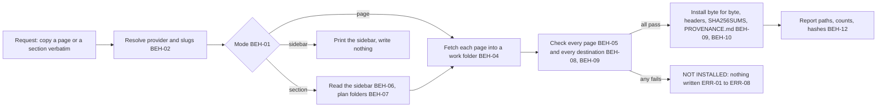

# SPEC-018 — Research capture skill: copy documentation pages verbatim, with provenance, into docs/research/

> **Status:** version 1, draft, written on 2026-10-30 at Bryan's request. Not reviewed, not approved, not built. The
> skill's name, `research-capture`, is proposed (§13 item 1). The workflow it specifies was carried out by hand in
> session `504f8573-69d8-42d7-885a-98c21d37ae70`; that session's scripts and run record are in
> `tmp/plans/2026-10-30-research-capture/` (local, gitignored). The enhancement is issue #133.

## 1. Overview

DevForgeAI's specs cite Anthropic's documentation, and the copies they cite live in `docs/research/` (gitignored,
local only; for example SPEC-014 version 2 cites `docs/research/Claude/subagents.md`). Until now each copy was made
by hand, in no fixed layout and mostly without a record of where and when it came from. On 2026-10-30 Bryan asked
Claude to copy a documentation page "verbatim with full-provenance", then every page of its sidebar section, and
asked that the workflow be remembered and then documented as a plugin enhancement (§1.1).

This spec turns that workflow into a skill of the `devforgeai` plugin, recorded as `SKL-014` in its
`provenance.yaml`. It has one bundled script, `scripts/capture.py` (standard library plus `curl`), with three modes:
1. **`page`** copies one page: it downloads the page's markdown copy byte for byte into
   `docs/research/<Provider>/<slug>/`, with the response headers (cookies removed), a `SHA256SUMS` file and a
   generated `PROVENANCE.md`.
2. **`sidebar`** lists a page's side navigation: groups, links and sub-groups, expanding collapsed sub-groups. It
   writes nothing.
3. **`section`** copies every page in a page's side navigation, one folder per sidebar group:
   `docs/research/<Provider>/<slug1>/<group>/`, with a sub-group nested inside its group's folder.

The bytes go from `curl` to disk and never through the conversation; Claude reports paths, counts and hashes, never
page text (BEH-03).

**Scope, version 1.** Every behaviour here was carried out, or its mechanism probed, in Claude Code's terminal on
2026-10-30/31 (§2, "Verified"). The only site it was carried out on is `code.claude.com`, which serves a markdown copy
of each page at the page's address plus `.md`, with a "Documentation Index" note at its top. The script captures only
pages that pass those checks (BEH-05) and refuses every other page (ERR-01). It doesn't convert HTML to markdown,
because a converted page is no longer the site's own bytes. Whether the skill should cover other providers, and what
"verbatim" means for a site with no markdown copy, is Bryan's decision before approval (§13 item 2). A side agent
raised this during drafting, and Bryan relayed it.

**What this can't guarantee:**
- The sidebar is read from the site's HTML, whose markup belongs to the site's documentation platform (Mintlify,
  client `0.0.4043` when probed). If the markup changes, the script refuses (ERR-02) instead of guessing.
- A skill loads when its description matches the request; automatic use is best effort, and
  `/devforgeai:research-capture` always loads it.
- Network access inside `claude plugin eval` runs is not verified (§2, N1); the e2e evals depend on it (§13 item 3).

### 1.1 The session this documents

Times are UTC on 2026-10-31 (Bryan's local date was 2026-10-30, UTC−4). Claude Code ran in auto mode, with Bash in
its sandbox. Bryan's words are quoted exactly.

| # | Bryan's request (verbatim) | What Claude did | Who decided |
|---|---|---|---|
| 1 | "copy the markdown text from the following site verbatim with full-provenance and store it in `\\wsl$\Ubuntu\home\bryan\Projects\DevForgeAI\docs\research\<provider>\<slug>\` where `<provider>` is claude and `<slug>` is plugins.  remember for when we document your workflow to do this work." with `https://code.claude.com/docs/en/plugins/overview` | Checked `git check-ignore` (`.gitignore:37: docs/research/`) and saw an existing `docs/research/Claude/`. At 03:27:43 downloaded `…/plugins/overview.md` with `curl -sS -L -D -o -w` into the session scratchpad (HTTP/2 200, `text/markdown`, 14,519 bytes); a GET of the page URL gave 200 `text/html`. Copied it with `cp` to `docs/research/claude/plugins/overview.md` (sha256 `9124d73f…64ad`, matching the download), saved the headers without the two `set-cookie` lines, hand-wrote `PROVENANCE.md`, and saved the procedure to Claude's memory. Flagged that `claude/` now sat beside `Claude/` | Layout and names: Bryan. Method (`.md` copy, `cp`, cookies dropped, the provenance fields): Claude |
| 2 | "merge your folder with Claude" | `mv -n claude/plugins Claude/plugins`, `rmdir claude` (about 03:30); the hash still matched; updated the paths in `PROVENANCE.md` and the memory | Bryan: the provider folder is the existing `Claude/` |
| 3 | "what are the link names in the side navigation along with their group names?" | Downloaded the page's HTML and parsed its sidebar: 8 groups and 25 links, with two collapsed sub-groups under Mods. Found their pages in `/docs/llms.txt`, downloaded two of them (`mods/interface`, `mods/test`), whose sidebars showed those sub-groups expanded, and answered with the 8 groups and 31 links | — |
| 4 | "copy the markdown text from the site verbatim with full-provenance for each subgroup, create a new folder in `\\wsl$\Ubuntu\home\bryan\Projects\DevForgeAI\docs\research\<provider>\<slug1>\<slug2>` where `<provider>` is claude and `<slug1>` is plugins and the subgroups are `<slug2>`" | Wrote `capture.py`. It downloaded 30 pages between 03:38:30 and 03:38:42 into a fresh folder and checked each one: status 200 for the page and its `.md`, `text/markdown`, no redirect, the Documentation Index note at the top, an H1. It then downloaded the three sidebar pages again (03:38:42–43) and only after that installed the pages, refusing to overwrite anything. Every page came from deployment `dpl_4RHMRqtvdHvKgaEfTTjFqjzja3B6`. `sha256sum -c` passed in all 9 folders. Then, by hand: renamed `response-headers.txt` to `overview.response-headers.txt`, added a top-level `SHA256SUMS` (03:39:00) and appended a "Sidebar as served" section to the top-level `PROVENANCE.md` | One folder per sidebar group: Bryan. `Claude/` for "claude": Bryan's choice in row 2. The Plugins group as `plugins/` itself, the nesting, the file names and the generated provenance format: Claude |
| 5 | (Claude asked whether to delete the older copies in `docs/research/Claude/mods/`: 9 files, no provenance) "yes - delete them as they are older copies" | `rm -r docs/research/Claude/mods` raised Claude Code's confirmation ("delete 9 files (252 KB)"); Bryan pressed Cancel. Bryan: "i'll take care of it." The folder was gone when Claude next listed it | Bryan deletes, by hand |
| 6 | "document the workflow you performed in docs/specs/spec for a plugin enhancement use an original spec-xxx.md in that folder as your template/guide" and "document your workflow in full-fidelity, zero ambiguity and nothing aspriational is it must work within the confines of claude code terminal.  consult with /advisor for guidance and approach" | This spec, after a spec-lookup (§2), the advisor's guidance, and the probes in §2 | Bryan: a spec, after SPEC-014's form |
| 7 | A side agent's note, relayed by Bryan during drafting: verbatim copies are tested only on Claude's docs; decide whether the skill covers only them, or what "exact copy" means for other sites, before approval | Version 1 is limited to pages that pass BEH-05's checks, and the decision is §13 item 2 | Open: Bryan |

The session's own scripts were drafts. Its `sidebar.py` printed a flat list; the parser this spec specifies
(BEH-06) was probed afterwards with `tmp/plans/2026-10-30-research-capture/sidebar_model.py`. Its `capture.py`
hard-coded the 30 pages and the overview's deployment. This spec specifies what the skill does, not those drafts.

## 2. Constraints

- **PRD-001 NFR-001 to NFR-003** (version 14, a draft): SKILL.md is at most 500 lines and its description at most
  1024 characters; the frontmatter validates against `skill-frontmatter.schema.json` and `skill.schema.json`; the
  skill has a `claude plugin eval` suite run against the no-plugin baseline, every case at 0.8 or above over 3 runs.
- **ADR-001** (version 4): built in a worktree from `src/claude/DevForgeAI/`; the owner deploys; evals run from a plain
  terminal.
- **No PRD-001 requirement covers capturing research.** `find_spec.py` on 2026-10-30 found "curl", "mirror
  documentation", "SPEC-018" and "SKL-014" in none of 32 files. The only mention is ADR-007 version 2, lines 341–342:
  the user said the research "will be slated for another skill", a remark recorded with the ui decision. This spec
  follows Bryan's request of 2026-10-30 directly; whether PRD-001 gains a requirement is §13 item 6.
- **Local reference copies only.** The copies are third-party pages kept for reference. They go only where git
  ignores them (BEH-08), are never committed by this skill, and their text never enters the conversation (BEH-03).
- **The skill deletes, moves and renames nothing** (BEH-12). In the session, Claude Code's confirmation stopped a
  delete, and Bryan chose to do it himself (§1.1 row 5).
- **Standard library plus `curl`.** The script imports only Python's standard library and runs under `python3 -I`.
  It fetches with the `curl` executable, the tool verified in the session (V1), not with `urllib` (not tried).

### Verified (2026-10-30/31, Claude Code terminal, auto mode, Bash in the sandbox)

| # | Fact | Evidence |
|---|---|---|
| V1 | `curl 8.18.0` in the Bash tool reaches `https://code.claude.com`. For 31 of 31 pages, `<page URL>.md` answered HTTP/2 200 with `text/markdown; charset=utf-8` and no redirect, and the page URL answered 200 with `text/html; charset=utf-8` | `docs/research/Claude/plugins/**/PROVENANCE.md`; `tmp/plans/2026-10-30-research-capture/capture-run-meta.json` |
| V2 | Each of the 31 bodies starts with the line `> ## Documentation Index` and has a line starting `# ` (its title) | as V1 |
| V3 | Response headers sent with every page: `date`, `last-modified`, `cf-cache-status` (`HIT` for all 31), `age`, `x-served-version` (one value for all 31: `dpl_4RHMRqtvdHvKgaEfTTjFqjzja3B6`), `x-mintlify-client-version` (`0.0.4043`), `link` (with `rel="llms-txt"`), and two `set-cookie` lines (a geo cookie and a `__cf_bm` bot-management token) | `docs/research/Claude/plugins/**/*.response-headers.txt` (cookies removed) |
| V4 | The sidebar markup of three pages (`plugins/overview`, `plugins/mods/interface`, `plugins/mods/test`) matches BEH-06's rules R1 to R5: 8 groups; 25, 29 and 27 links; every link's `data-title` equals its link text; no link outside R3 | `tmp/plans/2026-10-30-research-capture/sidebar_model.py`, `sidebar-model-output.jsonl` |
| V5 | A collapsed sub-group's button has `aria-expanded="false"` and `data-nav-href`, which names its first page without the site's `/docs` base. That page's HTML shows the sub-group expanded (`aria-expanded="true"`) with its links: 2 of 2 (Build: 4 links, Test and troubleshoot: 2) | as V4 |
| V6 | `https://code.claude.com/docs/llms.txt` lists exactly the 31 sidebar pages of the plugins section. Not used by the skill (§12) | session probe |
| V7 | Python 3.14.4: `html.parser`, `hashlib`, `shutil.copyfile` and `tempfile.mkdtemp` work in the Bash tool (`$TMPDIR` unset; `mkdtemp` used `/tmp`) | session probe |
| V8 | `python3 -I -m http.server --bind 127.0.0.1 <port>` runs inside the Bash sandbox, on port 8765 and on port 0 (it printed the free port it took), and `curl` gets 200 from it, with `text/markdown` for a `.md` file | session probe |
| V9 | `git check-ignore` exits 0 for a path under `docs/research/` in this repository (`.gitignore:37`) | session probe |
| V10 | `cp`, `mv` and Python's file writes under `docs/research/` ran with no permission prompt in auto mode. `rm -r` of 9 files raised Claude Code's confirmation "delete 9 files (252 KB)" | §1.1 rows 1, 2, 4, 5 |
| V11 | The Linux file system keeps `claude/` and `Claude/` as two folders; Bryan chose the existing `Claude/` | §1.1 rows 1, 2 |
| V12 | The group slug rule of BEH-07 turns the 8 group names and 2 sub-group names into the 9 folder names used (`use-plugins`, `create-plugins`, `mods`, `mods/build`, `mods/test-and-troubleshoot`, `run-a-marketplace`, `manage-plugins-for-your-organization`, `troubleshooting`, `reference`) | session probe |

### Not verified (each is a question in §13, never a behaviour)

- **N1** Outbound network, and `127.0.0.1`, inside a `claude plugin eval` run.
- **N2** Any site other than `code.claude.com`, other Mintlify sites included.
- **N3** Mintlify markup in any client version other than `0.0.4043`.
- **N4** Claude Code's default permission mode, where each Bash call may prompt; only auto mode was used.
- **N5** The `\\wsl.localhost\<distro>\` path form, and Claude Code running natively on Windows.
- **N6** Paths the session never took: a page already captured with identical bytes (the overview was left out of
  the section run's list by hand), a page whose bytes changed, two deployments in one run, a sub-group in the start
  page's own group, and a sub-group inside a sub-group.

## 3. Architecture and components

```
src/claude/DevForgeAI/skills/research-capture/
├── SKILL.md                 # when to capture, which mode, the rules on content and deletion, the report
├── provenance.yaml          # SKL-014, implements SPEC-018
└── scripts/
    └── capture.py           # page | sidebar | section (IF-01 to IF-03); standard library plus curl
src/claude/DevForgeAI/evals/research-capture/<case>/   # one case per automated e2e VER item (§9)
src/tests/research-capture/                            # capture.py's tests, fixtures and make_evals.py (not deployed)
CLAUDE.md                                               # the skill table's row (this repository only)
```



The skill has no `assets/` folder: the script writes every file.

## 4. Data model

**Destination.** All paths are relative to the project root, the Bash working directory.

```
docs/research/<Provider>/<slug>/                 # page mode
docs/research/<Provider>/<slug1>/                # section mode: the start page's group
docs/research/<Provider>/<slug1>/<group>/        # section mode: every other group
docs/research/<Provider>/<slug1>/<group>/<sub>/  # section mode: a sub-group
```

Each folder holds, for each page `<name>` installed in it:

| File | Content |
|---|---|
| `<name>.md` | The response body of `<page URL>.md`, copied byte for byte from the download |
| `<name>.response-headers.txt` | The response's last header block (the one after any redirect), byte for byte, minus every line that starts with `set-cookie:` in any letter case |
| `SHA256SUMS` | One line per page, `<sha256 hex>  <name>.md` (two spaces), the format `sha256sum -c` reads; lines are appended |
| `PROVENANCE.md` | The record of BEH-10; sections are appended |

`<name>` is the last segment of the page's URL path (`/docs/en/plugins/mods/admin` gives `admin`).

**Sidebar.** The parse (BEH-06) gives an ordered list of groups. Each group has a name and an ordered list of
entries. An entry is either a link (label, path) or a sub-group (name, expanded or not, `data-nav-href` when
collapsed, ordered links).

**Run record.** For each page the script keeps: the sidebar label (section mode), the H1 title, the page URL with its
status and content type, the fetched URL with the status line, content type and effective URL, the UTC time just
before the fetch, the headers of V3, the sha256, the byte and line counts, and whether the body is ASCII and ends with
a newline. It writes the run record as `run.json` in the work folder, which stays on disk (BEH-04).

## 5. Interfaces and contracts

```yaml
# Proposed SKILL.md frontmatter (validated by src/schemas/skill-frontmatter.schema.json)
name: research-capture
description: Copies documentation pages verbatim, with full provenance, into the project's docs/research/ folder under a provider folder and a slug, one page or every page of a page's side navigation, one folder per sidebar group, using a bundled script that downloads each page's markdown copy byte for byte and records URLs, times, response headers and sha256 sums. Also lists a documentation page's side navigation, its groups and links. Use when the user asks to copy, save, capture or archive a documentation page or section verbatim or with provenance into docs/research, or asks for the link names and groups of a docs page's sidebar. Not for summarizing a page, answering questions from documentation, or editing saved copies.
argument-hint: "[page URL] [provider] [slug]"
metadata:
  devforgeai-id: "SKL-014"
  devforgeai-version: "<SKL-014's provenance.yaml version, quoted>"
  devforgeai-tracked: "false"
```

- **The name is `research-capture`** (proposed, §13 item 1), so the command is `/devforgeai:research-capture`.
- **Tools the instructions use** (no `allowed-tools`, as for the other skills): Bash only to run
  `python3 -I ${CLAUDE_SKILL_DIR}/scripts/capture.py`; AskUserQuestion for ERR-03, ERR-05, ERR-06 and ERR-10. No
  Read, Write, Edit or WebFetch.
- **Paths in a request.** A Windows path of the form `\\wsl$\<distro>\<path>` (the only form seen, §1.1) stands
  for the Linux path `/<path>`, each `\` read as `/`. The part after `<project root>/docs/research/` gives the
  provider and the slugs, in the order the request's placeholders give them.

| Item | Command | Behaviour |
| --- | --- | --- |
| IF-01 | `python3 -I capture.py sidebar URL` | Prints URL's sidebar in the format below, with each collapsed sub-group expanded (BEH-06). Writes nothing outside its work folder. Exit 0 when printed; 1 when the markup isn't recognised (ERR-02); 2 when it can't run (ERR-04, ERR-07, ERR-11) |
| IF-02 | `python3 -I capture.py page --provider P --slug S --session ID URL` | Captures URL into `docs/research/<Provider>/<slug>/` (BEH-02, BEH-04, BEH-05, BEH-08 to BEH-11). Exit 0 when every page is installed or identical; 1 when it refused and wrote nothing in `docs/research/` (ERR-01, ERR-03, ERR-05, ERR-06); 2 when it can't run |
| IF-03 | `python3 -I capture.py section --provider P --slug S --session ID URL` | Captures every page of URL's sidebar, as BEH-07 places them, with exit codes as IF-02. ERR-02 and ERR-08 also give 1 |

`ID` is `${CLAUDE_SESSION_ID}`, written in SKILL.md, which Claude Code expands to the session's ID (SPEC-002 §5's
precedent). The script runs from the project root.

**Output formats.** IF-01, one line each, in sidebar order:

```text
## <group name>
- <link label>  <path>
- <sub-group name> (sub-group, expanded from <path of its data-nav-href page>)
  - <link label>  <path>
<n> pages in <g> groups; sidebar of <URL> fetched <UTC time>
```

IF-02 and IF-03, after the fetch:

```text
installed  <path from the project root>  <bytes>B  <first 16 hex digits of the sha256>
identical  <path from the project root>  (already captured with the same sha256)
...
<i> installed, <d> identical, in <f> folders under docs/research/<Provider>/<slug>/
deployments: <x-served-version>[, <other> (pages: <names>)]
check: sha256sum -c SHA256SUMS in each folder: <f> of <f> pass
work folder: <path>
other entries in docs/research/<Provider>/: <names of the entries one level down not written by this run, or none>
```

On a refusal the output is `NOT INSTALLED:`, then one line per failed check, `<page URL or path>: <reason>`.

## 6. Behavior

```yaml items
behaviors:
  - id: BEH-01
    status: active
    rule: "Load on a request to copy, save, capture or archive a documentation page or section verbatim or with provenance into docs/research/, or on a question about a docs page's side navigation. Choose the mode from the request: a question about the side navigation's links or groups runs sidebar (IF-01); a request naming every page of a section, each subgroup, each group or the side navigation runs section (IF-03); any other capture runs page (IF-02). Run the script once per request, as a command of its own, from the project root."
  - id: BEH-02
    status: active
    rule: "Destination. The provider and slugs come from the request (section 5, Paths in a request); a destination that isn't under the project's docs/research/ is ERR-10. The script normalises each slug by the slug rule of BEH-07. Provider folder: when exactly one folder directly under docs/research/ has a name equal to the provider ignoring letter case, the script uses it as it is spelled (claude gives the existing Claude/); when none does, it creates docs/research/<provider as given>/; when two or more do, ERR-06. The report names the provider folder used."
  - id: BEH-03
    status: active
    rule: "Only capture.py fetches pages and writes the copies. Claude never fetches a page by WebFetch or any other tool, never reads a copy into the conversation, never writes or edits a copy, and never quotes page text in a reply: the reply gives paths, counts, sha256 sums, statuses, sidebar labels and the script's report lines only."
  - id: BEH-04
    status: active
    rule: "Fetching. The script makes a work folder with tempfile.mkdtemp(prefix='research-capture-'), keeps it after the run and prints its path. Before anything is installed it fetches every page of the run, in sidebar order, each as: the UTC time to the second; then curl -sS -L -D <work>/<n>.headers -o <work>/<n>.md -w '%{http_code}\\t%{url_effective}\\t%{content_type}\\t%{size_download}' '<page URL>.md'; then curl -sS -L -o /dev/null -w (the same format) '<page URL>'. The page URL is the URL given with any #fragment removed and a trailing .md removed. It writes run.json (section 4) to the work folder."
  - id: BEH-05
    status: active
    rule: "Checks, every one for every page, before anything is installed: C1 the .md fetch's status is 200; C2 the page URL's status is 200; C3 the .md content type starts with text/markdown; C4 the .md effective URL equals the fetched URL (no redirect); C5 the body decodes as UTF-8; C6 the body's first line is exactly '> ## Documentation Index'; C7 the body has a line starting '# '. The first such line, without '# ', is the page title. Any failure is ERR-01 for the whole run."
  - id: BEH-06
    status: active
    rule: "Reading the sidebar of a page's HTML (fetched with curl as BEH-04's page URL fetch, kept in the work folder). R1: the container is the element with id sidebar-content; none is ERR-02. R2: each element whose class has the token sidebar-group is a group, named by the whitespace-collapsed text of the last element with class token sidebar-group-header that closed before it; a group with no such header is ERR-02. R3: an li with a data-title attribute and an id starting '/' is a link, labelled by its data-title, its path being the href of the first a inside it. R4: an li with a data-title and no such id is a sub-group named by its data-title; the first button inside it gives aria-expanded and, when that is 'false', data-nav-href; its links are the R3 links inside it; a sub-group with no button, with an aria-expanded other than 'true' or 'false', or collapsed with no data-nav-href, and a sub-group inside a sub-group, are ERR-02. R5: an a element inside the container that is not inside an R3 link is ERR-02. The start page's link is the R3 link whose path equals the start URL's path (after BEH-04's removals); none is ERR-02. Base path: the start URL's path with that link's li id removed from its end (/docs for /docs/en/plugins/overview and li id /en/plugins/overview); an li id that isn't the path's end is ERR-02. R6: for each collapsed sub-group, in sidebar order, the script fetches the HTML of the start URL's scheme and host, the base path and its data-nav-href, parses it with R1 to R5, and takes the links of the sub-group with the same group name and sub-group name, which must have aria-expanded 'true' and at least one link; otherwise ERR-02. The sidebar's pages are its links in order, a sub-group's links in its place."
  - id: BEH-07
    status: active
    rule: "Section plan. The slug of a name is the name in lower case with every run of characters other than a to z and 0 to 9 replaced by one hyphen and leading and trailing hyphens removed. The group holding the start page's link is placed in docs/research/<Provider>/<slug1>/ itself; every other group in <slug1>/<group slug>/; a sub-group in its group's folder followed by <sub-group slug>/; a link directly in a group in that group's folder. Each page's file is <name>.md (section 4). Two groups or two sub-groups of one group with the same slug, two pages with the same <name> in one folder, or one page path appearing twice in the sidebar is ERR-08, found before any page is fetched."
  - id: BEH-08
    status: active
    rule: "Every file the run would write in docs/research/ must be ignored by git: the script runs git check-ignore -q '<path>' for each and needs exit 0 for all, before anything is installed. Exit 1 for any is ERR-03; exit 128, or no git, is ERR-04."
  - id: BEH-09
    status: active
    rule: "Installing, only after every page passed BEH-05 and every destination passed BEH-08 and the rules here. For each page: when <name>.md exists in its folder with the same sha256 as the download, the page is identical: nothing is written for it, and the report lists it as identical. When <name>.md exists with another sha256, or <name>.response-headers.txt exists without <name>.md, the run is ERR-05, found before anything is installed. Otherwise the script copies the download with shutil.copyfile, computes the copy's sha256 and compares it with the download's (a difference is ERR-09), writes <name>.response-headers.txt (section 4), appends the page's line to the folder's SHA256SUMS (creating it), and appends the page's section to the folder's PROVENANCE.md (BEH-10). There is no option to overwrite."
  - id: BEH-10
    status: active
    rule: "PROVENANCE.md. When a folder has none, the script creates it with: the heading '# Provenance: <Provider>/<path under the provider folder>'; a two-column table with the rows Tool (the curl version line's first field and number, the two curl commands of BEH-04, and the Python version), Copied with (shutil.copyfile from the download: not edited, reformatted or re-encoded; the Documentation Index note is part of the served document), Check (sha256sum -c SHA256SUMS in this folder), Repository (git ignores this folder: local reference copies, not part of the repository) and, in section mode, Sidebar group (the group's name, then ' › ' and the sub-group's name for a sub-group, and the relative path to slug1's PROVENANCE.md); then a Files table describing the four files of section 4; then '## Pages'. For each installed page it appends '### `<name>.md`' and a table with the rows: Sidebar label (section mode); Page title (H1); Page URL (status, content type); Fetched URL (status line, content type, no redirect); Fetched at (UTC) (the time, and the server date header); Content last modified (last-modified, cf-cache-status and age, noting that a cache hit makes last-modified, not the fetch time, date the content); Docs deployment (x-served-version, 'same as' or 'DIFFERS from' the run's first page's, and x-mintlify-client-version); Captured in (Claude Code session <ID>); sha256; Size (bytes, lines, ASCII or UTF-8, ends with a newline or not). A header that wasn't sent reads 'not sent'. In section mode it appends to slug1's PROVENANCE.md '## Sidebar as served <UTC time>': the start URL and the URL of each R6 page with its fetch time and status, and a table with a row per group or sub-group: name, folder, and pages as '<label> → <name>.md'. Text already in a PROVENANCE.md is never changed."
  - id: BEH-11
    status: active
    rule: "Deployment check: the script compares each page's x-served-version with the run's first page's. Pages that differ are still installed; PROVENANCE.md marks them DIFFERS and the report's deployments line names them. Claude tells the user that the run spans two deployments and that a later run can capture the earlier pages again under a new slug."
  - id: BEH-12
    status: active
    rule: "Reporting and leaving things alone. Claude's reply after a run gives: the folders written with their page counts (as a tree for section mode), the installed and identical counts, the sha256 check line, the deployment line, the provider folder used, and the script's 'other entries' line. It says older copies among those entries are for the user to judge and remove. Neither the script nor Claude deletes, moves or renames any file or folder, and nothing is committed. The work folder's path is given as evidence."
  - id: BEH-13
    status: active
    rule: "The skill is untracked: SKILL.md's metadata holds devforgeai-tracked \"false\" (SPEC-013 BEH-02), so loading it opens, ends and pauses no tracked run, and it may be used in the middle of another DevForgeAI skill's workflow."
  - id: BEH-14
    status: active
    rule: "When the script exits 1 or 2, Claude quotes its NOT INSTALLED or error lines, writes nothing, and doesn't retry by another route. For ERR-03, ERR-05, ERR-06 and ERR-10 Claude asks the user with AskUserQuestion when available, otherwise in plain text, offering only the choices those items list, and runs the script again only with the user's answer."
```

## 7. Errors and edge cases

```yaml items
errors:
  - id: ERR-01
    status: active
    condition: "A page fails one of BEH-05's checks C1 to C7"
    handling: "Print NOT INSTALLED and one line per failure; install nothing; exit 1. Claude reports it; when C6 failed (no Documentation Index note), Claude says version 1 captures only pages whose site serves a markdown copy with that note, verified on code.claude.com only"
    user_result: "No copy, the failed checks, and why"
  - id: ERR-02
    status: active
    condition: "The sidebar markup breaks a rule of BEH-06 (R1 to R6)"
    handling: "Print which rule and the page; write nothing in docs/research/; exit 1"
    user_result: "No copy and no list; the rule that failed, which says the site's markup isn't the one verified"
  - id: ERR-03
    status: active
    condition: "git doesn't ignore a destination path (git check-ignore exits 1)"
    handling: "Install nothing; exit 1. Claude names the path and the line to add to .gitignore (docs/research/), and asks whether the user adds it; the skill edits no .gitignore"
    user_result: "No copy until the user ignores the folder"
  - id: ERR-04
    status: active
    condition: "The project root isn't in a git repository, or git isn't installed (git check-ignore exits 128 or can't start)"
    handling: "Install nothing; exit 2"
    user_result: "No copy; the reason"
  - id: ERR-05
    status: active
    condition: "A page's <name>.md already exists with another sha256, or its headers file exists without it"
    handling: "Install nothing; exit 1, naming each such file. Claude asks: leave the existing copies (do nothing), or capture into a new slug the user names"
    user_result: "The existing copies unchanged"
  - id: ERR-06
    status: active
    condition: "Two or more folders under docs/research/ equal the provider ignoring case"
    handling: "Install nothing; exit 1, naming them. Claude asks which to use; merging them is the user's"
    user_result: "No copy until the user picks a folder"
  - id: ERR-07
    status: active
    condition: "curl is missing, or a curl call exits non-zero (no network, DNS, TLS)"
    handling: "Install nothing; exit 2, quoting curl's error"
    user_result: "No copy; curl's error"
  - id: ERR-08
    status: active
    condition: "The section plan has two folders with one slug, two pages with one file name in a folder, or a page path twice (BEH-07)"
    handling: "Install nothing; exit 1, naming the clash"
    user_result: "No copy; the clash"
  - id: ERR-09
    status: active
    condition: "A copy's sha256 differs from its download's"
    handling: "Stop at once; exit 1; list the files written so far, which stay, and the page that failed"
    user_result: "The partial result, listed; nothing removed"
  - id: ERR-10
    status: active
    condition: "The request's destination isn't under the project's docs/research/, or gives no provider or slug"
    handling: "Claude runs nothing and asks for the provider and slug(s)"
    user_result: "A question"
  - id: ERR-11
    status: active
    condition: "The URL isn't http or https, has a query string, or a required option is missing"
    handling: "Print the usage line; exit 2"
    user_result: "No copy; the usage"
```

## 8. Non-functional design

```yaml items
quality_responses:
  - id: QR-01
    status: active
    response: "SKILL.md holds when to load, the mode choice, the rules on content, deletion and asking, and the report; the formats live in this spec and the script"
    measured_by: "SKILL.md line count (at most 500) and description length (at most 1024 characters)"
    upstream:
      - {id: PRD-001, item: NFR-001, relation: satisfies, version: 14, hash: null}
  - id: QR-02
    status: active
    response: "Frontmatter limited to the fields in section 5; provenance in provenance.yaml; metadata values quoted, devforgeai-version equal to the provenance version, devforgeai-tracked \"false\""
    measured_by: "skill-frontmatter.schema.json and skill.schema.json, and comparing the two version values"
    upstream:
      - {id: PRD-001, item: NFR-002, relation: satisfies, version: 14, hash: null}
  - id: QR-03
    status: active
    response: "One eval case per automated e2e VER item, tagged research-capture and ver-NN, run against the no-plugin baseline, every case at 0.8 or above over 3 runs, or Bryan's recorded waiver"
    measured_by: "claude plugin eval --threshold 0.8 over 3 runs"
    upstream:
      - {id: PRD-001, item: NFR-003, relation: satisfies, version: 14, hash: null}
```

## 9. Verification

| Kind | Status |
|---|---|
| Structural: this spec against `spec.schema.json` | Passes, with every BEH, ERR, QR and IF item covered by a VER item (31 items; checked 2026-10-30, version 1, with `src/tests/precompact/test_structure.py`'s `spec_document` and `errors` helpers; VER-04 makes it a test) |
| The session's run (§1.1, §2 V1 to V12) | Evidence for the mechanisms, not a test of the skill: 31 pages in `docs/research/Claude/plugins/`, `sha256sum -c` passing in all 10 folders. Those files came from the session's drafts. The overview's `PROVENANCE.md` is hand-written, and the others say "Requested by" where BEH-10 says "Captured in", so they don't follow BEH-10 exactly |
| Unit, structural, e2e and manual VER items | Not built |

**Fixtures.** The tests use no page from any real site. `src/tests/research-capture/fixtures/` holds a small,
hand-written site: markdown pages with the Documentation Index note and an H1, and HTML pages whose sidebar uses the
attributes of V4 and V5 (two groups, one with a collapsed sub-group). VER-01 to VER-03 serve it with
`python3 -I -m http.server --bind 127.0.0.1 0` (V8), in a temporary git repository whose `.gitignore` holds
`docs/research/`. `http.server` sends no `x-served-version`, so those fields read "not sent".

```yaml items
verifications:
  - id: VER-01
    status: active
    obligation: "src/tests/research-capture/test_capture.py, page mode against the fixture server: the copy's bytes and sha256 equal the served file's; the headers file holds the last header block minus set-cookie lines (a fixture handler adds two); SHA256SUMS passes sha256sum -c; PROVENANCE.md has BEH-10's heading, rows and 'not sent' values; each of C1 to C7 fails on its own fixture (404 page, 404 .md, text/plain, a redirect, invalid UTF-8, no note, no H1) with NOT INSTALLED, exit 1 and no file in docs/research/; a second identical run reports identical and writes nothing; a changed fixture gives ERR-05 and leaves the first copy unchanged; a destination git doesn't ignore gives ERR-03; a folder outside git gives ERR-04; an existing Claude/ is used for --provider claude, and both claude/ and Claude/ give ERR-06; a #fragment and a trailing .md are removed from the URL; a query string gives ERR-11; the work folder exists afterwards and holds run.json; and no file outside docs/research/ and the work folder is changed."
    level: unit
    covers:
      - IF-02
      - BEH-02
      - BEH-04
      - BEH-05
      - BEH-08
      - BEH-09
      - BEH-10
      - ERR-01
      - ERR-03
      - ERR-04
      - ERR-05
      - ERR-06
      - ERR-11
  - id: VER-02
    status: active
    obligation: "src/tests/research-capture/test_sidebar.py: on the fixture HTML, IF-01 prints the groups, links and the collapsed sub-group expanded from its data-nav-href page in section 5's format, and writes nothing; the base path is derived as BEH-06 says; each of R1 to R6 fails on its own fixture (no container, a group with no header, a sub-group with no button, an aria-expanded of 'maybe', a collapsed sub-group with no data-nav-href, a sub-group inside a sub-group, a stray link, a start page not in its own sidebar, a data-nav-href page whose sub-group is still collapsed) with ERR-02. The slug rule turns the 8 group names and 2 sub-group names of section 2 V12 into its 9 folder names."
    level: unit
    covers:
      - IF-01
      - BEH-06
      - BEH-07
      - ERR-02
  - id: VER-03
    status: active
    obligation: "src/tests/research-capture/test_section.py, section mode against the fixture site: the start page's group lands in <slug1>/, the other group in <slug1>/<group slug>/, the sub-group nested in it; slug1's PROVENANCE.md gains the Sidebar as served section; each group folder's PROVENANCE.md names its group; a fixture with two pages of one name in a group gives ERR-08 before any fetch; a fixture whose second page sends another x-served-version (a handler adds the header) installs both and marks DIFFERS; curl replaced on PATH by a stand-in exiting 6 gives ERR-07 and exit 2; a copy step forced to corrupt one file gives ERR-09 with the files written so far listed and none removed; and the report's other-entries line names a pre-existing sibling folder."
    level: unit
    covers:
      - IF-03
      - BEH-07
      - BEH-11
      - BEH-12
      - ERR-07
      - ERR-08
      - ERR-09
  - id: VER-04
    status: active
    obligation: "src/tests/research-capture/test_structure.py: SKILL.md is at most 500 lines and its description at most 1024 characters with no angle brackets; the frontmatter has only section 5's fields, with devforgeai-tracked \"false\"; metadata.devforgeai-id and devforgeai-version equal provenance.yaml's id and version; SKILL.md names Bash and AskUserQuestion as its tools and none of Read, Write, Edit or WebFetch as a tool to use; it says never to quote page text, never to delete, move or rename, and to ask for ERR-03, ERR-05, ERR-06 and ERR-10; capture.py imports only the standard library; this repository's CLAUDE.md has a research-capture row; SPEC-018 validates against spec.schema.json and every BEH, ERR, QR and IF item is covered by a VER item."
    level: unit
    covers:
      - QR-01
      - QR-02
      - BEH-01
      - BEH-03
      - BEH-12
      - BEH-13
      - BEH-14
      - ERR-10
  - id: VER-05
    status: active
    obligation: "Eval cases, if §13 item 3's probe shows a local server reachable in an eval run: the scaffold starts the fixture server and a git repository ignoring docs/research/. (a) capture-page: the prompt asks to copy the fixture page verbatim into docs/research/claude/<slug>; the trace runs capture.py page, the copy's sha256 equals the fixture's, and the last message holds the installed line and no line of the page's text; (b) refuse-unmarked: a fixture page without the note; the reply reports ERR-01 and no file is written; (c) triggers: 'copy this docs page verbatim with provenance into docs/research' loads the skill; 'summarize this docs page' and 'save my notes to docs/research/notes.md' don't. If the probe fails, these become manual items run live, and QR-03 needs Bryan's recorded waiver."
    level: e2e
    covers:
      - BEH-01
      - BEH-03
      - ERR-01
  - id: VER-06
    status: active
    obligation: "Live, in Bryan's terminal with --plugin-dir on the build, in a scratch project whose .gitignore holds docs/research/: (a) the request of section 1.1 row 1 with that project's path captures https://code.claude.com/docs/en/plugins/overview, and the reply quotes no page text; (b) row 4's request captures the plugins section into 9 folders under one slug1, with 31 pages in all and sha256sum -c passing in every folder; (c) row 3's question prints 8 groups with both sub-groups expanded; (d) repeating (a) reports identical; (e) a page of a site with no markdown copy is refused with ERR-01; (f) with an older copy beside the new folders, the reply lists it in other entries and deletes nothing; (g) the same in Claude Code's default permission mode, recording each prompt shown. Recorded in section 9."
    level: manual
    covers:
      - BEH-01
      - BEH-02
      - BEH-03
      - BEH-12
      - BEH-14
  - id: VER-07
    status: active
    obligation: "The eval suite as QR-03 says, from a plain terminal, or Bryan's recorded waiver in this section."
    level: e2e
    covers:
      - QR-03
```

## 10. Rollout, migration and rollback

- **New skill.** It ships in the next free plugin minor after approval and build (Bryan's convention: a minor per
  cycle). Rolling back is removing `skills/research-capture/`, its evals and tests, and the CLAUDE.md row.
- **Existing copies.** The skill changes no existing file. The 31 copies of §1.1 stay as they are. Whether to
  capture them again with the skill (under a new slug, since BEH-09 never overwrites) is Bryan's decision (§13 item 5).
- **The tracker.** No SPEC-013 change: the skill is untracked through the metadata key that SPEC-013 BEH-02 already
  reads (BEH-13).
- **Codex.** Not ported here; a port is for Codex sessions to build.
- **Records.** CLAUDE.md's skill table gains a `research-capture` row (SKL-014, SPEC-018).

## 11. Implementation plan

After approval, through `/plugin-dev:create-plugin` and `/plugin-dev:skill-development`, on its own branch and
worktree (ADR-001):
1. Run §13 item 3's probe (network inside an eval run) and record it in §9; it decides VER-05's level.
2. Write the fixtures and `test_capture.py`, `test_sidebar.py`, `test_section.py` (VER-01 to VER-03) and
   `test_structure.py` (VER-04); see them fail.
3. Write `scripts/capture.py` until VER-01 to VER-03 pass. The session's drafts and the probe parser,
   `tmp/plans/2026-10-30-research-capture/capture.py`, `sidebar.py` and `sidebar_model.py`, are reference only.
4. Write `SKILL.md` from §5 and §6, and `provenance.yaml` as SKL-014 implementing SPEC-018; add the CLAUDE.md row.
   VER-04 passes.
5. Run plugin-validator and skill-reviewer; take any finding that would refuse valid work to Bryan.
6. Generate and run the eval cases cheapest first, then VER-07 or Bryan's waiver; run VER-06 live; record §9.

## 12. Alternatives considered

| Option | Why not chosen |
|---|---|
| WebFetch | It returns the page after processing, not the site's bytes, and the text passes through the conversation (BEH-03) |
| Saving the page's HTML, or converting HTML to markdown | The HTML isn't the markdown the site publishes, and a conversion changes the bytes; what verbatim means for a site without a markdown copy is §13 item 2 |
| Finding a section's pages in `/docs/llms.txt` | It lists pages by heading, not by sidebar group, and lists one page twice (V6). The sidebar gives the groups; `data-nav-href` expands sub-groups without a lookup |
| `urllib` instead of `curl` | Not tried in the sandbox; `curl` was (V1) |
| Overwriting a changed page, or dated snapshot folders | No decision covers either; the session refused to overwrite. §13 item 4 |
| Warning instead of refusing when git doesn't ignore the destination | The copies are third-party text kept for reference; a refusal with the line to add keeps them out of commits (ERR-03). §13 item 7 |
| Deleting older copies on the user's word | Claude Code's confirmation stopped it, and Bryan chose to delete by hand (§1.1 row 5); the skill lists them instead (BEH-12) |

## 13. Open questions

For Bryan, in order. None of these is a requirement until he decides it.

1. **The name.** `research-capture` is the drafter's proposal. It leaves `research` free for the broader research
   skill ADR-007 mentions.
2. **Providers other than Claude's docs** (raised by a side agent, relayed by Bryan, 2026-10-30). Version 1 captures
   only pages served as markdown with the Documentation Index note, verified on `code.claude.com` only (N2). Decide
   before approval whether the skill covers only Claude's docs, or what an exact copy means for a site without a
   markdown copy (for example, its HTML bytes as served, kept beside a converted copy that is labelled as converted).
3. **Network inside an eval run** (N1). Probe before building: one case scaffolding `python3 -I -m http.server
   --bind 127.0.0.1 8765` in the background and a Bash grader running `curl -sf http://127.0.0.1:8765/`, run as
   `claude plugin eval <plugin> --case <case> --runs 1 --ablation none` from a plain terminal (about a dollar). If it
   fails, VER-05 becomes manual and QR-03 needs a waiver that ends at an event or a date.
4. **A changed page.** Version 1 refuses (ERR-05). Alternatives: a dated snapshot folder beside the old one, or an
   overwrite on the user's explicit word.
5. **The 31 copies of §1.1.** Capture them again with the built skill, under a new slug, so that their provenance
   follows BEH-10 exactly? Not requested.
6. **PRD-001.** No requirement covers capturing research. Should PRD-001 gain one (a version bump), for this spec to
   cite?
7. **The git-ignore refusal** (BEH-08, ERR-03) is the drafter's choice; the session only checked and reported it.
   Keep the refusal, or warn instead?
8. **Paths and platforms** (N4, N5): the default permission mode, `\\wsl.localhost\`, and native Windows were not
   tried. VER-06 (g) covers the default mode; the others are not covered.
9. **Older copies.** In the session Claude recognised the older copies by an earlier listing. The skill lists the
   provider folder's other entries (BEH-12) and judges nothing; matching by page title is possible but was never
   tried.

## Change Log

| Version | Date | Author | Change | Items affected |
|---|---|---|---|---|
| 1 | 2026-10-30 | claude-code (session 504f8573-69d8-42d7-885a-98c21d37ae70) | Initial draft, at Bryan's request of 2026-10-30 to document as a plugin enhancement the capture workflow carried out in this session ("document the workflow you performed in docs/specs/spec for a plugin enhancement"), with the session record (§1.1), the facts verified in Claude Code's terminal (§2) and the side agent's scope note as §13 item 2 | all |
