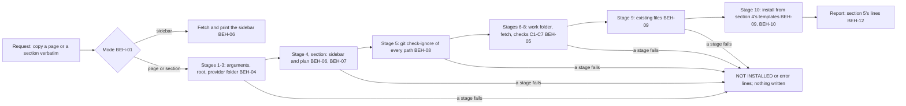

# SPEC-018 — Research capture skill: copy documentation pages verbatim, with provenance, into docs/research/

> **Status:** version 1, draft. Written on 2026-10-30 at Bryan's request and revised on 2026-10-31 after his decisions
> on §13 items 2 and 3, a probe of eval runs, and a cold test of this spec by a fresh Opus 5.5 subagent (§9). Not
> reviewed, not approved, not built. The skill's name, `research-capture`, is proposed (§13 item 1). The workflow was
> carried out by hand in session `504f8573-69d8-42d7-885a-98c21d37ae70`; that session's scripts, the probe plugin and
> the run record are in `tmp/plans/2026-10-30-research-capture/` (local, gitignored). The enhancement is issue #133;
> this spec is in PR #134.

## 1. Overview

DevForgeAI's specs cite Anthropic's documentation, and the copies they cite live in `docs/research/` (gitignored,
local only; for example SPEC-014 version 2 cites `docs/research/Claude/subagents.md`). Until now each copy was made
by hand, in no fixed layout and mostly without a record of where and when it came from. On 2026-10-30 Bryan asked
Claude to copy a documentation page "verbatim with full-provenance", then every page of its sidebar section, and
asked that the workflow be remembered and then documented as a plugin enhancement (§1.1).

This spec turns that workflow into a skill of the `devforgeai` plugin, recorded as `SKL-014` in its
`provenance.yaml`. It has one bundled script, `scripts/capture.py` (Python's standard library, plus the `curl` and
`git` executables), with three modes:
1. **`page`** copies one page: it downloads the page's markdown copy byte for byte into
   `docs/research/<Provider>/<slug>/`, with the response headers (cookies removed), a `SHA256SUMS` file and a
   `PROVENANCE.md` written from §4's template.
2. **`sidebar`** lists a page's side navigation: groups, links and sub-groups, expanding collapsed sub-groups. It
   writes nothing in the project.
3. **`section`** copies every page in a page's side navigation, one folder per sidebar group:
   `docs/research/<Provider>/<slug1>/<group>/`, with a sub-group nested inside its group's folder.

The bytes go from `curl` to disk and never through the conversation; Claude reports paths, counts, hashes, titles
and sidebar labels, never page text (BEH-03).

**Scope, version 1: the MVP.** Every behaviour here was carried out, or its mechanism probed, in Claude Code's
terminal on 2026-10-30/31 (§2, "Verified"). The script captures only pages whose markdown copy passes BEH-05's checks,
which `code.claude.com` passes (V1, V2) and `platform.claude.com` fails (V14: its markdown copy starts with YAML
frontmatter, not the Documentation Index note). It refuses every other page (ERR-01) and converts nothing, because a
converted page is no longer the site's own bytes. Bryan decided on 2026-10-31 that this scope is the MVP: "this is fine
for mvp to demonstrate this workflow" (§13 item 2).

**What this can't guarantee:**
- The sidebar is read from the site's HTML, whose markup belongs to the site's documentation platform (Mintlify,
  client `0.0.4043` when probed). If the markup changes, the script refuses (ERR-02) instead of guessing.
- A skill loads when its description matches the request; automatic use is best effort, and
  `/devforgeai:research-capture` always loads it.
- Eval runs can't exercise the capture. In Claude Code 2.1.314, an eval run's Bash wrote no file and reached no outside
  host (V13), so the capture is checked by unit tests (VER-01 to VER-03) and live items (VER-06, VER-08), and the eval
  suite holds trigger cases only (VER-05; §13 item 3).

### 1.1 The session this documents

Times are UTC on 2026-10-31 (Bryan's local date was 2026-10-30, UTC−4). Claude Code ran in auto mode, with Bash in
its sandbox. Bryan's words are quoted exactly.

| # | Bryan's request (verbatim) | What Claude did | Who decided |
|---|---|---|---|
| 1 | "copy the markdown text from the following site verbatim with full-provenance and store it in `\\wsl$\Ubuntu\home\bryan\Projects\DevForgeAI\docs\research\<provider>\<slug>\` where `<provider>` is claude and `<slug>` is plugins.  remember for when we document your workflow to do this work." with `https://code.claude.com/docs/en/plugins/overview` | Checked `git check-ignore` (`.gitignore:37: docs/research/`) and saw an existing `docs/research/Claude/`. At 03:27:43 downloaded `…/plugins/overview.md` with `curl -sS -L -D -o -w` into the session scratchpad (HTTP/2 200, `text/markdown`, 14,519 bytes); a GET of the page URL gave 200 `text/html`. Copied it with `cp` to `docs/research/claude/plugins/overview.md` (sha256 `9124d73f…64ad`, matching the download), saved the headers without the two `set-cookie` lines, hand-wrote `PROVENANCE.md`, and saved the procedure to Claude's memory. Flagged that `claude/` now sat beside `Claude/` | Layout and names: Bryan. Method (`.md` copy, `cp`, cookies dropped, the provenance fields): Claude |
| 2 | "merge your folder with Claude" | `mv -n claude/plugins Claude/plugins`, `rmdir claude` (about 03:30); the hash still matched; updated the paths in `PROVENANCE.md` and the memory | Bryan: the provider folder is the existing `Claude/` |
| 3 | "what are the link names in the side navigation along with their group names?" | Downloaded the page's HTML and parsed its sidebar: 8 groups and 25 links, with two collapsed sub-groups under Mods. Found their pages in `/docs/llms.txt`, downloaded two of them (`mods/interface`, `mods/test`), whose sidebars showed those sub-groups expanded, and answered with the 8 groups and 31 links | — |
| 4 | "copy the markdown text from the site verbatim with full-provenance for each subgroup, create a new folder in `\\wsl$\Ubuntu\home\bryan\Projects\DevForgeAI\docs\research\<provider>\<slug1>\<slug2>` where `<provider>` is claude and `<slug1>` is plugins and the subgroups are `<slug2>`" | Wrote `capture.py`. It downloaded 30 pages between 03:38:30 and 03:38:42 into a fresh folder and checked each one: status 200 for the page and its `.md`, `text/markdown`, no redirect, the Documentation Index note at the top, an H1. It then downloaded the three sidebar pages again (03:38:42–43) and only after that installed the pages, refusing to overwrite anything. Every page came from deployment `dpl_4RHMRqtvdHvKgaEfTTjFqjzja3B6`. `sha256sum -c` passed in all 9 folders. Then, by hand: renamed `response-headers.txt` to `overview.response-headers.txt`, added a top-level `SHA256SUMS` (03:39:00) and appended a "Sidebar as served" section to the top-level `PROVENANCE.md` | One folder per sidebar group: Bryan. `Claude/` for "claude": Bryan's choice in row 2. The Plugins group as `plugins/` itself, the nesting, the file names and the generated provenance format: Claude |
| 5 | (Claude asked whether to delete the older copies in `docs/research/Claude/mods/`: 9 files, no provenance) "yes - delete them as they are older copies" | `rm -r docs/research/Claude/mods` raised Claude Code's confirmation ("delete 9 files (252 KB)"); Bryan pressed Cancel. Bryan: "i'll take care of it." The folder was gone when Claude next listed it | Bryan deletes, by hand |
| 6 | "document the workflow you performed in docs/specs/spec for a plugin enhancement use an original spec-xxx.md in that folder as your template/guide" and "document your workflow in full-fidelity, zero ambiguity and nothing aspriational is it must work within the confines of claude code terminal.  consult with /advisor for guidance and approach" | This spec, after a spec-lookup (§2), the advisor's guidance, and the probes in §2 | Bryan: a spec, after SPEC-014's form |
| 7 | A side agent's note, relayed by Bryan during drafting: verbatim copies are tested only on Claude's docs; decide whether the skill covers only them, or what "exact copy" means for other sites, before approval | Version 1 is limited to pages that pass BEH-05's checks, and the decision is §13 item 2 | Bryan, row 8 |
| 8 | (After PR #134 and issue #133) on §13 item 2: "this is fine for mvp to demonstrate this workflow"; on item 3: "automation is always good but must be accurate" | Recorded both. Ran item 3's probe: five one-case eval runs from a herdr pane, $0.56 (§9). By Bryan's rule, VER-05 keeps only what an eval run can check accurately, the trigger cases | Bryan: version 1 is the MVP (Claude's docs only); automate only when accurate |
| 9 | "run the workflow you documented as a test for https://code.claude.com/docs/en/skills & https://platform.claude.com/docs/en/agents-and-tools/agent-skills/overview via an opus 5.5 subagent.  this will help determine if a "cold session" is capable of running this workflow exactly as you did." | A fresh Opus 5.5 subagent, given only this spec (told not to read the drafts, the earlier captures or Claude's memory), carried out page mode by hand with provider `claude` and slugs `skills` and `agent-skills` (Claude's choice of slugs). The first page installed (`docs/research/Claude/skills/`, `sha256sum -c` passing); the second was refused at C6, as specified. It found one defect (C7 took a `# ` comment inside a code fence for a title), two contradictions and 34 other places where the spec left a choice open (G1 to G36). This revision closes them (§13 item 10) | Bryan: the test. The closures: Claude, listed in §13 item 10 |

The session's own scripts were drafts. Its `sidebar.py` printed a flat list; the parser this spec specifies
(BEH-06) was probed afterwards with `tmp/plans/2026-10-30-research-capture/sidebar_model.py`. Its `capture.py`
hard-coded the 30 pages and the overview's deployment. This spec specifies what the skill does, not those drafts.

## 2. Constraints

- **PRD-001 NFR-001 to NFR-003** (version 14, a draft): SKILL.md is at most 500 lines and its description at most
  1024 characters; the frontmatter validates against `skill-frontmatter.schema.json` and `skill.schema.json`; the
  skill has a `claude plugin eval` suite run against the no-plugin baseline, every case at 0.8 or above over 3 runs.
- **ADR-001** (version 4): built in a worktree from `src/claude/DevForgeAI/`; the owner deploys; evals run from a plain
  terminal.
- **No PRD-001 requirement covers capturing research.** `find_spec.py` on 2026-10-30 found "curl", "mirror
  documentation", "SPEC-018" and "SKL-014" in none of 32 files. The only mention is ADR-007 version 2, lines 341–342:
  the user said the research "will be slated for another skill", a remark recorded with the ui decision. This spec
  follows Bryan's request of 2026-10-30 directly; whether PRD-001 gains a requirement is §13 item 6.
- **Local reference copies only.** The copies are third-party pages kept for reference. They go only where git
  ignores them (BEH-08), are never committed by this skill, and their text never enters the conversation (BEH-03).
- **The skill deletes, moves and renames nothing** (BEH-12). In the session, Claude Code's confirmation stopped a
  delete, and Bryan chose to do it himself (§1.1 row 5).
- **Standard library, `curl` and `git`.** The script imports only Python's standard library and runs under
  `python3 -I`. It runs two executables: `curl` to fetch (V1) and `git` to ask whether paths are ignored and where the
  repository root is (V9). It computes every sha256 itself, so it doesn't need `sha256sum`.

### Verified (2026-10-30/31, Claude Code terminal, auto mode, Bash in the sandbox)

| # | Fact | Evidence |
|---|---|---|
| V1 | `curl 8.18.0` in the Bash tool reaches `https://code.claude.com`. For 31 of 31 pages, `<page URL>.md` answered HTTP/2 200 with `text/markdown; charset=utf-8` and no redirect, and the page URL answered 200 with `text/html; charset=utf-8` | `docs/research/Claude/plugins/**/PROVENANCE.md`; `tmp/plans/2026-10-30-research-capture/capture-run-meta.json` |
| V2 | Each of the 31 bodies starts with the line `> ## Documentation Index` and has a line starting `# ` (its title) | as V1 |
| V3 | Response headers sent with every page: `date`, `last-modified`, `cf-cache-status` (`HIT` for all 31), `age`, `x-served-version` (one value for all 31: `dpl_4RHMRqtvdHvKgaEfTTjFqjzja3B6`), `x-mintlify-client-version` (`0.0.4043`), `link` (with `rel="llms-txt"`), and two `set-cookie` lines (a geo cookie and a `__cf_bm` bot-management token) | `docs/research/Claude/plugins/**/*.response-headers.txt` (cookies removed) |
| V4 | The sidebar markup of three pages (`plugins/overview`, `plugins/mods/interface`, `plugins/mods/test`) matches BEH-06's rules R1 to R5: 8 groups; 25, 29 and 27 links; every link's `data-title` equals its link text; no link outside R3 | `tmp/plans/2026-10-30-research-capture/sidebar_model.py`, `sidebar-model-output.jsonl` |
| V5 | A collapsed sub-group's button has `aria-expanded="false"` and `data-nav-href`, which names its first page without the site's `/docs` base. That page's HTML shows the sub-group expanded (`aria-expanded="true"`) with its links: 2 of 2 (Build: 4 links, Test and troubleshoot: 2) | as V4 |
| V6 | `https://code.claude.com/docs/llms.txt` lists exactly the 31 sidebar pages of the plugins section. Not used by the skill (§12) | session probe |
| V7 | Python 3.14.4: `html.parser`, `hashlib`, `shutil.copyfile` and `tempfile.mkdtemp` work in the Bash tool (`$TMPDIR` unset; `mkdtemp` used `/tmp`, mode 0700) | session probe; V15 |
| V8 | `python3 -I -m http.server --bind 127.0.0.1 <port>` runs inside the Bash sandbox, on port 8765 and on port 0 (it printed the free port it took, with `-u` so the line isn't buffered), and `curl` gets 200 from it, with `text/markdown` for a `.md` file | session probe; V15 |
| V9 | `git check-ignore` exits 0 for a path under `docs/research/` in this repository (`.gitignore:37`) | session probe; V15 |
| V10 | `cp`, `mv` and Python's file writes under `docs/research/` ran with no permission prompt in auto mode. `rm -r` of 9 files raised Claude Code's confirmation "delete 9 files (252 KB)" | §1.1 rows 1, 2, 4, 5 |
| V11 | The Linux file system keeps `claude/` and `Claude/` as two folders; Bryan chose the existing `Claude/` | §1.1 rows 1, 2 |
| V12 | The group slug rule of BEH-07 turns the 8 group names and 2 sub-group names into the 9 folder names used (`use-plugins`, `create-plugins`, `mods`, `mods/build`, `mods/test-and-troubleshoot`, `run-a-marketplace`, `manage-plugins-for-your-organization`, `troubleshooting`, `reference`) | session probe |
| V13 | In `claude plugin eval` runs (Claude Code 2.1.314, five one-case runs, $0.56): Bash reached `127.0.0.1` (3 of 3 runs that tried); outbound HTTPS was denied by the run's sandbox ("deny network-outbound code.claude.com:443", CONNECT 403; 2 of 2); Bash wrote no file in the workspace or `$TMPDIR` ("Read-only file system" in 4 of 4 traced runs, with Bash only, with Write and Edit granted, and with them in the case's `allowed_tools`; nothing written in the untraced fifth run, without `--keep-temp`); and a safety classifier (`[cyber]`) stopped 1 of the 4 turns that ran a local `http.server` plus `curl` | §9, probe table |
| V14 | `https://platform.claude.com/docs/en/agents-and-tools/agent-skills/overview.md` answers HTTP/2 200 with `text/markdown; charset=utf-8` and no redirect, but its first line is `---` (YAML frontmatter), it has no `# ` line outside a code fence, and it sends none of `last-modified`, `age`, `x-served-version` or `x-mintlify-client-version` (`cf-cache-status: BYPASS`, a `link` with `rel="canonical"`, one `set-cookie`) | §9, cold test |
| V15 | A fresh Opus 5.5 subagent in this terminal, given only this spec, carried out page mode by hand: `mkdtemp`, `curl` to both sites, `git check-ignore`, Python writes under `docs/research/` and a local `http.server` fixture on port 0, all without a prompt in auto mode. `code.claude.com/docs/en/skills.md` (1,258 lines) has its H1 at line 5, before its first code fence (line 108), and four more `# ` lines inside fences | §9, cold test; `docs/research/Claude/skills/` |

### Not verified (each is a question in §13, never a behaviour)

- **N1** Why an eval run's Bash can write nothing (V13), when earlier suites here committed through Bash on earlier
  Claude Code versions; and whether a later version changes it.
- **N2** Any site other than the two tried (V1, V14).
- **N3** Mintlify markup in any client version other than `0.0.4043`.
- **N4** Claude Code's default permission mode, where each Bash call may prompt; only auto mode was used.
- **N5** The `\\wsl.localhost\<distro>\` path form, and Claude Code running natively on Windows.
- **N6** On real pages, paths never taken: a page already captured with identical bytes, a page whose bytes changed,
  two deployments in one run, a sub-group in the start page's own group, and a sub-group inside a sub-group.

## 3. Architecture and components

```
src/claude/DevForgeAI/skills/research-capture/
├── SKILL.md                 # when to capture, which mode, the rules on content and deletion, the report
├── provenance.yaml          # SKL-014, implements SPEC-018
└── scripts/
    └── capture.py           # sidebar | page | section (IF-01 to IF-03); standard library, curl and git
src/claude/DevForgeAI/evals/research-capture/<case>/   # the trigger cases (VER-05)
src/tests/research-capture/                            # tests, fixture site, golden files, make_evals.py, check_graders.py (not deployed)
CLAUDE.md                                               # the skill table's row (this repository only)
```



The skill has no `assets/` folder: the script writes every file, from the templates in §4.

## 4. Data model

All paths are relative to the project root, which is the Bash working directory and must be the git repository's
top level (BEH-04 stage 2).

### Destination

```
docs/research/<Provider>/<slug>/                 # page mode
docs/research/<Provider>/<slug1>/                # section mode: the start page's group
docs/research/<Provider>/<slug1>/<group>/        # section mode: every other group
docs/research/<Provider>/<slug1>/<group>/<sub>/  # section mode: a sub-group
```

`<name>` is the last segment of the page URL's path, after BEH-04's removals (`/docs/en/plugins/mods/admin` gives
`admin`). For each page, its folder holds:

| File | Content (byte-exact rules) |
|---|---|
| `<name>.md` | The download `<work>/<k>.md`, copied with `shutil.copyfile` |
| `<name>.response-headers.txt` | From `<work>/<k>.headers`: the bytes from the start of the last line that begins `HTTP/` to the end of the file (curl ends a block with an empty CRLF line, which is kept), without each line, with its line ending, whose text starts with `set-cookie:` in any letter case |
| `SHA256SUMS` | One line per page, appended: the 64 lowercase hex digits, two spaces, `<name>.md`, `\n` |
| `PROVENANCE.md` | Created from the header template below when absent; a page section and, in section mode, the sidebar section are appended. Existing text is never changed |

### Work folder

`tempfile.mkdtemp(prefix='research-capture-')`, kept after the run; it holds the downloads. `<k>` is the page's
1-based position in the run. Files: `<k>.md` and `<k>.headers` (curl's, raw, cookies included), `sidebar-<j>.html` (the
`j`-th sidebar page fetched, 1-based, in section and sidebar mode), and `run.json`.

`run.json` is written with `json.dump(record, f, indent=1, sort_keys=True)` and a final `\n`. Its keys: `mode`,
`start_url`, `session`, `stage_failed` (the stage number of BEH-04 that failed, or `null`), `exit` (0 to 3), and
`pages`, a list of objects with `k`, `label` (`null` in page mode), `title`, `name`, `folder`, `page_url`, `md_url`,
`fetched_at`, `md` (`status`, `url_effective`, `content_type`, `bytes`), `page` (`status`, `content_type`),
`status_line`, `headers` (`date`, `last-modified`, `cf-cache-status`, `age`, `x-served-version`,
`x-mintlify-client-version`, each the value or `null`, and `set-cookie-lines`, a count: never a cookie's value),
`sha256`, `lines`, `ascii`, `ends_newline`, `checks` (`C1` to `C7`, each `true`, `false`, or `null` when not
evaluated) and `result` (`installed`, `identical`, or `null`).

### PROVENANCE.md templates

The header, written when the folder has no `PROVENANCE.md` (the `Sidebar group` row only in section mode):

````text
# Provenance: <Provider>/<folder>

| Field | Value |
|---|---|
| Tool | curl <curl version> (`curl -sS -L -D <work>/<k>.headers -o <work>/<k>.md -w <format> <page URL>.md`, then `curl -sS -L -o /dev/null -w <format> <page URL>` for the page's own status); Python <python version>; sha256 computed by the script |
| Copied with | Python `shutil.copyfile` from the download: not edited, reformatted or re-encoded. The "Documentation Index" note at the top is part of the served document |
| Check | `sha256sum -c SHA256SUMS` in this folder |
| Repository | git ignores this folder (`git check-ignore`): local reference copies, not part of the repository |
| Sidebar group | <group> of <start URL>; the sidebar as served is in `<up>PROVENANCE.md` |

## Files

| File | What it is |
|---|---|
| `<name>.md` | The response body of `<page URL>.md`, byte for byte |
| `<name>.response-headers.txt` | The response's last header block, byte for byte, without its `set-cookie` lines |
| `SHA256SUMS` | The sha256 of each `<name>.md`, in the format `sha256sum -c` reads |
| `PROVENANCE.md` | This file |

## Pages
````

Each installed page appends (the `Sidebar label` row only in section mode):

````text

### `<name>.md`

| Field | Value |
|---|---|
| Sidebar label | <label> |
| Page title | <title> |
| Page URL | <page URL> (HTTP <page status>, `<page content type>`) |
| Fetched URL | <page URL>.md (<status line>, `<md content type>`, no redirect) |
| Fetched at (UTC) | <utc> (server date: <date>) |
| Content last modified | <last-modified> <cache note> |
| Docs deployment | <x-served-version><deployment note>; client <x-mintlify-client-version> |
| Captured in | Claude Code session <session> |
| sha256 | `<sha256>` |
| Size | <bytes> bytes, <lines> lines, <ASCII or UTF-8>, <ends with a newline or no final newline> |
````

In section mode, `<slug1>/PROVENANCE.md` then appends (one `Expanded from` line per R6 page, in order, or the single
line `- Expanded from: none`; one table row per group and per sub-group, in sidebar order):

````text

## Sidebar as served <utc>

- Start page: <start URL> (fetched <utc>, HTTP <status>)
- Expanded from: <URL> (fetched <utc>, HTTP <status>)

| Sidebar group | Folder | Pages |
|---|---|---|
| <group> | `<folder>` | <label> → `<name>.md`; <label> → `<name>.md` |
````

**Placeholders.** Every line ends with `\n`, and the file's last byte is the `\n` of its last line.
- `<Provider>/<folder>`: the folder's path under `docs/research/`; in the sidebar table, `<folder>` is the path under
  `<slug1>/`, or `.` for `<slug1>/` itself.
- `<group>`: the group's name, or `<group name> › <sub-group name>` for a sub-group. `<up>`: `../` once per level below
  `<slug1>/`.
- `<curl version>`: the second field of the first line of `curl --version` (`8.18.0`). `<python version>`:
  `platform.python_version()` (`3.14.4`). `<format>`: the literal text `'%{http_code}\t%{url_effective}\t%{content_type}\t%{size_download}'`.
- `<utc>`: `YYYY-MM-DDTHH:MM:SSZ`, read once before the page's first curl call (or the sidebar page's fetch).
- `<status line>`: the first line of the last header block, with trailing whitespace removed (`HTTP/2 200`).
  `<page status>`: the page URL fetch's `%{http_code}`. The two content types: each fetch's `%{content_type}`, as given.
- A header that wasn't sent is written `not sent`. `<date>`, `<last-modified>`, `<x-served-version>` and
  `<x-mintlify-client-version>` are the header values from the last block, as sent.
- `<cache note>`: when `cf-cache-status` is `HIT`, `(cache HIT, age <age>: last-modified, not the fetch time, dates the
  content)`; otherwise `(cf-cache-status <value, or not sent>)`.
- `<deployment note>`: empty in page mode; in section mode ` (same as the run's first page)` or
  ` (DIFFERS from the run's first page: <its value>)`.
- `<session>`: the `--session` value, verbatim.
- `<lines>`: the number of `\n` bytes, plus 1 when the body is not empty and doesn't end with `\n`. `ASCII` when every
  byte is below 0x80, else `UTF-8`.
- In any cell, a `|` in a value is written as a backslash followed by `|`.

### Sidebar

The parse (BEH-06) gives an ordered list of groups. Each group has a name and an ordered list of entries. An entry is
either a link (label, path) or a sub-group (name, expanded or not, `data-nav-href` when collapsed, ordered links).

## 5. Interfaces and contracts

```yaml
# Proposed SKILL.md frontmatter (validated by src/schemas/skill-frontmatter.schema.json)
name: research-capture
description: Copies documentation pages verbatim, with full provenance, into the project's docs/research/ folder under a provider folder and a slug, one page or every page of a page's side navigation, one folder per sidebar group, using a bundled script that downloads each page's markdown copy byte for byte and records URLs, times, response headers and sha256 sums. Also lists a documentation page's side navigation, its groups and links. Use when the user asks to copy, save, capture or archive a documentation page or section verbatim or with provenance into docs/research, or asks for the link names and groups of a docs page's sidebar. Not for summarizing a page, answering questions from documentation, or editing saved copies.
argument-hint: "[page URL] [provider] [slug]"
metadata:
  devforgeai-id: "SKL-014"
  devforgeai-version: "<SKL-014's provenance.yaml version, quoted>"
  devforgeai-tracked: "false"
```

- **The name is `research-capture`** (proposed, §13 item 1), so the command is `/devforgeai:research-capture`.
- **Tools the instructions use** (no `allowed-tools`, as for the other skills): Bash only to run
  `python3 -I ${CLAUDE_SKILL_DIR}/scripts/capture.py`, from the project root; AskUserQuestion for ERR-03, ERR-05, ERR-06
  and ERR-10. No Read, Write, Edit or WebFetch.
- **`--session`** is `${CLAUDE_SESSION_ID}`, written in SKILL.md, which Claude Code expands to the session's ID
  (SPEC-002 §5's precedent). The script writes the value verbatim.
- **Paths in a request** (BEH-02). A destination is given as provider and slug values, as a path relative to the
  project root (`docs/research/<provider>/<slug>/`), or as a Windows path `\\wsl$\<distro>\<path>`, which stands for
  the Linux path `/<path>`, each `\` read as `/` (the only Windows form seen, §1.1).

| Item | Command | Behaviour |
| --- | --- | --- |
| IF-01 | `python3 -I capture.py sidebar URL` | Fetches URL's HTML and prints its sidebar, each collapsed sub-group expanded (BEH-06). Writes only its work folder. Exit 0 when printed; 1 when the markup breaks a rule (ERR-02); 2 when it can't run (ERR-07, ERR-11) |
| IF-02 | `python3 -I capture.py page --provider P --slug S --session ID URL` | Captures URL into `docs/research/<Provider>/<slug>/` in BEH-04's stages. Exit 0 when every page is installed or identical; 1 when refused (ERR-01, ERR-03, ERR-05, ERR-06), with nothing written in `docs/research/`; 2 when it can't run (ERR-04, ERR-07, ERR-11), with nothing written there; 3 when stopped after writing (ERR-09) |
| IF-03 | `python3 -I capture.py section --provider P --slug S --session ID URL` | Captures every page of URL's sidebar, placed by BEH-07, with IF-02's exit codes; ERR-02 and ERR-08 also give 1 |

### Output (stdout only; every line literal except `<placeholders>`)

IF-01, in sidebar order:

```text
## <group name>
- <link label>  <path>
- <sub-group name> (sub-group, expanded from <path of its data-nav-href page>)
  - <link label>  <path>
<n> pages in <g> groups; sidebar of <URL> fetched <utc>
work folder: <path> (kept; holds the downloads)
```

IF-02 and IF-03, exit 0 (one `installed` or `identical` line per page, in run order; `<path>` from the project root):

```text
installed  <path>  <bytes>B  <first 16 hex digits of the sha256>
identical  <path>  (already captured with the same sha256)
<i> installed, <d> identical, in <f> folders under docs/research/<Provider>/<slug>/
provider folder: docs/research/<Provider>/ (<existing | existing, matched ignoring case | created>)
deployments: <first page's x-served-version>[, <other value> (pages: <name>, <name>)]
check: sha256 of every SHA256SUMS line, recomputed in each folder: <p> of <f> pass
other entries in docs/research/<Provider>/: <entry>, <entry> | none
work folder: <path> (kept; holds the downloads)
```

The words are literal: `1 folders` is printed as written. `<f>` counts the folders that hold a page of the run, written
or identical. `<entry>`: BEH-12.

Exit 1:

```text
NOT INSTALLED:
<subject>: <reason>
work folder: <path> (kept; holds the downloads)
```

One `<subject>: <reason>` line per failure of the failing stage, in run order. The `work folder` line is printed only
when stage 6 has run. Subjects and reasons:

| Item | Subject | Reason |
|---|---|---|
| C1 | the `.md` URL | `C1 .md status <code>` |
| C2 | the page URL | `C2 page status <code>` |
| C3 | the `.md` URL | `C3 content type <type, or none>` |
| C4 | the `.md` URL | `C4 redirected to <effective URL>` |
| C5 | the `.md` URL | `C5 not UTF-8` |
| C6 | the `.md` URL | `C6 first line is not '> ## Documentation Index'` |
| C7 | the `.md` URL | `C7 no '# ' line outside fenced code` |
| ERR-02 | the HTML page's URL | `R1 no element with id sidebar-content`; `R2 group with no header`; `R4 sub-group <name>: no button`; `R4 sub-group <name>: aria-expanded '<value>'`; `R4 sub-group <name>: collapsed with no data-nav-href`; `R4 sub-group <name>: inside another sub-group`; `R5 link outside a sidebar item: <href>`; `start page <path> not in its sidebar`; `start page li id <id> is not the end of <path>`; `R6 sub-group <name> missing`; `R6 sub-group <name> still collapsed`; `R6 sub-group <name> has no links` |
| ERR-03 | the path | `not ignored by git` |
| ERR-05 | the path | `exists with another sha256`; `headers file without its .md`; `named in SHA256SUMS but absent` |
| ERR-06 | `docs/research/` | `<name>, <name> both match '<provider>' ignoring case` |
| ERR-08 | the folder, file or page path | `two groups with the slug <slug>`; `two sub-groups with the slug <slug>`; `two pages named <name>.md`; `page appears twice in the sidebar` |

Exit 2, one or more `error:` lines, then the `work folder` line if stage 6 has run:

```text
usage: capture.py sidebar URL | page --provider P --slug S --session ID URL | section --provider P --slug S --session ID URL
error: <reason>
```

The `usage` line is printed for ERR-11 only. Reasons: ERR-11 `URL must be http or https`, `URL has no host`,
`URL has a query string`, `URL path has no last segment`, `<option> missing`, `unknown mode <mode>`; ERR-04
`git not found`, `not a git repository`, `run from the repository root <top level>`; ERR-07 `curl not found`,
`<URL>: curl exited <code>: <curl's stderr, newlines replaced by spaces>`.

Exit 3:

```text
STOPPED:
<path>: copy's sha256 <x> differs from the download's <y>
written so far:
installed  <path>  <bytes>B  <first 16 hex digits of the sha256>
work folder: <path> (kept; holds the downloads)
```

## 6. Behavior

```yaml items
behaviors:
  - id: BEH-01
    status: active
    rule: "Load on a request to copy, save, capture or archive a documentation page or section verbatim or with provenance into docs/research/, or on a question about a docs page's side navigation. Choose the mode from the request: a question about the side navigation's links or groups runs sidebar (IF-01); a request naming every page of a section, each subgroup, each group or the side navigation runs section (IF-03); any other capture runs page (IF-02). Run the script once per request, as a command of its own, from the project root."
  - id: BEH-02
    status: active
    rule: "Destination. The provider and slug(s) come from the request in one of section 5's forms (Paths in a request); a destination that isn't under the project's docs/research/, or no provider or slug, is ERR-10. The script normalises each slug by BEH-07's slug rule. Provider folder (stage 3): the candidates are the entries directly in docs/research/ that are directories and not symbolic links; a candidate matches when its name, casefolded, equals the provider casefolded. Exactly one match is used as it is spelled (claude gives the existing Claude/); none: docs/research/<provider as given>/ is created at install (stage 10); two or more: ERR-06. The report's provider folder line says which (section 5)."
  - id: BEH-03
    status: active
    rule: "Only capture.py fetches pages and writes the copies. Claude never fetches a page by WebFetch or any other tool, never reads a copy, a download or run.json into the conversation, never writes or edits a copy, and checks the result only through the script's report lines. Page titles and sidebar labels are metadata: the script writes them into PROVENANCE.md and run.json, and Claude may name them. No other page text appears in a reply or in a command Claude runs."
  - id: BEH-04
    status: active
    rule: "The run order of page and section mode, stated once. Stage 1, arguments (ERR-11): the URL's scheme is http or https, it has a host and no query string, and its path has a non-empty last segment after the removals; the page URL is the URL given with any #fragment removed and then a trailing .md removed. Stage 2, root (ERR-04): git rev-parse --show-toplevel must succeed and equal the working directory. Stage 3, provider folder (BEH-02, ERR-06). Stage 4, section mode only: the sidebar and the plan (BEH-06, BEH-07, ERR-02, ERR-08), fetching the sidebar pages into the work folder, which is then made at this stage. Stage 5, ignore check: every destination path of every page (its four files) must be ignored by git (BEH-08, ERR-03). Stage 6, work folder: made unless stage 4 made it. Stage 7, fetch: every page in run order, each by reading the UTC time, then section 4's two curl commands; the first curl call that exits non-zero stops the run (ERR-07). Stage 8, checks C1 to C7 for every page (BEH-05, ERR-01). Stage 9, existing files (BEH-09, ERR-05). Stage 10, install (BEH-09, BEH-10, ERR-09). The run stops at the first stage that fails and reports every failure of that stage, in run order (section 5). run.json is written at the end of every run that made a work folder."
  - id: BEH-05
    status: active
    rule: "Checks of stage 8, for every page. C1: the .md fetch's status is 200. C2: the page URL's status is 200 (C2 is evaluated even when C1 fails). C3 to C7 are evaluated only when C1 passed: C3, the .md content type starts with text/markdown; C4, the .md effective URL equals the fetched URL; C5, the body decodes as UTF-8; C6, the bytes before the body's first newline byte are exactly the 23 bytes of '> ## Documentation Index' (a carriage return or a byte-order mark fails it); C7, the body has a line starting '# ' outside fenced code. A fence opens at a line whose first non-space characters are three or more backticks or three or more tildes, and closes at the next line whose first non-space characters are at least as many of the same character with nothing after them but spaces; a fence still open at the end runs to the end. The first '# ' line outside fences, without its '# ' and trailing whitespace, is the page title. Any failure is ERR-01."
  - id: BEH-06
    status: active
    rule: "Reading the sidebar of a page's HTML (fetched with curl -sS -L -o <work>/sidebar-<j>.html -w <format>). R1: the container is the element with id sidebar-content. R2: each element whose class has the token sidebar-group is a group, named by the whitespace-collapsed text of the last element with class token sidebar-group-header that closed before it. R3: an li with a data-title attribute and an id starting '/' is a link, labelled by its data-title, its path being the href of the first a inside it. R4: an li with a data-title and no such id is a sub-group named by its data-title; the first button inside it gives aria-expanded and, when that is 'false', data-nav-href; its links are the R3 links inside it. R5: every a element inside the container is inside an R3 link. The start page's link is the R3 link whose path equals the start URL's path after stage 1's removals; the base path is that path with the link's li id removed from its end (/docs for /docs/en/plugins/overview and li id /en/plugins/overview). R6: for each collapsed sub-group, in sidebar order, the script fetches the HTML at the start URL's scheme and host, the base path and its data-nav-href, parses it with R1 to R5, and takes the links of the sub-group with the same group name and sub-group name, which must have aria-expanded 'true' and at least one link. The sidebar's pages are its links in order, a sub-group's links in its place. Any break of these rules is ERR-02, with section 5's reasons."
  - id: BEH-07
    status: active
    rule: "Section plan (stage 4). The slug of a name is the name in lower case with every run of characters other than a to z and 0 to 9 replaced by one hyphen and leading and trailing hyphens removed. The group holding the start page's link is placed in docs/research/<Provider>/<slug1>/ itself; every other group in <slug1>/<group slug>/; a sub-group in its group's folder followed by <sub-group slug>/; a link directly in a group in that group's folder. Each page's file is <name>.md (section 4). Two groups with the same slug, two sub-groups of one group with the same slug, two pages with the same <name> in one folder, or one page path appearing twice in the sidebar is ERR-08."
  - id: BEH-08
    status: active
    rule: "Ignore check (stage 5): before any page is fetched, the script runs git check-ignore -q '<path>' for each of the four destination files of every page (identical or not), and needs exit 0 for all. Exit 1 for any is ERR-03; exit 128, or git missing, is ERR-04."
  - id: BEH-09
    status: active
    rule: "Existing files (stage 9) and install (stage 10). For each page: <name>.md existing with the download's sha256 makes the page identical, and nothing is written for it. <name>.md existing with another sha256, <name>.response-headers.txt existing without <name>.md, or a SHA256SUMS line naming <name>.md while <name>.md is absent, is ERR-05. Install runs only when stages 1 to 9 passed: the script creates the page's folder with os.makedirs(exist_ok=True), copies the download with shutil.copyfile, recomputes the copy's sha256 and compares it with the download's (a difference is ERR-09: the run stops at once with exit 3, and nothing written is removed), writes <name>.response-headers.txt (section 4), appends the page's SHA256SUMS line, and writes PROVENANCE.md (BEH-10). There is no option to overwrite."
  - id: BEH-10
    status: active
    rule: "PROVENANCE.md, the headers file, SHA256SUMS and run.json are written exactly as section 4's rules and templates give them, byte for byte, with only the placeholders filled. Existing text in PROVENANCE.md and SHA256SUMS is never changed; new text is appended."
  - id: BEH-11
    status: active
    rule: "Deployment check, section mode: each page's x-served-version is compared with the run's first page's. A page that differs is still installed; its Docs deployment row carries the DIFFERS note and the report's deployments line names it. Claude tells the user that the run spans two deployments and that a later run can capture the earlier pages again under a new slug. In page mode there is no comparison and no note."
  - id: BEH-12
    status: active
    rule: "Report and leave things alone. Claude's reply after a run gives the script's report lines, and in section mode the folders written as a tree with their page counts. The other-entries line lists the entries directly in docs/research/<Provider>/ other than the run's own top folder (<slug> or <slug1>), files and folders alike, sorted by their names' bytes, a folder's name followed by '/', or 'none'; Claude says that older copies among them are for the user to judge and remove. Neither the script nor Claude deletes, moves or renames any file or folder, work folders included, and nothing is committed."
  - id: BEH-13
    status: active
    rule: "The skill is untracked: SKILL.md's metadata holds devforgeai-tracked \"false\" (SPEC-013 BEH-02), so loading it opens, ends and pauses no tracked run, and it may be used in the middle of another DevForgeAI skill's workflow."
  - id: BEH-14
    status: active
    rule: "When the script exits 1, 2 or 3, Claude quotes its NOT INSTALLED, error or STOPPED lines, writes nothing, and doesn't retry by another route. For ERR-03, ERR-05, ERR-06 and ERR-10 Claude asks the user with AskUserQuestion when available, otherwise in plain text, offering only the choices those items list, and runs the script again only with the user's answer."
```

## 7. Errors and edge cases

```yaml items
errors:
  - id: ERR-01
    status: active
    condition: "A page fails one of BEH-05's checks C1 to C7 (stage 8)"
    handling: "Print NOT INSTALLED and one line per failed check, with section 5's reasons; install nothing; exit 1. When C6 failed, Claude adds that version 1 captures only pages whose markdown copy starts with the Documentation Index note, as code.claude.com's do"
    user_result: "No copy, the failed checks, and why"
  - id: ERR-02
    status: active
    condition: "The sidebar markup breaks a rule of BEH-06 (stage 4, or sidebar mode)"
    handling: "Print the page and the rule with section 5's reason; write nothing in docs/research/; exit 1"
    user_result: "No copy and no list; the rule that failed, which says the site's markup isn't the one verified"
  - id: ERR-03
    status: active
    condition: "git doesn't ignore a destination path (git check-ignore exits 1, stage 5)"
    handling: "Print NOT INSTALLED with each such path; fetch and install nothing; exit 1. Claude names the line to add to .gitignore (docs/research/) and asks whether the user adds it; the skill edits no .gitignore"
    user_result: "No copy until the user ignores the folder"
  - id: ERR-04
    status: active
    condition: "git is missing, the working directory isn't in a git repository, or it isn't the repository's top level (stage 2), or git check-ignore exits 128 (stage 5)"
    handling: "Print the error line of section 5; install nothing; exit 2"
    user_result: "No copy; the reason"
  - id: ERR-05
    status: active
    condition: "A page's <name>.md exists with another sha256, its headers file exists without it, or SHA256SUMS names it while it is absent (stage 9)"
    handling: "Print NOT INSTALLED with each such path; install nothing; exit 1. Claude asks: leave the existing copies (do nothing), or capture into a new slug the user names"
    user_result: "The existing copies unchanged"
  - id: ERR-06
    status: active
    condition: "Two or more directories in docs/research/ match the provider ignoring case (stage 3)"
    handling: "Print NOT INSTALLED naming them; install nothing; exit 1. Claude asks which to use; merging them is the user's"
    user_result: "No copy until the user picks a folder"
  - id: ERR-07
    status: active
    condition: "curl is missing, or a curl call exits non-zero (no network, DNS, TLS, or a sandbox refusal)"
    handling: "Stop at that call; print the error line of section 5; install nothing; exit 2"
    user_result: "No copy; curl's error"
  - id: ERR-08
    status: active
    condition: "The section plan has two folders with one slug, two pages with one file name in a folder, or a page path twice (BEH-07, stage 4)"
    handling: "Print NOT INSTALLED naming each clash; fetch no page; exit 1"
    user_result: "No copy; the clash"
  - id: ERR-09
    status: active
    condition: "A copy's sha256 differs from its download's (stage 10)"
    handling: "Stop at once; print STOPPED, the failing path, and every file written so far; remove nothing; exit 3"
    user_result: "The partial result, listed; nothing removed"
  - id: ERR-10
    status: active
    condition: "The request's destination isn't under the project's docs/research/, or gives no provider or slug"
    handling: "Claude runs nothing and asks for the provider and slug(s)"
    user_result: "A question"
  - id: ERR-11
    status: active
    condition: "A stage 1 check fails: a URL that isn't http or https, has no host, has a query string or has no last path segment, a missing option, or an unknown mode"
    handling: "Print the usage line and the error line of section 5; exit 2"
    user_result: "No copy; the usage"
```

## 8. Non-functional design

```yaml items
quality_responses:
  - id: QR-01
    status: active
    response: "SKILL.md holds when to load, the mode choice, the rules on content, deletion and asking, and the report; the formats live in this spec and the script"
    measured_by: "SKILL.md line count (at most 500) and description length (at most 1024 characters)"
    upstream:
      - {id: PRD-001, item: NFR-001, relation: satisfies, version: 14, hash: null}
  - id: QR-02
    status: active
    response: "Frontmatter limited to the fields in section 5; provenance in provenance.yaml; metadata values quoted, devforgeai-version equal to the provenance version, devforgeai-tracked \"false\""
    measured_by: "skill-frontmatter.schema.json and skill.schema.json, and comparing the two version values"
    upstream:
      - {id: PRD-001, item: NFR-002, relation: satisfies, version: 14, hash: null}
  - id: QR-03
    status: active
    response: "One eval case per automated e2e VER item, tagged research-capture and ver-NN, run against the no-plugin baseline, every case at 0.8 or above over 3 runs, or Bryan's recorded waiver"
    measured_by: "claude plugin eval --threshold 0.8 over 3 runs"
    upstream:
      - {id: PRD-001, item: NFR-003, relation: satisfies, version: 14, hash: null}
```

## 9. Verification

| Kind | Status |
|---|---|
| Structural: this spec against `spec.schema.json` | Passes, with every BEH, ERR, QR and IF item (31) covered by a VER item; the proposed description is 721 characters with no angle brackets (checked 2026-10-31 on the revision after the cold test, with `src/tests/precompact/test_structure.py`'s `spec_document` and `errors` helpers; VER-04 makes it a test) |
| The session's run (§1.1, §2 V1 to V12) | Evidence for the mechanisms, not a test of the skill: 31 pages in `docs/research/Claude/plugins/`, `sha256sum -c` passing in all 10 folders. Those files came from the session's drafts, before §4's templates: the overview's `PROVENANCE.md` is hand-written, the others say "Requested by" |
| Eval-run probe (§13 item 3; V13) | Five one-case runs of a throwaway plugin, `tmp/plans/2026-10-30-research-capture/eval-probe/`, on 2026-10-31 from a herdr pane the session drove (`w8:p4`), Claude Code 2.1.314, each `--runs 1 --ablation none --scaffold --no-publish`; $0.56 in all; table below |
| Cold test (§1.1 row 9; V14, V15) | 2026-10-31 04:24–04:29 UTC. A fresh Opus 5.5 subagent with only this spec (its pre-revision text), told not to read the drafts, the earlier captures or Claude's memory, carried out page mode by hand with its own script. Run 1, `https://code.claude.com/docs/en/skills`, provider `claude`, slug `skills`: installed `docs/research/Claude/skills/skills.md` (118,879 bytes, sha256 `d2a5d07c0d1cef1d…`), `sha256sum -c` passing, provider folder `Claude/`, all four paths ignored. Run 2, `https://platform.claude.com/docs/en/agents-and-tools/agent-skills/overview`, slug `agent-skills`: refused at C6 (first line `---`), nothing written. It reported 36 gaps (G1 to G36): a defect (C7 counted a `# ` comment inside a code fence, so run 2's C7 passed with no title), two contradictions (G9: the work folder line on a refusal; G12: exit 1 used both for "nothing written" and for ERR-09) and 33 open choices. This revision closes all 36 (§13 item 10). Its capture in `docs/research/Claude/skills/` follows its own reading of the old text, not §4's templates. It left work folders `/tmp/research-capture-*` (8, holding downloads), a fixture project `tmp/coldtest-fixture-GwH4Jf/` and scripts in the session scratchpad; none removed |
| Unit, structural, e2e and manual VER items | Not built |

**Eval-run probe** (results folders under `tmp/eval-results/`):

| Run | Folder | Case and flags | Cost | Graders | Finding |
|---|---|---|---|---|---|
| 1 | `net-probe-20261031T041251Z` | `net-probe`, case `allowed_tools: [Bash]`, `--allow-tools Bash --keep-temp` | $0.14 | bash-used ✓, local-status ✓, local-file ✗, remote-status ✗ | `curl` to `127.0.0.1` got 200; writing `local.txt` failed ("Read-only file system"); outbound "deny network-outbound code.claude.com:443 (user denied)", CONNECT 403 |
| 2 | `net-probe2-20261031T041340Z` | as run 1, `--allow-tools Write Edit Bash` | $0.14 | as run 1 | the same: granting Write and Edit changed nothing |
| 3 | `write-probe-20261031T041435Z` | `write-probe`, `--allow-tools Bash --keep-temp` | $0.11 | local-status ✓, write1 ✗, write3 ✗, write4 ✗ | a plain `printf > w1.txt`, with no network, failed ("Read-only file system"); a local fetch to stdout worked |
| 4 | `write-probe-w-20261031T041516Z` | `write-probe-w`, case `allowed_tools: [Bash, Write, Edit]`, `--allow-tools Write Edit Bash --keep-temp` | $0.08 | all ✗ (run error) | the plain write failed again; a safety classifier stopped the turn at the local `http.server` plus `curl` command (`[cyber]`, request `req_011CgZfdA7KoeheXnXXznzhs`) |
| 5 | `write-only-20261031T041804Z` | `write-only` (two plain writes), `--allow-tools Bash`, no `--keep-temp` | $0.09 | write1 ✗, write3 ✗ | no write reported; the trace wasn't kept, so its cause isn't shown |

Each grader was checked offline against a good and a bad output before run 1. The probe is evidence about the eval
harness on one Claude Code version, not a test of the skill.

**Fixtures and golden files.** The tests use no page from any real site. `src/tests/research-capture/fixtures/`
holds a hand-written site: markdown pages with the Documentation Index note and an H1 (one with a `# ` line inside a
fence after its H1), and HTML pages whose sidebar uses the attributes of V4 and V5 (two groups, one with a collapsed
sub-group). The tests serve it with `python3 -I -u -m http.server --bind 127.0.0.1 0` (V8), reading the port from
the server's first line, inside a temporary git repository whose `.gitignore` holds `docs/research/`. A handler adds
`set-cookie` and `x-served-version` headers where a test needs them. `src/tests/research-capture/golden/` holds the
expected `PROVENANCE.md`, `SHA256SUMS`, headers files and report lines for page mode and section mode on that site.
`http.server` sends no `last-modified`, `cf-cache-status`, `age` or `x-mintlify-client-version`, so those cells read
`not sent`.

```yaml items
verifications:
  - id: VER-01
    status: active
    obligation: "src/tests/research-capture/test_capture.py, page mode against the fixture server. Golden: the run's PROVENANCE.md, SHA256SUMS, headers file and report lines are byte-identical to golden/page/, with only the <utc>, date, work folder and session values substituted; the copy's bytes equal the served file's. Checks: C1 to C7 each fail on their own fixture (a 404 page giving the C1 and C2 lines only, a 404 .md, text/plain, a redirect, invalid UTF-8, a first line ending in a carriage return, no note, and a page whose only '# ' line is inside a fence) with section 5's reason, NOT INSTALLED, exit 1 and nothing in docs/research/; a page with a fenced '# ' line after its H1 takes the H1 as its title. Stages: a destination git doesn't ignore gives ERR-03 before any fetch (the fixture server logs no request), even for a page that would fail C6; a second identical run reports identical and writes nothing; a changed fixture gives ERR-05, as do a headers file without its .md and a SHA256SUMS line for an absent .md; a working directory below the top level, and one outside git, give ERR-04 and exit 2; an existing Claude/ is used for --provider claude, and directories claude/ and Claude/ give ERR-06 with no work folder line; a fragment and a trailing .md are removed; a query string, a path ending in '/', and an ftp URL give ERR-11 with the usage line. run.json has section 4's keys, the set-cookie count and no cookie value. No file outside docs/research/ and the work folder changes."
    level: unit
    covers:
      - IF-02
      - BEH-02
      - BEH-04
      - BEH-05
      - BEH-08
      - BEH-09
      - BEH-10
      - ERR-01
      - ERR-03
      - ERR-04
      - ERR-05
      - ERR-06
      - ERR-11
  - id: VER-02
    status: active
    obligation: "src/tests/research-capture/test_sidebar.py: on the fixture HTML, IF-01 prints the groups, links and the collapsed sub-group expanded from its data-nav-href page in section 5's format, then the work folder line, and writes nothing in the project; the base path is derived as BEH-06 says; each of section 5's ERR-02 reasons is produced by its own fixture (no container, a group with no header, a sub-group with no button, an aria-expanded of 'maybe', a collapsed sub-group with no data-nav-href, a sub-group inside a sub-group, a stray link, a start page not in its own sidebar, a data-nav-href page whose sub-group is missing, still collapsed, or has no links). The slug rule turns the 8 group names and 2 sub-group names of section 2 V12 into its 9 folder names."
    level: unit
    covers:
      - IF-01
      - BEH-06
      - BEH-07
      - ERR-02
  - id: VER-03
    status: active
    obligation: "src/tests/research-capture/test_section.py, section mode against the fixture site: the run's files and report lines are byte-identical to golden/section/ with only the times, date, work folder and session substituted: the start page's group in <slug1>/, the other group in <slug1>/<group slug>/, the sub-group nested in it, the Sidebar as served section in <slug1>/PROVENANCE.md, the Sidebar group and Sidebar label rows; a fixture with two pages of one name in a group gives ERR-08 before any page fetch; a second page sending another x-served-version is installed with the DIFFERS note and named on the deployments line; curl replaced on PATH by a stand-in exiting 6 gives ERR-07, exit 2, after the first call; a copy step forced to corrupt one file gives ERR-09, STOPPED, exit 3, the files written so far listed and none removed; and the other-entries line lists a pre-existing sibling folder with a trailing '/' and a file, sorted, and not the run's own slug1."
    level: unit
    covers:
      - IF-03
      - BEH-07
      - BEH-11
      - BEH-12
      - ERR-07
      - ERR-08
      - ERR-09
  - id: VER-04
    status: active
    obligation: "src/tests/research-capture/test_structure.py: SKILL.md is at most 500 lines and its description at most 1024 characters with no angle brackets; the frontmatter has only section 5's fields, with devforgeai-tracked \"false\"; metadata.devforgeai-id and devforgeai-version equal provenance.yaml's id and version; SKILL.md names Bash and AskUserQuestion as its tools and none of Read, Write, Edit or WebFetch as a tool to use; it says never to quote page text beyond titles and labels, never to delete, move or rename, to check results only through the report lines, and to ask for ERR-03, ERR-05, ERR-06 and ERR-10; capture.py imports only the standard library and runs no executable but curl and git; this repository's CLAUDE.md has a research-capture row; SPEC-018 validates against spec.schema.json and every BEH, ERR, QR and IF item is covered by a VER item."
    level: unit
    covers:
      - QR-01
      - QR-02
      - BEH-01
      - BEH-03
      - BEH-12
      - BEH-13
      - BEH-14
      - ERR-10
  - id: VER-05
    status: active
    obligation: "Eval trigger cases only, since an eval run's Bash can write nothing and reach no outside host (section 2 V13; Bryan, 2026-10-31: 'automation is always good but must be accurate'): 'copy this docs page verbatim with provenance into docs/research' and 'what are the link names in this docs page's side navigation' load the skill; 'summarize this docs page' and 'save my notes to docs/research/notes.md' don't. Graded by tool_used Skill only. Before any paid run, src/tests/research-capture/check_graders.py runs every grader against a simulated trace that loads the skill and one that doesn't, and each must pass and fail as intended. The capture itself is checked by VER-01 to VER-03 and live by VER-06."
    level: e2e
    covers:
      - BEH-01
  - id: VER-06
    status: active
    obligation: "Live, in Bryan's terminal with --plugin-dir on the build, in a scratch project whose .gitignore holds docs/research/: (a) the request of section 1.1 row 1 with that project's path captures https://code.claude.com/docs/en/plugins/overview, the reply gives the report lines and no page text beyond the title, and the copy's sha256 equals a separate curl download's; (b) row 4's request captures the plugins section into 9 folders under one slug1, with 31 pages in all and every SHA256SUMS passing sha256sum -c; (c) row 3's question prints 8 groups with both sub-groups expanded; (d) repeating (a) reports identical; (e) https://platform.claude.com/docs/en/agents-and-tools/agent-skills/overview is refused with C6 and nothing written; (f) with an older copy beside the new folders, the reply lists it among the other entries and deletes nothing; (g) the same in Claude Code's default permission mode, recording each prompt shown. Recorded in section 9."
    level: manual
    covers:
      - BEH-01
      - BEH-02
      - BEH-03
      - BEH-12
      - BEH-14
  - id: VER-07
    status: active
    obligation: "The eval suite as QR-03 says, from a plain terminal, or Bryan's recorded waiver in this section."
    level: e2e
    covers:
      - QR-03
  - id: VER-08
    status: active
    obligation: "Cold test, before approval and again after any change to sections 4 to 7: a fresh Claude Code session or subagent, given only this spec and the fixture site, and told not to read the build, the golden files or earlier captures, carries out page and section mode on the fixture by hand. Its files and report lines must be byte-identical to the golden files with only the times, date, work folder and session substituted, and it must report no place where the spec left it a choice. Recorded in section 9 with its gaps, if any."
    level: manual
    covers:
      - BEH-04
      - BEH-05
      - BEH-09
      - BEH-10
```

## 10. Rollout, migration and rollback

- **New skill.** It ships in the next free plugin minor after approval and build (Bryan's convention: a minor per
  cycle). Rolling back is removing `skills/research-capture/`, its evals and tests, and the CLAUDE.md row.
- **Existing copies.** The skill changes no existing file. The 31 copies of §1.1 and the cold test's
  `docs/research/Claude/skills/` stay as they are. Whether to capture them again with the skill (under a new slug,
  since BEH-09 never overwrites) is Bryan's decision (§13 item 5).
- **The tracker.** No SPEC-013 change: the skill is untracked through the metadata key that SPEC-013 BEH-02 already
  reads (BEH-13).
- **Codex.** Not ported here; a port is for Codex sessions to build.
- **Records.** CLAUDE.md's skill table gains a `research-capture` row (SKL-014, SPEC-018).

## 11. Implementation plan

After approval, through `/plugin-dev:create-plugin` and `/plugin-dev:skill-development`, on its own branch and
worktree (ADR-001):
1. Write the fixture site and the golden files of §9 by hand from §4's templates and §5's lines, and run VER-08 on
   them before any code; a gap it finds is a spec change first.
2. Write `test_capture.py`, `test_sidebar.py`, `test_section.py` (VER-01 to VER-03) and `test_structure.py` (VER-04);
   see them fail.
3. Write `scripts/capture.py` until VER-01 to VER-03 pass. The session's drafts and the probe parser,
   `tmp/plans/2026-10-30-research-capture/capture.py`, `sidebar.py` and `sidebar_model.py`, are reference only.
4. Write `SKILL.md` from §5 and §6, and `provenance.yaml` as SKL-014 implementing SPEC-018; add the CLAUDE.md row.
   VER-04 passes.
5. Run plugin-validator and skill-reviewer; take any finding that would refuse valid work to Bryan.
6. Generate the trigger cases and pass VER-05's `check_graders.py`; run them cheapest first, then VER-07 or Bryan's
   waiver; run VER-06 live; record §9.

## 12. Alternatives considered

| Option | Why not chosen |
|---|---|
| WebFetch | It returns the page after processing, not the site's bytes, and the text passes through the conversation (BEH-03) |
| Saving the page's HTML, or converting HTML to markdown | The HTML isn't the markdown the site publishes, and a conversion changes the bytes; version 1 is the MVP (§13 item 2) |
| Finding a section's pages in `/docs/llms.txt` | It lists pages by heading, not by sidebar group, and lists one page twice (V6). The sidebar gives the groups; `data-nav-href` expands sub-groups without a lookup |
| `urllib` instead of `curl` | Not tried in the sandbox; `curl` was (V1) |
| `sha256sum` for the check | A third executable; the script recomputes the same sums with `hashlib` |
| Overwriting a changed page, or dated snapshot folders | No decision covers either; the session refused to overwrite. §13 item 4 |
| Warning instead of refusing when git doesn't ignore the destination | The copies are third-party text kept for reference; a refusal with the line to add keeps them out of commits (ERR-03). §13 item 7 |
| Deleting older copies on the user's word | Claude Code's confirmation stopped it, and Bryan chose to delete by hand (§1.1 row 5); the skill lists them instead (BEH-12) |
| Eval cases for the capture itself | An eval run's Bash can write nothing and reach no outside host (V13); such cases would fail for the harness's reasons, not the skill's (§13 item 3) |
| Rules in prose for the output formats | The cold test showed sentences leave the bytes open (G2 to G5, G15 to G24); §4 and §5 give literal templates |

## 13. Open questions

For Bryan, in order. None of these is a requirement until he decides it.

1. **The name.** `research-capture` is the drafter's proposal. It leaves `research` free for the broader research
   skill ADR-007 mentions.
2. **Resolved (Bryan, 2026-10-31): providers.** "this is fine for mvp to demonstrate this workflow". Version 1 is the
   MVP: it captures only pages whose markdown copy starts with the Documentation Index note, as `code.claude.com`'s do
   (V1, V2). The cold test found the concrete case for a later version: `platform.claude.com` serves a byte-exact
   markdown copy that starts with YAML frontmatter and sends none of the Mintlify headers, so version 1 refuses it at
   C6 (V14). (Raised by a side agent, relayed by Bryan, 2026-10-30.)
3. **Decided (Bryan, 2026-10-31): network inside an eval run.** "automation is always good but must be accurate". The
   probe (§9) found that an eval run's Bash reaches `127.0.0.1` but writes no file and reaches no outside host (V13).
   An eval case for the capture would fail for the harness's reasons, so by Bryan's rule VER-05 holds only trigger
   cases, and the capture is checked by unit tests (VER-01 to VER-03), the cold test (VER-08) and live (VER-06).
   **Open:** does a trigger-only suite satisfy QR-03 (PRD-001 NFR-003), or does Bryan record a waiver for the capture
   cases, ending at an event or a date (for example, a Claude Code version whose eval runs let Bash write, N1)?
4. **A changed page.** Version 1 refuses (ERR-05). Alternatives: a dated snapshot folder beside the old one, or an
   overwrite on the user's explicit word.
5. **Existing copies.** Capture the 31 copies of §1.1, and the cold test's `docs/research/Claude/skills/`, again with
   the built skill, under a new slug, so that their provenance follows §4's templates? Not requested.
6. **PRD-001.** No requirement covers capturing research. Should PRD-001 gain one (a version bump), for this spec to
   cite?
7. **The git-ignore refusal** (BEH-08, ERR-03) is the drafter's choice; the session only checked and reported it.
   Keep the refusal, or warn instead?
8. **Paths and platforms** (N4, N5): the default permission mode, `\\wsl.localhost\`, and native Windows were not
   tried. VER-06 (g) covers the default mode; the others are not covered.
9. **Older copies.** In the session Claude recognised the older copies by an earlier listing. The skill lists the
   provider folder's other entries (BEH-12) and judges nothing; matching by page title is possible but was never
   tried.
10. **Cold-test closures, the drafter's choices** (2026-10-31; each closes a gap G1 to G36 of §9's cold test):
    - **C7 and the title** skip fenced code (G1); the fence rule is BEH-05's.
    - **Exact formats** are §4's templates and §5's lines (G2 to G5, G15 to G24, G33): work files `<k>.md` and
      `<k>.headers`; UTC as `YYYY-MM-DDTHH:MM:SSZ`; the status line as curl writes it, trimmed; the header block with
      its closing empty line and its CRLF endings kept; table labels and cells; `1 folders` literal; line counting;
      the cache note only for `HIT`; the deployment note only in section mode; `|` escaped; and every reason string.
    - **One run order** (G8, G31): BEH-04's ten stages, with the ignore check before any fetch. So ERR-03 is never
      hidden by ERR-01, and an ERR-06 refusal prints no work folder line. C3 to C7 are skipped after a failed C1
      (G7).
    - **Contradictions:** the work folder line is printed on refusals too, once the work folder exists (G9); ERR-09
      exits 3, apart from exit 1's "nothing written" (G12).
    - **Exit-2 output** is `error:` lines (G10, G11), the run stops at the first failed curl call, and a URL path
      ending in `/`, or with no host, is ERR-11.
    - **Folders** are created at install with `os.makedirs` (G13). **Executables:** `curl` and `git` only, with sha256
      recomputed by the script (G14, D2). **The provider folder line** is in the report (G16).
    - **Other entries:** files and folders directly in the provider folder, except the run's own top folder, sorted
      bytewise, folders with a trailing `/` (G17).
    - **Requests:** a relative `docs/research/<provider>/<slug>/` path is a valid form (G27). **Provider matching:**
      directories that aren't symbolic links, compared casefolded (G28). The C6 refusal is the scope boundary (G29).
    - **Content:** titles and sidebar labels are metadata that Claude may name; Claude checks results only through
      the report lines (G30). `run.json` keeps the cookie count, never a value; the raw `<k>.headers` in the work
      folder keeps what curl wrote (G25, D4).
    - **Records:** a `SHA256SUMS` line for an absent `.md` is ERR-05 (G32). **The project root** is the working
      directory and must be git's top level (G34). `-L` stays, so C4 can name a redirect's target; the C2 fetch
      downloads the page's HTML to `/dev/null` (G35). `--session` is written verbatim, and SKILL.md passes only
      `${CLAUDE_SESSION_ID}` (G36).
    - **Open for Bryan:** work folders are kept and named in the report as holding the downloads (G26). Delete a
      successful run's work folder instead?

## Change Log

| Version | Date | Author | Change | Items affected |
|---|---|---|---|---|
| 1 | 2026-10-30 | claude-code (session 504f8573-69d8-42d7-885a-98c21d37ae70) | Initial draft, at Bryan's request of 2026-10-30 to document as a plugin enhancement the capture workflow carried out in this session ("document the workflow you performed in docs/specs/spec for a plugin enhancement"), with the session record (§1.1), the facts verified in Claude Code's terminal (§2) and the side agent's scope note as §13 item 2 | all |
| 1 | 2026-10-31 | claude-code (session 504f8573-69d8-42d7-885a-98c21d37ae70) | Before approval, Bryan's answers of 2026-10-31: on §13 item 2, "this is fine for mvp to demonstrate this workflow" (version 1 is the MVP, Claude's docs only); on item 3, "automation is always good but must be accurate" (VER-05 automated only after the network probe passes and its graders pass an offline check against passing and failing simulated runs); §1.1 row 8 | §1, §1.1, §3, VER-05, §11, §13 |
| 1 | 2026-10-31 | claude-code (session 504f8573-69d8-42d7-885a-98c21d37ae70) | Before approval: the eval-run probe (five runs, $0.56: an eval run's Bash writes nothing and reaches no outside host, V13), so VER-05 holds trigger cases only; Bryan's cold test by a fresh Opus 5.5 subagent (§1.1 row 9; V14, V15), whose 36 gaps are closed: literal templates for every written file and output line (§4, §5), one ten-stage run order (BEH-04), C7 and the title skip fenced code (BEH-05), exit 3 for ERR-09, the provider folder and work folder lines, the project-root rule, curl and git as the only executables; VER-01 and VER-03 compare against golden files; new VER-08, the cold test as a standing check; §13 items 3 and 10 | §1, §1.1, §2, §3, §4, §5, all BEH, ERR-01 to ERR-11, VER-01 to VER-05, VER-08, §9 to §13 |
