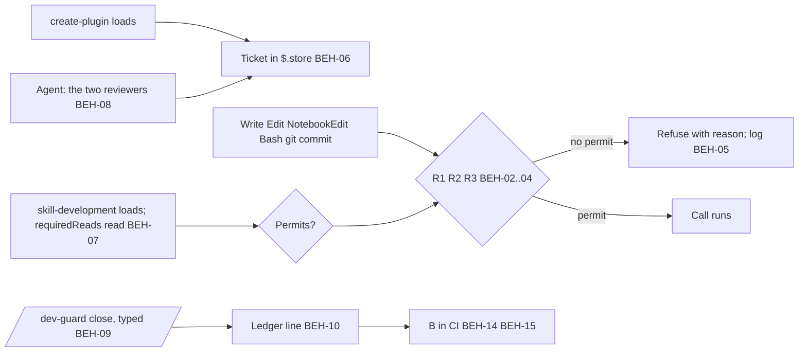

# SPEC-019 — Dev-guard: the plugin-workflow guard (A) and the commit check (B)

## 1. Overview

ADR-008 decides that a dev-only mod refuses edits to DevForgeAI's own plugin outside a `/plugin-dev:create-plugin`
iteration (A), and that a commit check backs it where the mod can't see (B). Issue #137 is the incident and the
enhancement; C, the CLAUDE.md rule, shipped in PR #138. This spec carries A's and B's requirements, because
`find_spec.py` searches `docs/specs/` and not GitHub issues (ADR-008, Bryan's answer 3: "SPEC-019 + /mod-builder:build").
Where #137's A.1 to A.7 and B differ from this spec, this spec and ADR-008 replace them (#137, comment 6547572711).

Three parts: **A**, the mod `src/tools/mods/dev-guard/`, built through `/mod-builder:build` (BEH-01 to BEH-13); **B**,
`src/tests/process/test_plugin_workflow.py` and its CI job (BEH-14, BEH-15); **M**, design mockups of the surfaces the
mod shows a person, made in Claude Design before A is built (BEH-16, BEH-17; Bryan, 2026-11-02: "ensure that the spec
for dev-guard includes: use /dataviz (where applicable or similar GUI skill) through /design for design mockups for the
dev-guard"). Bryan's answers of 2026-11-02 to the points #137 left open: every surface gets a mockup ("All four
surfaces"); they are recorded in Appendix A ("Appendix in SPEC-019"); the live checks compare the mod with them as a
manual item ("Yes, as a manual VER item"); `marketplace.json` and the version pin stay outside the protected scope
("No, keep the path anchor").

Each rule cites the ADR-008 decision, #137 item, review note or answer it comes from. The readings the drafting session
made beyond those are in §13, for Bryan's answer at approval; so are the probes the build runs before writing a test.

## 2. Constraints

- **ADR-008 v2** D1 to D8 (the separate mod, the path anchor and R1 to R3, when a guard may block, no mode, the rules
  in `guard.json`, the ticket and the close, failing closed, the commit check), its probes P1 to P8, and the twelve
  notes of PR #141's rounds 2 and 3, each settled here (§13 names them).
- **ADR-006 v2 D1:** a guard fails closed and refuses with a reason the model reads; the tracker is never involved.
- **ADR-001 v4 and ADR-005 D7:** sessions work in worktrees, some detached; a ticket belongs to one checkout (BEH-06).
- **The mods API** (`docs/research/Claude/plugins/mods/reference.md`, local): `tool.check` answers `{decision: 'deny',
  reason}` (:59); `e.agentId` marks a subagent's call (:66, v2.1.290); `e.isReadOnly` is `true` or absent (:73,
  v2.1.304); `skill.prompt` carries `e.skill` and `e.pluginName` (:97, v2.1.299); `$.fs` has `read`, `write`, `list`,
  `exists`, `stat` and `ancestors`, with no append (:220); `$.store` is `get`, `set`, `delete` and `keys`, shared by every
  session on the machine, 4 MiB in all (:221, :391); a `.catch` handler gets 1 second (:373); `$.process.run` times
  out at 30 seconds by default (:375); one `claude plugin test` test gets 5 seconds (:401); `CLAUDE_CODE_PLUGIN_DIRS`
  loads a mod without a flag (:409). What the reference doesn't show is a probe, never a fact (§13).
- **`/mod-builder:build`'s house rules** apply at the build (the logic split, tests first, `/dev-guard demo`, the
  UI-states checklist with its widths: full at 60 columns or more, medium 40 to 59, compact under 40). The mod's own
  `SPEC.md` takes its slots from this spec (BEH-13).
- **Claude Design** is reached through the Artifact tool's Design type; the Skill tool refuses `/design` (SPEC-017
  §12; ADR-007 D3). A brief states goal, context, real content, states, two to four must-haves and a style reference,
  never a layout (Bryan, 2026-10-10). A canvas stays private unless Bryan shares it (#121).

## 3. Architecture and components

```
src/tools/mods/dev-guard/                      # A (ADR-008 D1): plugin.json (no userConfig), hooks/hooks.json,
                                               # hooks/register.tsx (every $ call), hooks/dev-guard-logic.ts (pure
                                               # rules), types/index.d.ts, tests/, SPEC.md (mod-builder's), README.md
src/tests/process/test_plugin_workflow.py      # B (BEH-14)
.github/workflows/plugin-workflow.yml          # B's CI job (BEH-15)
docs/process/plugin-workflow/guard.json        # requiredReads and the allowlist (DM-02); protected
docs/process/plugin-workflow/ledger.jsonl      # one line per closed ticket (DM-03); protected; the mod writes it
docs/process/plugin-workflow/ledger.schema.json  # DM-03 as a file, equal to the block (BEH-14)
docs/process/plugin-workflow/reviews/          # the reports (DM-05)
docs/specs/design/dev-guard/                   # M: briefs.md and boards/ (Appendix A)
devforgeai/dev-guard/refusals/<session>.jsonl  # the refusal log (DM-04), gitignored
```



## 4. Data model

```json
{
  "x-item-id": "DM-01",
  "title": "The ticket: $.store keys under dev-guard/<checkout>/",
  "description": "<checkout> is <real path of git rev-parse --show-toplevel>/<branch name, or the word detached> (BEH-06). The ticket is several keys, so parallel hooks never overwrite each other's writes (reading (i)): dev-guard/<checkout>/ticket holds this object; dev-guard/<checkout>/read/<n> holds one read of requiredReads[n] (its time and tool); dev-guard/<checkout>/reviewer/<type> holds one observed reviewer (its time, and the agent id when the platform gives one); dev-guard/<checkout>/refusals holds a count",
  "type": "object",
  "required": ["id", "checkout", "scope", "openedAt", "sessionId", "skillDevelopment", "modVersion"],
  "properties": {
    "id": {"type": "string", "pattern": "^pw-[0-9]{8}T[0-9]{6}Z$", "description": "pw- and the opening time in UTC"},
    "checkout": {"type": "string"},
    "scope": {"type": "string", "description": "the create-plugin call's arguments, as typed or as the Skill tool's input; empty when none (probe, §13)"},
    "openedAt": {"type": "string", "format": "date-time", "description": "when plugin-dev:create-plugin loaded"},
    "sessionId": {"type": "string"},
    "skillDevelopment": {"type": ["string", "null"], "format": "date-time", "description": "when plugin-dev:skill-development loaded; null until then"},
    "modVersion": {"type": "string"}
  }
}
```

```json
{
  "x-item-id": "DM-02",
  "title": "docs/process/plugin-workflow/guard.json",
  "type": "object",
  "required": ["version", "requiredReads", "allow"],
  "additionalProperties": false,
  "properties": {
    "version": {"const": 1},
    "requiredReads": {"type": "array", "minItems": 1, "items": {"type": "string", "pattern": "^docs/research/Claude/"}, "description": "repository-relative; a worktree reads the main checkout's copy (BEH-07)"},
    "allow": {"type": "array", "items": {"type": "object", "required": ["name", "pattern"], "additionalProperties": false, "properties": {"name": {"type": "string"}, "pattern": {"type": "string", "description": "an ECMAScript regular expression, anchored by the mod with ^ and $, matched against the whole normalised command text (BEH-03)"}}}, "description": "the read-only invocations R2 allows without a ticket (ADR-008 D2)"}
  }
}
```

The initial `guard.json` (ADR-008 D2, D6; #137 A.2's three guides). In each pattern, `P` stands for the plugin path in
any form (`src/claude/DevForgeAI` with any prefix that resolves to it, or `$P`), `F` for one or more words that start
with `-` each followed by at most one value word, `V` for zero or more `VAR=value` words, and `Q` for one or more
quoted or bare query words; the mod expands them before matching:

```json
{
  "version": 1,
  "requiredReads": [
    "docs/research/Claude/Skill-authoring-best-practices.md",
    "docs/research/Claude/The-Complete-Guide-to-Building-Skill-for-Claude.pdf",
    "docs/research/Claude/skills/skills.md"
  ],
  "allow": [
    {"name": "plugin validate", "pattern": "claude plugin validate( F)? P"},
    {"name": "plugin test", "pattern": "claude plugin test( F)? P"},
    {"name": "pytest", "pattern": "(V )?python3( F)? -m pytest( F)? src/tests(/\\S+)?"},
    {"name": "validate_brn", "pattern": "(V )?python3( F)? P/skills/brainstorm/scripts/validate_brn\\.py \\S+"},
    {"name": "check_docs", "pattern": "(V )?python3( F)? P/skills/documents-updater/scripts/check_docs\\.py \\S+"},
    {"name": "find_spec", "pattern": "(V )?python3( F)? P/skills/spec-lookup/scripts/find_spec\\.py( --root \\S+)? Q"}
  ]
}
```

A command runs under an allow entry only when its whole text, with each word normalised (BEH-03) and runs of spaces
collapsed, matches the expanded pattern, and it holds no `>`, `>>`, `|`, `;`, `&&`, `||`, `$(`, backtick or `tee`.
VER-15 runs every command CLAUDE.md's "Commands" lists and the spec-lookup agent's invocation (`python3 <script>
--root <root> "<query>"`) through the matcher. `pytest` and `claude plugin test` run repository code that can write
plugin files unseen: a stated limit (D2), left to B.

```json
{
  "x-item-id": "DM-03",
  "title": "One line of docs/process/plugin-workflow/ledger.jsonl: a closed ticket's evidence (also docs/process/plugin-workflow/ledger.schema.json)",
  "type": "object",
  "required": ["id", "checkout", "scope", "openedAt", "closedAt", "sessionId", "skillDevelopment", "reads", "reviewers", "refusals", "tree", "commit", "reports", "closedBy", "modVersion"],
  "additionalProperties": false,
  "properties": {
    "id": {"type": "string", "pattern": "^pw-[0-9]{8}T[0-9]{6}Z$"},
    "checkout": {"type": "string"},
    "scope": {"type": "string"},
    "openedAt": {"type": "string", "format": "date-time"},
    "closedAt": {"type": "string", "format": "date-time"},
    "sessionId": {"type": "string"},
    "skillDevelopment": {"type": "string", "format": "date-time"},
    "reads": {"type": "array", "minItems": 1, "items": {"type": "object", "required": ["path", "at", "tool"], "properties": {"path": {"type": "string"}, "at": {"type": "string", "format": "date-time"}, "tool": {"enum": ["Read", "Bash"]}}}, "description": "one per requiredReads path of the guard.json in force at close; B checks every path is present"},
    "reviewers": {"type": "array", "minItems": 2, "maxItems": 2, "items": {"type": "object", "required": ["subagentType", "at"], "properties": {"subagentType": {"enum": ["plugin-dev:plugin-validator", "plugin-dev:skill-reviewer"]}, "agentId": {"type": "string"}, "at": {"type": "string", "format": "date-time"}}}, "description": "one of each type; agentId only when the platform gives one (probe, §13)"},
    "refusals": {"type": "integer", "minimum": 0},
    "tree": {"type": "string", "pattern": "^[0-9a-f]{40}$", "description": "git rev-parse HEAD:src/claude/DevForgeAI at close (ADR-008 D6)"},
    "commit": {"type": "string", "pattern": "^[0-9a-f]{40}$", "description": "HEAD at close, informational: a rewrite after close may drop it (BEH-10)"},
    "reports": {"type": "array", "minItems": 2, "maxItems": 2, "items": {"type": "string", "pattern": "^docs/process/plugin-workflow/reviews/[0-9]{8}T[0-9]{4}Z-(plugin-validator|skill-reviewer)-[0-9a-f]{7,40}\\.md$"}, "description": "one of each tool"},
    "closedBy": {"type": "object", "required": ["originKind", "at"], "properties": {"originKind": {"type": "string"}, "at": {"type": "string", "format": "date-time"}}},
    "modVersion": {"type": "string"}
  }
}
```

**DM-04, the refusal log:** `devforgeai/dev-guard/refusals/<session ID>.jsonl`, one file per session so sessions never
write the same file (reading (j)), gitignored through `devforgeai/dev-guard/.gitignore` holding `*`; one JSON line per
refusal: `at`, `sessionId`, `agentId` (when set), `rule` (`R1`, `R2`, `R3`, `catch`, `guard.json`), `tool`, `path`
(the first protected path), `command` (the full command text for Bash, the file path otherwise), `ticket` (the open
ticket's id or null) and `reason` (the text the model read).

**DM-05, a report file:** `docs/process/plugin-workflow/reviews/<UTC>-<tool>-<hash>.md`, `<UTC>` as
`YYYYMMDDTHHMMZ`, `<tool>` one of `plugin-validator`, `skill-reviewer`, `drafts-review`, `code-review`, `<hash>` the
short hash of the commit the review ran on (reading (d)). A plugin-validator or skill-reviewer report's first lines
hold `commit: <40-hex>` and `tree: <40-hex>`, the commit and its plugin subtree hash; close and B match reports by
`tree`, which survives a rewrite, and resolve `commit` only when it still exists (BEH-10).

## 5. Interfaces and contracts

| ID | Interface | Contract |
|---|---|---|
| IF-01 | `/dev-guard` | A pane (reading (k)) showing the checkout's ticket: id, scope, opened at, whether it permits, and what is missing (skill-development not loaded; each `requiredReads` file not yet read; the main checkout's copy not found), or "no ticket: invoke /plugin-dev:create-plugin with the iteration's scope". Shows only; `immediate: true` |
| IF-02 | `/dev-guard close` | Closes the ticket as BEH-09 says, or refuses naming each failing condition; then shows IF-04 for the iteration's refusals (D4). Not immediate: it writes |
| IF-03 | `/dev-guard demo` | Shows every state of IF-01, IF-02 and IF-04 without real events (mod-builder's house rule); writes nothing |
| IF-04 | `/dev-guard log` | The data view, a pane: this checkout's refusals from DM-04 (every session's file), newest first, with counts by rule and by tool for the open ticket and for the last seven days (reading (l)); its charts follow the `dataviz` skill (BEH-16) |
| IF-05 | Hooks | `skill.prompt` (opens the ticket; records skill-development); `tool.call` on `Skill` (opens the ticket when `skill.prompt` didn't fire), on `Agent` (records a reviewer) and on `Read` (records a required read after the call succeeds); `tool.check` on `Write`, `Edit`, `NotebookEdit` (R1) and `Bash` (R2, R3, and a read-only Bash read of a required file); `command.run` for IF-01 to IF-04. The gating hooks (R1, R2, R3, close) have a `.catch` that refuses; the recording hooks' `.catch` lets the call through and logs the error (BEH-11) |
| IF-06 | B's test | `pytest -m plugin_workflow src/tests/process` from the repository root, on a checkout whose history reaches the merge base with `origin/main` (`fetch-depth: 0` in CI). Exit 0 passes; any other exit fails the job, exit 5 (no test selected) included |
| IF-07 | B's CI job | `.github/workflows/plugin-workflow.yml`: on every pull request, checkout with `fetch-depth: 0`, the PR's head commit (not GitHub's merge commit), the job installs pytest, PyYAML and jsonschema itself (the repository has no requirements file; reading (m)), runs IF-06; a required check once B ships (Owner's setting) |

## 6. Behavior

```yaml items
behaviors:
  - id: BEH-01
    status: active
    rule: "Scope (ADR-008 D2; Bryan, 2026-11-02: 'No, keep the path anchor'). A path is protected when its real path contains the segment /src/claude/DevForgeAI/ and the .claude-plugin/plugin.json under that folder names the plugin devforgeai, in any checkout or worktree; and when it is docs/process/plugin-workflow/guard.json or docs/process/plugin-workflow/ledger.jsonl of the same repository. The two files are protected whatever the ticket: only the mod's own close writes ledger.jsonl, and a person edits guard.json outside Claude Code (D2: 'Only a person, or the mod's own close, changes them'); staging and committing them is not a content write (BEH-03, BEH-04). Nothing else is protected: .claude-plugin/marketplace.json at the root and the version pin in src/tests/progress/test_adapter_structure.py stay outside, since plugin.json is inside the plugin and EVAL.md G6 checks the three agree. The checkout a path belongs to is the one whose top level contains its real path; a ticket permits writes in its own checkout only. The mod holds no machine path and no off switch (D4, D5)."
  - id: BEH-02
    status: active
    rule: "R1 (D2). A Write or Edit whose input.file_path, or a NotebookEdit whose input.notebook_path, resolved against the session's working directory when relative, is protected is refused unless the file's checkout has a permitting ticket (BEH-07); guard.json and ledger.jsonl are refused with or without one (BEH-01). The rule applies the same to a call carrying e.agentId (a subagent's or a teammate's)."
  - id: BEH-03
    status: active
    rule: "R2 (D2; PR #141 round-2 notes 7 and 8). A Bash call whose e.isReadOnly is not true is refused, unless the working directory's checkout has a permitting ticket, when any of these holds: its whole command text, heredoc bodies and quoted strings included, contains a form of a protected path (the segment src/claude/DevForgeAI in any spelling that resolves to the anchor: absolute, relative, with ./ or ../, a trailing slash or none, inside quotes, or through a variable the same command assigns from such a form; the bare folder name counts; guard.json and ledger.jsonl by their names under docs/process/plugin-workflow/), or the text names make_evals.py, or the working directory is protected. Word normalisation (a relative path resolved against the working directory, symlinks resolved through git rev-parse --show-toplevel and the realpath the mod computes with $.process.run, a trailing slash dropped) is applied before the text match. Exceptions: git add, git rm --cached and git commit naming ledger.jsonl or guard.json or a reviews/ report are allowed, so the records commit after a close can be made (reading (c)); a command that only names a protected path inside a git log, git show, git diff or git status invocation is read-only by the tool's own report and never reaches R2. A command that R2 would otherwise refuse runs without a ticket only when it matches one allow entry of guard.json in full (DM-02). R2 is best effort: it matches text, and B is the proof."
  - id: BEH-04
    status: active
    rule: "R3 (D2). A Bash call whose command runs git commit (git -C <dir> commit included) is refused, unless the checkout of that directory has a permitting ticket, when git diff --cached --name-only, run there with $.process.run under BEH-11's bound, lists a path under src/claude/DevForgeAI/. Staged guard.json, ledger.jsonl or reports never refuse a commit (the records commit). R3 reads only the index: commit -a, commit <path>, cherry-pick and merge pass it, and B catches what it misses."
  - id: BEH-05
    status: active
    rule: "The refusal (D3, D4). A refused call gets a reason the model reads, naming the rule, the first protected path, and the remedy: invoke /plugin-dev:create-plugin with the iteration's scope, then /plugin-dev:skill-development, and read each requiredReads file; when a ticket exists, the reason names what it still lacks; for guard.json and ledger.jsonl the reason says a person or the close changes them. The mod never changes content silently. Every refusal is appended to the session's refusal log (DM-04, by reading the file and writing it whole) with the full command text, and the ticket's refusals count is raised; a failed log write never lifts the refusal (BEH-11)."
  - id: BEH-06
    status: active
    rule: "The ticket (D6). One ticket per checkout, under $.store keys dev-guard/<real path of the checkout's top level>/<branch name, or detached>/… (DM-01), so a detached worktree (ADR-005 D7) has one ticket whatever its HEAD, and a branch switched inside a checkout doesn't carry a ticket (reading (a)). The top level and branch are found with git rev-parse --show-toplevel and --abbrev-ref HEAD through $.process.run, cached per working directory for the session (QR-03). It opens when plugin-dev:create-plugin loads: a skill.prompt event whose e.skill is plugin-dev:create-plugin, or a Skill tool call with that skill when no skill.prompt fired (ADR-008 P1); its scope is the call's arguments where the platform gives them (probe, §13). A second load while a ticket is open changes nothing. The ticket's checkout is the session's working directory's at the load."
  - id: BEH-07
    status: active
    rule: "The permit (D6; #137 A.2). An open ticket permits protected writes only once plugin-dev:skill-development has loaded in it and each requiredReads file of guard.json has been read in it: a Read tool call of any range on the file that succeeded (recorded on tool.call after the call returns), or a read-only Bash call (e.isReadOnly true) whose command names the file by a path, relative or absolute, that resolves to it (reading (b): sessions read with cat and sed -n; ADR-008 D6: a nudge, not a proof). Reads don't carry over to the next ticket, and no order between the load and the reads is required. In a worktree the file is the main checkout's copy, the parent of git rev-parse --git-common-dir; with no copy found the ticket doesn't permit, and the remedy is to capture the pages by each PROVENANCE.md's recipe (CLAUDE.md's rule)."
  - id: BEH-08
    status: active
    rule: "Observed reviewers (D6; Bryan, 2026-10-31: observed, not asserted). The ticket records each Agent tool call seen in its checkout whose subagent_type is plugin-dev:plugin-validator or plugin-dev:skill-reviewer, with its time and, when the platform gives one, the spawned agent's id. Where subagent_type and that id can be read (e.input on the Agent tool.call, or agent.spawn) is the build's probe (§13); ADR-008 P2 saw no agentId on the Agent call itself."
  - id: BEH-09
    status: active
    rule: "Close (D6; PR #141 round-2 notes 1 and 3). /dev-guard close closes the checkout's open ticket only when every condition holds: the command's origin is the kind a person's typed command carries (the build's probe records it, expected composer; close allows that kind alone and refuses sdk and every other); skill-development loaded in the ticket; one reviewer of each type was observed (BEH-08); every requiredReads file was read in the ticket; a plugin-validator report and a skill-reviewer report exist in reviews/ (DM-05) whose tree line equals HEAD's plugin subtree hash, the newest of each tool when several do; and the plugin's working tree and index are clean (git status --porcelain -- src/claude/DevForgeAI empty), so what the reports reviewed is what the line binds. On success the mod appends the ledger line (BEH-10), deletes the ticket's keys, and shows IF-04. A refusal names each failing condition. The limit: a person's origin is also what the model gets when it types into a sibling pane of a terminal multiplexer (reading (n)); the close can't tell those apart, and the close review reads the line."
  - id: BEH-10
    status: active
    rule: "The ledger line (D6, D8; PR #141 round-3 note 3). One JSON line of DM-03 per closed ticket, appended to ledger.jsonl by the mod only (read the file, write it whole with the line added; one close at a time per machine, since $.store holds a close lock key while it runs). What ties a line to the mod is re-derivation, not a signature (reading (e)): B checks that the line validates against ledger.schema.json; that its tree equals HEAD's plugin subtree hash; that each report file exists, names its tool in its name and carries a tree line equal to the line's tree; that reads covers every requiredReads path of guard.json; that reviewers holds one of each type; that every time lies between openedAt and closedAt; and that closedBy.originKind is the allowed kind. The line's commit is resolved only when it exists: a rebase, amend or squash after the close that leaves the plugin subtree unchanged still passes (ADR-008 D8). The limit stays: a session the guard can't see could write a line that passes; the line and the reports go out in one records commit, and the close review reads them."
  - id: BEH-11
    status: active
    rule: "Failing closed (ADR-006 D1; ADR-008 D7; PR #141 round-2 note 2). Each gating hook (R1, R2, R3, the close) has a .catch that refuses the call it was checking, naming the error; the handler does no I/O, since it gets one second. A recording hook (the ticket's open, a read, a reviewer) never refuses: its .catch lets the call through and logs the error. The hooks' own work is bounded: guard.json is read with $.fs.read once per call and parsed; each $.process.run for git carries the API's timeout option at 5 seconds, and a call that exceeds it refuses as a timeout; a $.store read that fails counts as no ticket. A missing or invalid guard.json refuses every protected write, naming the file (D5, ERR-01). A log write that fails never lifts a refusal."
  - id: BEH-12
    status: active
    rule: "Where the guard doesn't run (D7): sessions started with --bare or --safe-mode, or with disableAllHooks set; Desktop WSL and cloud sessions; claude plugin eval runs (P5); a session where the module failed to load; and edits made by Codex, an editor or a shell. The mod claims nothing for those: B is the check there. Recovery from a broken guard is a person's act, --safe-mode or dropping the folder from CLAUDE_CODE_PLUGIN_DIRS (D4)."
  - id: BEH-13
    status: active
    rule: "The build (ADR-008, Bryan's answer 3). The mod is built through /mod-builder:build in src/tools/mods/dev-guard/, archetype guard, the mods folder being src/tools/mods/ with no marketplace entry: the root marketplace lists the devforgeai plugin, and the mod loads through CLAUDE_CODE_PLUGIN_DIRS only (reading (f)). The mod's SPEC.md takes its slots from this spec: name dev-guard; triggers IF-05; commands IF-01 to IF-04; states drawn from the mockups (BEH-17); state lifetime: cross-session $.store for the ticket, session atoms for the rest; external reach: files (guard.json, ledger.jsonl, the refusal log, the reports) and the git process; no options; no network; no model calls. A divergence between SPEC.md and this spec is a version of this spec. The probes of §13 run before the first test; tests come first (VER-01, VER-15). The mod is loaded through CLAUDE_CODE_PLUGIN_DIRS in ~/.claude/settings.json, Bryan's step at install (ADR-008 P4)."
  - id: BEH-14
    status: active
    rule: "B's test (D8; PR #141 round-2 note 9, round-3 note 1). src/tests/process/test_plugin_workflow.py carries the pytest marker plugin_workflow, registered in pytest.ini, whose addopts deselect it (-m 'not plugin_workflow'), so pytest src/tests skips it and its count is unchanged. It computes the merge base of HEAD and origin/main, then git rev-parse <merge-base>:src/claude/DevForgeAI and git rev-parse HEAD:src/claude/DevForgeAI, and passes when the two are equal. Otherwise it passes only when some line of ledger.jsonl has tree equal to HEAD's subtree hash and passes BEH-10's re-derivation; other lines aren't checked (ADR-008 D8). It reads guard.json for requiredReads and docs/process/plugin-workflow/ledger.schema.json for DM-03, which a test keeps equal to this spec's block. A rebase or merge that brings main's plugin changes into the branch gives a head subtree that matches no line: that content was never reviewed as a whole, so the branch needs a new iteration and close (reading (g)). Commits already on main are never checked."
  - id: BEH-15
    status: active
    rule: "B's CI job (D8; EVAL.md B4; Bryan, 2026-10-31: 'docs/process + CI job', 'B's CI job becomes a required check when B ships'). .github/workflows/plugin-workflow.yml runs on every pull request, checks out the PR's head commit with fetch-depth 0, installs pytest, PyYAML and jsonschema itself (IF-07), and runs IF-06. A pytest exit other than 0 fails the job, 5 (no test selected) included. The job passes at once on a PR whose plugin subtree is unchanged, so a required check never waits on a docs-only PR. Making it a required check is the Owner's setting, done when B ships."
  - id: BEH-16
    status: active
    rule: "Mockups (Bryan, 2026-11-02: 'use /dataviz (where applicable or similar GUI skill) through /design for design mockups for the dev-guard'; 'All four surfaces'). Before A is built, each surface the mod shows a person gets boards in one Claude Design canvas, made through the Artifact tool's Design type from a brief (goal, context, the real content of §5 and BEH-05, the states, two to four must-haves, a style reference; no layout, no tokens; three directions): the refusal reason as it appears in the transcript; /dev-guard (a ticket that permits, one that doesn't with what is missing, no ticket); /dev-guard close (refused with its failing conditions, and the line written); and /dev-guard log, the data view, whose charts follow the dataviz skill's guidance (counts by rule and tool, the seven-day timeline). Text-only surfaces carry no chart. Each surface is drawn for the terminal at the full width (60 columns or more), the medium width (40 to 59) and the compact width (under 40), and shows the UI-states checklist's states that apply (empty, idle, done, error, folded, too narrow); a state that doesn't apply says why. The canvas stays private unless Bryan shares it."
  - id: BEH-17
    status: active
    rule: "The mockups' record and use (Bryan, 2026-11-02: 'Appendix in SPEC-019'; 'Yes, as a manual VER item'). Appendix A names the canvas and, per board, its surface, states, width, the exported image's path under docs/specs/design/dev-guard/boards/ and the image's sha256; the briefs are docs/specs/design/dev-guard/briefs.md. The images and the filled appendix go in with a record-only Change Log row (a §9-style record, no version bump). The folder is reading (h): SPEC-017 keys docs/specs/design/ by DSN ID and dsn_check.py counts only DSN-NNN names, so dev-guard/ collides with nothing. The chosen board is the source of the ASCII drawing in the mod's SPEC.md (BEH-13), and /dev-guard demo reaches every state a board shows. The live checks (VER-14) compare each surface's rendering with its board at the board's width, by a person, pass or fail; nothing automated compares pixels."
```

## 7. Errors and edge cases

```yaml items
errors:
  - id: ERR-01
    status: active
    condition: "guard.json is missing, unreadable or invalid against DM-02"
    handling: "Every protected write, R2 command and R3 commit is refused, naming the file and the error, until a person fixes the file outside Claude Code (D5). /dev-guard says so"
    user_result: "A refusal naming docs/process/plugin-workflow/guard.json and what is wrong"
  - id: ERR-02
    status: active
    condition: "A gating hook throws or exceeds a bound (BEH-11)"
    handling: "Its .catch refuses the call it was checking, naming the error kind (throw or timeout) and message, with no I/O in the handler; the next hook that runs logs it"
    user_result: "A refusal naming the hook's error, with BEH-05's remedy"
  - id: ERR-03
    status: active
    condition: "/dev-guard close runs with a condition of BEH-09 unmet, or with no open ticket, or from an origin other than the allowed kind"
    handling: "Nothing is written; the reply names each failing condition (no ticket; skill-development not loaded; a reviewer not observed, by type; a required file not read, by path; a report missing, by expected path, or whose tree differs from HEAD's; a dirty plugin working tree or index, with the paths; the origin kind refused)"
    user_result: "What to do before the close can succeed"
  - id: ERR-04
    status: active
    condition: "$.store can't be read or written, or R3's git call fails (no git on PATH, a timeout)"
    handling: "The call being checked is refused, naming the error (fail closed, ADR-006 D1); a store write that fails leaves the ticket's keys as they were. A directory that isn't a repository isn't an error: R3 applies only where git diff --cached runs (reading (o))"
    user_result: "A refusal naming the store or git error"
  - id: ERR-05
    status: active
    condition: "B finds that the line whose tree equals HEAD's subtree hash doesn't validate or fails a re-derivation check (BEH-10)"
    handling: "The test fails, naming the line number, the field and the check; other lines aren't checked (ADR-008 D8)"
    user_result: "The CI job fails with the line and the reason"
  - id: ERR-06
    status: active
    condition: "B can't compute the merge base (a shallow checkout, or origin/main unknown)"
    handling: "The test fails, naming the remedy: fetch-depth 0, and a fetched origin/main"
    user_result: "The CI job fails with the fetch remedy"
  - id: ERR-07
    status: active
    condition: "A requiredReads file has no copy to read: not in the checkout, nor in the main checkout found through git rev-parse --git-common-dir"
    handling: "The ticket doesn't permit; /dev-guard and each refusal name the file and the capture recipe (each PROVENANCE.md under docs/research/Claude/)"
    user_result: "The missing file and how to capture it"
  - id: ERR-08
    status: active
    condition: "A board of BEH-16 can't be made or imported: the Artifact tool answers not found, or the canvas is unreachable"
    handling: "The build doesn't start (BEH-16 comes first); §9 records the attempt, and Bryan decides whether the mod's SPEC.md ASCII drawings stand in as the record"
    user_result: "The build waits; the owner's decision"
```

## 8. Non-functional design

```yaml items
quality_responses:
  - id: QR-01
    status: active
    response: "Every gating hook fails closed: a .catch that refuses with no I/O, bounded reads and process calls, a missing guard.json that refuses (BEH-11)"
    measured_by: "Kit tests with a throwing hook, a timed-out git call and a missing guard.json (VER-15); claude plugin validate --strict passes (VER-02)"
    upstream:
      - {id: ADR-006, relation: satisfies, version: 2, hash: null}
      - {id: ADR-008, relation: satisfies, version: 2, hash: null}
  - id: QR-02
    status: active
    response: "No machine path and no off switch in the repository: the scope is the path anchor, the rules file is protected, recovery is --safe-mode (BEH-01, BEH-12)"
    measured_by: "Reading plugin.json (no userConfig) and guard.json (no path, no mode); a kit test that an edit to guard.json is refused under a permitting ticket"
    upstream:
      - {id: ADR-008, relation: satisfies, version: 2, hash: null}
  - id: QR-03
    status: active
    response: "A refusal is quick: R1 and R2 need no process call (the checkout lookup is cached per working directory), R3 one git call; the refusal log is written per session and never read on the hot path. Targets (reading (p)): under 100 ms for R1 and R2, under 5 s for R3"
    measured_by: "The kit tests' timings; VER-14's live checks note each refusal's delay"
    upstream:
      - {id: ADR-008, relation: satisfies, version: 2, hash: null}
```

## 9. Verification

**Verification status.**

| Kind | Status |
|---|---|
| Version 1 | **Drafted 2026-11-02, revised after the drafts review, not approved, not built.** VER-01 to VER-12 are EVAL.md's A1 to A8 and B1 to B4 (ADR-008, Bryan's answer 3: one source); EVAL.md's rows cite them back. VER-13 and VER-14 are the mockups (Bryan, 2026-11-02); VER-15 to VER-18 the review notes, the install and the first close. Structural: validates against `spec.schema.json` with every BEH, ERR and QR item covered. Behavioural: NOT_RUN. Step 1 of §11 starts with a check that the Artifact tool reaches Claude Design from this account (ERR-08) |

```yaml items
verifications:
  - id: VER-01
    status: active
    obligation: "EVAL.md A1: the mod's tests pass under claude plugin test: R1 (Write, Edit, and NotebookEdit through notebook_path), R2 and R3 each refuse with no ticket and allow with a permitting ticket; R1 refuses a call carrying agentId; an open ticket without skill-development or a required read doesn't permit; a gating hook's .catch refuses on a thrown error."
    level: unit
    covers:
      - BEH-02
      - BEH-03
      - BEH-04
      - BEH-07
      - BEH-11
  - id: VER-02
    status: active
    obligation: "EVAL.md A2: claude plugin validate --strict src/tools/mods/dev-guard exits 0."
    level: unit
    covers:
      - BEH-13
      - QR-01
  - id: VER-03
    status: active
    obligation: "EVAL.md A3, live in this repository with no ticket: an Edit to src/claude/DevForgeAI/skills/ui/SKILL.md in .claude/worktrees/<name>/ is refused with R1's reason (the rule, the path, the remedy)."
    level: e2e
    covers:
      - BEH-01
      - BEH-02
      - BEH-05
  - id: VER-04
    status: active
    obligation: "EVAL.md A4, live: with no ticket, a subagent's Write under the plugin path is refused."
    level: e2e
    covers:
      - BEH-02
  - id: VER-05
    status: active
    obligation: "EVAL.md A5, live: with no ticket, python3 src/tests/ui/make_evals.py is refused by R2, and so is a python3 - <<'EOF' script whose body names src/claude/DevForgeAI/skills/ui/SKILL.md (the incident's form); claude plugin validate src/claude/DevForgeAI runs under the allowlist."
    level: e2e
    covers:
      - BEH-03
  - id: VER-06
    status: active
    obligation: "EVAL.md A6, live: with no ticket, a git commit with a staged plugin file is refused by R3; a git commit with only ledger.jsonl and a reviews/ report staged runs."
    level: e2e
    covers:
      - BEH-04
  - id: VER-07
    status: active
    obligation: "EVAL.md A7, live: after /plugin-dev:create-plugin, /plugin-dev:skill-development and reads of the requiredReads files (one through the Read tool, one through cat), /dev-guard says the ticket permits and VER-03's Edit is allowed; an edit to guard.json is still refused."
    level: e2e
    covers:
      - BEH-06
      - BEH-07
      - BEH-01
  - id: VER-08
    status: active
    obligation: "EVAL.md A8, live: /dev-guard close, typed by a person, refuses unless both reviewers' Agent calls were observed during the ticket, their reports carry a tree line equal to HEAD's plugin subtree hash, every required file was read and the plugin tree is clean; it then writes the ledger line with that evidence and removes the ticket; a nested claude -p '/dev-guard close' is refused."
    level: e2e
    covers:
      - BEH-08
      - BEH-09
      - BEH-10
      - ERR-03
  - id: VER-09
    status: active
    obligation: "EVAL.md B1: test_plugin_workflow.py fails on a branch whose head's plugin subtree hash differs from its merge base's and matches no valid ledger line."
    level: integration
    covers:
      - BEH-14
  - id: VER-10
    status: active
    obligation: "EVAL.md B2: it passes once a valid ledger line carries that subtree hash with its re-derivation satisfied, and at once on a branch that leaves the plugin unchanged; it still passes after the branch is rebased or squashed without a plugin change, the line's commit being gone."
    level: integration
    covers:
      - BEH-14
      - BEH-10
  - id: VER-11
    status: active
    obligation: "EVAL.md B3: pytest src/tests deselects the plugin_workflow marker through pytest.ini (the collected count is the same with and without the test file present), and pytest -m plugin_workflow src/tests/process selects it."
    level: integration
    covers:
      - BEH-14
  - id: VER-12
    status: active
    obligation: "EVAL.md B4: the GitHub Actions job runs on every pull request, with fetch-depth 0 and the PR's head commit, shows in the PR's checks, fails when pytest exits 5, and is made a required check when B ships (Owner's step, recorded in §9)."
    level: integration
    covers:
      - BEH-15
      - ERR-06
  - id: VER-13
    status: active
    obligation: "The mockups exist and are recorded: one canvas with boards for each surface of BEH-16 at the full, medium and compact widths, the data view with dataviz-guided charts, each board exported under docs/specs/design/dev-guard/boards/ and listed in Appendix A with its sha256; the briefs are committed beside them. Checked by reading Appendix A against the folder (sha256sum) before A's first iteration."
    level: manual
    covers:
      - BEH-16
      - BEH-17
      - ERR-08
  - id: VER-14
    status: active
    obligation: "Live against the mockups, on the build commit: each surface (the refusal reason, /dev-guard in its three states, /dev-guard close refused and succeeded, /dev-guard log) is compared with its board at the board's width by a person, pass or fail per surface and state, in docs/runbooks/dev-guard-checks.md; /dev-guard demo reaches every state a board shows; each refusal's delay is noted (QR-03)."
    level: manual
    covers:
      - BEH-17
      - QR-03
  - id: VER-15
    status: active
    obligation: "Kit tests for the review notes and the readings, written first: close allows only the probed origin kind and refuses sdk and an unknown kind; close refuses a dirty plugin tree and a missing required read; R2 matches the bare folder name, a relative path, a trailing slash, a quoted path, a heredoc body and a variable assigned from the path, and refuses a substring match of an allow entry; every command in CLAUDE.md's Commands section and the spec-lookup agent's invocation match an allow entry, and each with a shell operator appended doesn't; git add and git commit naming ledger.jsonl run without a ticket while sed -i on it is refused under a permitting ticket; a detached checkout's keys hold after a commit moves HEAD, and a branch switch doesn't carry a ticket; a required read counts through the Read tool after success and through a read-only Bash command naming the file by a relative or absolute path, not through a non-read-only one and not through a failed Read; three parallel reads all count; a second create-plugin load changes nothing; a missing guard.json refuses with the file named; a git call that exceeds 5 s refuses as a timeout; a recording hook that throws lets the call through; a refusal is logged with the full command text, and a failed log write doesn't lift the refusal."
    level: unit
    covers:
      - BEH-01
      - BEH-03
      - BEH-04
      - BEH-05
      - BEH-06
      - BEH-07
      - BEH-09
      - BEH-11
      - ERR-01
      - ERR-02
      - ERR-04
      - QR-02
  - id: VER-16
    status: active
    obligation: "B's cases, in src/tests/process/, each on a scratch repository the test builds: a rebase that brings a plugin change from main fails until a line with the merged tree exists; a rebase without a plugin change passes with the line's commit gone; the matching line with a bad field, a tree that no report carries, a missing report, a read path not in guard.json's list, one reviewer type missing, a time outside openedAt to closedAt, or an origin kind other than the allowed one fails with its line number and reason; an invalid non-matching line is ignored; ledger.schema.json equals DM-03's block; a shallow clone fails with the fetch remedy; a workflow run with zero tests selected exits 5 and the job step fails."
    level: integration
    covers:
      - BEH-14
      - BEH-15
      - BEH-10
      - ERR-05
      - ERR-06
  - id: VER-17
    status: active
    obligation: "Install (ADR-008 P4's remaining parts, Bryan's step): with CLAUDE_CODE_PLUGIN_DIRS in ~/.claude/settings.json naming src/tools/mods/dev-guard, /dev-guard answers in a new terminal session, a herdr pane and a Remote Control session; EVAL.md's P4 row moves from NOT_RUN. A session with --safe-mode gets no answer (BEH-12)."
    level: manual
    covers:
      - BEH-12
      - BEH-13
  - id: VER-18
    status: active
    obligation: "The first iteration's close shows its refusals for review (D4), and each refusal is either a process skip the guard was right to refuse or an allowlist gap, which a person fixes in guard.json outside Claude Code and the session commits as a records commit; the worktree case (ERR-07: a requiredReads copy found through the main checkout, and not found in a clone without docs/research/) is run once each."
    level: manual
    covers:
      - BEH-05
      - BEH-09
      - ERR-07
```

The live items (VER-03 to VER-08, VER-14, VER-17, VER-18) follow `docs/runbooks/dev-guard-checks.md`, written with
the build.

## 10. Rollout, migration and rollback

The mod loads only where `CLAUDE_CODE_PLUGIN_DIRS` names it (BEH-13); removing the folder or the setting rolls it
back. `guard.json`, `ledger.schema.json` and an empty `ledger.jsonl` are committed with A. B's job is advisory until
it is a required check (BEH-15). A broken guard is recovered with `--safe-mode` (BEH-12). EVAL.md's carry-forward rule
gains `ledger.jsonl` (issue #140), so the records commit after a close keeps a review valid.

## 11. Implementation plan

1. **M first:** check that the Artifact tool reaches Claude Design from the signed-in account (ERR-08); write the
   briefs from §5 and BEH-05 and show them; make the canvas; export the boards, commit them and fill Appendix A (VER-13).
2. **A, through `/mod-builder:build`:** the probes of §13 first, their values into the tests; tests first (VER-01,
   VER-15); `src/tools/mods/dev-guard/` with `SPEC.md` filled from this spec and the chosen board's ASCII; `claude
   plugin validate --strict` and `claude plugin test`; `guard.json`, `ledger.schema.json` and `ledger.jsonl` committed.
3. **B:** the test, the marker and `addopts` in `pytest.ini`, the workflow; VER-09 to VER-11 and VER-16; the job's first
   run on that PR (VER-12); the required check when it ships.
4. **Live checks** on the build commit (VER-03 to VER-08, VER-14) with the runbook; install (VER-17); the first
   iteration's refusal review at its close (VER-18).
5. **Records:** §9 rows, EVAL.md, #137's comment that ADR-008's follow-up names, and ADR-006's pointer at its next change.

The order is Bryan's (2026-10-31). SKL-002 v6 and the ui redo wait for A and B to pass their rows.

## 12. Alternatives considered

| Option | Why not chosen |
|---|---|
| A signature on the ledger line (a key only Bryan's machine holds, checked in CI through a secret) | Re-derivation needs no secret and checks the content; a signature proves the writer, not that the reports reviewed that content. The limit is stated (BEH-10); Bryan's to revisit |
| Bind close and B to commits, as #137 did | A rebase, amend or squash drops the commit; the subtree hash and the reports' `tree` lines survive (ADR-008 D8, BEH-10) |
| One ticket per branch (ADR-008 D6's words) | A detached worktree has no branch, and a branch switched inside a checkout would carry a ticket to content it never covered (BEH-06) |
| Count only the Read tool as a required read | Sessions read with `cat` and `sed -n`; the permit would never open for them, and the rule is a nudge (ADR-008 D6) |
| Let a permitting ticket write `guard.json` and `ledger.jsonl` | ADR-008 D2 and Bryan's "no hand-written ledger.jsonl lines"; the records commit gets its own exception instead (BEH-03, BEH-04) |
| Bryan's three other options of 2026-11-02 (a DSN through `/devforgeai:ui`; automated comparison with the boards; protecting `marketplace.json` and the pin) | Each refused by him that day: "Appendix in SPEC-019", "Yes, as a manual VER item", "No, keep the path anchor" |

## 13. Open questions

- **Readings to confirm at approval** (the drafting session's, beyond ADR-008, #137, the review notes and Bryan's answers):
  - (a) The ticket key is per checkout and branch, with `detached` for a detached head (BEH-06); a branch switch inside a checkout doesn't carry the ticket.
  - (b) A required read counts through the Read tool (after success) or a read-only Bash command naming the file (BEH-07): a one-line `sed -n 1,1p` counts, as ADR-008's nudge does; the stricter forms (the Read tool only; a minimum range) are Bryan's to choose.
  - (c) The records commit: `git add`, `git rm --cached` and `git commit` naming `ledger.jsonl`, `guard.json` or a report run without a ticket, and staging them never refuses a commit, while any content write to the two files is refused whatever the ticket (BEH-01, BEH-03, BEH-04); `guard.json` is edited by a person outside Claude Code.
  - (d) A report's `<hash>` is the commit's short hash, and the report's `commit:` and `tree:` lines carry the full values; close and B match by `tree` (DM-05).
  - (e) The ledger line is tied to the mod by re-derivation, not a signature; B checks only the line whose `tree` is HEAD's (BEH-10, BEH-14).
  - (f) The mods folder is `src/tools/mods/` (ADR-008 D1) with no marketplace entry (BEH-13).
  - (g) After a rebase or merge that brings main's plugin changes into the branch, B fails until a new iteration closes with the merged tree (BEH-14).
  - (h) The boards and briefs live in `docs/specs/design/dev-guard/` (BEH-17).
  - (i) The ticket is several `$.store` keys, one per read and per reviewer, so parallel hooks lose no update (DM-01).
  - (j) The refusal log is one file per session under `devforgeai/dev-guard/refusals/` (DM-04).
  - (k) `/dev-guard` and `/dev-guard log` are panes (the charts need one), `/dev-guard close` is not immediate (IF-01 to IF-04).
  - (l) `/dev-guard log` counts the open ticket's refusals and the last seven days' (IF-04).
  - (m) B's job installs pytest, PyYAML and jsonschema itself (IF-07).
  - (n) The close's origin allow-list can't tell a person from the model typing into a sibling terminal pane; the close review reads the line (BEH-09).
  - (o) A store or git failure refuses the call being checked; a non-repository directory is not R3's concern (ERR-04).
  - (p) QR-03's targets, 100 ms and 5 s.
- **Probes the build runs before its first test** (not facts): the `origin.kind` a typed mod command carries (expected `composer`; BEH-09); where `subagent_type` and the spawned agent's id can be read on an Agent call (BEH-08); whether `tool.call` fires for `Read` with the file path in `e.input` (BEH-07); where the create-plugin call's arguments appear (DM-01's scope); the name of `$.process.run`'s timeout option in the d.ts (BEH-11); that the recording of three parallel reads through separate keys holds (DM-01).
- Open: whether `marketplace.json` and the version pin join the scope later, if G6 misses a drift (Bryan, 2026-11-02: keep the anchor).
- Open: a signature for the ledger line, if a forged line is ever found (BEH-10).
- Open: ADR-006 D1's pointer to ADR-008, at ADR-006's next change (Bryan, 2026-10-31).
- Open: EVAL.md's carry-forward of `ledger.jsonl`, and its rows ADR1 and P5 (#140).

## Appendix A — The mockups (filled by the record-only row that commits the boards)

One row per board: four surfaces at three widths, twelve boards, more where a surface's states need their own.

| Surface | States shown | Width | File (`docs/specs/design/dev-guard/boards/`) | sha256 |
|---|---|---|---|---|
| The refusal reason (BEH-05) | | full | | |
| The refusal reason (BEH-05) | | medium | | |
| The refusal reason (BEH-05) | | compact | | |
| `/dev-guard` (IF-01) | | full | | |
| `/dev-guard` (IF-01) | | medium | | |
| `/dev-guard` (IF-01) | | compact | | |
| `/dev-guard close` (IF-02) | | full | | |
| `/dev-guard close` (IF-02) | | medium | | |
| `/dev-guard close` (IF-02) | | compact | | |
| `/dev-guard log` (IF-04) | | full | | |
| `/dev-guard log` (IF-04) | | medium | | |
| `/dev-guard log` (IF-04) | | compact | | |

Canvas: (the Claude Design canvas's ID, private). Briefs: `docs/specs/design/dev-guard/briefs.md`.

## Change Log

| Version | Date | Author | Change | Items affected |
|---|---|---|---|---|
| 1 | 2026-11-02 | claude-code (session 1c98fbaa-c1b5-46cd-b918-3dde63e1c8dc) | Initial draft from ADR-008 v2 (D1 to D8, the probes, Bryan's answers of 2026-10-31), issue #137 with its two comments (the acceptance comment and Bryan's mockup requirement of 2026-11-02), the twelve notes of PR #141's close reviews (`docs/process/plugin-workflow/reviews/20261031T1844Z-code-review-aa99849.md`, `20261031T2204Z-code-review-2cbd868.md`) and Bryan's four answers of 2026-11-02 ("All four surfaces", "Appendix in SPEC-019", "Yes, as a manual VER item", "No, keep the path anchor"). BEH-01 to BEH-17, ERR-01 to ERR-09, QR-01 to QR-03, VER-01 to VER-18 (VER-01 to VER-12 are EVAL.md's A1 to A8 and B1 to B4); DM-01 to DM-05; IF-01 to IF-07. Status draft | all |
| 1 | 2026-11-02 | claude-code (session 1c98fbaa-c1b5-46cd-b918-3dde63e1c8dc) | Before approval, the independent drafts review's fixes (`docs/process/plugin-workflow/reviews/20261102T1957Z-drafts-review-df1e844.md`, seven blocking findings and nine notes, each answered there). The records commit: guard.json and ledger.jsonl are refused whatever the ticket, and git add and git commit naming them run (BEH-01, BEH-03, BEH-04). agentId is optional and probed (DM-01, DM-03, BEH-08). Close and B match reports by a tree line and resolve a commit only when it exists, so a rewrite after close passes (DM-05, BEH-10, BEH-14, VER-10). R2 searches the whole command text, heredoc bodies and quoted strings included (BEH-03, VER-05, VER-15). NotebookEdit's field is notebook_path (BEH-02). The allowlist is anchored regular expressions with named expansions, and VER-15 runs CLAUDE.md's commands through it (DM-02). The detached key is the word detached (DM-01, BEH-06). The ticket is several store keys (DM-01); the refusal log is per session (DM-04); a recording hook never refuses (BEH-11); B checks only the matching line and reads guard.json and ledger.schema.json (BEH-14, ERR-05); no order between the load and the reads (BEH-07, BEH-10); each reviewer type once (DM-03). Readings (i) to (p) and four probes added; ERR-04 merged with the old ERR-05, so ERR-05 to ERR-08 renumbered; §2, §3 and §12 shortened; Appendix A has one row per board. Status in-review; Bryan's approval not yet given | frontmatter, §2, §3, DM-01 to DM-05, IF-01 to IF-07, BEH-01 to BEH-04, BEH-06 to BEH-11, BEH-13, BEH-14, BEH-16, BEH-17, ERR-01 to ERR-08, QR-03, VER-01, VER-05 to VER-08, VER-10, VER-11, VER-13, VER-15, VER-16, VER-18, §12, §13, Appendix A, status |
