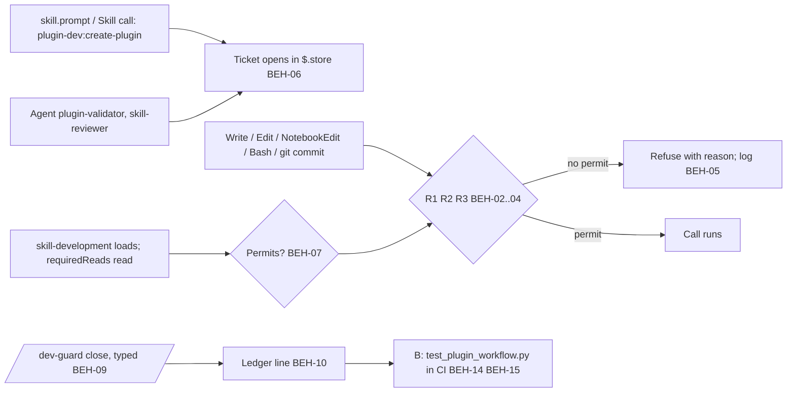

# SPEC-019 — Dev-guard: the plugin-workflow guard (A) and the commit check (B)

## 1. Overview

ADR-008 decides that a dev-only mod refuses edits to DevForgeAI's own plugin outside a `/plugin-dev:create-plugin`
iteration (A), and that a commit check backs it where the mod can't see (B). Issue #137 is the incident and the
enhancement; C, the CLAUDE.md rule, shipped in PR #138. This spec carries A's and B's requirements, because
`find_spec.py` searches `docs/specs/` and not GitHub issues, so a requirement that lived only in #137 would be invisible
to the rule "Look it up before building it" (ADR-008, Bryan's answer 3: "SPEC-019 + /mod-builder:build"). Where #137's
A.1 to A.7 and B differ from this spec, this spec and ADR-008 replace them (#137, comment 6547572711).

Three parts: **A**, the mod `src/tools/mods/dev-guard/`, built through `/mod-builder:build` (BEH-01 to BEH-13); **B**,
`src/tests/process/test_plugin_workflow.py` and its CI job (BEH-14, BEH-15); **M**, design mockups of the surfaces the
mod shows a person, made in Claude Design before A is built (BEH-16, BEH-17; Bryan, 2026-11-02: "ensure that the spec
for dev-guard includes: use /dataviz (where applicable or similar GUI skill) through /design for design mockups for the
dev-guard"). Bryan's answers of 2026-11-02 to the points #137 left open: every surface gets a mockup ("All four
surfaces"); they are recorded in this spec's Appendix A ("Appendix in SPEC-019"); the live checks compare the mod with
them as a manual item ("Yes, as a manual VER item"); `marketplace.json` and the version pin stay outside the protected
scope ("No, keep the path anchor").

The spec is short on purpose. Each rule cites the ADR-008 decision it comes from, and the readings the drafting
session made beyond the ADR, #137 and the twelve review notes of PR #141 are listed in §13 for Bryan's answer.

## 2. Constraints

- **ADR-008 v2:** D1 a separate mod, the mods proposal's A3 skill-gate only; D2 the path anchor, the protected files,
  R1 to R3 and the allowlist; D3 a guard may refuse its named calls whatever `progress.mode` is; D4 no mode; D5 the
  rules in a tracked `guard.json` that fails closed; D6 the ticket, its permit, the reports and the close; D7 failing
  closed and where the guard doesn't run; D8 the commit check. The twelve notes of PR #141's rounds 2 and 3 are settled
  here (§13 lists each).
- **ADR-006 v2 D1:** a guard fails closed and refuses with a reason the model reads; watching without blocking stays
  possible for the tracker, which this mod never touches.
- **ADR-001 v4 and ADR-005 D7:** sessions work in worktrees, some detached; the guard sees every checkout the same way
  (BEH-01) and keys its ticket per checkout (BEH-06).
- **The mods API** (`docs/research/Claude/plugins/mods/reference.md`, local): `tool.check` answers `{decision: 'deny',
  reason}` (:59); `e.agentId` marks a subagent's call (:66, v2.1.290); `e.isReadOnly` is `true` or absent (:73,
  v2.1.304); `skill.prompt` carries `e.skill` and `e.pluginName` (:97, v2.1.299); `$.store` is shared by every session
  on the machine and holds 4 MiB (:221, :391); a `.catch` handler gets 1 second (:373); `$.process.run` times out at 30
  seconds by default (:375); one `claude plugin test` test gets 5 seconds (:401); `CLAUDE_CODE_PLUGIN_DIRS` loads a
  mod without a flag (:409).
- **`/mod-builder:build`'s house rules** apply at the build: the logic split (`hooks/dev-guard-logic.ts` free of `$`,
  every `$` call in `register.tsx`), tests first, `/dev-guard demo` showing every state, the UI-states checklist and its
  widths (full at 60 columns or more, medium 40 to 59, compact under 40). The mod's own `SPEC.md`, which that skill
  writes for approval, takes its slots from this spec (BEH-13).
- **Claude Design** is reached through the Artifact tool's Design type; the Skill tool refuses `/design` (SPEC-017
  §12; ADR-007 D3). A brief states goal, context, real content, states, two to four must-haves and a style reference,
  never a layout (Bryan, 2026-10-10). A canvas stays private unless Bryan shares it (#121).

## 3. Architecture and components

```
src/tools/mods/dev-guard/                      # A: the mod, outside the plugin (ADR-008 D1)
├── .claude-plugin/plugin.json                 # name dev-guard; no userConfig (D5: no machine path, no off switch)
├── hooks/hooks.json                           # one module: ./register.tsx
├── hooks/register.tsx                         # every $ call; the hooks of §5 IF-05
├── hooks/dev-guard-logic.ts                   # pure rules: paths, commands, the ticket's permit, the ledger line
├── types/index.d.ts                           # the state atoms
├── tests/                                     # claude plugin test: logic, hooks, UI (VER-01, VER-15, VER-16)
├── SPEC.md                                    # mod-builder's spec, slots from this document (BEH-13)
└── README.md
src/tests/process/test_plugin_workflow.py      # B: the commit check (BEH-14)
.github/workflows/plugin-workflow.yml          # B's CI job (BEH-15)
docs/process/plugin-workflow/
├── guard.json                                 # requiredReads and the allowlist (DM-02); protected
├── ledger.jsonl                               # one line per closed ticket (DM-03); protected; written by the mod only
└── reviews/<UTC>-<tool>-<hash>.md             # the Phase 6 reports and the close reviews (DM-05)
docs/specs/design/dev-guard/boards/            # M: the exported mockups (Appendix A)
devforgeai/dev-guard/refusals.jsonl            # the refusal log (DM-04), gitignored
```



## 4. Data model

```json
{
  "x-item-id": "DM-01",
  "title": "The ticket, one per checkout, in $.store under the key dev-guard/<checkout>",
  "type": "object",
  "required": ["id", "key", "status", "scope", "openedAt", "sessionId", "createPlugin", "reads", "reviewers", "refusals"],
  "properties": {
    "id": {"type": "string", "pattern": "^pw-[0-9]{8}T[0-9]{6}Z$", "description": "pw- and the opening time in UTC"},
    "key": {"type": "string", "description": "dev-guard/<real path of git rev-parse --show-toplevel>/<branch, or detached:<head's short hash at opening>> (BEH-06)"},
    "status": {"enum": ["open", "closed"]},
    "scope": {"type": "string", "description": "the create-plugin call's arguments, as typed or as the Skill tool's input; empty when none"},
    "openedAt": {"type": "string", "format": "date-time"},
    "closedAt": {"type": ["string", "null"], "format": "date-time"},
    "sessionId": {"type": "string"},
    "createPlugin": {"type": "string", "format": "date-time", "description": "when plugin-dev:create-plugin loaded (BEH-06)"},
    "skillDevelopment": {"type": ["string", "null"], "format": "date-time", "description": "when plugin-dev:skill-development loaded; null until then (BEH-07)"},
    "reads": {"type": "array", "items": {"type": "object", "required": ["path", "at", "tool"], "properties": {"path": {"type": "string"}, "at": {"type": "string", "format": "date-time"}, "tool": {"enum": ["Read", "Bash"]}}}, "description": "each read of a requiredReads file in this ticket (BEH-07)"},
    "reviewers": {"type": "array", "items": {"type": "object", "required": ["subagentType", "agentId", "at"], "properties": {"subagentType": {"enum": ["plugin-dev:plugin-validator", "plugin-dev:skill-reviewer"]}, "agentId": {"type": "string"}, "at": {"type": "string", "format": "date-time"}}}, "description": "each observed Agent call (BEH-08)"},
    "refusals": {"type": "integer", "minimum": 0, "description": "refusals logged while this ticket was open (BEH-05)"}
  }
}
```

```json
{
  "x-item-id": "DM-02",
  "title": "docs/process/plugin-workflow/guard.json",
  "type": "object",
  "required": ["version", "requiredReads", "allow"],
  "additionalProperties": false,
  "properties": {
    "version": {"const": 1},
    "requiredReads": {"type": "array", "minItems": 1, "items": {"type": "string", "pattern": "^docs/research/Claude/"}, "description": "repository-relative; a worktree reads the main checkout's copy (BEH-07)"},
    "allow": {"type": "array", "items": {"type": "object", "required": ["name", "argv"], "additionalProperties": false, "properties": {"name": {"type": "string"}, "argv": {"type": "array", "minItems": 1, "items": {"type": "string"}, "description": "each element a literal word or a pattern: <plugin> for the plugin path in any form, <tests> for a path under src/tests/, <flags> for zero or more words starting with -, <file> for one path that doesn't start with -"}}}, "description": "the read-only invocations R2 allows without a ticket, matched as whole commands (BEH-03)"}
  }
}
```

The initial `guard.json` (D2, D6; #137 A.2's three guides):

```json
{
  "version": 1,
  "requiredReads": [
    "docs/research/Claude/Skill-authoring-best-practices.md",
    "docs/research/Claude/The-Complete-Guide-to-Building-Skill-for-Claude.pdf",
    "docs/research/Claude/skills/skills.md"
  ],
  "allow": [
    {"name": "plugin validate", "argv": ["claude", "plugin", "validate", "<flags>", "<plugin>"]},
    {"name": "plugin test", "argv": ["claude", "plugin", "test", "<flags>", "<plugin>"]},
    {"name": "pytest", "argv": ["<flags>", "python3", "<flags>", "-m", "pytest", "<flags>", "<tests>"]},
    {"name": "validate_brn", "argv": ["python3", "<flags>", "<plugin>/skills/brainstorm/scripts/validate_brn.py", "<file>"]},
    {"name": "check_docs", "argv": ["<flags>", "python3", "<flags>", "<plugin>/skills/documents-updater/scripts/check_docs.py", "<file>"]},
    {"name": "find_spec", "argv": ["python3", "<flags>", "<plugin>/skills/spec-lookup/scripts/find_spec.py", "<flags>", "<file>"]}
  ]
}
```

`<flags>` also takes the `VAR=value` words that CLAUDE.md's commands start with (`PYTHONDONTWRITEBYTECODE=1`). A
command matches an entry only when its whole word list matches the entry's `argv` and it holds no `>`, `>>`, `|`, `;`,
`&&`, `||`, `$(`, backtick or `tee` (D2). `pytest` and `claude plugin test` run repository code that can write plugin
files unseen: a stated limit (D2), left to B.

```json
{
  "x-item-id": "DM-03",
  "title": "One line of docs/process/plugin-workflow/ledger.jsonl: a closed ticket's evidence",
  "type": "object",
  "required": ["id", "key", "scope", "openedAt", "closedAt", "sessionId", "createPlugin", "skillDevelopment", "reads", "reviewers", "refusals", "tree", "commit", "reports", "closedBy", "modVersion"],
  "additionalProperties": false,
  "properties": {
    "id": {"type": "string", "pattern": "^pw-[0-9]{8}T[0-9]{6}Z$"},
    "key": {"type": "string"},
    "scope": {"type": "string"},
    "openedAt": {"type": "string", "format": "date-time"},
    "closedAt": {"type": "string", "format": "date-time"},
    "sessionId": {"type": "string"},
    "createPlugin": {"type": "string", "format": "date-time"},
    "skillDevelopment": {"type": "string", "format": "date-time"},
    "reads": {"type": "array", "minItems": 1, "items": {"type": "object", "required": ["path", "at", "tool"], "properties": {"path": {"type": "string"}, "at": {"type": "string", "format": "date-time"}, "tool": {"enum": ["Read", "Bash"]}}}},
    "reviewers": {"type": "array", "minItems": 2, "items": {"type": "object", "required": ["subagentType", "agentId", "at"], "properties": {"subagentType": {"enum": ["plugin-dev:plugin-validator", "plugin-dev:skill-reviewer"]}, "agentId": {"type": "string"}, "at": {"type": "string", "format": "date-time"}}}},
    "refusals": {"type": "integer", "minimum": 0},
    "tree": {"type": "string", "pattern": "^[0-9a-f]{40}$", "description": "git rev-parse HEAD:src/claude/DevForgeAI at close (D6)"},
    "commit": {"type": "string", "pattern": "^[0-9a-f]{40}$", "description": "HEAD at close; its subtree is tree"},
    "reports": {"type": "array", "minItems": 2, "maxItems": 2, "items": {"type": "string", "pattern": "^docs/process/plugin-workflow/reviews/[0-9]{8}T[0-9]{4}Z-(plugin-validator|skill-reviewer)-[0-9a-f]{7,40}\\.md$"}},
    "closedBy": {"type": "object", "required": ["originKind", "at"], "properties": {"originKind": {"type": "string"}, "at": {"type": "string", "format": "date-time"}}, "description": "the typed command's origin (BEH-09)"},
    "modVersion": {"type": "string", "description": "the dev-guard plugin.json version that wrote the line"}
  }
}
```

**DM-04, the refusal log** `devforgeai/dev-guard/refusals.jsonl`, gitignored through `devforgeai/dev-guard/.gitignore`
holding `*` (the brainstorm work file's rule), one JSON line per refusal: `at`, `sessionId`, `agentId` (when set),
`rule` (`R1`, `R2`, `R3`, `catch`, `guard.json`), `tool`, `path` (the first protected path) and `command` (the full
command text for Bash, the file path for the other tools), `ticket` (the open ticket's id or null) and `reason` (the
text the model read).

**DM-05, a report file name** `docs/process/plugin-workflow/reviews/<UTC>-<tool>-<hash>.md`: `<UTC>` as
`YYYYMMDDTHHMMZ`, `<tool>` one of `plugin-validator`, `skill-reviewer`, `drafts-review`, `code-review`, and `<hash>`
the short hash of the **commit** the review ran on (reading (d), §13). Close matches a report to HEAD by that commit's
subtree hash, `git rev-parse <hash>:src/claude/DevForgeAI`, never by the commit itself (D6).

## 5. Interfaces and contracts

| ID | Interface | Contract |
|---|---|---|
| IF-01 | `/dev-guard` | Prints the ticket for this checkout: id, scope, opened at, whether it permits, and what is missing (skill-development not loaded; each `requiredReads` file not yet read; the main checkout's copy not found), or "no ticket: invoke /plugin-dev:create-plugin with the iteration's scope". Shows only; runs mid-turn (`immediate: true`) |
| IF-02 | `/dev-guard close` | Closes the ticket as BEH-09 says, or refuses naming each condition that fails. Then shows the iteration's refusals (IF-04) for review (D4) |
| IF-03 | `/dev-guard demo` | Shows every state of IF-01, IF-02 and IF-04 without real events (mod-builder's house rule); never writes the ledger or the store |
| IF-04 | `/dev-guard log` | The data view: this checkout's refusals from DM-04, newest first, with counts by rule and by tool for the open ticket and for the last seven days; follows the `dataviz` skill (BEH-16) |
| IF-05 | Hooks | `skill.prompt` (opens the ticket; records skill-development); `tool.call` on `Skill` (opens the ticket when `skill.prompt` didn't fire) and on `Agent` (records the reviewers); `tool.check` on `Write`, `Edit`, `NotebookEdit` (R1), `Bash` (R2, R3) and `Read` (records a required read); `command.run` for IF-01 to IF-04. Each gating hook has a `.catch` (BEH-11) |
| IF-06 | B's test | `pytest -m plugin_workflow src/tests/process` from the repository root, on a checkout whose history reaches the merge base with `origin/main` (`fetch-depth: 0` in CI). Exit 0 passes; any other exit fails the job, exit 5 (no test selected) included |
| IF-07 | B's CI job | `.github/workflows/plugin-workflow.yml`: on every pull request, checkout with `fetch-depth: 0`, run IF-06 with the PR's head commit checked out (not GitHub's merge commit); a required check once B ships (Owner's setting) |

## 6. Behavior

```yaml items
behaviors:
  - id: BEH-01
    status: active
    rule: "Scope (ADR-008 D2; Bryan, 2026-11-02: 'No, keep the path anchor'). A path is protected when its real path contains the segment /src/claude/DevForgeAI/ and the .claude-plugin/plugin.json under that folder names the plugin devforgeai, in any checkout or worktree; and when it is docs/process/plugin-workflow/guard.json or docs/process/plugin-workflow/ledger.jsonl of the same repository. Nothing else is protected: .claude-plugin/marketplace.json at the root and the version pin in src/tests/progress/test_adapter_structure.py stay outside, since plugin.json itself is inside the plugin and EVAL.md G6 checks the three agree. The mod holds no machine path and no off switch (D4, D5)."
  - id: BEH-02
    status: active
    rule: "R1 (D2). A Write, Edit or NotebookEdit whose input.file_path, resolved against the session's working directory when relative, is protected is refused unless the checkout's ticket permits (BEH-07). The rule applies the same to a call carrying e.agentId (a subagent's or a teammate's)."
  - id: BEH-03
    status: active
    rule: "R2 (D2; PR #141 round-2 notes 7 and 8). A Bash call whose e.isReadOnly is not true is refused unless the ticket permits, when any of these holds: its command text, after normalising each word (resolving a relative path against the working directory, resolving symlinks, dropping a trailing slash), names a protected path, the bare folder name src/claude/DevForgeAI included; it names make_evals.py; or the session's working directory is protected. A command runs without a ticket only when its whole word list matches one allow entry of guard.json (DM-02) and it holds no shell operator; the match is on words, never on a substring. R2 is best effort: it matches text, and B is the proof."
  - id: BEH-04
    status: active
    rule: "R3 (D2). A Bash call whose command runs git commit (git -C <dir> commit included) is refused unless the ticket permits, when git diff --cached --name-only, run in that directory with $.process.run under BEH-11's bound, lists a protected path. R3 reads only the index: commit -a, commit <path>, cherry-pick and merge pass it, and B catches what it misses."
  - id: BEH-05
    status: active
    rule: "The refusal (D3, D4). A refused call gets a reason the model reads, naming the rule, the first protected path, and the remedy: invoke /plugin-dev:create-plugin with the iteration's scope, then /plugin-dev:skill-development, and read each requiredReads file; when a ticket exists, the reason names what it still lacks instead. The mod never changes content silently. Every refusal is appended to the refusal log (DM-04) with the full command text, and the open ticket's refusals count is raised."
  - id: BEH-06
    status: active
    rule: "The ticket (D6). One ticket per checkout, in $.store under dev-guard/<real path of the checkout's top level>/<branch name, or detached:<the head's short hash when the ticket opened>>, so a detached worktree (ADR-005 D7) has its own ticket and a branch switched inside one checkout doesn't carry it (reading (a), §13). It opens when plugin-dev:create-plugin loads: a skill.prompt event whose e.skill is plugin-dev:create-plugin, or a Skill tool call with that skill when no skill.prompt fired (ADR-008 P1). Its scope is the call's arguments. A second load in the same checkout while a ticket is open restarts nothing: the ticket stays, and the load is recorded as a note. The ticket holds DM-01's fields."
  - id: BEH-07
    status: active
    rule: "The permit (D6; #137 A.2). An open ticket permits protected writes only once plugin-dev:skill-development has loaded in it and each requiredReads file of guard.json has been read in it: a Read tool call of any range on the file, or a read-only Bash call (e.isReadOnly true) whose command names the file (reading (b), §13: sessions read with cat and sed -n). Reads don't carry over to the next ticket. In a worktree the file is the main checkout's copy, the parent of git rev-parse --git-common-dir; with no copy found the ticket doesn't permit, and the remedy is to capture the pages by each PROVENANCE.md's recipe (CLAUDE.md's rule). A ticket permits for the checkout it belongs to only."
  - id: BEH-08
    status: active
    rule: "Observed reviewers (D6; Bryan, 2026-10-31: the reviewers' runs are observed, not asserted). The ticket records each Agent tool call seen in its checkout whose subagent_type is plugin-dev:plugin-validator or plugin-dev:skill-reviewer, with the call's agentId and time. Whether subagent_type is readable on the Agent call's tool.call input is the build's first probe (ADR-008 D6); the expected place is e.input.subagent_type."
  - id: BEH-09
    status: active
    rule: "Close (D6; PR #141 round-2 notes 1 and 3). /dev-guard close closes the checkout's open ticket only when every condition holds: the command was typed by a person (the build's second probe records the origin.kind a typed mod command carries, expected composer; close allows that kind alone, an allow-list, and refuses sdk and every other kind); plugin-dev:skill-development loaded in the ticket; both reviewers were observed (BEH-08); the plugin-validator and skill-reviewer reports exist in reviews/ (DM-05) for a commit whose subtree hash equals HEAD's; and the plugin's working tree and index are clean (git status --porcelain -- src/claude/DevForgeAI empty), so what the reports reviewed is what the line binds. On success the mod appends the ledger line (BEH-10), deletes the ticket from $.store, and shows the iteration's refusals (IF-04) for review. A refusal names each failing condition."
  - id: BEH-10
    status: active
    rule: "The ledger line (D6, D8; PR #141 round-3 note 3). One JSON line of DM-03 per closed ticket, appended to docs/process/plugin-workflow/ledger.jsonl by the mod only (Bryan, 2026-10-31: 'no hand-written ledger.jsonl lines; the mod writes those'). The line carries the evidence, not a reference to it. What ties a line to the mod is re-derivation, not a signature (reading (c), §13): B checks that the line validates, that its tree equals git rev-parse <commit>:src/claude/DevForgeAI for its commit, that each report file exists and names its tool and a commit with that same subtree hash, that its times are ordered (openedAt, createPlugin, skillDevelopment, each read, each reviewer, closedAt), and that closedBy.originKind is the allowed kind. The limit stays: a session the guard can't see could write a line that passes these checks; the ledger line and the reports go out in one records commit, and the close review reads them."
  - id: BEH-11
    status: active
    rule: "Failing closed (ADR-006 D1; ADR-008 D7; PR #141 round-2 note 2). Each gating hook (R1, R2, R3, the close) has a .catch that refuses the call it was checking, naming the error; the .catch handler does no I/O, since it gets one second. The hooks' own work is bounded: guard.json is read with $.fs.read and parsed once per call; $.process.run for git carries a 5-second timeout; a hook that exceeds its bound refuses as a timeout. A missing or invalid guard.json refuses every protected write, naming the file (D5, ERR-01). A missing refusal log or an unwritable one never stops a refusal: the refusal stands and the log failure is in the reason."
  - id: BEH-12
    status: active
    rule: "Where the guard doesn't run (D7): sessions started with --bare or --safe-mode, or with disableAllHooks set; Desktop WSL and cloud sessions; claude plugin eval runs (P5); a session where the module failed to load; and edits made by Codex, an editor or a shell. The mod claims nothing for those: B is the check there. Recovery from a broken guard is a person's act, --safe-mode or dropping the folder from CLAUDE_CODE_PLUGIN_DIRS (D4)."
  - id: BEH-13
    status: active
    rule: "The build (ADR-008, Bryan's answer 3: 'SPEC-019 + /mod-builder:build'). The mod is built through /mod-builder:build in src/tools/mods/dev-guard/, archetype guard, with the mods folder being this repository's (reading (e), §13: src/tools/mods/, not <marketplace root>/mods/, since the root marketplace.json lists the devforgeai plugin and the mod is dev-only). The mod's SPEC.md takes its slots from this spec: name dev-guard; triggers IF-05; commands IF-01 to IF-04; states drawn from the mockups (BEH-17); state lifetime cross-session $.store for the ticket and session atoms for the rest; external reach: files (guard.json, ledger.jsonl, the refusal log) and the git process; no options; no network; no model calls. A divergence between SPEC.md and this spec is a version of this spec, never a silent change to SPEC.md. Tests are written first (VER-01, VER-15, VER-16), the kit's logic tests on dev-guard-logic.ts and hook tests on register.tsx. The mod is loaded through CLAUDE_CODE_PLUGIN_DIRS in ~/.claude/settings.json, Bryan's step at install (ADR-008 P4)."
  - id: BEH-14
    status: active
    rule: "B's test (D8; PR #141 round-2 note 9, round-3 note 1). src/tests/process/test_plugin_workflow.py carries the pytest marker plugin_workflow, registered in pytest.ini and deselected by default there, so pytest src/tests skips it. It computes the merge base of HEAD and origin/main, then git rev-parse <merge-base>:src/claude/DevForgeAI and git rev-parse HEAD:src/claude/DevForgeAI. It passes when the two are equal. Otherwise it passes only when a ledger line (DM-03) has tree equal to HEAD's subtree hash and passes BEH-10's re-derivation. A rebase or merge that brings main's plugin changes into the branch gives a head subtree that matches no line: that content was never reviewed as a whole, so the branch needs a new iteration and its close (reading (f), §13). Commits already on main are never checked, since the comparison is with the merge base."
  - id: BEH-15
    status: active
    rule: "B's CI job (D8; EVAL.md B4; Bryan, 2026-10-31: 'docs/process + CI job', 'B's CI job becomes a required check when B ships'). .github/workflows/plugin-workflow.yml runs on every pull request, checks out the PR's head commit with fetch-depth 0, installs pytest and PyYAML and jsonschema from the repository's requirements, and runs IF-06. A pytest exit of 5 (no test selected) fails the job, as any non-zero exit does. The job passes at once on a PR whose plugin subtree is unchanged, so a required check never waits on a docs-only PR. Making it a required check is the Owner's setting, done when B ships."
  - id: BEH-16
    status: active
    rule: "Mockups (Bryan, 2026-11-02: 'use /dataviz (where applicable or similar GUI skill) through /design for design mockups for the dev-guard'; 'All four surfaces'). Before A is built, each surface the mod shows a person gets a board in one Claude Design canvas, made through the Artifact tool's Design type from a brief (goal, context, the real content of §5 and BEH-05, the states, two to four must-haves, a style reference; no layout, no tokens; three directions): the refusal reason as it appears in the transcript; /dev-guard (a ticket that permits, one that doesn't with what is missing, no ticket); /dev-guard close (refused with its failing conditions, and the line written); and /dev-guard log, the data view, whose charts follow the dataviz skill's guidance (counts by rule and tool, the seven-day timeline). Text-only surfaces carry no chart. Each board is drawn for the terminal at the full width (60 columns or more) and the compact width (under 40), and shows the UI-states checklist's states that apply (empty, idle, done, error, folded, too narrow); a state that doesn't apply says why. The canvas stays private unless Bryan shares it."
  - id: BEH-17
    status: active
    rule: "The mockups' record and use (Bryan, 2026-11-02: 'Appendix in SPEC-019'; 'Yes, as a manual VER item'). Appendix A names the canvas, and for each board its surface, its states, its width, the exported image's path under docs/specs/design/dev-guard/boards/ and the image's sha256; the images are committed with the record-only Change Log row that fills the appendix (no version bump: a §9-style record). The folder is a reading (g), §13: SPEC-017 keys docs/specs/design/ by DSN ID and the ui skill's next-number scan reads DSN-*.md only, so dev-guard/ collides with nothing. The chosen board is the source of the ASCII drawing in the mod's SPEC.md (BEH-13), and /dev-guard demo reaches every state a board shows. The live checks (VER-14) compare each surface's rendering with its board at the board's width, by a person, pass or fail; nothing automated compares pixels."
```

## 7. Errors and edge cases

```yaml items
errors:
  - id: ERR-01
    status: active
    condition: "guard.json is missing, unreadable or invalid against DM-02"
    handling: "Every protected write, R2 command and R3 commit is refused, naming the file and the error; nothing is permitted until a person fixes the file (D5). /dev-guard says so"
    user_result: "A refusal naming docs/process/plugin-workflow/guard.json and what is wrong with it"
  - id: ERR-02
    status: active
    condition: "A gating hook throws or exceeds its time bound (BEH-11)"
    handling: "Its .catch refuses the call it was checking, naming the error kind (throw or timeout) and message, with no I/O in the handler; the refusal is logged by the next hook that can"
    user_result: "A refusal naming the hook's error, with the remedy of BEH-05"
  - id: ERR-03
    status: active
    condition: "/dev-guard close is run with a condition of BEH-09 unmet, or with no open ticket, or from an origin other than the allowed kind"
    handling: "Nothing is written; the reply names each failing condition (no ticket; skill-development not loaded; a reviewer not observed, by name; a report missing, by expected path; a report's commit whose subtree hash differs from HEAD's; a dirty plugin working tree or index, with the paths; the origin kind refused)"
    user_result: "The list of what to do before the close can succeed"
  - id: ERR-04
    status: active
    condition: "$.store can't be read or written (the 4 MiB limit, or a failed call)"
    handling: "A write of the ticket that fails leaves the ticket as it was and refuses the call being checked; a read that fails counts as no ticket, so protected writes are refused (fail closed)"
    user_result: "A refusal naming the store error"
  - id: ERR-05
    status: active
    condition: "R3 can't run git (no git on PATH, a timeout, a non-git directory)"
    handling: "The git commit is refused, naming the git error, unless the ticket permits; a directory that isn't a repository is not a refusal reason by itself: R3 applies only where git diff --cached runs"
    user_result: "A refusal naming the git error"
  - id: ERR-06
    status: active
    condition: "B finds a ledger line that doesn't validate against DM-03, or whose re-derivation (BEH-10) fails"
    handling: "The test fails, naming the line number, the field and the check that failed; a valid earlier line never masks an invalid later one"
    user_result: "The CI job fails with the line and the reason"
  - id: ERR-07
    status: active
    condition: "B can't compute the merge base (a shallow checkout, or origin/main unknown)"
    handling: "The test fails, naming the remedy: fetch-depth 0, and a fetched origin/main"
    user_result: "The CI job fails with the fetch remedy"
  - id: ERR-08
    status: active
    condition: "A requiredReads file has no copy to read: not in the checkout, nor in the main checkout found through git rev-parse --git-common-dir"
    handling: "The ticket doesn't permit; /dev-guard and each refusal name the file and the capture recipe (each PROVENANCE.md under docs/research/Claude/)"
    user_result: "The missing file and how to capture it"
  - id: ERR-09
    status: active
    condition: "A board of BEH-16 can't be made or imported: the Artifact tool returns not found, or the canvas is unreachable"
    handling: "The build doesn't start (BEH-16 comes first); the spec's §9 records the attempt and the account check the handoff names, and Bryan decides whether to proceed with ASCII mockups in the mod's SPEC.md as the record instead"
    user_result: "The build waits; the owner's decision"
```

## 8. Non-functional design

```yaml items
quality_responses:
  - id: QR-01
    status: active
    response: "Every gating hook fails closed: a .catch that refuses with no I/O, bounded reads and process calls, a missing guard.json that refuses (BEH-11)"
    measured_by: "Kit tests with a throwing hook, a timed-out git call and a missing guard.json (VER-15); claude plugin validate --strict passes (VER-02)"
    upstream:
      - {id: ADR-006, relation: satisfies, version: 2, hash: null}
      - {id: ADR-008, relation: satisfies, version: 2, hash: null}
  - id: QR-02
    status: active
    response: "No machine path and no off switch in the repository: the scope is the path anchor, the rules file is protected, recovery is --safe-mode (BEH-01, BEH-12)"
    measured_by: "Reading plugin.json (no userConfig) and guard.json (no path, no mode); a kit test that an edit to guard.json is refused"
    upstream:
      - {id: ADR-008, relation: satisfies, version: 2, hash: null}
  - id: QR-03
    status: active
    response: "A refusal costs under 100 ms for R1 and R2 and under 5 s for R3 (one git call), so an iteration's tool calls aren't slowed; the refusal log is append-only and never read on the hot path"
    measured_by: "The kit tests' timings; VER-14's live checks note each refusal's delay"
    upstream:
      - {id: ADR-008, relation: satisfies, version: 2, hash: null}
```

## 9. Verification

**Verification status.**

| Kind | Status |
|---|---|
| Version 1 | **Drafted 2026-11-02, not approved, not built.** VER-01 to VER-12 are EVAL.md's A1 to A8 and B1 to B4 (ADR-008, Bryan's answer 3: one source); EVAL.md's rows cite them back. VER-13 and VER-14 are the mockups (Bryan, 2026-11-02); VER-15 to VER-18 cover the twelve notes and the install. Structural: validates against `spec.schema.json` with every BEH, ERR and QR item covered (checked at the draft with `test_structure.py`'s helpers). Behavioural: NOT_RUN. The Artifact tool returned "not found" on 2026-11-01 (handoff §3); until Bryan has checked the signed-in account, no board can be made (ERR-09) |

```yaml items
verifications:
  - id: VER-01
    status: active
    obligation: "EVAL.md A1: the mod's tests pass under claude plugin test: R1, R2 and R3 each refuse with no ticket and allow with a permitting ticket; R1 refuses a call carrying agentId; an open ticket without skill-development or a required read doesn't permit; a .catch refuses on a thrown error (#137 A.7)."
    level: unit
    covers:
      - BEH-02
      - BEH-03
      - BEH-04
      - BEH-07
      - BEH-11
  - id: VER-02
    status: active
    obligation: "EVAL.md A2: claude plugin validate --strict src/tools/mods/dev-guard exits 0."
    level: unit
    covers:
      - BEH-13
      - QR-01
  - id: VER-03
    status: active
    obligation: "EVAL.md A3, live in this repository with no ticket: an Edit to src/claude/DevForgeAI/skills/ui/SKILL.md in .claude/worktrees/<name>/ is refused with R1's reason (the rule, the path, the remedy)."
    level: e2e
    covers:
      - BEH-01
      - BEH-02
      - BEH-05
  - id: VER-04
    status: active
    obligation: "EVAL.md A4, live: with no ticket, a subagent's Write under the plugin path is refused."
    level: e2e
    covers:
      - BEH-02
  - id: VER-05
    status: active
    obligation: "EVAL.md A5, live: with no ticket, python3 src/tests/ui/make_evals.py is refused by R2; claude plugin validate src/claude/DevForgeAI and PYTHONDONTWRITEBYTECODE=1 python3 -B -m pytest -q -p no:cacheprovider src/tests run (the allowlist)."
    level: e2e
    covers:
      - BEH-03
  - id: VER-06
    status: active
    obligation: "EVAL.md A6, live: with no ticket, a git commit with a staged plugin file is refused by R3."
    level: e2e
    covers:
      - BEH-04
  - id: VER-07
    status: active
    obligation: "EVAL.md A7, live: after /plugin-dev:create-plugin, /plugin-dev:skill-development and reads of the requiredReads files (one through the Read tool, one through cat), /dev-guard says the ticket permits and VER-03's Edit is allowed."
    level: e2e
    covers:
      - BEH-06
      - BEH-07
  - id: VER-08
    status: active
    obligation: "EVAL.md A8, live: /dev-guard close, typed by a person, refuses unless both reviewers' Agent calls were observed during the ticket, their reports exist for a commit whose plugin subtree hash equals HEAD's, and the plugin tree is clean; it then writes the ledger line with that evidence and removes the ticket; a nested claude -p '/dev-guard close' is refused."
    level: e2e
    covers:
      - BEH-08
      - BEH-09
      - BEH-10
      - ERR-03
  - id: VER-09
    status: active
    obligation: "EVAL.md B1: test_plugin_workflow.py fails on a branch whose head's plugin subtree hash differs from its merge base's and matches no valid ledger line."
    level: integration
    covers:
      - BEH-14
  - id: VER-10
    status: active
    obligation: "EVAL.md B2: it passes once a valid ledger line carries that subtree hash with its re-derivation satisfied, and at once on a branch that leaves the plugin unchanged."
    level: integration
    covers:
      - BEH-14
      - BEH-10
  - id: VER-11
    status: active
    obligation: "EVAL.md B3: pytest src/tests deselects the plugin_workflow marker by default (the count is unchanged), and pytest -m plugin_workflow src/tests/process selects it."
    level: integration
    covers:
      - BEH-14
  - id: VER-12
    status: active
    obligation: "EVAL.md B4: the GitHub Actions job runs on every pull request, with fetch-depth 0 and the PR's head commit, shows in the PR's checks, fails when pytest exits 5, and is made a required check when B ships (Owner's step, recorded in §9)."
    level: integration
    covers:
      - BEH-15
      - ERR-07
  - id: VER-13
    status: active
    obligation: "The mockups exist and are recorded: one canvas with a board per surface of BEH-16 at the full and compact widths, the data view with dataviz-guided charts, each board exported under docs/specs/design/dev-guard/boards/ and listed in Appendix A with its sha256; the briefs are committed beside them. Checked by reading Appendix A against the folder (sha256sum) before A's first iteration."
    level: manual
    covers:
      - BEH-16
      - BEH-17
      - ERR-09
  - id: VER-14
    status: active
    obligation: "Live against the mockups, on the build commit: each surface (the refusal reason, /dev-guard in its three states, /dev-guard close refused and succeeded, /dev-guard log) is compared with its board at the board's width by a person, pass or fail per surface and state, in the runbook docs/runbooks/dev-guard-checks.md; /dev-guard demo reaches every state a board shows; each refusal's delay is noted (QR-03)."
    level: manual
    covers:
      - BEH-17
      - QR-03
  - id: VER-15
    status: active
    obligation: "Kit tests for the review notes and the readings, written first: close allows only the probed origin kind and refuses sdk and an unknown kind; close refuses a dirty plugin tree; R2 matches the bare folder name, a relative path and a trailing slash, and refuses a substring match of an allow entry; the allowlist's argument patterns accept CLAUDE.md's commands and refuse them with a shell operator; a detached-HEAD checkout gets its own ticket key and a branch switch doesn't carry the ticket; a required read counts through the Read tool and through a read-only Bash command naming the file, and not through a non-read-only one; a second create-plugin load doesn't reset the ticket; a missing guard.json refuses with the file named; a git call that exceeds 5 s refuses as a timeout; an edit to guard.json or ledger.jsonl is refused; a refusal is logged with the full command text, and a failed log write doesn't lift the refusal."
    level: unit
    covers:
      - BEH-01
      - BEH-03
      - BEH-05
      - BEH-06
      - BEH-07
      - BEH-09
      - BEH-11
      - ERR-01
      - ERR-02
      - ERR-04
      - ERR-05
      - QR-02
  - id: VER-16
    status: active
    obligation: "B's cases, in src/tests/process/, each on a scratch repository the test builds: a rebase that brings a plugin change from main gives a failing branch until a line with the merged tree exists; an invalid line (a bad field, a tree that isn't the commit's subtree, a report path that doesn't exist, times out of order, an origin kind other than the allowed one) fails with its line number and reason; a valid earlier line doesn't mask an invalid later one; a shallow clone fails with the fetch remedy; a workflow run with zero tests selected exits 5 and the job step fails."
    level: integration
    covers:
      - BEH-14
      - BEH-15
      - BEH-10
      - ERR-06
      - ERR-07
  - id: VER-17
    status: active
    obligation: "Install (ADR-008 P4's remaining parts, Bryan's step): with CLAUDE_CODE_PLUGIN_DIRS in ~/.claude/settings.json naming src/tools/mods/dev-guard, /dev-guard answers in a new terminal session, a herdr pane and a Remote Control session; EVAL.md's P4 row moves from NOT_RUN. A session with --safe-mode gets no answer (BEH-12)."
    level: manual
    covers:
      - BEH-12
      - BEH-13
  - id: VER-18
    status: active
    obligation: "The first iteration's close shows its refusals for review (D4), and each refusal is either a process skip the guard was right to refuse or an allowlist gap, which becomes a guard.json change in a records commit; the worktree case (ERR-08: a requiredReads copy found through the main checkout, and not found in a clone without docs/research/) is run once each."
    level: manual
    covers:
      - BEH-05
      - BEH-09
      - ERR-08
```

Each VER item numbered 01 to 12 is one EVAL.md row; the EVAL.md rows cite these IDs. The live items (VER-03 to VER-08,
VER-14, VER-17, VER-18) follow `docs/runbooks/dev-guard-checks.md`, written with the build.

## 10. Rollout, migration and rollback

The mod is new and loads only where `CLAUDE_CODE_PLUGIN_DIRS` names it (BEH-13); removing the folder or the setting
rolls it back. `guard.json` and an empty `ledger.jsonl` are committed with A. B's job is advisory until it is a required
check (BEH-15). A broken guard is recovered with `--safe-mode` (BEH-12). EVAL.md's carry-forward rule gains
`ledger.jsonl` (issue #140), so the records commit after a close keeps a review valid.

## 11. Implementation plan

1. **M first:** Bryan checks the signed-in account (handoff §3); the briefs are written from §5 and BEH-05 and shown;
   the canvas is made through the Artifact tool; the boards are exported, committed and recorded in Appendix A (VER-13).
2. **A, through `/mod-builder:build`:** `src/tools/mods/dev-guard/`, archetype guard, `SPEC.md` filled from this spec
   with the chosen board's ASCII; the two probes of BEH-08 and BEH-09 run first and their values go into the tests; tests
   first (VER-01, VER-15); `claude plugin validate --strict` and `claude plugin test`; `guard.json` and `ledger.jsonl`
   committed. EVAL.md's A rows record the evidence.
3. **B:** the test, the marker in `pytest.ini`, the workflow; VER-09 to VER-11 and VER-16; the job on this PR as its own
   first run (VER-12); the required check when it ships.
4. **Live checks** on the build commit (VER-03 to VER-08, VER-14), with the runbook; install (VER-17); the first
   iteration's refusal review at its close (VER-18).
5. **Records:** §9 rows, EVAL.md, #137's comment that ADR-008's follow-up names, and ADR-006's pointer at its next change.

The order is Bryan's (2026-10-31: the docs PR, ADR-008 and the probes, A, B, then the ui redo). SKL-002 v6 and the ui
redo wait for A and B to pass their rows.

## 12. Alternatives considered

| Option | Why not chosen |
|---|---|
| A signature on the ledger line (a key only Bryan's machine holds, checked in CI through a secret) | Re-derivation in CI needs no secret and checks what matters, the content; a signature would prove the mod wrote the line but not that the reports reviewed that content. The limit is stated instead (BEH-10). Bryan's to revisit (§13) |
| One ticket per branch, as ADR-008 D6 says | A detached worktree has no branch (ADR-005 D7), and a branch switched inside a checkout would carry a ticket to content it never covered; one ticket per checkout plus branch keeps both cases (BEH-06) |
| Count only the Read tool as a required read | Sessions read with `cat` and `sed -n` even when the Read tool is present; the permit would never open for them, and the rule is a nudge, not a proof (ADR-008 D6) |
| The mockups as a DSN through `/devforgeai:ui` | The skill needs a brainstorm the dev-guard doesn't have; Bryan, 2026-11-02: "Appendix in SPEC-019" |
| Automated comparison of the rendering with the boards | Terminal widgets can't be diffed against a canvas; a person compares (Bryan, 2026-11-02: "Yes, as a manual VER item") |
| Protect `marketplace.json` and the version pin | `plugin.json` is inside the plugin, so a bump needs an iteration anyway, and G6 checks the three agree; Bryan, 2026-11-02: "No, keep the path anchor" |
| The refusal log in the tracked `docs/process/plugin-workflow/` | Full command text from every session would churn a tracked file; the gitignored `devforgeai/` folder is where the tracker and the handoffs keep such data |

## 13. Open questions

- **Readings to confirm at approval** (the drafting session's, beyond ADR-008, #137 and the review notes):
  - (a) The ticket key is per checkout and branch, `detached:<short hash>` for a detached head (BEH-06); a branch switch inside a checkout doesn't carry the ticket.
  - (b) A required read counts through the Read tool or a read-only Bash command naming the file (BEH-07).
  - (c) The ledger line is tied to the mod by CI re-derivation, not a signature; the limit is stated (BEH-10).
  - (d) A report's `<hash>` is the commit's short hash; close and B match by that commit's subtree hash (DM-05).
  - (e) The mods folder is `src/tools/mods/` (ADR-008 D1), not the `mods/` under the root marketplace, which lists the devforgeai plugin; mod-builder's "home" slot takes it (BEH-13).
  - (f) After a rebase or merge that brings main's plugin changes into the branch, B fails until a new iteration closes with the merged tree (BEH-14).
  - (g) The boards live in `docs/specs/design/dev-guard/boards/`, beside the DSNs, with their briefs (BEH-17).
  - (h) Close also requires a clean plugin working tree and index (BEH-09).
  - (i) The hooks' bounds: `$.process.run` at 5 s, a missing log never lifts a refusal (BEH-11); the refusal log at `devforgeai/dev-guard/refusals.jsonl` (DM-04).
  - (j) The allowlist entries and their argument patterns (DM-02's initial content), including `VAR=value` words.
  - (k) `/dev-guard log` is the data view that gets the dataviz charts (IF-04), and it is one of the four surfaces (BEH-16).
  - (l) B's job installs pytest, PyYAML and jsonschema from the repository's requirements (BEH-15); the repository has no requirements file today, so the job pins them itself until one exists.
- **Probes the build runs first** (not facts): the `origin.kind` a typed mod command carries (expected `composer`; BEH-09), and whether `subagent_type` is readable on an Agent call's `tool.call` input (BEH-08).
- Open: whether the version pin and `marketplace.json` join the scope later, if G6 misses a drift (Bryan, 2026-11-02: keep the anchor).
- Open: a signature for the ledger line, if a forged line is ever found (BEH-10).
- Open: ADR-006 D1's pointer to ADR-008, at ADR-006's next change (Bryan, 2026-10-31).
- Open: EVAL.md's carry-forward of `ledger.jsonl`, and its rows ADR1 and P5 (#140).

## Appendix A — The mockups (filled by the record-only row that commits the boards)

| Surface | Board | States shown | Width | File (`docs/specs/design/dev-guard/boards/`) | sha256 |
|---|---|---|---|---|---|
| The refusal reason (BEH-05) | | | | | |
| `/dev-guard` (IF-01) | | | | | |
| `/dev-guard close` (IF-02) | | | | | |
| `/dev-guard log` (IF-04) | | | | | |

Canvas: (the Claude Design canvas's ID, private). Briefs: `docs/specs/design/dev-guard/briefs.md`.

## Change Log

| Version | Date | Author | Change | Items affected |
|---|---|---|---|---|
| 1 | 2026-11-02 | claude-code (session 1c98fbaa-c1b5-46cd-b918-3dde63e1c8dc) | Initial draft from ADR-008 v2 (D1 to D8, the probes, Bryan's answers of 2026-10-31), issue #137 with its two comments (the acceptance comment and Bryan's mockup requirement of 2026-11-02), the twelve notes of PR #141's close reviews (`docs/process/plugin-workflow/reviews/20261031T1844Z-code-review-aa99849.md`, `20261031T2204Z-code-review-2cbd868.md`) and Bryan's four answers of 2026-11-02 ("All four surfaces", "Appendix in SPEC-019", "Yes, as a manual VER item", "No, keep the path anchor"). BEH-01 to BEH-17, ERR-01 to ERR-09, QR-01 to QR-03, VER-01 to VER-18 (VER-01 to VER-12 are EVAL.md's A1 to A8 and B1 to B4); DM-01 to DM-05; IF-01 to IF-07. The drafting session's readings (a) to (l) are in §13 for approval. Status draft; the drafts review comes next | all |
